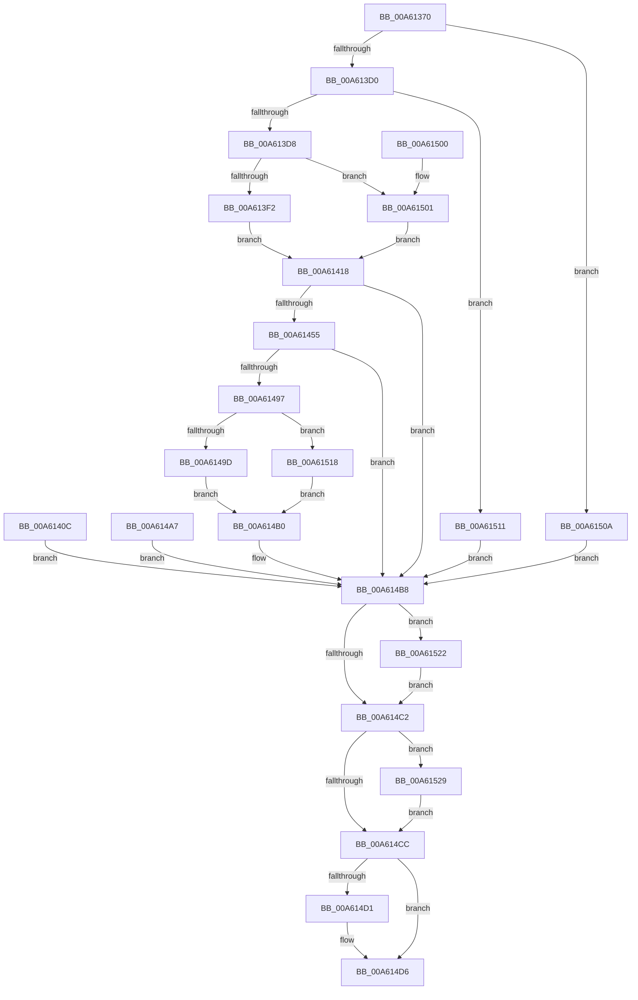

# NtCreateRegistryTransaction

- RVA: `0x00A61370`–`0x00A61530` (길이 `448` bytes)
- VA: `0x0000000140A61370`
- 실행 섹션: `PAGE`
- PDB 이름 있음: `예`; PDB Function 태그: `아니요`
- unwind 정보 RVA: `0x000B3170`
- 디코드: `116`개 명령, `448/448` bytes 표시
- 미해석 바이트: `0` (있으면 어셈블리에 `.byte`로 보존)

> 이 문서는 커널 이미지의 기계어와 PDB 기호를 분석해 생성했습니다. 4번과 5번은 함수 원형과 자료형을 바이너리 사용 방식에서 추정한 C 해석이며 원본 소스 복구 결과는 아닙니다.

## 1. Dependencies

- 직접 호출 지점: **8**; 고유 호출 대상: **8**
- 직접 호출자로 확인된 함수: **0**
- RIP 상대 이미지 참조: **1**

### Outgoing calls
- `0x00A613B7` → [CmpInitializeThreadInfo](../../text/3F/CmpInitializeThreadInfo_function_003FBE70.md) (function, `0x003FBE70`)
- `0x00A613BC` → [CmpAcquireShutdownRundown](../../pagecmrc/BC/CmpAcquireShutdownRundown_function_00BC9400.md) (function, `0x00BC9400`)
- `0x00A6144A` → [ObCreateObjectEx](../89/ObCreateObjectEx_function_0089B1E0.md) (function, `0x0089B1E0`)
- `0x00A61486` → [ObInsertObjectEx](../8B/ObInsertObjectEx_function_008B97A0.md) (function, `0x008B97A0`)
- `0x00A614D1` → [CmpReleaseShutdownRundown](../../pagecmrc/BC/CmpReleaseShutdownRundown_function_00BC9880.md) (function, `0x00BC9880`)
- `0x00A614DB` → [CmCleanupThreadInfo](../../text/41/CmCleanupThreadInfo_function_0041FD50.md) (function, `0x0041FD50`)
- `0x00A61522` → [NtClose](../86/NtClose_function_00868870.md) (function, `0x00868870`)
- `0x00A61529` → [ObfDereferenceObject](../../text/2F/ObfDereferenceObject_function_002F9350.md) (function, `0x002F9350`)

### Direct callers
- 이 함수 시작 RVA로 연결되는 직접 call은 확인되지 않았습니다. 간접 호출은 완전히 역산할 수 없습니다.

### Static image references
- `0x00A61418` → RVA `0x00EF5720` (`.data`; read)

## 2. Other-region calls and transfers

- 다른 실행 섹션으로 향하는 call: **5**
  - `0x00A613B7` → [CmpInitializeThreadInfo](../../text/3F/CmpInitializeThreadInfo_function_003FBE70.md) (`PAGE` → `.text`)
  - `0x00A613BC` → [CmpAcquireShutdownRundown](../../pagecmrc/BC/CmpAcquireShutdownRundown_function_00BC9400.md) (`PAGE` → `PAGECMRC`)
  - `0x00A614D1` → [CmpReleaseShutdownRundown](../../pagecmrc/BC/CmpReleaseShutdownRundown_function_00BC9880.md) (`PAGE` → `PAGECMRC`)
  - `0x00A614DB` → [CmCleanupThreadInfo](../../text/41/CmCleanupThreadInfo_function_0041FD50.md) (`PAGE` → `.text`)
  - `0x00A61529` → [ObfDereferenceObject](../../text/2F/ObfDereferenceObject_function_002F9350.md) (`PAGE` → `.text`)
- 별도 외부 분기/꼬리 이동을 확인하지 못했습니다.

## 3. Assembly (complete function range)

```asm
00A61370  4C 8B DC                        mov r11, rsp
00A61373  49 89 73 08                     mov qword ptr [r11 + 8], rsi
00A61377  49 89 7B 10                     mov qword ptr [r11 + 0x10], rdi
00A6137B  4D 89 63 18                     mov qword ptr [r11 + 0x18], r12
00A6137F  41 55                           push r13
00A61381  41 56                           push r14
00A61383  41 57                           push r15
00A61385  48 81 EC 80 00 00 00            sub rsp, 0x80
00A6138C  41 8B F9                        mov edi, r9d
00A6138F  4D 8B E0                        mov r12, r8
00A61392  44 8B EA                        mov r13d, edx
00A61395  48 8B F1                        mov rsi, rcx
00A61398  83 64 24 54 00                  and dword ptr [rsp + 0x54], 0
00A6139D  0F 57 C0                        xorps xmm0, xmm0
00A613A0  33 C0                           xor eax, eax
00A613A2  0F 11 44 24 68                  movups xmmword ptr [rsp + 0x68], xmm0
00A613A7  49 89 43 E0                     mov qword ptr [r11 - 0x20], rax
00A613AB  49 21 43 C8                     and qword ptr [r11 - 0x38], rax
00A613AF  49 21 43 C0                     and qword ptr [r11 - 0x40], rax
00A613B3  49 8D 4B D0                     lea rcx, [r11 - 0x30]
00A613B7  E8 B4 AA 99 FF                  call 0x1403fbe70
00A613BC  E8 3F 80 16 00                  call 0x140bc9400
00A613C1  44 8A F0                        mov r14b, al
00A613C4  88 44 24 50                     mov byte ptr [rsp + 0x50], al
00A613C8  84 C0                           test al, al
00A613CA  0F 84 3A 01 00 00               je 0x140a6150a
00A613D0  85 FF                           test edi, edi
00A613D2  0F 85 39 01 00 00               jne 0x140a61511
00A613D8  65 48 8B 04 25 88 01 00 00      mov rax, qword ptr gs:[0x188]
00A613E1  44 8A B8 32 02 00 00            mov r15b, byte ptr [rax + 0x232]
00A613E8  41 80 FF 01                     cmp r15b, 1
00A613EC  0F 85 0F 01 00 00               jne 0x140a61501
00A613F2  48 B8 00 00 FF FF FF 7F 00 00   movabs rax, 0x7fffffff0000
00A613FC  48 3B F0                        cmp rsi, rax
00A613FF  48 0F 42 C6                     cmovb rax, rsi
00A61403  48 C7 00 00 00 00 00            mov qword ptr [rax], 0
00A6140A  EB 0C                           jmp 0x140a61418
00A6140C  8B F8                           mov edi, eax
00A6140E  44 8A 74 24 50                  mov r14b, byte ptr [rsp + 0x50]
00A61413  E9 A0 00 00 00                  jmp 0x140a614b8
00A61418  48 8B 15 01 43 49 00            mov rdx, qword ptr [rip + 0x494301]
00A6141F  48 83 64 24 48 00               and qword ptr [rsp + 0x48], 0
00A61425  48 8D 44 24 60                  lea rax, [rsp + 0x60]
00A6142A  48 89 44 24 40                  mov qword ptr [rsp + 0x40], rax
00A6142F  83 64 24 38 00                  and dword ptr [rsp + 0x38], 0
00A61434  83 64 24 30 00                  and dword ptr [rsp + 0x30], 0
00A61439  C7 44 24 28 20 00 00 00         mov dword ptr [rsp + 0x28], 0x20
00A61441  45 8A CF                        mov r9b, r15b
00A61444  4D 8B C4                        mov r8, r12
00A61447  41 8A CF                        mov cl, r15b
00A6144A  E8 91 9D E3 FF                  call 0x14089b1e0
00A6144F  8B F8                           mov edi, eax
00A61451  85 C0                           test eax, eax
00A61453  78 63                           js 0x140a614b8
00A61455  0F 57 C0                        xorps xmm0, xmm0
00A61458  48 8B 4C 24 60                  mov rcx, qword ptr [rsp + 0x60]
00A6145D  0F 11 01                        movups xmmword ptr [rcx], xmm0
00A61460  0F 11 41 10                     movups xmmword ptr [rcx + 0x10], xmm0
00A61464  48 83 61 08 00                  and qword ptr [rcx + 8], 0
00A61469  48 8D 44 24 58                  lea rax, [rsp + 0x58]
00A6146E  48 89 44 24 30                  mov qword ptr [rsp + 0x30], rax
00A61473  48 83 64 24 28 00               and qword ptr [rsp + 0x28], 0
00A61479  83 64 24 20 00                  and dword ptr [rsp + 0x20], 0
00A6147E  45 33 C9                        xor r9d, r9d
00A61481  45 8B C5                        mov r8d, r13d
00A61484  33 D2                           xor edx, edx
00A61486  E8 15 83 E5 FF                  call 0x1408b97a0
00A6148B  8B F8                           mov edi, eax
00A6148D  48 83 64 24 60 00               and qword ptr [rsp + 0x60], 0
00A61493  85 C0                           test eax, eax
00A61495  78 21                           js 0x140a614b8
00A61497  41 80 FF 01                     cmp r15b, 1
00A6149B  75 7B                           jne 0x140a61518
00A6149D  48 8B 44 24 58                  mov rax, qword ptr [rsp + 0x58]
00A614A2  48 89 06                        mov qword ptr [rsi], rax
00A614A5  EB 09                           jmp 0x140a614b0
00A614A7  8B F8                           mov edi, eax
00A614A9  44 8A 74 24 50                  mov r14b, byte ptr [rsp + 0x50]
00A614AE  EB 08                           jmp 0x140a614b8
00A614B0  48 83 64 24 58 00               and qword ptr [rsp + 0x58], 0
00A614B6  33 FF                           xor edi, edi
00A614B8  48 8B 4C 24 58                  mov rcx, qword ptr [rsp + 0x58]
00A614BD  48 85 C9                        test rcx, rcx
00A614C0  75 60                           jne 0x140a61522
00A614C2  48 8B 4C 24 60                  mov rcx, qword ptr [rsp + 0x60]
00A614C7  48 85 C9                        test rcx, rcx
00A614CA  75 5D                           jne 0x140a61529
00A614CC  45 84 F6                        test r14b, r14b
00A614CF  74 05                           je 0x140a614d6
00A614D1  E8 AA 83 16 00                  call 0x140bc9880
00A614D6  48 8D 4C 24 68                  lea rcx, [rsp + 0x68]
00A614DB  E8 70 E8 9B FF                  call 0x14041fd50
00A614E0  8B C7                           mov eax, edi
00A614E2  4C 8D 9C 24 80 00 00 00         lea r11, [rsp + 0x80]
00A614EA  49 8B 73 20                     mov rsi, qword ptr [r11 + 0x20]
00A614EE  49 8B 7B 28                     mov rdi, qword ptr [r11 + 0x28]
00A614F2  4D 8B 63 30                     mov r12, qword ptr [r11 + 0x30]
00A614F6  49 8B E3                        mov rsp, r11
00A614F9  41 5F                           pop r15
00A614FB  41 5E                           pop r14
00A614FD  41 5D                           pop r13
00A614FF  C3                              ret
00A61500  CC                              int3
00A61501  48 83 26 00                     and qword ptr [rsi], 0
00A61505  E9 0E FF FF FF                  jmp 0x140a61418
00A6150A  BF 89 01 00 C0                  mov edi, 0xc0000189
00A6150F  EB A7                           jmp 0x140a614b8
00A61511  BF 0D 00 00 C0                  mov edi, 0xc000000d
00A61516  EB A0                           jmp 0x140a614b8
00A61518  48 8B 44 24 58                  mov rax, qword ptr [rsp + 0x58]
00A6151D  48 89 06                        mov qword ptr [rsi], rax
00A61520  EB 8E                           jmp 0x140a614b0
00A61522  E8 49 73 E0 FF                  call 0x140868870
00A61527  EB 99                           jmp 0x140a614c2
00A61529  E8 22 7E 89 FF                  call 0x1402f9350
00A6152E  EB 9C                           jmp 0x140a614cc
```

## 4. C-style interpretation (structured pseudocode)

```c
__int64 __fastcall NtCreateRegistryTransaction(__int64 a1, int a2, __int64 a3, int a4)
{
    __int64 result;
    __int64 v_rdi;
    __int64 v_rsp;
    unsigned __int64 v_stack_m18;
    unsigned __int64 v_stack_m28;
    unsigned __int64 v_stack_m30;
    unsigned __int64 v_stack_m38;
    unsigned __int64 v_stack_m40;
    unsigned int v_stack_m44;
    unsigned __int8 v_stack_m48;
    unsigned __int64 v_stack_m50;
    unsigned __int64 v_stack_m58;
    unsigned int v_stack_m60;
    unsigned int v_stack_m68;
    unsigned int v_stack_m70;
    unsigned int v_stack_m78;

    *(unsigned __int64 *)(v_rsp + 8) = v_rsi;
    *(unsigned __int64 *)(v_rsp + 16) = v_rdi;
    *(unsigned __int64 *)(v_rsp + 24) = v_r12;
    v_rsp = (v_rsp) - (128);
    result = 0;
    v_stack_m30 = v_xmm0;
    *(unsigned __int64 *)(v_rsp - 32) = 0;
    result = CmpInitializeThreadInfo(v_rsp - 48, a2, a3, a4);
    result = CmpAcquireShutdownRundown(v_rsp - 48, a2, a3, a4);
    v_stack_m48 = (unsigned __int8)(result);
    if ((unsigned __int8)(result) == 0) goto loc_00A6150A;
    if ((unsigned int)((unsigned int)(a4)) != 0) goto loc_00A61511;
    if (((unsigned __int8)(*(unsigned __int8 *)(*(unsigned __int64 *)(gs_base + (0 + 392)) + 562))) != 1) goto loc_00A61501;
    result = *(unsigned __int64 *)(gs_base + (0 + 392));
    if (a1 < (*(unsigned __int64 *)(gs_base + (0 + 392)))) { result = a1; }
    *(unsigned __int64 *)(result) = 0;
    goto loc_00A61418;
loc_00A61418:
    v_stack_m58 = v_stack_m38;
    v_stack_m70 = 32;
    result = ObCreateObjectEx((unsigned __int8)(*(unsigned __int8 *)(*(unsigned __int64 *)(gs_base + (0 + 392)) + 562)), *(unsigned __int64 *)(v_rip + 4801281), a3, (unsigned __int8)(*(unsigned __int8 *)(*(unsigned __int64 *)(gs_base + (0 + 392)) + 562)));
    if (sign_flag) goto loc_00A614B8;
    *(unsigned __int64 *)(v_stack_m38) = v_xmm0;
    *(unsigned __int64 *)(v_stack_m38 + 16) = v_xmm0;
    v_stack_m68 = v_stack_m40;
    a4 = 0;
    a2 = 0;
    result = ObInsertObjectEx(v_stack_m38, a2, (unsigned int)((unsigned int)((unsigned int)(a2))), a4);
    if (sign_flag) goto loc_00A614B8;
    if (((unsigned __int8)(*(unsigned __int8 *)(*(unsigned __int64 *)(gs_base + (0 + 392)) + 562))) != 1) goto loc_00A61518;
    *(unsigned __int64 *)(a1) = v_stack_m40;
    goto loc_00A614B0;
loc_00A614B0:
    v_rdi = 0;
loc_00A614B8:
    if (v_stack_m40 != 0) goto loc_00A61522;
loc_00A614C2:
    if (v_stack_m38 != 0) goto loc_00A61529;
loc_00A614CC:
    result = v_stack_m40;
    if ((unsigned __int8)((unsigned __int8)(result)) != 0) {
        result = CmpReleaseShutdownRundown(v_stack_m38, a2, (unsigned int)((unsigned int)((unsigned int)(a2))), a4);
    }
    result = CmCleanupThreadInfo(v_stack_m30, a2, (unsigned int)((unsigned int)((unsigned int)(a2))), a4);
    return 0;
loc_00A61501:
    goto loc_00A61418;
loc_00A6150A:
    goto loc_00A614B8;
loc_00A61511:
    goto loc_00A614B8;
loc_00A61518:
    *(unsigned __int64 *)(*(unsigned __int64 *)(v_stack_m18 + 32)) = v_stack_m28;
    goto loc_00A614B0;
loc_00A61522:
    result = NtClose(v_stack_m30, a2, (unsigned int)((unsigned int)((unsigned int)(a2))), a4);
    goto loc_00A614C2;
loc_00A61529:
    result = ObfDereferenceObject(v_stack_m30, a2, (unsigned int)((unsigned int)((unsigned int)(a2))), a4);
    goto loc_00A614CC;
}
```

## 5. (Beta) C Style

```c
int64_t NtCreateRegistryTransaction(void *Arg1, int32_t Arg2, int64_t Arg3, int32_t Arg4)
{
    uint8_t *arg1 = (uint8_t *)Arg1;

    int64_t result;
    int64_t local_rdi;
    int64_t local_rsp;
    uint64_t v_stack_m18;
    uint64_t v_stack_m28;
    uint64_t v_stack_m30;
    uint64_t v_stack_m38;
    uint64_t v_stack_m40;
    uint32_t v_stack_m44;
    uint8_t v_stack_m48;
    uint64_t v_stack_m50;
    uint64_t v_stack_m58;
    uint32_t v_stack_m60;
    uint32_t v_stack_m68;
    uint32_t v_stack_m70;
    uint32_t v_stack_m78;

    *(uint64_t *)(local_rsp + 0x8) = local_rsi;
    *(uint64_t *)(local_rsp + 0x10) = local_rdi;
    *(uint64_t *)(local_rsp + 0x18) = local_r12;
    local_rsp = (local_rsp) - (128);
    result = 0;
    v_stack_m30 = v_xmm0;
    *(uint64_t *)(local_rsp - 0x20) = 0;
    result = CmpInitializeThreadInfo(local_rsp - 48, Arg2, Arg3, Arg4);
    result = CmpAcquireShutdownRundown(local_rsp - 48, Arg2, Arg3, Arg4);
    v_stack_m48 = (uint8_t)(result);
    if ((uint8_t)(result) == 0) goto loc_00A6150A;
    if ((uint32_t)((uint32_t)(Arg4)) != 0) goto loc_00A61511;
    if (((uint8_t)(*(uint8_t *)(*(uint64_t *)(gs_base + (0 + 0x188)) + 0x232))) != 1) goto loc_00A61501;
    result = *(uint64_t *)(gs_base + (0 + 0x188));
    if (Arg1 < (*(uint64_t *)(gs_base + (0 + 0x188)))) { result = Arg1; }
    *(uint64_t *)(result) = 0;
    goto loc_00A61418;
loc_00A61418:
    v_stack_m58 = v_stack_m38;
    v_stack_m70 = 32;
    result = ObCreateObjectEx((uint8_t)(*(uint8_t *)(*(uint64_t *)(gs_base + (0 + 0x188)) + 0x232)), *(uint64_t *)(v_rip + 0x494301), Arg3, (uint8_t)(*(uint8_t *)(*(uint64_t *)(gs_base + (0 + 0x188)) + 0x232)));
    if (sign_flag) goto loc_00A614B8;
    *(uint64_t *)(v_stack_m38) = v_xmm0;
    *(uint64_t *)(v_stack_m38 + 0x10) = v_xmm0;
    v_stack_m68 = v_stack_m40;
    Arg4 = 0;
    Arg2 = 0;
    result = ObInsertObjectEx(v_stack_m38, Arg2, (uint32_t)((uint32_t)((uint32_t)(Arg2))), Arg4);
    if (sign_flag) goto loc_00A614B8;
    if (((uint8_t)(*(uint8_t *)(*(uint64_t *)(gs_base + (0 + 0x188)) + 0x232))) != 1) goto loc_00A61518;
    *(uint64_t *)(arg1) = v_stack_m40;
    goto loc_00A614B0;
loc_00A614B0:
    local_rdi = 0;
loc_00A614B8:
    if (v_stack_m40 != 0) goto loc_00A61522;
loc_00A614C2:
    if (v_stack_m38 != 0) goto loc_00A61529;
loc_00A614CC:
    result = v_stack_m40;
    if ((uint8_t)((uint8_t)(result)) != 0) {
        result = CmpReleaseShutdownRundown(v_stack_m38, Arg2, (uint32_t)((uint32_t)((uint32_t)(Arg2))), Arg4);
    }
    result = CmCleanupThreadInfo(v_stack_m30, Arg2, (uint32_t)((uint32_t)((uint32_t)(Arg2))), Arg4);
    return 0;
loc_00A61501:
    goto loc_00A61418;
loc_00A6150A:
    goto loc_00A614B8;
loc_00A61511:
    goto loc_00A614B8;
loc_00A61518:
    *(uint64_t *)(*(uint64_t *)(v_stack_m18 + 0x20)) = v_stack_m28;
    goto loc_00A614B0;
loc_00A61522:
    result = NtClose(v_stack_m30, Arg2, (uint32_t)((uint32_t)((uint32_t)(Arg2))), Arg4);
    goto loc_00A614C2;
loc_00A61529:
    result = ObfDereferenceObject(v_stack_m30, Arg2, (uint32_t)((uint32_t)((uint32_t)(Arg2))), Arg4);
    goto loc_00A614CC;
}
```

### 관측된 메모리 오프셋

구조체 형식이 확인되지 않은 접근은 인자 기준의 오프셋으로만 기록했습니다.

| 기준 인자 | 오프셋 표현 | 폭 (bit) | 접근 |
|---|---:|---:|---|
| `Arg1` | `+ 0x0` | `64` | `R/W` |

## 6. Execution-region graph

[열기: 2D/3D 그래프와 함수 탐색 컨트롤 패널](../../../control-panel.html?section=page&rva=0x00A61370&view=graph)

- 2D 그래프는 위에서 아래로 흐르고, 3D 그래프는 빈 공간을 드래그해 회전합니다. Shift+드래그는 이동, 휠은 확대·축소, 함수 노드 선택은 대상 보고서 이동입니다.

### Static fallback


