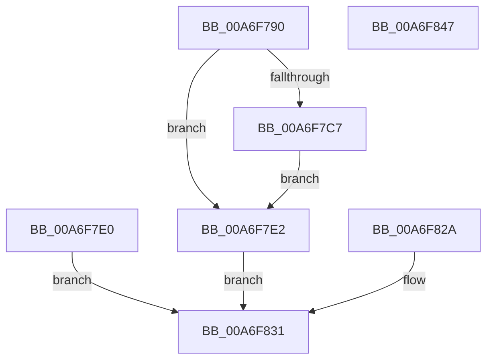

# NtOpenSession

- RVA: `0x00A6F790`–`0x00A6F848` (길이 `184` bytes)
- VA: `0x0000000140A6F790`
- 실행 섹션: `PAGE`
- PDB 이름 있음: `예`; PDB Function 태그: `아니요`
- unwind 정보 RVA: `0x000B4DC4`
- 디코드: `47`개 명령, `184/184` bytes 표시
- 미해석 바이트: `0` (있으면 어셈블리에 `.byte`로 보존)

> 이 문서는 커널 이미지의 기계어와 PDB 기호를 분석해 생성했습니다. 4번과 5번은 함수 원형과 자료형을 바이너리 사용 방식에서 추정한 C 해석이며 원본 소스 복구 결과는 아닙니다.

## 1. Dependencies

- 직접 호출 지점: **2**; 고유 호출 대상: **2**
- 직접 호출자로 확인된 함수: **0**
- RIP 상대 이미지 참조: **1**

### Outgoing calls
- `0x00A6F7E9` → [PsGetCurrentSilo](../../text/40/PsGetCurrentSilo_function_004094A0.md) (function, `0x004094A0`)
- `0x00A6F814` → [ObOpenObjectByNameEx](../89/ObOpenObjectByNameEx_function_0089A8A0.md) (function, `0x0089A8A0`)

### Direct callers
- 이 함수 시작 RVA로 연결되는 직접 call은 확인되지 않았습니다. 간접 호출은 완전히 역산할 수 없습니다.

### Static image references
- `0x00A6F7E2` → RVA `0x00FC6E08` (`ALMOSTRO`; read)

## 2. Other-region calls and transfers

- 다른 실행 섹션으로 향하는 call: **1**
  - `0x00A6F7E9` → [PsGetCurrentSilo](../../text/40/PsGetCurrentSilo_function_004094A0.md) (`PAGE` → `.text`)
- 별도 외부 분기/꼬리 이동을 확인하지 못했습니다.

## 3. Assembly (complete function range)

```asm
00A6F790  48 89 5C 24 08                  mov qword ptr [rsp + 8], rbx
00A6F795  48 89 74 24 10                  mov qword ptr [rsp + 0x10], rsi
00A6F79A  57                              push rdi
00A6F79B  41 56                           push r14
00A6F79D  41 57                           push r15
00A6F79F  48 83 EC 60                     sub rsp, 0x60
00A6F7A3  4D 8B F0                        mov r14, r8
00A6F7A6  44 8B FA                        mov r15d, edx
00A6F7A9  48 8B F9                        mov rdi, rcx
00A6F7AC  48 83 64 24 48 00               and qword ptr [rsp + 0x48], 0
00A6F7B2  65 48 8B 04 25 88 01 00 00      mov rax, qword ptr gs:[0x188]
00A6F7BB  40 8A B0 32 02 00 00            mov sil, byte ptr [rax + 0x232]
00A6F7C2  40 84 F6                        test sil, sil
00A6F7C5  74 1B                           je 0x140a6f7e2
00A6F7C7  48 BA 00 00 FF FF FF 7F 00 00   movabs rdx, 0x7fffffff0000
00A6F7D1  48 3B CA                        cmp rcx, rdx
00A6F7D4  48 0F 42 D1                     cmovb rdx, rcx
00A6F7D8  48 8B 02                        mov rax, qword ptr [rdx]
00A6F7DB  48 89 02                        mov qword ptr [rdx], rax
00A6F7DE  EB 02                           jmp 0x140a6f7e2
00A6F7E0  EB 4F                           jmp 0x140a6f831
00A6F7E2  48 8B 1D 1F 76 55 00            mov rbx, qword ptr [rip + 0x55761f]
00A6F7E9  E8 B2 9C 99 FF                  call 0x1404094a0
00A6F7EE  48 8D 4C 24 48                  lea rcx, [rsp + 0x48]
00A6F7F3  48 89 4C 24 38                  mov qword ptr [rsp + 0x38], rcx
00A6F7F8  48 89 44 24 30                  mov qword ptr [rsp + 0x30], rax
00A6F7FD  48 83 64 24 28 00               and qword ptr [rsp + 0x28], 0
00A6F803  44 89 7C 24 20                  mov dword ptr [rsp + 0x20], r15d
00A6F808  45 33 C9                        xor r9d, r9d
00A6F80B  44 8A C6                        mov r8b, sil
00A6F80E  48 8B D3                        mov rdx, rbx
00A6F811  49 8B CE                        mov rcx, r14
00A6F814  E8 87 B0 E2 FF                  call 0x14089a8a0
00A6F819  89 84 24 98 00 00 00            mov dword ptr [rsp + 0x98], eax
00A6F820  48 8B 4C 24 48                  mov rcx, qword ptr [rsp + 0x48]
00A6F825  48 89 0F                        mov qword ptr [rdi], rcx
00A6F828  EB 07                           jmp 0x140a6f831
00A6F82A  8B 84 24 98 00 00 00            mov eax, dword ptr [rsp + 0x98]
00A6F831  4C 8D 5C 24 60                  lea r11, [rsp + 0x60]
00A6F836  49 8B 5B 20                     mov rbx, qword ptr [r11 + 0x20]
00A6F83A  49 8B 73 28                     mov rsi, qword ptr [r11 + 0x28]
00A6F83E  49 8B E3                        mov rsp, r11
00A6F841  41 5F                           pop r15
00A6F843  41 5E                           pop r14
00A6F845  5F                              pop rdi
00A6F846  C3                              ret
00A6F847  CC                              int3
```

## 4. C-style interpretation (structured pseudocode)

```c
__int64 __fastcall NtOpenSession(__int64 a1, int a2, __int64 a3, int a4)
{
    __int64 result;
    __int64 v_rsp;
    unsigned __int64 v_stack_m18;
    unsigned __int64 v_stack_m30;
    unsigned __int64 v_stack_m40;
    unsigned __int64 v_stack_m48;
    unsigned __int64 v_stack_m50;
    unsigned int v_stack_m58;
    unsigned __int64 v_stack_p10;
    unsigned int v_stack_p20;
    unsigned __int64 v_stack_p8;

    v_stack_p8 = v_rbx;
    v_stack_p10 = v_rsi;
    v_rsp = (v_rsp) - (96);
    if ((unsigned __int8)(*(unsigned __int8 *)(*(unsigned __int64 *)(gs_base + (0 + 392)) + 562)) == 0) goto loc_00A6F7E2;
    if (a1 < a2) { a2 = a1; }
    *(unsigned __int64 *)(a2) = *(unsigned __int64 *)(a2);
    goto loc_00A6F7E2;
loc_00A6F7E2:
    result = PsGetCurrentSilo(a1, a2, a3, a4);
    v_stack_m40 = v_stack_m30;
    v_stack_m48 = result;
    v_stack_m58 = (unsigned int)((unsigned int)(a2));
    a4 = 0;
    result = ObOpenObjectByNameEx(a3, *(unsigned __int64 *)(v_rip + 5600799), (unsigned __int8)(*(unsigned __int8 *)(*(unsigned __int64 *)(gs_base + (0 + 392)) + 562)), a4);
    v_stack_p20 = (unsigned int)(result);
    *(unsigned __int64 *)(a1) = v_stack_m30;
    goto loc_00A6F831;
loc_00A6F831:
    return result;
}
```

## 5. (Beta) C Style

```c
int64_t NtOpenSession(void *Arg1, int32_t Arg2, int64_t Arg3, int32_t Arg4)
{
    uint8_t *arg1 = (uint8_t *)Arg1;

    int64_t result;
    int64_t local_rsp;
    uint64_t v_stack_m18;
    uint64_t v_stack_m30;
    uint64_t v_stack_m40;
    uint64_t v_stack_m48;
    uint64_t v_stack_m50;
    uint32_t v_stack_m58;
    uint64_t v_stack_p10;
    uint32_t v_stack_p20;
    uint64_t v_stack_p8;

    v_stack_p8 = local_rbx;
    v_stack_p10 = local_rsi;
    local_rsp = (local_rsp) - (96);
    if ((uint8_t)(*(uint8_t *)(*(uint64_t *)(gs_base + (0 + 0x188)) + 0x232)) == 0) goto loc_00A6F7E2;
    if (Arg1 < Arg2) { Arg2 = Arg1; }
    *(uint64_t *)(Arg2) = *(uint64_t *)(Arg2);
    goto loc_00A6F7E2;
loc_00A6F7E2:
    result = PsGetCurrentSilo(Arg1, Arg2, Arg3, Arg4);
    v_stack_m40 = v_stack_m30;
    v_stack_m48 = result;
    v_stack_m58 = (uint32_t)((uint32_t)(Arg2));
    Arg4 = 0;
    result = ObOpenObjectByNameEx(Arg3, *(uint64_t *)(v_rip + 0x55761F), (uint8_t)(*(uint8_t *)(*(uint64_t *)(gs_base + (0 + 0x188)) + 0x232)), Arg4);
    v_stack_p20 = (uint32_t)(result);
    *(uint64_t *)(arg1) = v_stack_m30;
    goto loc_00A6F831;
loc_00A6F831:
    return result;
}
```

### 관측된 메모리 오프셋

구조체 형식이 확인되지 않은 접근은 인자 기준의 오프셋으로만 기록했습니다.

| 기준 인자 | 오프셋 표현 | 폭 (bit) | 접근 |
|---|---:|---:|---|
| `Arg1` | `+ 0x0` | `64` | `W` |

## 6. Execution-region graph

[열기: 2D/3D 그래프와 함수 탐색 컨트롤 패널](../../../control-panel.html?section=page&rva=0x00A6F790&view=graph)

- 2D 그래프는 위에서 아래로 흐르고, 3D 그래프는 빈 공간을 드래그해 회전합니다. Shift+드래그는 이동, 휠은 확대·축소, 함수 노드 선택은 대상 보고서 이동입니다.

### Static fallback


