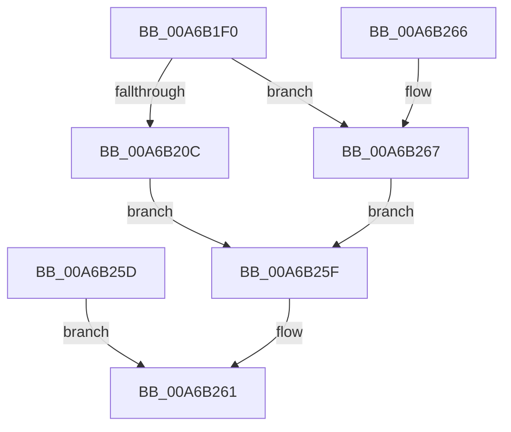

# NtQueryTimerResolution

- RVA: `0x00A6B1F0`–`0x00A6B282` (길이 `146` bytes)
- VA: `0x0000000140A6B1F0`
- 실행 섹션: `PAGE`
- PDB 이름 있음: `예`; PDB Function 태그: `아니요`
- unwind 정보 RVA: `0x000B42CC`
- 디코드: `40`개 명령, `146/146` bytes 표시
- 미해석 바이트: `0` (있으면 어셈블리에 `.byte`로 보존)

> 이 문서는 커널 이미지의 기계어와 PDB 기호를 분석해 생성했습니다. 4번과 5번은 함수 원형과 자료형을 바이너리 사용 방식에서 추정한 C 해석이며 원본 소스 복구 결과는 아닙니다.

## 1. Dependencies

- 직접 호출 지점: **0**; 고유 호출 대상: **0**
- 직접 호출자로 확인된 함수: **0**
- RIP 상대 이미지 참조: **3**

### Outgoing calls
- 직접 디코드된 call 명령이 없습니다.

### Direct callers
- 이 함수 시작 RVA로 연결되는 직접 call은 확인되지 않았습니다. 간접 호출은 완전히 역산할 수 없습니다.

### Static image references
- `0x00A6B241` → RVA `0x00FC6AA0` (`ALMOSTRO`; read)
- `0x00A6B24A` → RVA `0x00FC6B3C` (`ALMOSTRO`; read)
- `0x00A6B252` → RVA `0x00FC6BB8` (`ALMOSTRO`; read)

## 2. Other-region calls and transfers

- 다른 실행 섹션으로 향하는 call: **0**
- 별도 외부 분기/꼬리 이동을 확인하지 못했습니다.

## 3. Assembly (complete function range)

```asm
00A6B1F0  48 83 EC 18                     sub rsp, 0x18
00A6B1F4  4D 8B D0                        mov r10, r8
00A6B1F7  4C 8B D9                        mov r11, rcx
00A6B1FA  65 48 8B 04 25 88 01 00 00      mov rax, qword ptr gs:[0x188]
00A6B203  80 B8 32 02 00 00 00            cmp byte ptr [rax + 0x232], 0
00A6B20A  74 5B                           je 0x140a6b267
00A6B20C  49 B9 00 00 FF FF FF 7F 00 00   movabs r9, 0x7fffffff0000
00A6B216  4D 8B C1                        mov r8, r9
00A6B219  49 3B C9                        cmp rcx, r9
00A6B21C  4C 0F 42 C1                     cmovb r8, rcx
00A6B220  41 8B 00                        mov eax, dword ptr [r8]
00A6B223  41 89 00                        mov dword ptr [r8], eax
00A6B226  49 8B C9                        mov rcx, r9
00A6B229  49 3B D1                        cmp rdx, r9
00A6B22C  48 0F 42 CA                     cmovb rcx, rdx
00A6B230  8B 01                           mov eax, dword ptr [rcx]
00A6B232  89 01                           mov dword ptr [rcx], eax
00A6B234  4D 3B D1                        cmp r10, r9
00A6B237  4D 0F 42 CA                     cmovb r9, r10
00A6B23B  41 8B 01                        mov eax, dword ptr [r9]
00A6B23E  41 89 01                        mov dword ptr [r9], eax
00A6B241  8B 05 59 B8 55 00               mov eax, dword ptr [rip + 0x55b859]
00A6B247  41 89 03                        mov dword ptr [r11], eax
00A6B24A  8B 05 EC B8 55 00               mov eax, dword ptr [rip + 0x55b8ec]
00A6B250  89 02                           mov dword ptr [rdx], eax
00A6B252  8B 05 60 B9 55 00               mov eax, dword ptr [rip + 0x55b960]
00A6B258  41 89 02                        mov dword ptr [r10], eax
00A6B25B  EB 02                           jmp 0x140a6b25f
00A6B25D  EB 02                           jmp 0x140a6b261
00A6B25F  33 C0                           xor eax, eax
00A6B261  48 83 C4 18                     add rsp, 0x18
00A6B265  C3                              ret
00A6B266  CC                              int3
00A6B267  8B 05 33 B8 55 00               mov eax, dword ptr [rip + 0x55b833]
00A6B26D  89 01                           mov dword ptr [rcx], eax
00A6B26F  8B 05 C7 B8 55 00               mov eax, dword ptr [rip + 0x55b8c7]
00A6B275  89 02                           mov dword ptr [rdx], eax
00A6B277  8B 05 3B B9 55 00               mov eax, dword ptr [rip + 0x55b93b]
00A6B27D  41 89 00                        mov dword ptr [r8], eax
00A6B280  EB DD                           jmp 0x140a6b25f
```

## 4. C-style interpretation (structured pseudocode)

```c
__int64 __fastcall NtQueryTimerResolution(__int64 a1, __int64 a2, __int64 a3)
{
    __int64 result;
    __int64 v_rsp;

    v_rsp = (v_rsp) - (24);
    if ((*(unsigned __int8 *)(*(unsigned __int64 *)(gs_base + (0 + 392)) + 562)) == 0) goto loc_00A6B267;
    if (a1 < a4) { a4 = a1; }
    *(unsigned int *)(a4) = (unsigned int)((unsigned int)(*(unsigned int *)(a4)));
    if (a2 < a4) { a4 = a2; }
    *(unsigned int *)(a4) = (unsigned int)((unsigned int)(*(unsigned int *)(a4)));
    if (a3 < a4) { a4 = a3; }
    *(unsigned int *)(a4) = (unsigned int)((unsigned int)(*(unsigned int *)(a4)));
    *(unsigned int *)(a1) = (unsigned int)((unsigned int)(*(unsigned int *)(v_rip + 5617753)));
    *(unsigned int *)(a2) = (unsigned int)((unsigned int)(*(unsigned int *)(v_rip + 5617900)));
    *(unsigned int *)(a3) = (unsigned int)((unsigned int)(*(unsigned int *)(v_rip + 5618016)));
    goto loc_00A6B25F;
loc_00A6B25F:
    result = 0;
loc_00A6B261:
    v_rsp = (v_rsp) + (24);
    return result;
loc_00A6B267:
    *(unsigned int *)(a4) = (unsigned int)((unsigned int)(*(unsigned int *)(v_rip + 5617715)));
    *(unsigned int *)(a2) = (unsigned int)((unsigned int)(*(unsigned int *)(v_rip + 5617863)));
    *(unsigned int *)(a4) = (unsigned int)((unsigned int)(*(unsigned int *)(v_rip + 5617979)));
    goto loc_00A6B25F;
}
```

## 5. (Beta) C Style

```c
int64_t NtQueryTimerResolution(void *Arg1, void *Arg2, void *Arg3)
{
    uint8_t *arg1 = (uint8_t *)Arg1;
    uint8_t *arg2 = (uint8_t *)Arg2;
    uint8_t *arg3 = (uint8_t *)Arg3;

    int64_t result;
    int64_t local_rsp;

    local_rsp = (local_rsp) - (24);
    if ((*(uint8_t *)(*(uint64_t *)(gs_base + (0 + 0x188)) + 0x232)) == 0) goto loc_00A6B267;
    if (Arg1 < a4) { a4 = Arg1; }
    *(uint32_t *)(a4) = (uint32_t)((uint32_t)(*(uint32_t *)(a4)));
    if (Arg2 < a4) { a4 = Arg2; }
    *(uint32_t *)(a4) = (uint32_t)((uint32_t)(*(uint32_t *)(a4)));
    if (Arg3 < a4) { a4 = Arg3; }
    *(uint32_t *)(a4) = (uint32_t)((uint32_t)(*(uint32_t *)(a4)));
    *(uint32_t *)(arg1) = (uint32_t)((uint32_t)(*(uint32_t *)(v_rip + 0x55B859)));
    *(uint32_t *)(arg2) = (uint32_t)((uint32_t)(*(uint32_t *)(v_rip + 0x55B8EC)));
    *(uint32_t *)(arg3) = (uint32_t)((uint32_t)(*(uint32_t *)(v_rip + 0x55B960)));
    goto loc_00A6B25F;
loc_00A6B25F:
    result = 0;
loc_00A6B261:
    local_rsp = (local_rsp) + (24);
    return result;
loc_00A6B267:
    *(uint32_t *)(a4) = (uint32_t)((uint32_t)(*(uint32_t *)(v_rip + 0x55B833)));
    *(uint32_t *)(arg2) = (uint32_t)((uint32_t)(*(uint32_t *)(v_rip + 0x55B8C7)));
    *(uint32_t *)(a4) = (uint32_t)((uint32_t)(*(uint32_t *)(v_rip + 0x55B93B)));
    goto loc_00A6B25F;
}
```

### 관측된 메모리 오프셋

구조체 형식이 확인되지 않은 접근은 인자 기준의 오프셋으로만 기록했습니다.

| 기준 인자 | 오프셋 표현 | 폭 (bit) | 접근 |
|---|---:|---:|---|
| `Arg1` | `+ 0x0` | `32` | `W` |
| `Arg2` | `+ 0x0` | `32` | `W` |
| `Arg3` | `+ 0x0` | `32` | `W` |

## 6. Execution-region graph

[열기: 2D/3D 그래프와 함수 탐색 컨트롤 패널](../../../control-panel.html?section=page&rva=0x00A6B1F0&view=graph)

- 2D 그래프는 위에서 아래로 흐르고, 3D 그래프는 빈 공간을 드래그해 회전합니다. Shift+드래그는 이동, 휠은 확대·축소, 함수 노드 선택은 대상 보고서 이동입니다.

### Static fallback


