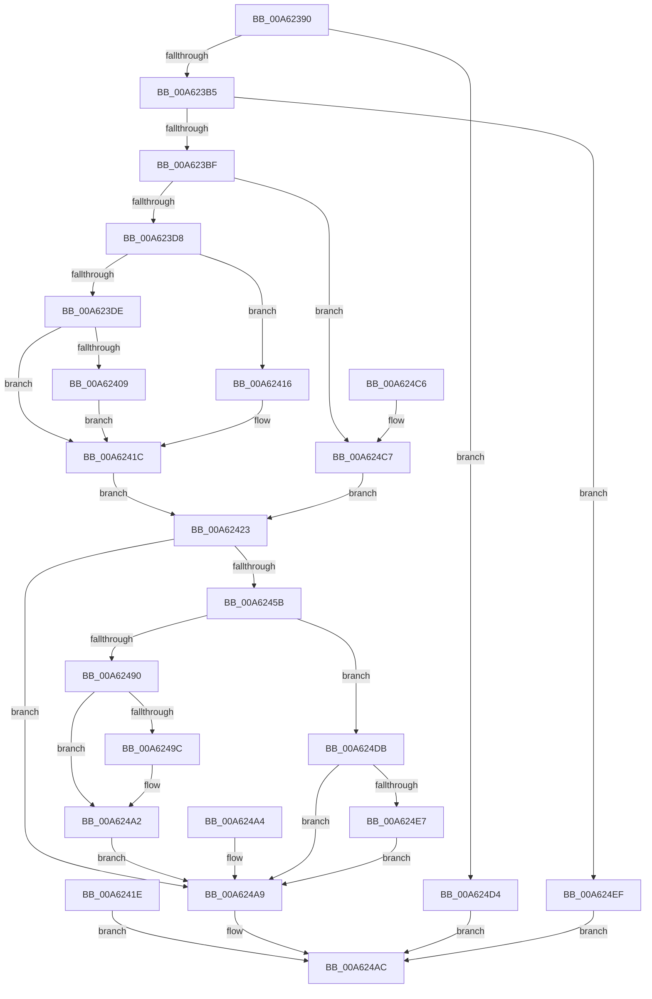

# NtQueryTimer

- RVA: `0x00A62390`–`0x00A624F6` (길이 `358` bytes)
- VA: `0x0000000140A62390`
- 실행 섹션: `PAGE`
- PDB 이름 있음: `예`; PDB Function 태그: `아니요`
- unwind 정보 RVA: `0x000B332C`
- 디코드: `96`개 명령, `358/358` bytes 표시
- 미해석 바이트: `0` (있으면 어셈블리에 `.byte`로 보존)

> 이 문서는 커널 이미지의 기계어와 PDB 기호를 분석해 생성했습니다. 4번과 5번은 함수 원형과 자료형을 바이너리 사용 방식에서 추정한 C 해석이며 원본 소스 복구 결과는 아닙니다.

## 1. Dependencies

- 직접 호출 지점: **4**; 고유 호출 대상: **4**
- 직접 호출자로 확인된 함수: **0**
- RIP 상대 이미지 참조: **1**

### Outgoing calls
- `0x00A62416` → [ExRaiseDatatypeMisalignment](../89/ExRaiseDatatypeMisalignment_function_00899FD0.md) (function, `0x00899FD0`)
- `0x00A6244B` → [ObReferenceObjectByHandle](../86/ObReferenceObjectByHandle_function_00868DB0.md) (function, `0x00868DB0`)
- `0x00A62476` → [KeQueryTimerDueTime](../../text/49/KeQueryTimerDueTime_function_00499CC0.md) (function, `0x00499CC0`)
- `0x00A62486` → [ObfDereferenceObject](../../text/2F/ObfDereferenceObject_function_002F9350.md) (function, `0x002F9350`)

### Direct callers
- 이 함수 시작 RVA로 연결되는 직접 call은 확인되지 않았습니다. 간접 호출은 완전히 역산할 수 없습니다.

### Static image references
- `0x00A62423` → RVA `0x00FC6D98` (`ALMOSTRO`; read)

## 2. Other-region calls and transfers

- 다른 실행 섹션으로 향하는 call: **2**
  - `0x00A62476` → [KeQueryTimerDueTime](../../text/49/KeQueryTimerDueTime_function_00499CC0.md) (`PAGE` → `.text`)
  - `0x00A62486` → [ObfDereferenceObject](../../text/2F/ObfDereferenceObject_function_002F9350.md) (`PAGE` → `.text`)
- 별도 외부 분기/꼬리 이동을 확인하지 못했습니다.

## 3. Assembly (complete function range)

```asm
00A62390  48 89 5C 24 08                  mov qword ptr [rsp + 8], rbx
00A62395  48 89 74 24 18                  mov qword ptr [rsp + 0x18], rsi
00A6239A  57                              push rdi
00A6239B  41 54                           push r12
00A6239D  41 55                           push r13
00A6239F  41 56                           push r14
00A623A1  41 57                           push r15
00A623A3  48 83 EC 40                     sub rsp, 0x40
00A623A7  4D 8B F0                        mov r14, r8
00A623AA  4C 8B D1                        mov r10, rcx
00A623AD  85 D2                           test edx, edx
00A623AF  0F 85 1F 01 00 00               jne 0x140a624d4
00A623B5  41 83 F9 10                     cmp r9d, 0x10
00A623B9  0F 85 30 01 00 00               jne 0x140a624ef
00A623BF  65 48 8B 04 25 88 01 00 00      mov rax, qword ptr gs:[0x188]
00A623C8  44 8A A8 32 02 00 00            mov r13b, byte ptr [rax + 0x232]
00A623CF  45 84 ED                        test r13b, r13b
00A623D2  0F 84 EF 00 00 00               je 0x140a624c7
00A623D8  41 F6 C6 03                     test r14b, 3
00A623DC  75 38                           jne 0x140a62416
00A623DE  48 BA 00 00 FF FF FF 7F 00 00   movabs rdx, 0x7fffffff0000
00A623E8  48 8B CA                        mov rcx, rdx
00A623EB  4C 3B C2                        cmp r8, rdx
00A623EE  49 0F 42 C8                     cmovb rcx, r8
00A623F2  8A 01                           mov al, byte ptr [rcx]
00A623F4  88 01                           mov byte ptr [rcx], al
00A623F6  8A 41 0F                        mov al, byte ptr [rcx + 0xf]
00A623F9  88 41 0F                        mov byte ptr [rcx + 0xf], al
00A623FC  48 8B B4 24 90 00 00 00         mov rsi, qword ptr [rsp + 0x90]
00A62404  48 85 F6                        test rsi, rsi
00A62407  74 13                           je 0x140a6241c
00A62409  48 3B F2                        cmp rsi, rdx
00A6240C  48 0F 42 D6                     cmovb rdx, rsi
00A62410  8B 02                           mov eax, dword ptr [rdx]
00A62412  89 02                           mov dword ptr [rdx], eax
00A62414  EB 06                           jmp 0x140a6241c
00A62416  E8 B5 7B E3 FF                  call 0x140899fd0
00A6241B  CC                              int3
00A6241C  EB 05                           jmp 0x140a62423
00A6241E  E9 89 00 00 00                  jmp 0x140a624ac
00A62423  4C 8B 05 6E 49 56 00            mov r8, qword ptr [rip + 0x56496e]
00A6242A  48 83 64 24 30 00               and qword ptr [rsp + 0x30], 0
00A62430  48 83 64 24 28 00               and qword ptr [rsp + 0x28], 0
00A62436  48 8D 44 24 30                  lea rax, [rsp + 0x30]
00A6243B  48 89 44 24 20                  mov qword ptr [rsp + 0x20], rax
00A62440  45 8A CD                        mov r9b, r13b
00A62443  BA 01 00 00 00                  mov edx, 1
00A62448  49 8B CA                        mov rcx, r10
00A6244B  E8 60 69 E0 FF                  call 0x140868db0
00A62450  44 8B F8                        mov r15d, eax
00A62453  89 44 24 78                     mov dword ptr [rsp + 0x78], eax
00A62457  85 C0                           test eax, eax
00A62459  78 4E                           js 0x140a624a9
00A6245B  48 8B 4C 24 30                  mov rcx, qword ptr [rsp + 0x30]
00A62460  44 8A 61 04                     mov r12b, byte ptr [rcx + 4]
00A62464  48 BB 08 00 00 00 80 F7 FF FF   movabs rbx, 0xfffff78000000008
00A6246E  48 8B 1B                        mov rbx, qword ptr [rbx]
00A62471  48 8B 4C 24 30                  mov rcx, qword ptr [rsp + 0x30]
00A62476  E8 45 78 A3 FF                  call 0x140499cc0
00A6247B  48 8B F8                        mov rdi, rax
00A6247E  48 2B FB                        sub rdi, rbx
00A62481  48 8B 4C 24 30                  mov rcx, qword ptr [rsp + 0x30]
00A62486  E8 C5 6E 89 FF                  call 0x1402f9350
00A6248B  45 84 ED                        test r13b, r13b
00A6248E  74 4B                           je 0x140a624db
00A62490  45 88 66 08                     mov byte ptr [r14 + 8], r12b
00A62494  49 89 3E                        mov qword ptr [r14], rdi
00A62497  48 85 F6                        test rsi, rsi
00A6249A  74 06                           je 0x140a624a2
00A6249C  C7 06 10 00 00 00               mov dword ptr [rsi], 0x10
00A624A2  EB 05                           jmp 0x140a624a9
00A624A4  44 8B 7C 24 78                  mov r15d, dword ptr [rsp + 0x78]
00A624A9  41 8B C7                        mov eax, r15d
00A624AC  4C 8D 5C 24 40                  lea r11, [rsp + 0x40]
00A624B1  49 8B 5B 30                     mov rbx, qword ptr [r11 + 0x30]
00A624B5  49 8B 73 40                     mov rsi, qword ptr [r11 + 0x40]
00A624B9  49 8B E3                        mov rsp, r11
00A624BC  41 5F                           pop r15
00A624BE  41 5E                           pop r14
00A624C0  41 5D                           pop r13
00A624C2  41 5C                           pop r12
00A624C4  5F                              pop rdi
00A624C5  C3                              ret
00A624C6  CC                              int3
00A624C7  48 8B B4 24 90 00 00 00         mov rsi, qword ptr [rsp + 0x90]
00A624CF  E9 4F FF FF FF                  jmp 0x140a62423
00A624D4  B8 03 00 00 C0                  mov eax, 0xc0000003
00A624D9  EB D1                           jmp 0x140a624ac
00A624DB  45 88 66 08                     mov byte ptr [r14 + 8], r12b
00A624DF  49 89 3E                        mov qword ptr [r14], rdi
00A624E2  48 85 F6                        test rsi, rsi
00A624E5  74 C2                           je 0x140a624a9
00A624E7  C7 06 10 00 00 00               mov dword ptr [rsi], 0x10
00A624ED  EB BA                           jmp 0x140a624a9
00A624EF  B8 04 00 00 C0                  mov eax, 0xc0000004
00A624F4  EB B6                           jmp 0x140a624ac
```

## 4. C-style interpretation (structured pseudocode)

```c
__int64 __fastcall NtQueryTimer(__int64 a1, int a2, __int64 a3, int a4, __int64 a5)
{
    __int64 result;
    __int64 v_rdi;
    __int64 v_rsp;
    unsigned __int64 v_stack_m28;
    unsigned __int64 v_stack_m38;
    unsigned __int64 v_stack_m40;
    unsigned __int64 v_stack_m48;
    unsigned int v_stack_p10;
    unsigned __int64 v_stack_p18;
    unsigned __int64 v_stack_p8;

    v_stack_p8 = v_rbx;
    v_stack_p18 = v_rsi;
    v_rsp = (v_rsp) - (64);
    if (a2 != 0) goto loc_00A624D4;
    if (a4 != 16) goto loc_00A624EF;
    if ((unsigned __int8)(*(unsigned __int8 *)(*(unsigned __int64 *)(gs_base + (0 + 392)) + 562)) == 0) goto loc_00A624C7;
    if ((((unsigned __int8)(a3)) & (3)) != 0) goto loc_00A62416;
    if (a3 < a2) { a2 = a3; }
    *(unsigned __int8 *)(a2) = (unsigned __int8)(*(unsigned __int8 *)(a2));
    *(unsigned __int8 *)(a2 + 15) = (unsigned __int8)(*(unsigned __int8 *)(a2 + 15));
    if (a5 == 0) goto loc_00A6241C;
    if (a5 < a2) { a2 = a5; }
    *(unsigned int *)(a2) = (unsigned int)((unsigned int)(*(unsigned int *)(a2)));
    goto loc_00A6241C;
loc_00A62416:
    result = ExRaiseDatatypeMisalignment(a2, a2, a3, a4);
loc_00A6241C:
    goto loc_00A62423;
loc_00A62423:
    v_stack_m48 = v_stack_m38;
    result = ObReferenceObjectByHandle(a1, 1, *(unsigned __int64 *)(v_rip + 5654894), (unsigned __int8)(*(unsigned __int8 *)(*(unsigned __int64 *)(gs_base + (0 + 392)) + 562)));
    v_stack_p10 = (unsigned int)(result);
    if (sign_flag) goto loc_00A624A9;
    result = KeQueryTimerDueTime(v_stack_m38, 1, *(unsigned __int64 *)(v_rip + 5654894), (unsigned __int8)(*(unsigned __int8 *)(*(unsigned __int64 *)(gs_base + (0 + 392)) + 562)));
    v_rdi = (result) - (*(unsigned __int64 *)(v_rbx));
    result = ObfDereferenceObject(v_stack_m38, 1, *(unsigned __int64 *)(v_rip + 5654894), (unsigned __int8)(*(unsigned __int8 *)(*(unsigned __int64 *)(gs_base + (0 + 392)) + 562)));
    if ((unsigned __int8)(*(unsigned __int8 *)(*(unsigned __int64 *)(gs_base + (0 + 392)) + 562)) == 0) goto loc_00A624DB;
    *(unsigned __int8 *)(a3 + 8) = (unsigned __int8)(*(unsigned __int8 *)(v_stack_m38 + 4));
    *(unsigned __int64 *)(a3) = v_rdi;
    if (a5 != 0) {
        *(unsigned int *)(a5) = 16;
    }
    goto loc_00A624A9;
loc_00A624A9:
loc_00A624AC:
    return (unsigned int)((unsigned int)((unsigned int)((unsigned int)(result))));
loc_00A624C7:
    goto loc_00A62423;
loc_00A624D4:
    goto loc_00A624AC;
loc_00A624DB:
    *(unsigned __int8 *)(a3 + 8) = (unsigned __int8)(*(unsigned __int8 *)(v_stack_m38 + 4));
    *(unsigned __int64 *)(a3) = v_rdi;
    if (a5 == 0) goto loc_00A624A9;
    *(unsigned int *)(a5) = 16;
    goto loc_00A624A9;
loc_00A624EF:
    goto loc_00A624AC;
}
```

## 5. (Beta) C Style

```c
int64_t NtQueryTimer(int64_t Arg1, int32_t Arg2, int64_t Arg3, int32_t Arg4, int64_t Arg5)
{
    int64_t result;
    int64_t local_rdi;
    int64_t local_rsp;
    uint64_t v_stack_m28;
    uint64_t v_stack_m38;
    uint64_t v_stack_m40;
    uint64_t v_stack_m48;
    uint32_t v_stack_p10;
    uint64_t v_stack_p18;
    uint64_t v_stack_p8;

    v_stack_p8 = local_rbx;
    v_stack_p18 = local_rsi;
    local_rsp = (local_rsp) - (64);
    if (Arg2 != 0) goto loc_00A624D4;
    if (Arg4 != 16) goto loc_00A624EF;
    if ((uint8_t)(*(uint8_t *)(*(uint64_t *)(gs_base + (0 + 0x188)) + 0x232)) == 0) goto loc_00A624C7;
    if ((((uint8_t)(Arg3)) & (3)) != 0) goto loc_00A62416;
    if (Arg3 < Arg2) { Arg2 = Arg3; }
    *(uint8_t *)(Arg2) = (uint8_t)(*(uint8_t *)(Arg2));
    *(uint8_t *)(Arg2 + 0xF) = (uint8_t)(*(uint8_t *)(Arg2 + 0xF));
    if (Arg5 == 0) goto loc_00A6241C;
    if (Arg5 < Arg2) { Arg2 = Arg5; }
    *(uint32_t *)(Arg2) = (uint32_t)((uint32_t)(*(uint32_t *)(Arg2)));
    goto loc_00A6241C;
loc_00A62416:
    result = ExRaiseDatatypeMisalignment(Arg2, Arg2, Arg3, Arg4);
loc_00A6241C:
    goto loc_00A62423;
loc_00A62423:
    v_stack_m48 = v_stack_m38;
    result = ObReferenceObjectByHandle(Arg1, 1, *(uint64_t *)(v_rip + 0x56496E), (uint8_t)(*(uint8_t *)(*(uint64_t *)(gs_base + (0 + 0x188)) + 0x232)));
    v_stack_p10 = (uint32_t)(result);
    if (sign_flag) goto loc_00A624A9;
    result = KeQueryTimerDueTime(v_stack_m38, 1, *(uint64_t *)(v_rip + 0x56496E), (uint8_t)(*(uint8_t *)(*(uint64_t *)(gs_base + (0 + 0x188)) + 0x232)));
    local_rdi = (result) - (*(uint64_t *)(local_rbx));
    result = ObfDereferenceObject(v_stack_m38, 1, *(uint64_t *)(v_rip + 0x56496E), (uint8_t)(*(uint8_t *)(*(uint64_t *)(gs_base + (0 + 0x188)) + 0x232)));
    if ((uint8_t)(*(uint8_t *)(*(uint64_t *)(gs_base + (0 + 0x188)) + 0x232)) == 0) goto loc_00A624DB;
    *(uint8_t *)(Arg3 + 0x8) = (uint8_t)(*(uint8_t *)(v_stack_m38 + 0x4));
    *(uint64_t *)(Arg3) = local_rdi;
    if (Arg5 != 0) {
        *(uint32_t *)(Arg5) = 16;
    }
    goto loc_00A624A9;
loc_00A624A9:
loc_00A624AC:
    return (uint32_t)((uint32_t)((uint32_t)((uint32_t)(result))));
loc_00A624C7:
    goto loc_00A62423;
loc_00A624D4:
    goto loc_00A624AC;
loc_00A624DB:
    *(uint8_t *)(Arg3 + 0x8) = (uint8_t)(*(uint8_t *)(v_stack_m38 + 0x4));
    *(uint64_t *)(Arg3) = local_rdi;
    if (Arg5 == 0) goto loc_00A624A9;
    *(uint32_t *)(Arg5) = 16;
    goto loc_00A624A9;
loc_00A624EF:
    goto loc_00A624AC;
}
```

## 6. Execution-region graph

[열기: 2D/3D 그래프와 함수 탐색 컨트롤 패널](../../../control-panel.html?section=page&rva=0x00A62390&view=graph)

- 2D 그래프는 위에서 아래로 흐르고, 3D 그래프는 빈 공간을 드래그해 회전합니다. Shift+드래그는 이동, 휠은 확대·축소, 함수 노드 선택은 대상 보고서 이동입니다.

### Static fallback


