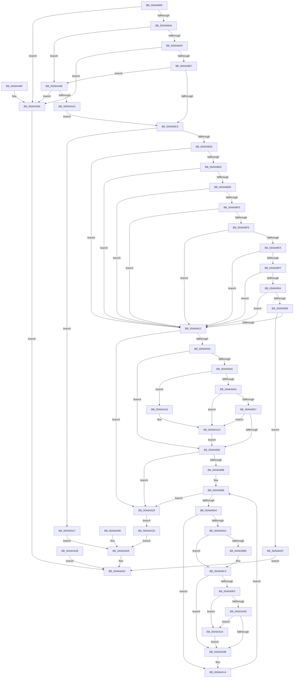

# NtRaiseHardError

- RVA: `0x00A64860`–`0x00A64ACD` (길이 `621` bytes)
- VA: `0x0000000140A64860`
- 실행 섹션: `PAGE`
- PDB 이름 있음: `예`; PDB Function 태그: `아니요`
- unwind 정보 RVA: `0x000B371C`
- 디코드: `167`개 명령, `621/621` bytes 표시
- 미해석 바이트: `0` (있으면 어셈블리에 `.byte`로 보존)

> 이 문서는 커널 이미지의 기계어와 PDB 기호를 분석해 생성했습니다. 4번과 5번은 함수 원형과 자료형을 바이너리 사용 방식에서 추정한 C 해석이며 원본 소스 복구 결과는 아닙니다.

## 1. Dependencies

- 직접 호출 지점: **7**; 고유 호출 대상: **5**
- 직접 호출자로 확인된 함수: **0**
- RIP 상대 이미지 참조: **1**

### Outgoing calls
- `0x00A6496B` → [memcpy](../../text/6C/memcpy_function_006C6840.md) (function, `0x006C6840`)
- `0x00A6497D` → [memcpy](../../text/6C/memcpy_function_006C6840.md) (function, `0x006C6840`)
- `0x00A649BE` → [ExRaiseDatatypeMisalignment](../89/ExRaiseDatatypeMisalignment_function_00899FD0.md) (function, `0x00899FD0`)
- `0x00A64A18` → [ExRaiseDatatypeMisalignment](../89/ExRaiseDatatypeMisalignment_function_00899FD0.md) (function, `0x00899FD0`)
- `0x00A64A53` → [ExpRaiseHardError](ExpRaiseHardError_function_00A64AD4.md) (function, `0x00A64AD4`)
- `0x00A64A77` → [_security_check_cookie](../../text/6A/_security_check_cookie_function_006AC640.md) (function, `0x006AC640`)
- `0x00A64ABE` → [ExRaiseHardError](ExRaiseHardError_function_00A64520.md) (function, `0x00A64520`)

### Direct callers
- 이 함수 시작 RVA로 연결되는 직접 call은 확인되지 않았습니다. 간접 호출은 완전히 역산할 수 없습니다.

### Static image references
- `0x00A64873` → RVA `0x00E0A740` (`.data`; read)

## 2. Other-region calls and transfers

- 다른 실행 섹션으로 향하는 call: **3**
  - `0x00A6496B` → [memcpy](../../text/6C/memcpy_function_006C6840.md) (`PAGE` → `.text`)
  - `0x00A6497D` → [memcpy](../../text/6C/memcpy_function_006C6840.md) (`PAGE` → `.text`)
  - `0x00A64A77` → [_security_check_cookie](../../text/6A/_security_check_cookie_function_006AC640.md) (`PAGE` → `.text`)
- 별도 외부 분기/꼬리 이동을 확인하지 못했습니다.

## 3. Assembly (complete function range)

```asm
00A64860  40 53                           push rbx
00A64862  56                              push rsi
00A64863  57                              push rdi
00A64864  41 54                           push r12
00A64866  41 55                           push r13
00A64868  41 56                           push r14
00A6486A  41 57                           push r15
00A6486C  48 81 EC 00 01 00 00            sub rsp, 0x100
00A64873  48 8B 05 C6 5E 3A 00            mov rax, qword ptr [rip + 0x3a5ec6]
00A6487A  48 33 C4                        xor rax, rsp
00A6487D  48 89 84 24 F0 00 00 00         mov qword ptr [rsp + 0xf0], rax
00A64885  45 8B F0                        mov r14d, r8d
00A64888  8B DA                           mov ebx, edx
00A6488A  44 8B E1                        mov r12d, ecx
00A6488D  48 8B B4 24 68 01 00 00         mov rsi, qword ptr [rsp + 0x168]
00A64895  45 33 ED                        xor r13d, r13d
00A64898  44 89 6C 24 40                  mov dword ptr [rsp + 0x40], r13d
00A6489D  83 FA 05                        cmp edx, 5
00A648A0  0F 87 EA 01 00 00               ja 0x140a64a90
00A648A6  4D 85 C9                        test r9, r9
00A648A9  0F 84 EF 01 00 00               je 0x140a64a9e
00A648AF  85 D2                           test edx, edx
00A648B1  0F 84 D9 01 00 00               je 0x140a64a90
00A648B7  4D 85 C9                        test r9, r9
00A648BA  0F 84 DE 01 00 00               je 0x140a64a9e
00A648C0  65 48 8B 04 25 88 01 00 00      mov rax, qword ptr gs:[0x188]
00A648C9  44 38 A8 32 02 00 00            cmp byte ptr [rax + 0x232], r13b
00A648D0  0F 84 D1 01 00 00               je 0x140a64aa7
00A648D6  44 8B BC 24 60 01 00 00         mov r15d, dword ptr [rsp + 0x160]
00A648DE  41 8B C7                        mov eax, r15d
00A648E1  45 85 FF                        test r15d, r15d
00A648E4  74 2C                           je 0x140a64912
00A648E6  83 E8 01                        sub eax, 1
00A648E9  74 27                           je 0x140a64912
00A648EB  83 E8 01                        sub eax, 1
00A648EE  74 22                           je 0x140a64912
00A648F0  83 E8 01                        sub eax, 1
00A648F3  74 1D                           je 0x140a64912
00A648F5  83 E8 01                        sub eax, 1
00A648F8  74 18                           je 0x140a64912
00A648FA  83 E8 01                        sub eax, 1
00A648FD  74 13                           je 0x140a64912
00A648FF  83 E8 01                        sub eax, 1
00A64902  74 0E                           je 0x140a64912
00A64904  83 E8 01                        sub eax, 1
00A64907  74 09                           je 0x140a64912
00A64909  83 F8 01                        cmp eax, 1
00A6490C  0F 85 85 01 00 00               jne 0x140a64a97
00A64912  48 BA 00 00 FF FF FF 7F 00 00   movabs rdx, 0x7fffffff0000
00A6491C  48 8B CA                        mov rcx, rdx
00A6491F  48 3B F2                        cmp rsi, rdx
00A64922  48 0F 42 CE                     cmovb rcx, rsi
00A64926  8B 01                           mov eax, dword ptr [rcx]
00A64928  89 01                           mov dword ptr [rcx], eax
00A6492A  4D 85 C9                        test r9, r9
00A6492D  0F 84 F6 00 00 00               je 0x140a64a29
00A64933  48 8D 3C DD 00 00 00 00         lea rdi, [rbx*8]
00A6493B  48 85 FF                        test rdi, rdi
00A6493E  74 20                           je 0x140a64960
00A64940  41 F6 C1 07                     test r9b, 7
00A64944  0F 85 CE 00 00 00               jne 0x140a64a18
00A6494A  4A 8D 04 0F                     lea rax, [rdi + r9]
00A6494E  48 3B C2                        cmp rax, rdx
00A64951  0F 87 C6 00 00 00               ja 0x140a64a1d
00A64957  49 3B C1                        cmp rax, r9
00A6495A  0F 82 BD 00 00 00               jb 0x140a64a1d
00A64960  4C 8B C7                        mov r8, rdi
00A64963  49 8B D1                        mov rdx, r9
00A64966  48 8D 4C 24 50                  lea rcx, [rsp + 0x50]
00A6496B  E8 D0 1E C6 FF                  call 0x1406c6840
00A64970  4C 8B C7                        mov r8, rdi
00A64973  48 8D 54 24 50                  lea rdx, [rsp + 0x50]
00A64978  48 8D 4C 24 78                  lea rcx, [rsp + 0x78]
00A6497D  E8 BE 1E C6 FF                  call 0x1406c6840
00A64982  45 85 F6                        test r14d, r14d
00A64985  0F 84 9E 00 00 00               je 0x140a64a29
00A6498B  41 8B C5                        mov eax, r13d
00A6498E  49 BA 00 00 FF FF FF 7F 00 00   movabs r10, 0x7fffffff0000
00A64998  89 44 24 44                     mov dword ptr [rsp + 0x44], eax
00A6499C  3B C3                           cmp eax, ebx
00A6499E  0F 83 85 00 00 00               jae 0x140a64a29
00A649A4  41 0F A3 C6                     bt r14d, eax
00A649A8  73 6A                           jae 0x140a64a14
00A649AA  8B C8                           mov ecx, eax
00A649AC  4C 8D 04 CD 00 00 00 00         lea r8, [rcx*8]
00A649B4  4A 8B 54 04 50                  mov rdx, qword ptr [rsp + r8 + 0x50]
00A649B9  F6 C2 07                        test dl, 7
00A649BC  74 06                           je 0x140a649c4
00A649BE  E8 0D 56 E3 FF                  call 0x140899fd0
00A649C3  CC                              int3
00A649C4  48 8B C2                        mov rax, rdx
00A649C7  49 3B D2                        cmp rdx, r10
00A649CA  49 0F 43 C2                     cmovae rax, r10
00A649CE  90                              nop
00A649CF  8A 00                           mov al, byte ptr [rax]
00A649D1  48 C1 E1 04                     shl rcx, 4
00A649D5  4C 8D 8C 24 A0 00 00 00         lea r9, [rsp + 0xa0]
00A649DD  4C 03 C9                        add r9, rcx
00A649E0  0F 10 02                        movups xmm0, xmmword ptr [rdx]
00A649E3  F3 41 0F 7F 01                  movdqu xmmword ptr [r9], xmm0
00A649E8  0F B7 84 0C A2 00 00 00         movzx eax, word ptr [rsp + rcx + 0xa2]
00A649F0  66 85 C0                        test ax, ax
00A649F3  74 16                           je 0x140a64a0b
00A649F5  48 8B 94 0C A8 00 00 00         mov rdx, qword ptr [rsp + rcx + 0xa8]
00A649FD  48 8D 0C 02                     lea rcx, [rdx + rax]
00A64A01  49 3B CA                        cmp rcx, r10
00A64A04  77 1E                           ja 0x140a64a24
00A64A06  48 3B CA                        cmp rcx, rdx
00A64A09  72 19                           jb 0x140a64a24
00A64A0B  4E 89 4C 04 78                  mov qword ptr [rsp + r8 + 0x78], r9
00A64A10  8B 44 24 44                     mov eax, dword ptr [rsp + 0x44]
00A64A14  FF C0                           inc eax
00A64A16  EB 80                           jmp 0x140a64998
00A64A18  E8 B3 55 E3 FF                  call 0x140899fd0
00A64A1D  8A 02                           mov al, byte ptr [rdx]
00A64A1F  E9 3C FF FF FF                  jmp 0x140a64960
00A64A24  41 8A 02                        mov al, byte ptr [r10]
00A64A27  EB E2                           jmp 0x140a64a0b
00A64A29  EB 02                           jmp 0x140a64a2d
00A64A2B  EB 3F                           jmp 0x140a64a6c
00A64A2D  48 8D 44 24 40                  lea rax, [rsp + 0x40]
00A64A32  48 89 44 24 30                  mov qword ptr [rsp + 0x30], rax
00A64A37  44 89 7C 24 28                  mov dword ptr [rsp + 0x28], r15d
00A64A3C  48 8D 44 24 78                  lea rax, [rsp + 0x78]
00A64A41  48 89 44 24 20                  mov qword ptr [rsp + 0x20], rax
00A64A46  4C 8D 4C 24 50                  lea r9, [rsp + 0x50]
00A64A4B  45 8B C6                        mov r8d, r14d
00A64A4E  8B D3                           mov edx, ebx
00A64A50  41 8B CC                        mov ecx, r12d
00A64A53  E8 7C 00 00 00                  call 0x140a64ad4
00A64A58  8B D0                           mov edx, eax
00A64A5A  89 44 24 48                     mov dword ptr [rsp + 0x48], eax
00A64A5E  8B 4C 24 40                     mov ecx, dword ptr [rsp + 0x40]
00A64A62  89 0E                           mov dword ptr [rsi], ecx
00A64A64  EB 04                           jmp 0x140a64a6a
00A64A66  8B 54 24 48                     mov edx, dword ptr [rsp + 0x48]
00A64A6A  8B C2                           mov eax, edx
00A64A6C  48 8B 8C 24 F0 00 00 00         mov rcx, qword ptr [rsp + 0xf0]
00A64A74  48 33 CC                        xor rcx, rsp
00A64A77  E8 C4 7B C4 FF                  call 0x1406ac640
00A64A7C  48 81 C4 00 01 00 00            add rsp, 0x100
00A64A83  41 5F                           pop r15
00A64A85  41 5E                           pop r14
00A64A87  41 5D                           pop r13
00A64A89  41 5C                           pop r12
00A64A8B  5F                              pop rdi
00A64A8C  5E                              pop rsi
00A64A8D  5B                              pop rbx
00A64A8E  C3                              ret
00A64A8F  CC                              int3
00A64A90  B8 F0 00 00 C0                  mov eax, 0xc00000f0
00A64A95  EB D5                           jmp 0x140a64a6c
00A64A97  B8 F2 00 00 C0                  mov eax, 0xc00000f2
00A64A9C  EB CE                           jmp 0x140a64a6c
00A64A9E  85 D2                           test edx, edx
00A64AA0  75 EE                           jne 0x140a64a90
00A64AA2  E9 19 FE FF FF                  jmp 0x140a648c0
00A64AA7  48 8D 44 24 40                  lea rax, [rsp + 0x40]
00A64AAC  48 89 44 24 28                  mov qword ptr [rsp + 0x28], rax
00A64AB1  8B 84 24 60 01 00 00            mov eax, dword ptr [rsp + 0x160]
00A64AB8  89 44 24 20                     mov dword ptr [rsp + 0x20], eax
00A64ABC  8B D3                           mov edx, ebx
00A64ABE  E8 5D FA FF FF                  call 0x140a64520
00A64AC3  8B D0                           mov edx, eax
00A64AC5  8B 44 24 40                     mov eax, dword ptr [rsp + 0x40]
00A64AC9  89 06                           mov dword ptr [rsi], eax
00A64ACB  EB 9D                           jmp 0x140a64a6a
```

## 4. C-style interpretation (structured pseudocode)

```c
__int64 __fastcall NtRaiseHardError(int a1, int a2, int a3, __int64 a4, unsigned int a5, __int64 a6)
{
    __int64 result;
    __int64 v_r13;
    __int64 v_rsp;
    unsigned __int64 v_stack_m108;
    unsigned int v_stack_m110;
    unsigned __int64 v_stack_m118;
    unsigned __int64 v_stack_m48;
    unsigned __int64 v_stack_m98;
    unsigned __int64 v_stack_mC0;
    unsigned __int64 v_stack_mE8;
    unsigned int v_stack_mF0;
    unsigned int v_stack_mF4;
    unsigned int v_stack_mF8;
    unsigned int v_stack_p20;
    unsigned __int64 v_stack_p28;
    unsigned __int64 v_stack_p40;

    v_rsp = (v_rsp) - (256);
    result = (*(unsigned __int64 *)(v_rip + 3825350)) ^ (v_rsp);
    v_stack_m48 = result;
    v_r13 = 0;
    v_stack_mF8 = 0;
    if (a2 > 5) goto loc_00A64A90;
    if (a4 == 0) goto loc_00A64A9E;
    if (a2 == 0) goto loc_00A64A90;
    if (a4 == 0) goto loc_00A64A9E;
loc_00A648C0:
    if ((*(unsigned __int8 *)(*(unsigned __int64 *)(gs_base + (0 + 392)) + 562)) == 0) goto loc_00A64AA7;
    if ((unsigned int)((unsigned int)(a5)) == 0) goto loc_00A64912;
    result = (unsigned int)(((unsigned int)((unsigned int)((unsigned int)(a5)))) - (1));
    if (condition_is_equal) goto loc_00A64912;
    result = (unsigned int)((result) - (1));
    if (condition_is_equal) goto loc_00A64912;
    result = (unsigned int)((result) - (1));
    if (condition_is_equal) goto loc_00A64912;
    result = (unsigned int)((result) - (1));
    if (condition_is_equal) goto loc_00A64912;
    result = (unsigned int)((result) - (1));
    if (condition_is_equal) goto loc_00A64912;
    result = (unsigned int)((result) - (1));
    if (condition_is_equal) goto loc_00A64912;
    result = (unsigned int)((result) - (1));
    if (condition_is_equal) goto loc_00A64912;
    if (((unsigned int)(result)) != 1) goto loc_00A64A97;
loc_00A64912:
    if (a6 < a2) { a2 = a6; }
    *(unsigned int *)(a2) = (unsigned int)((unsigned int)(*(unsigned int *)(a2)));
    if (a4 == 0) goto loc_00A64A29;
    if ((unsigned int)(a2) * 8 == 0) goto loc_00A64960;
    if ((((unsigned __int8)(a4)) & (7)) != 0) goto loc_00A64A18;
    if (((unsigned int)(a2) * 8 + a4 * 1) > a2) goto loc_00A64A1D;
    if (((unsigned int)(a2) * 8 + a4 * 1) < a4) goto loc_00A64A1D;
loc_00A64960:
    result = memcpy(v_stack_mE8, a4, (unsigned int)(a2) * 8, a4);
    result = memcpy(v_stack_mC0, v_stack_mE8, (unsigned int)(a2) * 8, a4);
    if ((unsigned int)((unsigned int)(a3)) == 0) goto loc_00A64A29;
loc_00A64998:
    v_stack_mF4 = 0;
    if (0 >= ((unsigned int)((unsigned int)(a2)))) goto loc_00A64A29;
    if (0 >= ((unsigned int)((unsigned int)(a2)))) goto loc_00A64A14;
    result = 0;
    if ((((unsigned __int8)(*(unsigned __int64 *)(v_rsp + 0 * 8 * 1 + 80))) & (7)) != 0) {
        result = ExRaiseDatatypeMisalignment(0, *(unsigned __int64 *)(v_rsp + 0 * 8 * 1 + 80), 0 * 8, a4);
    }
    result = *(unsigned __int64 *)(v_rsp + 0 * 8 * 1 + 80);
    if ((*(unsigned __int64 *)(v_rsp + 0 * 8 * 1 + 80)) >= v_r10) { result = v_r10; }
    a1 = (0) << (4);
    a4 = (v_stack_m98) + (a1);
    *(unsigned __int64 *)(a4) = v_xmm0;
    if ((unsigned __int16)(*(unsigned __int16 *)(v_rsp + a1 * 1 + 162)) == 0) goto loc_00A64A0B;
    if ((*(unsigned __int64 *)(v_rsp + a1 * 1 + 168) + *(unsigned __int16 *)(v_rsp + a1 * 1 + 162) * 1) > v_r10) goto loc_00A64A24;
    if ((*(unsigned __int64 *)(v_rsp + a1 * 1 + 168) + *(unsigned __int16 *)(v_rsp + a1 * 1 + 162) * 1) < (*(unsigned __int64 *)(v_rsp + a1 * 1 + 168))) goto loc_00A64A24;
loc_00A64A0B:
    *(unsigned __int64 *)(v_rsp + 0 * 8 * 1 + 120) = a4;
loc_00A64A14:
    result = (unsigned int)(((unsigned int)(v_stack_mF4)) + 1);
    goto loc_00A64998;
loc_00A64A18:
    result = ExRaiseDatatypeMisalignment(*(unsigned __int64 *)(v_rsp + a1 * 1 + 168) + *(unsigned __int16 *)(v_rsp + a1 * 1 + 162) * 1, *(unsigned __int64 *)(v_rsp + a1 * 1 + 168), 0 * 8, a4);
loc_00A64A1D:
    goto loc_00A64960;
loc_00A64A24:
    goto loc_00A64A0B;
loc_00A64A29:
    goto loc_00A64A2D;
loc_00A64A2D:
    v_stack_m108 = v_stack_mF8;
    v_stack_m110 = (unsigned int)((unsigned int)(a5));
    v_stack_m118 = v_stack_mC0;
    result = ExpRaiseHardError((unsigned int)((unsigned int)((unsigned int)(a1))), (unsigned int)((unsigned int)((unsigned int)(a2))), (unsigned int)((unsigned int)((unsigned int)(a3))), v_stack_mE8);
    v_stack_mF0 = (unsigned int)(result);
    *(unsigned int *)(a6) = (unsigned int)((unsigned int)(v_stack_mF8));
    goto loc_00A64A6A;
loc_00A64A6A:
loc_00A64A6C:
    a1 = (v_stack_m48) ^ (v_rsp);
    result = _security_check_cookie(a1, (unsigned int)((unsigned int)(result)), (unsigned int)((unsigned int)((unsigned int)(a3))), v_stack_mE8);
    v_rsp = (v_rsp) + (256);
    return result;
loc_00A64A90:
    goto loc_00A64A6C;
loc_00A64A97:
    goto loc_00A64A6C;
loc_00A64A9E:
    if ((unsigned int)((unsigned int)((unsigned int)(result))) != 0) goto loc_00A64A90;
    goto loc_00A648C0;
loc_00A64AA7:
    v_stack_p28 = v_stack_p40;
    v_stack_p20 = (unsigned int)((unsigned int)(a5));
    result = ExRaiseHardError(a1, (unsigned int)((unsigned int)((unsigned int)(a2))), (unsigned int)((unsigned int)((unsigned int)(a3))), v_stack_mE8);
    *(unsigned int *)(a6) = (unsigned int)((unsigned int)(v_stack_p40));
    goto loc_00A64A6A;
}
```

## 5. (Beta) C Style

```c
int64_t NtRaiseHardError(int32_t Arg1, int32_t Arg2, int32_t Arg3, int64_t Arg4, uint32_t Arg5, void *Arg6)
{
    uint8_t *arg6 = (uint8_t *)Arg6;

    int64_t result;
    int64_t local_r13;
    int64_t local_rsp;
    uint64_t v_stack_m108;
    uint32_t v_stack_m110;
    uint64_t v_stack_m118;
    uint64_t v_stack_m48;
    uint64_t v_stack_m98;
    uint64_t v_stack_mC0;
    uint64_t v_stack_mE8;
    uint32_t v_stack_mF0;
    uint32_t v_stack_mF4;
    uint32_t v_stack_mF8;
    uint32_t v_stack_p20;
    uint64_t v_stack_p28;
    uint64_t v_stack_p40;

    local_rsp = (local_rsp) - (256);
    result = (*(uint64_t *)(v_rip + 0x3A5EC6)) ^ (local_rsp);
    v_stack_m48 = result;
    local_r13 = 0;
    v_stack_mF8 = 0;
    if (Arg2 > 5) goto loc_00A64A90;
    if (Arg4 == 0) goto loc_00A64A9E;
    if (Arg2 == 0) goto loc_00A64A90;
    if (Arg4 == 0) goto loc_00A64A9E;
loc_00A648C0:
    if ((*(uint8_t *)(*(uint64_t *)(gs_base + (0 + 0x188)) + 0x232)) == 0) goto loc_00A64AA7;
    if ((uint32_t)((uint32_t)(Arg5)) == 0) goto loc_00A64912;
    result = (uint32_t)(((uint32_t)((uint32_t)((uint32_t)(Arg5)))) - (1));
    if (condition_is_equal) goto loc_00A64912;
    result = (uint32_t)((result) - (1));
    if (condition_is_equal) goto loc_00A64912;
    result = (uint32_t)((result) - (1));
    if (condition_is_equal) goto loc_00A64912;
    result = (uint32_t)((result) - (1));
    if (condition_is_equal) goto loc_00A64912;
    result = (uint32_t)((result) - (1));
    if (condition_is_equal) goto loc_00A64912;
    result = (uint32_t)((result) - (1));
    if (condition_is_equal) goto loc_00A64912;
    result = (uint32_t)((result) - (1));
    if (condition_is_equal) goto loc_00A64912;
    if (((uint32_t)(result)) != 1) goto loc_00A64A97;
loc_00A64912:
    if (Arg6 < Arg2) { Arg2 = Arg6; }
    *(uint32_t *)(Arg2) = (uint32_t)((uint32_t)(*(uint32_t *)(Arg2)));
    if (Arg4 == 0) goto loc_00A64A29;
    if ((uint32_t)(Arg2) * 8 == 0) goto loc_00A64960;
    if ((((uint8_t)(Arg4)) & (7)) != 0) goto loc_00A64A18;
    if (((uint32_t)(Arg2) * 8 + Arg4 * 1) > Arg2) goto loc_00A64A1D;
    if (((uint32_t)(Arg2) * 8 + Arg4 * 1) < Arg4) goto loc_00A64A1D;
loc_00A64960:
    result = memcpy(v_stack_mE8, Arg4, (uint32_t)(Arg2) * 8, Arg4);
    result = memcpy(v_stack_mC0, v_stack_mE8, (uint32_t)(Arg2) * 8, Arg4);
    if ((uint32_t)((uint32_t)(Arg3)) == 0) goto loc_00A64A29;
loc_00A64998:
    v_stack_mF4 = 0;
    if (0 >= ((uint32_t)((uint32_t)(Arg2)))) goto loc_00A64A29;
    if (0 >= ((uint32_t)((uint32_t)(Arg2)))) goto loc_00A64A14;
    result = 0;
    if ((((uint8_t)(*(uint64_t *)(local_rsp + 0x0 * 8 * 1 + 0x50))) & (7)) != 0) {
        result = ExRaiseDatatypeMisalignment(0, *(uint64_t *)(local_rsp + 0x0 * 8 * 1 + 0x50), 0 * 8, Arg4);
    }
    result = *(uint64_t *)(local_rsp + 0x0 * 8 * 1 + 0x50);
    if ((*(uint64_t *)(local_rsp + 0x0 * 8 * 1 + 0x50)) >= local_r10) { result = local_r10; }
    Arg1 = (0) << (4);
    Arg4 = (v_stack_m98) + (Arg1);
    *(uint64_t *)(Arg4) = v_xmm0;
    if ((uint16_t)(*(uint16_t *)(local_rsp + Arg1 * 1 + 0xA2)) == 0) goto loc_00A64A0B;
    if ((*(uint64_t *)(local_rsp + Arg1 * 1 + 0xA8) + *(uint16_t *)(local_rsp + Arg1 * 1 + 0xA2) * 1) > local_r10) goto loc_00A64A24;
    if ((*(uint64_t *)(local_rsp + Arg1 * 1 + 0xA8) + *(uint16_t *)(local_rsp + Arg1 * 1 + 0xA2) * 1) < (*(uint64_t *)(local_rsp + Arg1 * 1 + 0xA8))) goto loc_00A64A24;
loc_00A64A0B:
    *(uint64_t *)(local_rsp + 0x0 * 8 * 1 + 0x78) = Arg4;
loc_00A64A14:
    result = (uint32_t)(((uint32_t)(v_stack_mF4)) + 1);
    goto loc_00A64998;
loc_00A64A18:
    result = ExRaiseDatatypeMisalignment(*(uint64_t *)(local_rsp + Arg1 * 1 + 0xA8) + *(uint16_t *)(local_rsp + Arg1 * 1 + 0xA2) * 1, *(uint64_t *)(local_rsp + Arg1 * 1 + 0xA8), 0 * 8, Arg4);
loc_00A64A1D:
    goto loc_00A64960;
loc_00A64A24:
    goto loc_00A64A0B;
loc_00A64A29:
    goto loc_00A64A2D;
loc_00A64A2D:
    v_stack_m108 = v_stack_mF8;
    v_stack_m110 = (uint32_t)((uint32_t)(Arg5));
    v_stack_m118 = v_stack_mC0;
    result = ExpRaiseHardError((uint32_t)((uint32_t)((uint32_t)(Arg1))), (uint32_t)((uint32_t)((uint32_t)(Arg2))), (uint32_t)((uint32_t)((uint32_t)(Arg3))), v_stack_mE8);
    v_stack_mF0 = (uint32_t)(result);
    *(uint32_t *)(arg6) = (uint32_t)((uint32_t)(v_stack_mF8));
    goto loc_00A64A6A;
loc_00A64A6A:
loc_00A64A6C:
    Arg1 = (v_stack_m48) ^ (local_rsp);
    result = _security_check_cookie(Arg1, (uint32_t)((uint32_t)(result)), (uint32_t)((uint32_t)((uint32_t)(Arg3))), v_stack_mE8);
    local_rsp = (local_rsp) + (256);
    return result;
loc_00A64A90:
    goto loc_00A64A6C;
loc_00A64A97:
    goto loc_00A64A6C;
loc_00A64A9E:
    if ((uint32_t)((uint32_t)((uint32_t)(result))) != 0) goto loc_00A64A90;
    goto loc_00A648C0;
loc_00A64AA7:
    v_stack_p28 = v_stack_p40;
    v_stack_p20 = (uint32_t)((uint32_t)(Arg5));
    result = ExRaiseHardError(Arg1, (uint32_t)((uint32_t)((uint32_t)(Arg2))), (uint32_t)((uint32_t)((uint32_t)(Arg3))), v_stack_mE8);
    *(uint32_t *)(arg6) = (uint32_t)((uint32_t)(v_stack_p40));
    goto loc_00A64A6A;
}
```

### 관측된 메모리 오프셋

구조체 형식이 확인되지 않은 접근은 인자 기준의 오프셋으로만 기록했습니다.

| 기준 인자 | 오프셋 표현 | 폭 (bit) | 접근 |
|---|---:|---:|---|
| `Arg6` | `+ 0x0` | `32` | `W` |

## 6. Execution-region graph

[열기: 2D/3D 그래프와 함수 탐색 컨트롤 패널](../../../control-panel.html?section=page&rva=0x00A64860&view=graph)

- 2D 그래프는 위에서 아래로 흐르고, 3D 그래프는 빈 공간을 드래그해 회전합니다. Shift+드래그는 이동, 휠은 확대·축소, 함수 노드 선택은 대상 보고서 이동입니다.

### Static fallback


