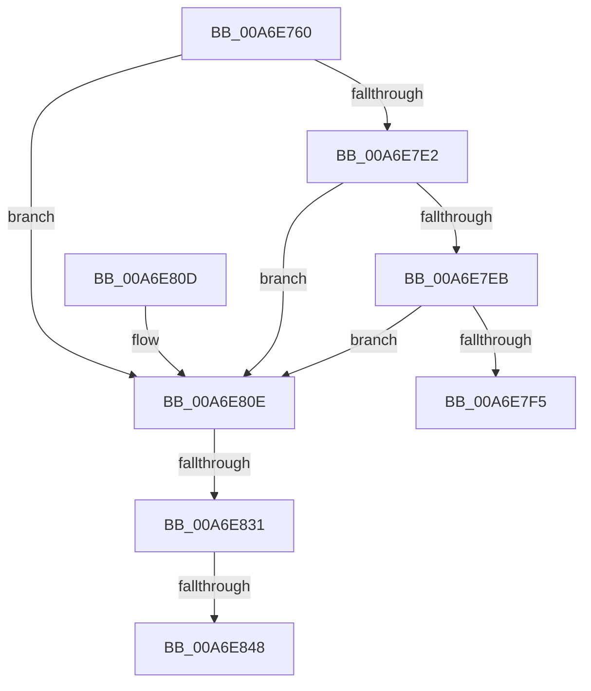

# NtSystemDebugControl

- RVA: `0x00A6E760`–`0x00A6E84D` (길이 `237` bytes)
- VA: `0x0000000140A6E760`
- 실행 섹션: `PAGE`
- PDB 이름 있음: `예`; PDB Function 태그: `예`
- unwind 정보 RVA: `0x000B4AB8`
- 디코드: `62`개 명령, `237/237` bytes 표시
- 미해석 바이트: `0` (있으면 어셈블리에 `.byte`로 보존)

> 이 문서는 커널 이미지의 기계어와 PDB 기호를 분석해 생성했습니다. 4번과 5번은 함수 원형과 자료형을 바이너리 사용 방식에서 추정한 C 해석이며 원본 소스 복구 결과는 아닙니다.

## 1. Dependencies

- 직접 호출 지점: **2**; 고유 호출 대상: **2**
- 직접 호출자로 확인된 함수: **0**
- RIP 상대 이미지 참조: **3**

### Outgoing calls
- `0x00A6E7C8` → [memset](../../text/6C/memset_function_006C6C40.md) (function, `0x006C6C40`)
- `0x00A6E83B` → [SeSinglePrivilegeCheck](../87/SeSinglePrivilegeCheck_function_00871E20.md) (function, `0x00871E20`)

### Direct callers
- 이 함수 시작 RVA로 연결되는 직접 call은 확인되지 않았습니다. 간접 호출은 완전히 역산할 수 없습니다.

### Static image references
- `0x00A6E7D9` → RVA `0x00E0AA1C` (`.data`; read)
- `0x00A6E7E2` → RVA `0x00F55C80` (`.data`; read)
- `0x00A6E834` → RVA `0x00FD9A80` (`PAGEDATA`; read)

## 2. Other-region calls and transfers

- 다른 실행 섹션으로 향하는 call: **1**
  - `0x00A6E7C8` → [memset](../../text/6C/memset_function_006C6C40.md) (`PAGE` → `.text`)
- call이 아닌 외부 분기/꼬리 이동: **3**
  - `0x00A6E82B` → [sub_00B3F842](../B3/Unknown_function_00B3F842.md) (`tail-transfer`)
  - `0x00A6E842` → [sub_00B3F842](../B3/Unknown_function_00B3F842.md) (`tail-transfer`)
  - `0x00A6E848` → [sub_00B3F842 + 0xBB](../B3/Unknown_function_00B3F842.md) (`tail-transfer`)

## 3. Assembly (complete function range)

```asm
00A6E760  4C 8B DC                        mov r11, rsp
00A6E763  4D 89 4B 20                     mov qword ptr [r11 + 0x20], r9
00A6E767  45 89 43 18                     mov dword ptr [r11 + 0x18], r8d
00A6E76B  49 89 53 10                     mov qword ptr [r11 + 0x10], rdx
00A6E76F  89 4C 24 08                     mov dword ptr [rsp + 8], ecx
00A6E773  53                              push rbx
00A6E774  56                              push rsi
00A6E775  57                              push rdi
00A6E776  41 54                           push r12
00A6E778  41 55                           push r13
00A6E77A  41 56                           push r14
00A6E77C  41 57                           push r15
00A6E77E  48 81 EC E0 00 00 00            sub rsp, 0xe0
00A6E785  4D 8B E1                        mov r12, r9
00A6E788  45 8B F8                        mov r15d, r8d
00A6E78B  4C 8B F2                        mov r14, rdx
00A6E78E  8B D9                           mov ebx, ecx
00A6E790  8B B4 24 40 01 00 00            mov esi, dword ptr [rsp + 0x140]
00A6E797  89 74 24 40                     mov dword ptr [rsp + 0x40], esi
00A6E79B  83 64 24 38 00                  and dword ptr [rsp + 0x38], 0
00A6E7A0  0F 57 C0                        xorps xmm0, xmm0
00A6E7A3  33 C0                           xor eax, eax
00A6E7A5  0F 11 44 24 58                  movups xmmword ptr [rsp + 0x58], xmm0
00A6E7AA  0F 11 44 24 68                  movups xmmword ptr [rsp + 0x68], xmm0
00A6E7AF  0F 11 44 24 78                  movups xmmword ptr [rsp + 0x78], xmm0
00A6E7B4  49 89 83 70 FF FF FF            mov qword ptr [r11 - 0x90], rax
00A6E7BB  33 D2                           xor edx, edx
00A6E7BD  44 8D 40 48                     lea r8d, [rax + 0x48]
00A6E7C1  49 8D 8B 78 FF FF FF            lea rcx, [r11 - 0x88]
00A6E7C8  E8 73 84 C5 FF                  call 0x1406c6c40
00A6E7CD  48 83 64 24 48 00               and qword ptr [rsp + 0x48], 0
00A6E7D3  48 83 64 24 50 00               and qword ptr [rsp + 0x50], 0
00A6E7D9  80 3D 3C C2 39 00 00            cmp byte ptr [rip + 0x39c23c], 0
00A6E7E0  74 2C                           je 0x140a6e80e
00A6E7E2  80 3D 97 74 4E 00 00            cmp byte ptr [rip + 0x4e7497], 0
00A6E7E9  75 23                           jne 0x140a6e80e
00A6E7EB  8D 43 E3                        lea eax, [rbx - 0x1d]
00A6E7EE  A9 F7 FF FF FF                  test eax, 0xfffffff7
00A6E7F3  74 19                           je 0x140a6e80e
00A6E7F5  B8 54 03 00 C0                  mov eax, 0xc0000354
00A6E7FA  48 81 C4 E0 00 00 00            add rsp, 0xe0
00A6E801  41 5F                           pop r15
00A6E803  41 5E                           pop r14
00A6E805  41 5D                           pop r13
00A6E807  41 5C                           pop r12
00A6E809  5F                              pop rdi
00A6E80A  5E                              pop rsi
00A6E80B  5B                              pop rbx
00A6E80C  C3                              ret
00A6E80D  CC                              int3
00A6E80E  65 48 8B 04 25 88 01 00 00      mov rax, qword ptr gs:[0x188]
00A6E817  44 8A A8 32 02 00 00            mov r13b, byte ptr [rax + 0x232]
00A6E81E  44 88 6C 24 34                  mov byte ptr [rsp + 0x34], r13b
00A6E823  44 88 6C 24 35                  mov byte ptr [rsp + 0x35], r13b
00A6E828  83 FB 26                        cmp ebx, 0x26
00A6E82B  0F 84 11 10 0D 00               je 0x140b3f842
00A6E831  41 8A D5                        mov dl, r13b
00A6E834  48 8B 0D 45 B2 56 00            mov rcx, qword ptr [rip + 0x56b245]
00A6E83B  E8 E0 35 E0 FF                  call 0x140871e20
00A6E840  84 C0                           test al, al
00A6E842  0F 85 FA 0F 0D 00               jne 0x140b3f842
00A6E848  E9 B0 10 0D 00                  jmp 0x140b3f8fd
```

## 4. C-style interpretation (structured pseudocode)

```c
__int64 __fastcall NtSystemDebugControl(int a1, __int64 a2, int a3, __int64 a4, unsigned int a5)
{
    __int64 result;
    __int64 v_rsp;
    unsigned __int64 v_stack_mA0;
    unsigned __int64 v_stack_mB0;
    unsigned __int64 v_stack_mC0;
    unsigned __int64 v_stack_mC8;
    unsigned __int64 v_stack_mD0;
    unsigned int v_stack_mD8;
    unsigned int v_stack_mE0;
    unsigned __int8 v_stack_p34;
    unsigned __int8 v_stack_p35;
    unsigned int v_stack_p8;

    *(unsigned __int64 *)(v_rsp + 32) = a4;
    *(unsigned int *)(v_rsp + 24) = a3;
    *(unsigned __int64 *)(v_rsp + 16) = a2;
    v_stack_p8 = a1;
    v_rsp = (v_rsp) - (224);
    v_stack_mD8 = (unsigned int)((unsigned int)(a5));
    result = 0;
    v_stack_mC0 = v_xmm0;
    v_stack_mB0 = v_xmm0;
    v_stack_mA0 = v_xmm0;
    *(unsigned __int64 *)(v_rsp - 144) = 0;
    a2 = 0;
    result = memset(v_rsp - 136, a2, result + 72, a4);
    if ((*(unsigned __int8 *)(v_rip + 3785276)) == 0) goto loc_00A6E80E;
    if ((*(unsigned __int8 *)(v_rip + 5141655)) != 0) goto loc_00A6E80E;
    if ((((unsigned int)((unsigned int)(a1) - 29)) & (0xFFFFFFF7ULL)) == 0) goto loc_00A6E80E;
    v_rsp = (v_rsp) + (224);
    return (unsigned int)(0xC0000354ULL);
loc_00A6E80E:
    v_stack_p34 = (unsigned __int8)(*(unsigned __int8 *)(*(unsigned __int64 *)(gs_base + (0 + 392)) + 562));
    v_stack_p35 = (unsigned __int8)(*(unsigned __int8 *)(*(unsigned __int64 *)(gs_base + (0 + 392)) + 562));
    result = SeSinglePrivilegeCheck(*(unsigned __int64 *)(v_rip + 5681733), (unsigned __int8)(*(unsigned __int8 *)(*(unsigned __int64 *)(gs_base + (0 + 392)) + 562)), result + 72, a4);
}
```

## 5. (Beta) C Style

```c
int64_t NtSystemDebugControl(void *Arg1, int64_t Arg2, int32_t Arg3, int64_t Arg4, uint32_t Arg5)
{
    uint8_t *arg1 = (uint8_t *)Arg1;

    int64_t result;
    int64_t local_rsp;
    uint64_t v_stack_mA0;
    uint64_t v_stack_mB0;
    uint64_t v_stack_mC0;
    uint64_t v_stack_mC8;
    uint64_t v_stack_mD0;
    uint32_t v_stack_mD8;
    uint32_t v_stack_mE0;
    uint8_t v_stack_p34;
    uint8_t v_stack_p35;
    uint32_t v_stack_p8;

    *(uint64_t *)(local_rsp + 0x20) = Arg4;
    *(uint32_t *)(local_rsp + 0x18) = Arg3;
    *(uint64_t *)(local_rsp + 0x10) = Arg2;
    v_stack_p8 = Arg1;
    local_rsp = (local_rsp) - (224);
    v_stack_mD8 = (uint32_t)((uint32_t)(Arg5));
    result = 0;
    v_stack_mC0 = v_xmm0;
    v_stack_mB0 = v_xmm0;
    v_stack_mA0 = v_xmm0;
    *(uint64_t *)(local_rsp - 0x90) = 0;
    Arg2 = 0;
    result = memset(local_rsp - 136, Arg2, result + 72, Arg4);
    if ((*(uint8_t *)(v_rip + 0x39C23C)) == 0) goto loc_00A6E80E;
    if ((*(uint8_t *)(v_rip + 0x4E7497)) != 0) goto loc_00A6E80E;
    if ((((uint32_t)((uint32_t)(Arg1) - 29)) & (0xFFFFFFF7ULL)) == 0) goto loc_00A6E80E;
    local_rsp = (local_rsp) + (224);
    return (uint32_t)(0xC0000354ULL);
loc_00A6E80E:
    v_stack_p34 = (uint8_t)(*(uint8_t *)(*(uint64_t *)(gs_base + (0 + 0x188)) + 0x232));
    v_stack_p35 = (uint8_t)(*(uint8_t *)(*(uint64_t *)(gs_base + (0 + 0x188)) + 0x232));
    result = SeSinglePrivilegeCheck(*(uint64_t *)(v_rip + 0x56B245), (uint8_t)(*(uint8_t *)(*(uint64_t *)(gs_base + (0 + 0x188)) + 0x232)), result + 72, Arg4);
}
```

### 관측된 메모리 오프셋

구조체 형식이 확인되지 않은 접근은 인자 기준의 오프셋으로만 기록했습니다.

| 기준 인자 | 오프셋 표현 | 폭 (bit) | 접근 |
|---|---:|---:|---|
| `Arg1` | `- 0x1D` | `32` | `R` |

## 6. Execution-region graph

[열기: 2D/3D 그래프와 함수 탐색 컨트롤 패널](../../../control-panel.html?section=page&rva=0x00A6E760&view=graph)

- 2D 그래프는 위에서 아래로 흐르고, 3D 그래프는 빈 공간을 드래그해 회전합니다. Shift+드래그는 이동, 휠은 확대·축소, 함수 노드 선택은 대상 보고서 이동입니다.

### Static fallback


