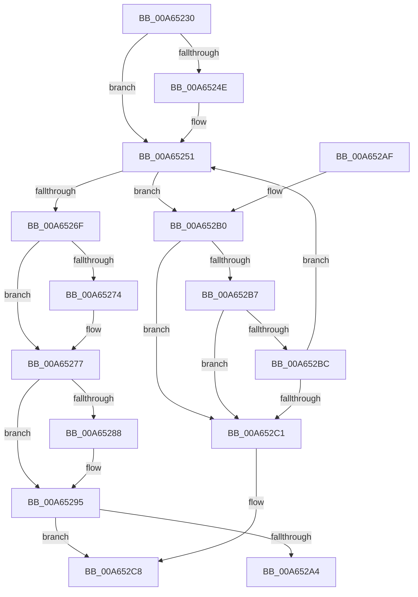

# PdcAcquireRwLockExclusive2

- RVA: `0x00A65230`–`0x00A652CF` (길이 `159` bytes)
- VA: `0x0000000140A65230`
- 실행 섹션: `PAGE`
- PDB 이름 있음: `예`; PDB Function 태그: `아니요`
- unwind 정보 RVA: `0x000B3874`
- 디코드: `46`개 명령, `159/159` bytes 표시
- 미해석 바이트: `0` (있으면 어셈블리에 `.byte`로 보존)

> 이 문서는 커널 이미지의 기계어와 PDB 기호를 분석해 생성했습니다. 4번과 5번은 함수 원형과 자료형을 바이너리 사용 방식에서 추정한 C 해석이며 원본 소스 복구 결과는 아닙니다.

## 1. Dependencies

- 직접 호출 지점: **1**; 고유 호출 대상: **1**
- 직접 호출자로 확인된 함수: **4**
- RIP 상대 이미지 참조: **0**

### Outgoing calls
- `0x00A65266` → [KeWaitForSingleObject](../../text/20/KeWaitForSingleObject_function_0020E6B0.md) (function, `0x0020E6B0`)

### Direct callers
- [Pdcv2ActivationClientRegister](../79/Pdcv2ActivationClientRegister_function_0079AF28.md) at `0x0079AFCD`
- [Pdcv2ActivationClientRenewActivation](../79/Pdcv2ActivationClientRenewActivation_function_0079B0F0.md) at `0x0079B1BD`
- [Pdcv2pActivationClientCallback](../79/Pdcv2pActivationClientCallback_function_0079B2C0.md) at `0x0079B33B`
- [Pdcv2pActivationClientCallback](../79/Pdcv2pActivationClientCallback_function_0079B2C0.md) at `0x0079B43E`
- [sub_00B2698A](../B2/Unknown_function_00B2698A.md) at `0x00B269AC`

### Static image references
- 디코드된 RIP-relative 메모리 참조가 없습니다.

## 2. Other-region calls and transfers

- 다른 실행 섹션으로 향하는 call: **1**
  - `0x00A65266` → [KeWaitForSingleObject](../../text/20/KeWaitForSingleObject_function_0020E6B0.md) (`PAGE` → `.text`)
- 별도 외부 분기/꼬리 이동을 확인하지 못했습니다.

## 3. Assembly (complete function range)

```asm
00A65230  48 89 5C 24 10                  mov qword ptr [rsp + 0x10], rbx
00A65235  57                              push rdi
00A65236  48 83 EC 30                     sub rsp, 0x30
00A6523A  48 C7 44 24 40 00 BA 3C DC      mov qword ptr [rsp + 0x40], 0xffffffffdc3cba00
00A65243  48 8B FA                        mov rdi, rdx
00A65246  48 8B D9                        mov rbx, rcx
00A65249  48 85 D2                        test rdx, rdx
00A6524C  74 03                           je 0x140a65251
00A6524E  C6 02 00                        mov byte ptr [rdx], 0
00A65251  48 8B 0B                        mov rcx, qword ptr [rbx]
00A65254  48 8D 44 24 40                  lea rax, [rsp + 0x40]
00A65259  45 33 C9                        xor r9d, r9d
00A6525C  48 89 44 24 20                  mov qword ptr [rsp + 0x20], rax
00A65261  45 33 C0                        xor r8d, r8d
00A65264  33 D2                           xor edx, edx
00A65266  E8 45 94 7A FF                  call 0x14020e6b0
00A6526B  85 C0                           test eax, eax
00A6526D  75 41                           jne 0x140a652b0
00A6526F  48 85 FF                        test rdi, rdi
00A65272  74 03                           je 0x140a65277
00A65274  C6 07 01                        mov byte ptr [rdi], 1
00A65277  B8 01 00 00 00                  mov eax, 1
00A6527C  F0 0F C1 43 10                  lock xadd dword ptr [rbx + 0x10], eax
00A65281  FF C0                           inc eax
00A65283  83 F8 01                        cmp eax, 1
00A65286  75 0D                           jne 0x140a65295
00A65288  65 48 8B 04 25 88 01 00 00      mov rax, qword ptr gs:[0x188]
00A65291  48 89 43 08                     mov qword ptr [rbx + 8], rax
00A65295  65 48 8B 04 25 88 01 00 00      mov rax, qword ptr gs:[0x188]
00A6529E  48 39 43 08                     cmp qword ptr [rbx + 8], rax
00A652A2  75 24                           jne 0x140a652c8
00A652A4  48 8B 5C 24 48                  mov rbx, qword ptr [rsp + 0x48]
00A652A9  48 83 C4 30                     add rsp, 0x30
00A652AD  5F                              pop rdi
00A652AE  C3                              ret
00A652AF  CC                              int3
00A652B0  2D C0 00 00 00                  sub eax, 0xc0
00A652B5  74 0A                           je 0x140a652c1
00A652B7  83 E8 41                        sub eax, 0x41
00A652BA  74 05                           je 0x140a652c1
00A652BC  83 F8 01                        cmp eax, 1
00A652BF  74 90                           je 0x140a65251
00A652C1  B9 05 00 00 00                  mov ecx, 5
00A652C6  CD 29                           int 0x29
00A652C8  B9 28 00 00 00                  mov ecx, 0x28
00A652CD  CD 29                           int 0x29
```

## 4. C-style interpretation (structured pseudocode)

```c
__int64 __fastcall PdcAcquireRwLockExclusive2(__int64 a1, __int64 a2, int a3, int a4)
{
    __int64 result;
    __int64 v_rsp;
    unsigned __int64 v_stack_m18;
    unsigned __int64 v_stack_p10;
    unsigned __int64 v_stack_p8;

    v_stack_p10 = v_rbx;
    v_rsp = (v_rsp) - (48);
    v_stack_p8 = 0xFFFFFFFFDC3CBA00ULL;
    if (a2 != 0) {
        *(unsigned __int8 *)(a2) = 0;
    }
    a4 = 0;
    v_stack_m18 = v_stack_p8;
    a3 = 0;
    a2 = 0;
    result = KeWaitForSingleObject(*(unsigned __int64 *)(a1), a2, a3, a4);
    if ((unsigned int)(result) != 0) goto loc_00A652B0;
    if (0 != 0) {
        *(unsigned __int8 *)(a2) = 1;
    }
    result = (unsigned int)((1) + 1);
    if (((unsigned int)(result)) == 1) {
        result = *(unsigned __int64 *)(gs_base + (0 + 392));
        *(unsigned __int64 *)(a1 + 8) = result;
    }
    if ((*(unsigned __int64 *)(a1 + 8)) != (*(unsigned __int64 *)(gs_base + (0 + 392)))) goto loc_00A652C8;
    v_rsp = (v_rsp) + (48);
    return *(unsigned __int64 *)(gs_base + (0 + 392));
loc_00A652B0:
    result = (unsigned int)((*(unsigned __int64 *)(gs_base + (0 + 392))) - (192));
    if (condition_is_equal) goto loc_00A652C1;
    result = (unsigned int)((result) - (65));
    if (condition_is_equal) goto loc_00A652C1;
    if (((unsigned int)(result)) == 1) goto loc_00A65251;
loc_00A652C1:
loc_00A652C8:
    return result;
}
```

## 5. (Beta) C Style

```c
int64_t PdcAcquireRwLockExclusive2(void *Arg1, int64_t Arg2, int32_t Arg3, int32_t Arg4)
{
    uint8_t *arg1 = (uint8_t *)Arg1;

    int64_t result;
    int64_t local_rsp;
    uint64_t v_stack_m18;
    uint64_t v_stack_p10;
    uint64_t v_stack_p8;

    v_stack_p10 = local_rbx;
    local_rsp = (local_rsp) - (48);
    v_stack_p8 = 0xFFFFFFFFDC3CBA00ULL;
    if (Arg2 != 0) {
        *(uint8_t *)(Arg2) = 0;
    }
    Arg4 = 0;
    v_stack_m18 = v_stack_p8;
    Arg3 = 0;
    Arg2 = 0;
    result = KeWaitForSingleObject(*(uint64_t *)(arg1), Arg2, Arg3, Arg4);
    if ((uint32_t)(result) != 0) goto loc_00A652B0;
    if (0 != 0) {
        *(uint8_t *)(Arg2) = 1;
    }
    result = (uint32_t)((1) + 1);
    if (((uint32_t)(result)) == 1) {
        result = *(uint64_t *)(gs_base + (0 + 0x188));
        *(uint64_t *)(arg1 + 0x8) = result;
    }
    if ((*(uint64_t *)(arg1 + 0x8)) != (*(uint64_t *)(gs_base + (0 + 0x188)))) goto loc_00A652C8;
    local_rsp = (local_rsp) + (48);
    return *(uint64_t *)(gs_base + (0 + 0x188));
loc_00A652B0:
    result = (uint32_t)((*(uint64_t *)(gs_base + (0 + 0x188))) - (192));
    if (condition_is_equal) goto loc_00A652C1;
    result = (uint32_t)((result) - (65));
    if (condition_is_equal) goto loc_00A652C1;
    if (((uint32_t)(result)) == 1) goto loc_00A65251;
loc_00A652C1:
loc_00A652C8:
    return result;
}
```

### 관측된 메모리 오프셋

구조체 형식이 확인되지 않은 접근은 인자 기준의 오프셋으로만 기록했습니다.

| 기준 인자 | 오프셋 표현 | 폭 (bit) | 접근 |
|---|---:|---:|---|
| `Arg1` | `+ 0x0` | `64` | `R` |
| `Arg1` | `+ 0x8` | `64` | `R` |
| `Arg1` | `+ 0x8` | `64` | `W` |
| `Arg1` | `+ 0x10` | `32` | `R/W` |

## 6. Execution-region graph

[열기: 2D/3D 그래프와 함수 탐색 컨트롤 패널](../../../control-panel.html?section=page&rva=0x00A65230&view=graph)

- 2D 그래프는 위에서 아래로 흐르고, 3D 그래프는 빈 공간을 드래그해 회전합니다. Shift+드래그는 이동, 휠은 확대·축소, 함수 노드 선택은 대상 보고서 이동입니다.

### Static fallback


