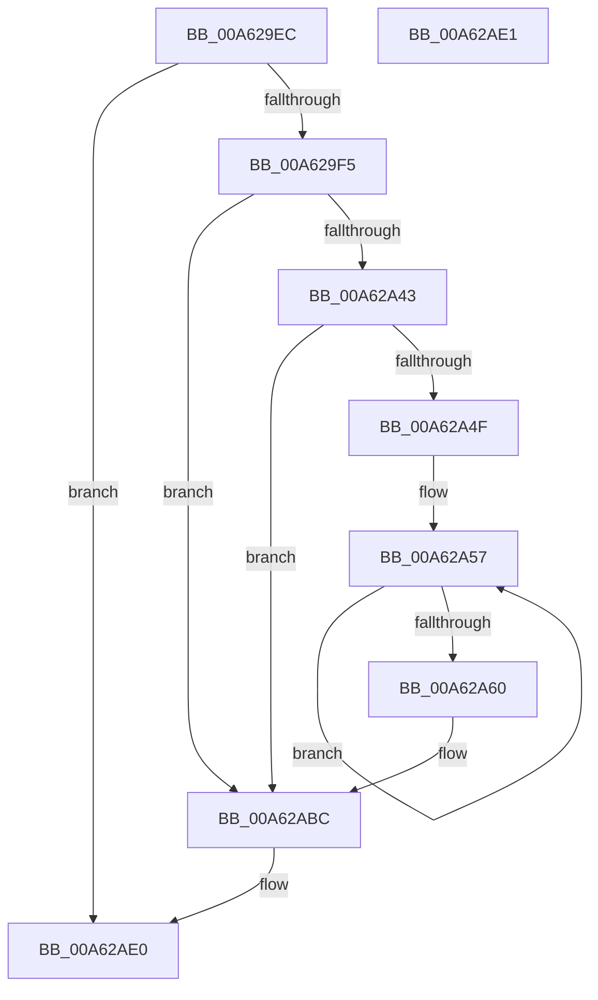

# PfSnLogOpenVolumesForPrefetch

- RVA: `0x00A629EC`–`0x00A62AE2` (길이 `246` bytes)
- VA: `0x0000000140A629EC`
- 실행 섹션: `PAGE`
- PDB 이름 있음: `예`; PDB Function 태그: `아니요`
- unwind 정보 RVA: `0x000B3428`
- 디코드: `63`개 명령, `246/246` bytes 표시
- 미해석 바이트: `0` (있으면 어셈블리에 `.byte`로 보존)

> 이 문서는 커널 이미지의 기계어와 PDB 기호를 분석해 생성했습니다. 4번과 5번은 함수 원형과 자료형을 바이너리 사용 방식에서 추정한 C 해석이며 원본 소스 복구 결과는 아닙니다.

## 1. Dependencies

- 직접 호출 지점: **3**; 고유 호출 대상: **3**
- 직접 호출자로 확인된 함수: **1**
- RIP 상대 이미지 참조: **4**

### Outgoing calls
- `0x00A62A46` → [EtwEventEnabled](../../text/39/EtwEventEnabled_function_00392450.md) (function, `0x00392450`)
- `0x00A62AB7` → [EtwWrite](../../text/41/EtwWrite_function_0041C720.md) (function, `0x0041C720`)
- `0x00A62AC3` → [_security_check_cookie](../../text/6A/_security_check_cookie_function_006AC640.md) (function, `0x006AC640`)

### Direct callers
- [PfSnOpenVolumesForPrefetch](../8A/PfSnOpenVolumesForPrefetch_function_008AA4AC.md) at `0x008AA53D`
- [PfSnOpenVolumesForPrefetch](../8A/PfSnOpenVolumesForPrefetch_function_008AA4AC.md) at `0x008AA914`

### Static image references
- `0x00A62A10` → RVA `0x00E0A740` (`.data`; read)
- `0x00A62A20` → RVA `0x0001A840` (`.rdata`; read)
- `0x00A62A29` → RVA `0x0001A830` (`.rdata`; read)
- `0x00A62A33` → RVA `0x00E67358` (`.data`; read)

## 2. Other-region calls and transfers

- 다른 실행 섹션으로 향하는 call: **3**
  - `0x00A62A46` → [EtwEventEnabled](../../text/39/EtwEventEnabled_function_00392450.md) (`PAGE` → `.text`)
  - `0x00A62AB7` → [EtwWrite](../../text/41/EtwWrite_function_0041C720.md) (`PAGE` → `.text`)
  - `0x00A62AC3` → [_security_check_cookie](../../text/6A/_security_check_cookie_function_006AC640.md) (`PAGE` → `.text`)
- 별도 외부 분기/꼬리 이동을 확인하지 못했습니다.

## 3. Assembly (complete function range)

```asm
00A629EC  48 85 C9                        test rcx, rcx
00A629EF  0F 84 EB 00 00 00               je 0x140a62ae0
00A629F5  48 8B C4                        mov rax, rsp
00A629F8  48 89 58 08                     mov qword ptr [rax + 8], rbx
00A629FC  48 89 70 10                     mov qword ptr [rax + 0x10], rsi
00A62A00  48 89 78 18                     mov qword ptr [rax + 0x18], rdi
00A62A04  55                              push rbp
00A62A05  48 8D 68 A1                     lea rbp, [rax - 0x5f]
00A62A09  48 81 EC 90 00 00 00            sub rsp, 0x90
00A62A10  48 8B 05 29 7D 3A 00            mov rax, qword ptr [rip + 0x3a7d29]
00A62A17  48 33 C4                        xor rax, rsp
00A62A1A  48 89 45 47                     mov qword ptr [rbp + 0x47], rax
00A62A1E  33 F6                           xor esi, esi
00A62A20  48 8D 05 19 7E 5B FF            lea rax, [rip - 0xa481e7]
00A62A27  84 D2                           test dl, dl
00A62A29  48 8D 1D 00 7E 5B FF            lea rbx, [rip - 0xa48200]
00A62A30  48 8B F9                        mov rdi, rcx
00A62A33  48 8B 0D 1E 49 40 00            mov rcx, qword ptr [rip + 0x40491e]
00A62A3A  48 0F 44 D8                     cmove rbx, rax
00A62A3E  48 85 C9                        test rcx, rcx
00A62A41  74 79                           je 0x140a62abc
00A62A43  48 8B D3                        mov rdx, rbx
00A62A46  E8 05 FA 92 FF                  call 0x140392450
00A62A4B  84 C0                           test al, al
00A62A4D  74 6D                           je 0x140a62abc
00A62A4F  48 8D 4F 10                     lea rcx, [rdi + 0x10]
00A62A53  48 83 C8 FF                     or rax, 0xffffffffffffffff
00A62A57  48 FF C0                        inc rax
00A62A5A  66 39 34 41                     cmp word ptr [rcx + rax*2], si
00A62A5E  75 F7                           jne 0x140a62a57
00A62A60  66 89 45 F7                     mov word ptr [rbp - 9], ax
00A62A64  48 8D 55 F7                     lea rdx, [rbp - 9]
00A62A68  0F B7 C0                        movzx eax, ax
00A62A6B  41 B9 04 00 00 00               mov r9d, 4
00A62A71  03 C0                           add eax, eax
00A62A73  48 89 55 07                     mov qword ptr [rbp + 7], rdx
00A62A77  89 45 1F                        mov dword ptr [rbp + 0x1f], eax
00A62A7A  45 33 C0                        xor r8d, r8d
00A62A7D  48 8D 41 3C                     lea rax, [rcx + 0x3c]
00A62A81  48 89 4D 17                     mov qword ptr [rbp + 0x17], rcx
00A62A85  48 8B 0D CC 48 40 00            mov rcx, qword ptr [rip + 0x4048cc]
00A62A8C  48 8B D3                        mov rdx, rbx
00A62A8F  48 89 45 27                     mov qword ptr [rbp + 0x27], rax
00A62A93  48 8D 47 50                     lea rax, [rdi + 0x50]
00A62A97  48 89 45 37                     mov qword ptr [rbp + 0x37], rax
00A62A9B  48 8D 45 07                     lea rax, [rbp + 7]
00A62A9F  48 89 44 24 20                  mov qword ptr [rsp + 0x20], rax
00A62AA4  48 C7 45 0F 02 00 00 00         mov qword ptr [rbp + 0xf], 2
00A62AAC  89 75 23                        mov dword ptr [rbp + 0x23], esi
00A62AAF  4C 89 4D 2F                     mov qword ptr [rbp + 0x2f], r9
00A62AB3  4C 89 4D 3F                     mov qword ptr [rbp + 0x3f], r9
00A62AB7  E8 64 9C 9B FF                  call 0x14041c720
00A62ABC  48 8B 4D 47                     mov rcx, qword ptr [rbp + 0x47]
00A62AC0  48 33 CC                        xor rcx, rsp
00A62AC3  E8 78 9B C4 FF                  call 0x1406ac640
00A62AC8  4C 8D 9C 24 90 00 00 00         lea r11, [rsp + 0x90]
00A62AD0  49 8B 5B 10                     mov rbx, qword ptr [r11 + 0x10]
00A62AD4  49 8B 73 18                     mov rsi, qword ptr [r11 + 0x18]
00A62AD8  49 8B 7B 20                     mov rdi, qword ptr [r11 + 0x20]
00A62ADC  49 8B E3                        mov rsp, r11
00A62ADF  5D                              pop rbp
00A62AE0  C3                              ret
00A62AE1  CC                              int3
```

## 4. C-style interpretation (structured pseudocode)

```c
__int64 __fastcall PfSnLogOpenVolumesForPrefetch(__int64 a1, unsigned __int8 a2, int a3)
{
    __int64 result;
    __int64 v_rbx;
    __int64 v_rsi;
    __int64 v_rsp;
    unsigned __int64 v_stack_m78;
    unsigned __int64 v_stack_m8;

    if (a1 == 0) goto loc_00A62AE0;
    *(unsigned __int64 *)(v_rsp + 8) = v_rbx;
    *(unsigned __int64 *)(v_rsp + 16) = v_rsi;
    *(unsigned __int64 *)(v_rsp + 24) = v_rdi;
    v_rsp = (v_rsp) - (144);
    result = (*(unsigned __int64 *)(v_rip + 3833129)) ^ (v_rsp);
    *(unsigned __int64 *)(v_rsp - 95 + 71) = result;
    v_rsi = 0;
    v_rbx = v_rip - 10781184;
    if (a2 == 0) { v_rbx = v_rip - 10781159; }
    if (*(unsigned __int64 *)(v_rip + 4213022) == 0) goto loc_00A62ABC;
    result = EtwEventEnabled(*(unsigned __int64 *)(v_rip + 4213022), v_rbx, a3, a4);
    if ((unsigned __int8)(result) == 0) goto loc_00A62ABC;
    result = (result) | (-1);
loc_00A62A57:
    result = (result) + 1;
    if ((*(unsigned __int16 *)(a1 + 16 + result * 2)) != 0) goto loc_00A62A57;
    *(unsigned __int16 *)(v_rsp - 95 - 9) = (unsigned __int16)(result);
    result = (unsigned int)(((unsigned __int16)(result)) + ((unsigned int)((unsigned __int16)(result))));
    *(unsigned __int64 *)(v_rsp - 95 + 7) = v_rsp - 95 - 9;
    *(unsigned int *)(v_rsp - 95 + 31) = (unsigned int)(result);
    a3 = 0;
    *(unsigned __int64 *)(v_rsp - 95 + 23) = a1 + 16;
    *(unsigned __int64 *)(v_rsp - 95 + 39) = a1 + 16 + 60;
    *(unsigned __int64 *)(v_rsp - 95 + 55) = a1 + 80;
    v_stack_m78 = v_rsp - 95 + 7;
    *(unsigned __int64 *)(v_rsp - 95 + 15) = 2;
    *(unsigned int *)(v_rsp - 95 + 35) = 0;
    *(unsigned __int64 *)(v_rsp - 95 + 47) = 4;
    *(unsigned __int64 *)(v_rsp - 95 + 63) = 4;
    result = EtwWrite(*(unsigned __int64 *)(v_rip + 4212940), v_rbx, a3, 4);
loc_00A62ABC:
    a1 = (*(unsigned __int64 *)(v_rsp - 95 + 71)) ^ (v_rsp);
    result = _security_check_cookie(a1, v_rbx, a3, 4);
loc_00A62AE0:
    return result;
}
```

## 5. (Beta) C Style

```c
int64_t PfSnLogOpenVolumesForPrefetch(int64_t Arg1, uint8_t Arg2, int32_t Arg3)
{
    int64_t result;
    int64_t local_rbx;
    int64_t local_rsi;
    int64_t local_rsp;
    uint64_t v_stack_m78;
    uint64_t v_stack_m8;

    if (Arg1 == 0) goto loc_00A62AE0;
    *(uint64_t *)(local_rsp + 0x8) = local_rbx;
    *(uint64_t *)(local_rsp + 0x10) = local_rsi;
    *(uint64_t *)(local_rsp + 0x18) = local_rdi;
    local_rsp = (local_rsp) - (144);
    result = (*(uint64_t *)(v_rip + 0x3A7D29)) ^ (local_rsp);
    *(uint64_t *)(local_rsp - 0x5F + 0x47) = result;
    local_rsi = 0;
    local_rbx = v_rip - 10781184;
    if (Arg2 == 0) { local_rbx = v_rip - 10781159; }
    if (*(uint64_t *)(v_rip + 0x40491E) == 0) goto loc_00A62ABC;
    result = EtwEventEnabled(*(uint64_t *)(v_rip + 0x40491E), local_rbx, Arg3, a4);
    if ((uint8_t)(result) == 0) goto loc_00A62ABC;
    result = (result) | (-1);
loc_00A62A57:
    result = (result) + 1;
    if ((*(uint16_t *)(Arg1 + 0x10 + result * 2)) != 0) goto loc_00A62A57;
    *(uint16_t *)(local_rsp - 0x5F - 0x9) = (uint16_t)(result);
    result = (uint32_t)(((uint16_t)(result)) + ((uint32_t)((uint16_t)(result))));
    *(uint64_t *)(local_rsp - 0x5F + 0x7) = local_rsp - 95 - 9;
    *(uint32_t *)(local_rsp - 0x5F + 0x1F) = (uint32_t)(result);
    Arg3 = 0;
    *(uint64_t *)(local_rsp - 0x5F + 0x17) = Arg1 + 16;
    *(uint64_t *)(local_rsp - 0x5F + 0x27) = Arg1 + 16 + 60;
    *(uint64_t *)(local_rsp - 0x5F + 0x37) = Arg1 + 80;
    v_stack_m78 = local_rsp - 95 + 7;
    *(uint64_t *)(local_rsp - 0x5F + 0xF) = 2;
    *(uint32_t *)(local_rsp - 0x5F + 0x23) = 0;
    *(uint64_t *)(local_rsp - 0x5F + 0x2F) = 4;
    *(uint64_t *)(local_rsp - 0x5F + 0x3F) = 4;
    result = EtwWrite(*(uint64_t *)(v_rip + 0x4048CC), local_rbx, Arg3, 4);
loc_00A62ABC:
    Arg1 = (*(uint64_t *)(local_rsp - 0x5F + 0x47)) ^ (local_rsp);
    result = _security_check_cookie(Arg1, local_rbx, Arg3, 4);
loc_00A62AE0:
    return result;
}
```

## 6. Execution-region graph

[열기: 2D/3D 그래프와 함수 탐색 컨트롤 패널](../../../control-panel.html?section=page&rva=0x00A629EC&view=graph)

- 2D 그래프는 위에서 아래로 흐르고, 3D 그래프는 빈 공간을 드래그해 회전합니다. Shift+드래그는 이동, 휠은 확대·축소, 함수 노드 선택은 대상 보고서 이동입니다.

### Static fallback


