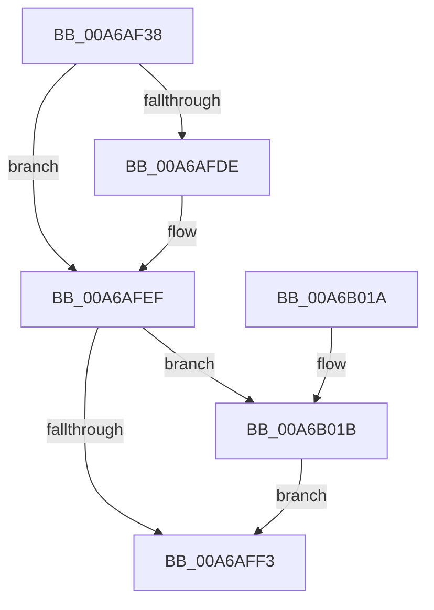

# PfSnVolumeCheckIsSdBus

- RVA: `0x00A6AF38`–`0x00A6B029` (길이 `241` bytes)
- VA: `0x0000000140A6AF38`
- 실행 섹션: `PAGE`
- PDB 이름 있음: `예`; PDB Function 태그: `아니요`
- unwind 정보 RVA: `0x000B428C`
- 디코드: `58`개 명령, `241/241` bytes 표시
- 미해석 바이트: `0` (있으면 어셈블리에 `.byte`로 보존)

> 이 문서는 커널 이미지의 기계어와 PDB 기호를 분석해 생성했습니다. 4번과 5번은 함수 원형과 자료형을 바이너리 사용 방식에서 추정한 C 해석이며 원본 소스 복구 결과는 아닙니다.

## 1. Dependencies

- 직접 호출 지점: **4**; 고유 호출 대상: **4**
- 직접 호출자로 확인된 함수: **1**
- RIP 상대 이미지 참조: **1**

### Outgoing calls
- `0x00A6AF8B` → [ZwResetEvent](../../text/6B/ZwResetEvent_function_006B01D0.md) (function, `0x006B01D0`)
- `0x00A6AFD2` → [ZwDeviceIoControlFile](../../text/6A/ZwDeviceIoControlFile_function_006AD1B0.md) (function, `0x006AD1B0`)
- `0x00A6AFE6` → [ZwWaitForSingleObject](../../text/6A/ZwWaitForSingleObject_function_006AD150.md) (function, `0x006AD150`)
- `0x00A6B000` → [_security_check_cookie](../../text/6A/_security_check_cookie_function_006AC640.md) (function, `0x006AC640`)

### Direct callers
- [PfSnOpenVolumesForPrefetch](../8A/PfSnOpenVolumesForPrefetch_function_008AA4AC.md) at `0x008AA850`

### Static image references
- `0x00A6AF4B` → RVA `0x00E0A740` (`.data`; read)

## 2. Other-region calls and transfers

- 다른 실행 섹션으로 향하는 call: **4**
  - `0x00A6AF8B` → [ZwResetEvent](../../text/6B/ZwResetEvent_function_006B01D0.md) (`PAGE` → `.text`)
  - `0x00A6AFD2` → [ZwDeviceIoControlFile](../../text/6A/ZwDeviceIoControlFile_function_006AD1B0.md) (`PAGE` → `.text`)
  - `0x00A6AFE6` → [ZwWaitForSingleObject](../../text/6A/ZwWaitForSingleObject_function_006AD150.md) (`PAGE` → `.text`)
  - `0x00A6B000` → [_security_check_cookie](../../text/6A/_security_check_cookie_function_006AC640.md) (`PAGE` → `.text`)
- 별도 외부 분기/꼬리 이동을 확인하지 못했습니다.

## 3. Assembly (complete function range)

```asm
00A6AF38  4C 8B DC                        mov r11, rsp
00A6AF3B  49 89 5B 18                     mov qword ptr [r11 + 0x18], rbx
00A6AF3F  49 89 73 20                     mov qword ptr [r11 + 0x20], rsi
00A6AF43  57                              push rdi
00A6AF44  48 81 EC A0 00 00 00            sub rsp, 0xa0
00A6AF4B  48 8B 05 EE F7 39 00            mov rax, qword ptr [rip + 0x39f7ee]
00A6AF52  48 33 C4                        xor rax, rsp
00A6AF55  48 89 84 24 90 00 00 00         mov qword ptr [rsp + 0x90], rax
00A6AF5D  48 8B F2                        mov rsi, rdx
00A6AF60  0F 57 C9                        xorps xmm1, xmm1
00A6AF63  48 8B D9                        mov rbx, rcx
00A6AF66  0F 57 C0                        xorps xmm0, xmm0
00A6AF69  0F 11 4C 24 70                  movups xmmword ptr [rsp + 0x70], xmm1
00A6AF6E  33 FF                           xor edi, edi
00A6AF70  48 8B CE                        mov rcx, rsi
00A6AF73  49 89 7B BC                     mov qword ptr [r11 - 0x44], rdi
00A6AF77  33 D2                           xor edx, edx
00A6AF79  41 0F 11 4B D8                  movups xmmword ptr [r11 - 0x28], xmm1
00A6AF7E  C7 44 24 60 01 00 00 00         mov dword ptr [rsp + 0x60], 1
00A6AF86  0F 11 44 24 50                  movups xmmword ptr [rsp + 0x50], xmm0
00A6AF8B  E8 40 52 C4 FF                  call 0x1406b01d0
00A6AF90  48 8B 0B                        mov rcx, qword ptr [rbx]
00A6AF93  48 8D 44 24 70                  lea rax, [rsp + 0x70]
00A6AF98  C7 44 24 48 20 00 00 00         mov dword ptr [rsp + 0x48], 0x20
00A6AFA0  45 33 C9                        xor r9d, r9d
00A6AFA3  48 89 44 24 40                  mov qword ptr [rsp + 0x40], rax
00A6AFA8  45 33 C0                        xor r8d, r8d
00A6AFAB  C7 44 24 38 0C 00 00 00         mov dword ptr [rsp + 0x38], 0xc
00A6AFB3  48 8D 44 24 60                  lea rax, [rsp + 0x60]
00A6AFB8  48 89 44 24 30                  mov qword ptr [rsp + 0x30], rax
00A6AFBD  48 8B D6                        mov rdx, rsi
00A6AFC0  48 8D 44 24 50                  lea rax, [rsp + 0x50]
00A6AFC5  C7 44 24 28 00 14 2D 00         mov dword ptr [rsp + 0x28], 0x2d1400
00A6AFCD  48 89 44 24 20                  mov qword ptr [rsp + 0x20], rax
00A6AFD2  E8 D9 21 C4 FF                  call 0x1406ad1b0
00A6AFD7  3D 03 01 00 00                  cmp eax, 0x103
00A6AFDC  75 11                           jne 0x140a6afef
00A6AFDE  45 33 C0                        xor r8d, r8d
00A6AFE1  33 D2                           xor edx, edx
00A6AFE3  48 8B CE                        mov rcx, rsi
00A6AFE6  E8 65 21 C4 FF                  call 0x1406ad150
00A6AFEB  8B 44 24 50                     mov eax, dword ptr [rsp + 0x50]
00A6AFEF  85 C0                           test eax, eax
00A6AFF1  79 28                           jns 0x140a6b01b
00A6AFF3  8B C7                           mov eax, edi
00A6AFF5  48 8B 8C 24 90 00 00 00         mov rcx, qword ptr [rsp + 0x90]
00A6AFFD  48 33 CC                        xor rcx, rsp
00A6B000  E8 3B 16 C4 FF                  call 0x1406ac640
00A6B005  4C 8D 9C 24 A0 00 00 00         lea r11, [rsp + 0xa0]
00A6B00D  49 8B 5B 20                     mov rbx, qword ptr [r11 + 0x20]
00A6B011  49 8B 73 28                     mov rsi, qword ptr [r11 + 0x28]
00A6B015  49 8B E3                        mov rsp, r11
00A6B018  5F                              pop rdi
00A6B019  C3                              ret
00A6B01A  CC                              int3
00A6B01B  80 BC 24 88 00 00 00 0C         cmp byte ptr [rsp + 0x88], 0xc
00A6B023  40 0F 94 C7                     sete dil
00A6B027  EB CA                           jmp 0x140a6aff3
```

## 4. C-style interpretation (structured pseudocode)

```c
__int64 __fastcall PfSnVolumeCheckIsSdBus(__int64 a1, __int64 a2, int a3, int a4)
{
    __int64 result;
    __int64 v_rdi;
    __int64 v_rsp;
    unsigned __int64 v_stack_m18;
    unsigned __int64 v_stack_m38;
    unsigned int v_stack_m48;
    unsigned __int64 v_stack_m58;
    unsigned int v_stack_m60;
    unsigned __int64 v_stack_m68;
    unsigned int v_stack_m70;
    unsigned __int64 v_stack_m78;
    unsigned __int64 v_stack_m8;
    unsigned int v_stack_m80;
    unsigned __int64 v_stack_m88;

    *(unsigned __int64 *)(v_rsp + 24) = v_rbx;
    *(unsigned __int64 *)(v_rsp + 32) = v_rsi;
    v_rsp = (v_rsp) - (160);
    result = (*(unsigned __int64 *)(v_rip + 3799022)) ^ (v_rsp);
    v_stack_m18 = result;
    v_stack_m38 = v_xmm1;
    v_rdi = 0;
    *(unsigned __int64 *)(v_rsp - 68) = 0;
    a2 = 0;
    *(unsigned __int64 *)(v_rsp - 40) = v_xmm1;
    v_stack_m48 = 1;
    v_stack_m58 = v_xmm0;
    result = ZwResetEvent(a2, a2, a3, a4);
    v_stack_m60 = 32;
    a4 = 0;
    v_stack_m68 = v_stack_m38;
    a3 = 0;
    v_stack_m70 = 12;
    v_stack_m78 = v_stack_m48;
    v_stack_m80 = 0x2D1400ULL;
    v_stack_m88 = v_stack_m58;
    result = ZwDeviceIoControlFile(*(unsigned __int64 *)(a1), 0, a3, a4);
    if (((unsigned int)(result)) == 259) {
        a3 = 0;
        a2 = 0;
        a1 = 0;
        result = ZwWaitForSingleObject(a1, a2, a3, a4);
        result = v_stack_m58;
    }
    if (!sign_flag) goto loc_00A6B01B;
loc_00A6AFF3:
    a1 = (v_stack_m18) ^ (v_rsp);
    result = _security_check_cookie(a1, a2, a3, a4);
    return result;
loc_00A6B01B:
    v_rdi = (v_stack_m18 == 12) ? 1 : 0;
    goto loc_00A6AFF3;
}
```

## 5. (Beta) C Style

```c
int64_t PfSnVolumeCheckIsSdBus(void *Arg1, int64_t Arg2, int32_t Arg3, int32_t Arg4)
{
    uint8_t *arg1 = (uint8_t *)Arg1;

    int64_t result;
    int64_t local_rdi;
    int64_t local_rsp;
    uint64_t v_stack_m18;
    uint64_t v_stack_m38;
    uint32_t v_stack_m48;
    uint64_t v_stack_m58;
    uint32_t v_stack_m60;
    uint64_t v_stack_m68;
    uint32_t v_stack_m70;
    uint64_t v_stack_m78;
    uint64_t v_stack_m8;
    uint32_t v_stack_m80;
    uint64_t v_stack_m88;

    *(uint64_t *)(local_rsp + 0x18) = local_rbx;
    *(uint64_t *)(local_rsp + 0x20) = local_rsi;
    local_rsp = (local_rsp) - (160);
    result = (*(uint64_t *)(v_rip + 0x39F7EE)) ^ (local_rsp);
    v_stack_m18 = result;
    v_stack_m38 = v_xmm1;
    local_rdi = 0;
    *(uint64_t *)(local_rsp - 0x44) = 0;
    Arg2 = 0;
    *(uint64_t *)(local_rsp - 0x28) = v_xmm1;
    v_stack_m48 = 1;
    v_stack_m58 = v_xmm0;
    result = ZwResetEvent(Arg2, Arg2, Arg3, Arg4);
    v_stack_m60 = 32;
    Arg4 = 0;
    v_stack_m68 = v_stack_m38;
    Arg3 = 0;
    v_stack_m70 = 12;
    v_stack_m78 = v_stack_m48;
    v_stack_m80 = 0x2D1400ULL;
    v_stack_m88 = v_stack_m58;
    result = ZwDeviceIoControlFile(*(uint64_t *)(arg1), 0, Arg3, Arg4);
    if (((uint32_t)(result)) == 259) {
        Arg3 = 0;
        Arg2 = 0;
        Arg1 = 0;
        result = ZwWaitForSingleObject(Arg1, Arg2, Arg3, Arg4);
        result = v_stack_m58;
    }
    if (!sign_flag) goto loc_00A6B01B;
loc_00A6AFF3:
    Arg1 = (v_stack_m18) ^ (local_rsp);
    result = _security_check_cookie(Arg1, Arg2, Arg3, Arg4);
    return result;
loc_00A6B01B:
    local_rdi = (v_stack_m18 == 12) ? 1 : 0;
    goto loc_00A6AFF3;
}
```

### 관측된 메모리 오프셋

구조체 형식이 확인되지 않은 접근은 인자 기준의 오프셋으로만 기록했습니다.

| 기준 인자 | 오프셋 표현 | 폭 (bit) | 접근 |
|---|---:|---:|---|
| `Arg1` | `+ 0x0` | `64` | `R` |

## 6. Execution-region graph

[열기: 2D/3D 그래프와 함수 탐색 컨트롤 패널](../../../control-panel.html?section=page&rva=0x00A6AF38&view=graph)

- 2D 그래프는 위에서 아래로 흐르고, 3D 그래프는 빈 공간을 드래그해 회전합니다. Shift+드래그는 이동, 휠은 확대·축소, 함수 노드 선택은 대상 보고서 이동입니다.

### Static fallback


