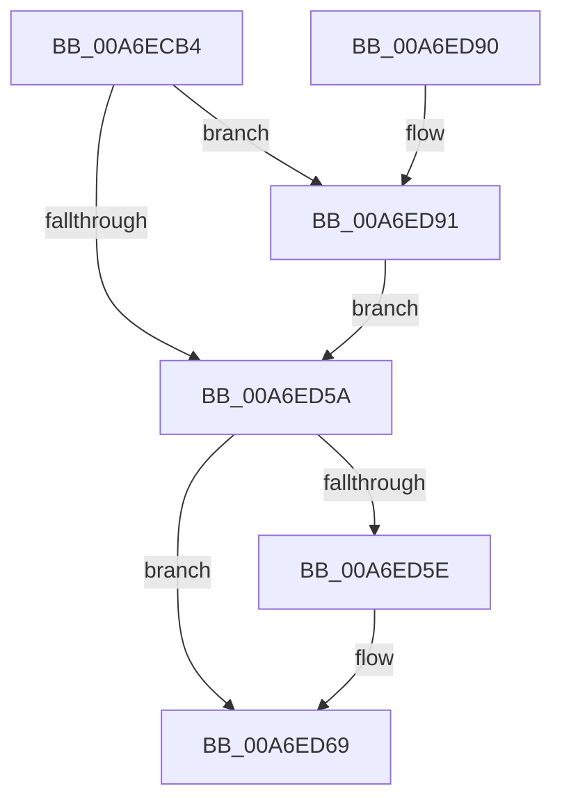

# PfSnVolumeCheckSeekPenalty

- RVA: `0x00A6ECB4`–`0x00A6EDA4` (길이 `240` bytes)
- VA: `0x0000000140A6ECB4`
- 실행 섹션: `PAGE`
- PDB 이름 있음: `예`; PDB Function 태그: `아니요`
- unwind 정보 RVA: `0x000B4C24`
- 디코드: `60`개 명령, `240/240` bytes 표시
- 미해석 바이트: `0` (있으면 어셈블리에 `.byte`로 보존)

> 이 문서는 커널 이미지의 기계어와 PDB 기호를 분석해 생성했습니다. 4번과 5번은 함수 원형과 자료형을 바이너리 사용 방식에서 추정한 C 해석이며 원본 소스 복구 결과는 아닙니다.

## 1. Dependencies

- 직접 호출 지점: **4**; 고유 호출 대상: **4**
- 직접 호출자로 확인된 함수: **1**
- RIP 상대 이미지 참조: **1**

### Outgoing calls
- `0x00A6ED0C` → [ZwResetEvent](../../text/6B/ZwResetEvent_function_006B01D0.md) (function, `0x006B01D0`)
- `0x00A6ED4E` → [ZwDeviceIoControlFile](../../text/6A/ZwDeviceIoControlFile_function_006AD1B0.md) (function, `0x006AD1B0`)
- `0x00A6ED76` → [_security_check_cookie](../../text/6A/_security_check_cookie_function_006AC640.md) (function, `0x006AC640`)
- `0x00A6ED99` → [ZwWaitForSingleObject](../../text/6A/ZwWaitForSingleObject_function_006AD150.md) (function, `0x006AD150`)

### Direct callers
- [PfSnOpenVolumesForPrefetch](../8A/PfSnOpenVolumesForPrefetch_function_008AA4AC.md) at `0x008AA827`

### Static image references
- `0x00A6ECC6` → RVA `0x00E0A740` (`.data`; read)

## 2. Other-region calls and transfers

- 다른 실행 섹션으로 향하는 call: **4**
  - `0x00A6ED0C` → [ZwResetEvent](../../text/6B/ZwResetEvent_function_006B01D0.md) (`PAGE` → `.text`)
  - `0x00A6ED4E` → [ZwDeviceIoControlFile](../../text/6A/ZwDeviceIoControlFile_function_006AD1B0.md) (`PAGE` → `.text`)
  - `0x00A6ED76` → [_security_check_cookie](../../text/6A/_security_check_cookie_function_006AC640.md) (`PAGE` → `.text`)
  - `0x00A6ED99` → [ZwWaitForSingleObject](../../text/6A/ZwWaitForSingleObject_function_006AD150.md) (`PAGE` → `.text`)
- 별도 외부 분기/꼬리 이동을 확인하지 못했습니다.

## 3. Assembly (complete function range)

```asm
00A6ECB4  48 89 5C 24 18                  mov qword ptr [rsp + 0x18], rbx
00A6ECB9  48 89 74 24 20                  mov qword ptr [rsp + 0x20], rsi
00A6ECBE  57                              push rdi
00A6ECBF  48 81 EC 90 00 00 00            sub rsp, 0x90
00A6ECC6  48 8B 05 73 BA 39 00            mov rax, qword ptr [rip + 0x39ba73]
00A6ECCD  48 33 C4                        xor rax, rsp
00A6ECD0  48 89 84 24 80 00 00 00         mov qword ptr [rsp + 0x80], rax
00A6ECD8  83 64 24 68 00                  and dword ptr [rsp + 0x68], 0
00A6ECDD  33 C0                           xor eax, eax
00A6ECDF  21 44 24 64                     and dword ptr [rsp + 0x64], eax
00A6ECE3  48 8B F2                        mov rsi, rdx
00A6ECE6  48 8B D9                        mov rbx, rcx
00A6ECE9  48 89 44 24 70                  mov qword ptr [rsp + 0x70], rax
00A6ECEE  0F 57 C0                        xorps xmm0, xmm0
00A6ECF1  89 44 24 78                     mov dword ptr [rsp + 0x78], eax
00A6ECF5  48 8B CE                        mov rcx, rsi
00A6ECF8  C7 44 24 60 07 00 00 00         mov dword ptr [rsp + 0x60], 7
00A6ED00  33 D2                           xor edx, edx
00A6ED02  BF 01 00 00 00                  mov edi, 1
00A6ED07  0F 11 44 24 50                  movups xmmword ptr [rsp + 0x50], xmm0
00A6ED0C  E8 BF 14 C4 FF                  call 0x1406b01d0
00A6ED11  8D 4F 0B                        lea ecx, [rdi + 0xb]
00A6ED14  45 33 C9                        xor r9d, r9d
00A6ED17  89 4C 24 48                     mov dword ptr [rsp + 0x48], ecx
00A6ED1B  48 8D 44 24 70                  lea rax, [rsp + 0x70]
00A6ED20  48 89 44 24 40                  mov qword ptr [rsp + 0x40], rax
00A6ED25  45 33 C0                        xor r8d, r8d
00A6ED28  89 4C 24 38                     mov dword ptr [rsp + 0x38], ecx
00A6ED2C  48 8D 44 24 60                  lea rax, [rsp + 0x60]
00A6ED31  48 8B 0B                        mov rcx, qword ptr [rbx]
00A6ED34  48 8B D6                        mov rdx, rsi
00A6ED37  48 89 44 24 30                  mov qword ptr [rsp + 0x30], rax
00A6ED3C  48 8D 44 24 50                  lea rax, [rsp + 0x50]
00A6ED41  C7 44 24 28 00 14 2D 00         mov dword ptr [rsp + 0x28], 0x2d1400
00A6ED49  48 89 44 24 20                  mov qword ptr [rsp + 0x20], rax
00A6ED4E  E8 5D E4 C3 FF                  call 0x1406ad1b0
00A6ED53  3D 03 01 00 00                  cmp eax, 0x103
00A6ED58  74 37                           je 0x140a6ed91
00A6ED5A  85 C0                           test eax, eax
00A6ED5C  78 0B                           js 0x140a6ed69
00A6ED5E  33 FF                           xor edi, edi
00A6ED60  40 38 7C 24 78                  cmp byte ptr [rsp + 0x78], dil
00A6ED65  40 0F 95 C7                     setne dil
00A6ED69  8B C7                           mov eax, edi
00A6ED6B  48 8B 8C 24 80 00 00 00         mov rcx, qword ptr [rsp + 0x80]
00A6ED73  48 33 CC                        xor rcx, rsp
00A6ED76  E8 C5 D8 C3 FF                  call 0x1406ac640
00A6ED7B  4C 8D 9C 24 90 00 00 00         lea r11, [rsp + 0x90]
00A6ED83  49 8B 5B 20                     mov rbx, qword ptr [r11 + 0x20]
00A6ED87  49 8B 73 28                     mov rsi, qword ptr [r11 + 0x28]
00A6ED8B  49 8B E3                        mov rsp, r11
00A6ED8E  5F                              pop rdi
00A6ED8F  C3                              ret
00A6ED90  CC                              int3
00A6ED91  45 33 C0                        xor r8d, r8d
00A6ED94  33 D2                           xor edx, edx
00A6ED96  48 8B CE                        mov rcx, rsi
00A6ED99  E8 B2 E3 C3 FF                  call 0x1406ad150
00A6ED9E  8B 44 24 50                     mov eax, dword ptr [rsp + 0x50]
00A6EDA2  EB B6                           jmp 0x140a6ed5a
```

## 4. C-style interpretation (structured pseudocode)

```c
__int64 __fastcall PfSnVolumeCheckSeekPenalty(__int64 a1, __int64 a2, int a3, int a4)
{
    __int64 result;
    __int64 v_rdi;
    __int64 v_rsp;
    unsigned __int64 v_stack_m18;
    unsigned int v_stack_m20;
    unsigned __int64 v_stack_m28;
    unsigned int v_stack_m30;
    unsigned int v_stack_m34;
    unsigned int v_stack_m38;
    unsigned int v_stack_m40;
    unsigned __int64 v_stack_m48;
    unsigned int v_stack_m50;
    unsigned __int64 v_stack_m58;
    unsigned int v_stack_m60;
    unsigned __int64 v_stack_m68;
    unsigned int v_stack_m70;
    unsigned __int64 v_stack_m78;
    unsigned __int64 v_stack_m8;
    unsigned __int64 v_stack_p18;
    unsigned __int64 v_stack_p20;

    v_stack_p18 = v_rbx;
    v_stack_p20 = v_rsi;
    v_rsp = (v_rsp) - (144);
    result = (*(unsigned __int64 *)(v_rip + 3783283)) ^ (v_rsp);
    v_stack_m18 = result;
    result = 0;
    v_stack_m28 = 0;
    v_stack_m20 = 0;
    v_stack_m38 = 7;
    a2 = 0;
    v_stack_m48 = v_xmm0;
    result = ZwResetEvent(a2, a2, a3, a4);
    a4 = 0;
    v_stack_m50 = (unsigned int)(1 + 11);
    v_stack_m58 = v_stack_m28;
    a3 = 0;
    v_stack_m60 = (unsigned int)(1 + 11);
    v_stack_m68 = v_stack_m38;
    v_stack_m70 = 0x2D1400ULL;
    v_stack_m78 = v_stack_m48;
    result = ZwDeviceIoControlFile(*(unsigned __int64 *)(a1), 0, a3, a4);
    if (((unsigned int)(result)) == 259) goto loc_00A6ED91;
loc_00A6ED5A:
    v_rdi = 1;
    if (!(sign_flag)) {
        v_rdi = 0;
        v_rdi = (v_stack_m20 != 0) ? 1 : 0;
    }
    a1 = (v_stack_m18) ^ (v_rsp);
    result = _security_check_cookie(a1, 0, a3, a4);
    return result;
loc_00A6ED91:
    a3 = 0;
    a2 = 0;
    result = ZwWaitForSingleObject(*(unsigned __int64 *)(v_stack_m8 + 40), a2, a3, a4);
    goto loc_00A6ED5A;
}
```

## 5. (Beta) C Style

```c
int64_t PfSnVolumeCheckSeekPenalty(void *Arg1, int64_t Arg2, int32_t Arg3, int32_t Arg4)
{
    uint8_t *arg1 = (uint8_t *)Arg1;

    int64_t result;
    int64_t local_rdi;
    int64_t local_rsp;
    uint64_t v_stack_m18;
    uint32_t v_stack_m20;
    uint64_t v_stack_m28;
    uint32_t v_stack_m30;
    uint32_t v_stack_m34;
    uint32_t v_stack_m38;
    uint32_t v_stack_m40;
    uint64_t v_stack_m48;
    uint32_t v_stack_m50;
    uint64_t v_stack_m58;
    uint32_t v_stack_m60;
    uint64_t v_stack_m68;
    uint32_t v_stack_m70;
    uint64_t v_stack_m78;
    uint64_t v_stack_m8;
    uint64_t v_stack_p18;
    uint64_t v_stack_p20;

    v_stack_p18 = local_rbx;
    v_stack_p20 = local_rsi;
    local_rsp = (local_rsp) - (144);
    result = (*(uint64_t *)(v_rip + 0x39BA73)) ^ (local_rsp);
    v_stack_m18 = result;
    result = 0;
    v_stack_m28 = 0;
    v_stack_m20 = 0;
    v_stack_m38 = 7;
    Arg2 = 0;
    v_stack_m48 = v_xmm0;
    result = ZwResetEvent(Arg2, Arg2, Arg3, Arg4);
    Arg4 = 0;
    v_stack_m50 = (uint32_t)(1 + 11);
    v_stack_m58 = v_stack_m28;
    Arg3 = 0;
    v_stack_m60 = (uint32_t)(1 + 11);
    v_stack_m68 = v_stack_m38;
    v_stack_m70 = 0x2D1400ULL;
    v_stack_m78 = v_stack_m48;
    result = ZwDeviceIoControlFile(*(uint64_t *)(arg1), 0, Arg3, Arg4);
    if (((uint32_t)(result)) == 259) goto loc_00A6ED91;
loc_00A6ED5A:
    local_rdi = 1;
    if (!(sign_flag)) {
        local_rdi = 0;
        local_rdi = (v_stack_m20 != 0) ? 1 : 0;
    }
    Arg1 = (v_stack_m18) ^ (local_rsp);
    result = _security_check_cookie(Arg1, 0, Arg3, Arg4);
    return result;
loc_00A6ED91:
    Arg3 = 0;
    Arg2 = 0;
    result = ZwWaitForSingleObject(*(uint64_t *)(v_stack_m8 + 0x28), Arg2, Arg3, Arg4);
    goto loc_00A6ED5A;
}
```

### 관측된 메모리 오프셋

구조체 형식이 확인되지 않은 접근은 인자 기준의 오프셋으로만 기록했습니다.

| 기준 인자 | 오프셋 표현 | 폭 (bit) | 접근 |
|---|---:|---:|---|
| `Arg1` | `+ 0x0` | `64` | `R` |

## 6. Execution-region graph

[열기: 2D/3D 그래프와 함수 탐색 컨트롤 패널](../../../control-panel.html?section=page&rva=0x00A6ECB4&view=graph)

- 2D 그래프는 위에서 아래로 흐르고, 3D 그래프는 빈 공간을 드래그해 회전합니다. Shift+드래그는 이동, 휠은 확대·축소, 함수 노드 선택은 대상 보고서 이동입니다.

### Static fallback


