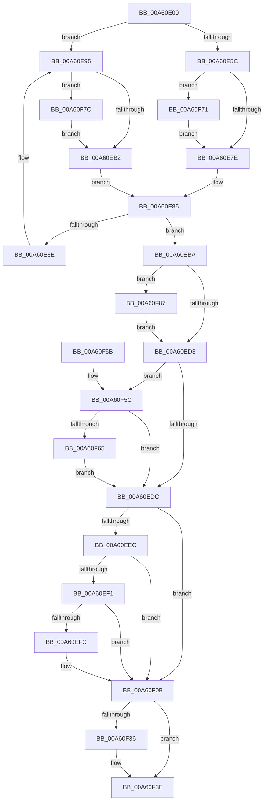

# PfTTraceListAdd

- RVA: `0x00A60E00`–`0x00A60F9C` (길이 `412` bytes)
- VA: `0x0000000140A60E00`
- 실행 섹션: `PAGE`
- PDB 이름 있음: `예`; PDB Function 태그: `아니요`
- unwind 정보 RVA: `0x000B3070`
- 디코드: `107`개 명령, `412/412` bytes 표시
- 미해석 바이트: `0` (있으면 어셈블리에 `.byte`로 보존)

> 이 문서는 커널 이미지의 기계어와 PDB 기호를 분석해 생성했습니다. 4번과 5번은 함수 원형과 자료형을 바이너리 사용 방식에서 추정한 C 해석이며 원본 소스 복구 결과는 아닙니다.

## 1. Dependencies

- 직접 호출 지점: **8**; 고유 호출 대상: **8**
- 직접 호출자로 확인된 함수: **2**
- RIP 상대 이미지 참조: **0**

### Outgoing calls
- `0x00A60E3C` → [ExAcquireFastMutex](../../text/20/ExAcquireFastMutex_function_0020E5A0.md) (function, `0x0020E5A0`)
- `0x00A60EDF` → [PfpPartitionReferenceParentSafe](../../text/34/PfpPartitionReferenceParentSafe_function_00343754.md) (function, `0x00343754`)
- `0x00A60F06` → [PfTAccessTracingCleanup](../../pagelk/B6/PfTAccessTracingCleanup_function_00B6B8AC.md) (function, `0x00B6B8AC`)
- `0x00A60F17` → [KeSetEvent](../../text/33/KeSetEvent_function_0033F310.md) (function, `0x0033F310`)
- `0x00A60F1F` → [ExReleaseFastMutex](../../text/25/ExReleaseFastMutex_function_002519C0.md) (function, `0x002519C0`)
- `0x00A60F2C` → [PfTTraceListFree](PfTTraceListFree_function_00A60FA4.md) (function, `0x00A60FA4`)
- `0x00A60F39` → [PfpPartitionDereferenceParent](../../text/34/PfpPartitionDereferenceParent_function_00341CDC.md) (function, `0x00341CDC`)
- `0x00A60F92` → [PfTTraceListTrim](../75/PfTTraceListTrim_function_00751BB4.md) (function, `0x00751BB4`)

### Direct callers
- [PfTGenerateTrace](../97/PfTGenerateTrace_function_0097B3CC.md) at `0x0097B429`
- [PfpSectInfoHandleFullBuffer](PfpSectInfoHandleFullBuffer_function_00A60D40.md) at `0x00A60DD9`

### Static image references
- 디코드된 RIP-relative 메모리 참조가 없습니다.

## 2. Other-region calls and transfers

- 다른 실행 섹션으로 향하는 call: **6**
  - `0x00A60E3C` → [ExAcquireFastMutex](../../text/20/ExAcquireFastMutex_function_0020E5A0.md) (`PAGE` → `.text`)
  - `0x00A60EDF` → [PfpPartitionReferenceParentSafe](../../text/34/PfpPartitionReferenceParentSafe_function_00343754.md) (`PAGE` → `.text`)
  - `0x00A60F06` → [PfTAccessTracingCleanup](../../pagelk/B6/PfTAccessTracingCleanup_function_00B6B8AC.md) (`PAGE` → `PAGELK`)
  - `0x00A60F17` → [KeSetEvent](../../text/33/KeSetEvent_function_0033F310.md) (`PAGE` → `.text`)
  - `0x00A60F1F` → [ExReleaseFastMutex](../../text/25/ExReleaseFastMutex_function_002519C0.md) (`PAGE` → `.text`)
  - `0x00A60F39` → [PfpPartitionDereferenceParent](../../text/34/PfpPartitionDereferenceParent_function_00341CDC.md) (`PAGE` → `.text`)
- 별도 외부 분기/꼬리 이동을 확인하지 못했습니다.

## 3. Assembly (complete function range)

```asm
00A60E00  4C 8B DC                        mov r11, rsp
00A60E03  49 89 5B 08                     mov qword ptr [r11 + 8], rbx
00A60E07  49 89 6B 10                     mov qword ptr [r11 + 0x10], rbp
00A60E0B  49 89 73 18                     mov qword ptr [r11 + 0x18], rsi
00A60E0F  57                              push rdi
00A60E10  41 54                           push r12
00A60E12  41 55                           push r13
00A60E14  41 56                           push r14
00A60E16  41 57                           push r15
00A60E18  48 83 EC 30                     sub rsp, 0x30
00A60E1C  49 8D 43 C8                     lea rax, [r11 - 0x38]
00A60E20  48 8B D9                        mov rbx, rcx
00A60E23  49 89 43 D0                     mov qword ptr [r11 - 0x30], rax
00A60E27  4C 8D A9 70 02 00 00            lea r13, [rcx + 0x270]
00A60E2E  49 8D 43 C8                     lea rax, [r11 - 0x38]
00A60E32  49 8B CD                        mov rcx, r13
00A60E35  49 89 43 C8                     mov qword ptr [r11 - 0x38], rax
00A60E39  48 8B F2                        mov rsi, rdx
00A60E3C  E8 5F D7 7A FF                  call 0x14020e5a0
00A60E41  44 8B A3 5C 02 00 00            mov r12d, dword ptr [rbx + 0x25c]
00A60E48  4C 8D B3 58 02 00 00            lea r14, [rbx + 0x258]
00A60E4F  45 8B 3E                        mov r15d, dword ptr [r14]
00A60E52  BA 01 00 00 00                  mov edx, 1
00A60E57  39 56 1C                        cmp dword ptr [rsi + 0x1c], edx
00A60E5A  75 39                           jne 0x140a60e95
00A60E5C  44 8B 83 64 02 00 00            mov r8d, dword ptr [rbx + 0x264]
00A60E63  48 8D 8B 60 02 00 00            lea rcx, [rbx + 0x260]
00A60E6A  8B 01                           mov eax, dword ptr [rcx]
00A60E6C  48 8D BB 48 02 00 00            lea rdi, [rbx + 0x248]
00A60E73  03 C2                           add eax, edx
00A60E75  41 3B C0                        cmp eax, r8d
00A60E78  0F 84 F3 00 00 00               je 0x140a60f71
00A60E7E  48 8D AB 38 02 00 00            lea rbp, [rbx + 0x238]
00A60E85  48 8B 47 08                     mov rax, qword ptr [rdi + 8]
00A60E89  48 39 38                        cmp qword ptr [rax], rdi
00A60E8C  74 2C                           je 0x140a60eba
00A60E8E  B9 03 00 00 00                  mov ecx, 3
00A60E93  CD 29                           int 0x29
00A60E95  41 8D 47 01                     lea eax, [r15 + 1]
00A60E99  49 8B CE                        mov rcx, r14
00A60E9C  48 8D AB 38 02 00 00            lea rbp, [rbx + 0x238]
00A60EA3  45 8B C4                        mov r8d, r12d
00A60EA6  48 8B FD                        mov rdi, rbp
00A60EA9  41 3B C4                        cmp eax, r12d
00A60EAC  0F 84 CA 00 00 00               je 0x140a60f7c
00A60EB2  89 93 68 02 00 00               mov dword ptr [rbx + 0x268], edx
00A60EB8  EB CB                           jmp 0x140a60e85
00A60EBA  48 89 3E                        mov qword ptr [rsi], rdi
00A60EBD  48 89 46 08                     mov qword ptr [rsi + 8], rax
00A60EC1  48 89 30                        mov qword ptr [rax], rsi
00A60EC4  48 89 77 08                     mov qword ptr [rdi + 8], rsi
00A60EC8  01 11                           add dword ptr [rcx], edx
00A60ECA  44 39 01                        cmp dword ptr [rcx], r8d
00A60ECD  0F 87 B4 00 00 00               ja 0x140a60f87
00A60ED3  48 3B FD                        cmp rdi, rbp
00A60ED6  0F 84 80 00 00 00               je 0x140a60f5c
00A60EDC  48 8B CB                        mov rcx, rbx
00A60EDF  E8 70 28 8E FF                  call 0x140343754
00A60EE4  48 8B F8                        mov rdi, rax
00A60EE7  45 3B FC                        cmp r15d, r12d
00A60EEA  73 1F                           jae 0x140a60f0b
00A60EEC  48 85 C0                        test rax, rax
00A60EEF  74 1A                           je 0x140a60f0b
00A60EF1  8B 93 5C 02 00 00               mov edx, dword ptr [rbx + 0x25c]
00A60EF7  41 39 16                        cmp dword ptr [r14], edx
00A60EFA  72 0F                           jb 0x140a60f0b
00A60EFC  45 33 C0                        xor r8d, r8d
00A60EFF  48 8B CB                        mov rcx, rbx
00A60F02  41 8D 50 02                     lea edx, [r8 + 2]
00A60F06  E8 A1 A9 10 00                  call 0x140b6b8ac
00A60F0B  48 8B 8B A8 02 00 00            mov rcx, qword ptr [rbx + 0x2a8]
00A60F12  45 33 C0                        xor r8d, r8d
00A60F15  33 D2                           xor edx, edx
00A60F17  E8 F4 E3 8D FF                  call 0x14033f310
00A60F1C  49 8B CD                        mov rcx, r13
00A60F1F  E8 9C 0A 7F FF                  call 0x1402519c0
00A60F24  48 8D 54 24 20                  lea rdx, [rsp + 0x20]
00A60F29  48 8B CB                        mov rcx, rbx
00A60F2C  E8 73 00 00 00                  call 0x140a60fa4
00A60F31  48 85 FF                        test rdi, rdi
00A60F34  74 08                           je 0x140a60f3e
00A60F36  48 8B CF                        mov rcx, rdi
00A60F39  E8 9E 0D 8E FF                  call 0x140341cdc
00A60F3E  48 8B 5C 24 60                  mov rbx, qword ptr [rsp + 0x60]
00A60F43  48 8B 6C 24 68                  mov rbp, qword ptr [rsp + 0x68]
00A60F48  48 8B 74 24 70                  mov rsi, qword ptr [rsp + 0x70]
00A60F4D  48 83 C4 30                     add rsp, 0x30
00A60F51  41 5F                           pop r15
00A60F53  41 5E                           pop r14
00A60F55  41 5D                           pop r13
00A60F57  41 5C                           pop r12
00A60F59  5F                              pop rdi
00A60F5A  C3                              ret
00A60F5B  CC                              int3
00A60F5C  48 39 3F                        cmp qword ptr [rdi], rdi
00A60F5F  0F 85 77 FF FF FF               jne 0x140a60edc
00A60F65  83 A3 68 02 00 00 00            and dword ptr [rbx + 0x268], 0
00A60F6C  E9 6B FF FF FF                  jmp 0x140a60edc
00A60F71  01 93 BC 02 00 00               add dword ptr [rbx + 0x2bc], edx
00A60F77  E9 02 FF FF FF                  jmp 0x140a60e7e
00A60F7C  01 93 B8 02 00 00               add dword ptr [rbx + 0x2b8], edx
00A60F82  E9 2B FF FF FF                  jmp 0x140a60eb2
00A60F87  8B 56 1C                        mov edx, dword ptr [rsi + 0x1c]
00A60F8A  4C 8D 4C 24 20                  lea r9, [rsp + 0x20]
00A60F8F  48 8B CB                        mov rcx, rbx
00A60F92  E8 1D 0C CF FF                  call 0x140751bb4
00A60F97  E9 37 FF FF FF                  jmp 0x140a60ed3
```

## 4. C-style interpretation (structured pseudocode)

```c
__int64 __fastcall PfTTraceListAdd(__int64 a1, __int64 a2)
{
    __int64 result;
    __int64 v_rsp;
    unsigned __int64 v_stack_m38;
    unsigned __int64 v_stack_p10;
    unsigned __int64 v_stack_p18;
    unsigned __int64 v_stack_p20;
    unsigned __int64 v_stack_p8;

    *(unsigned __int64 *)(v_rsp + 8) = v_rbx;
    *(unsigned __int64 *)(v_rsp + 16) = v_rbp;
    *(unsigned __int64 *)(v_rsp + 24) = v_rsi;
    v_rsp = (v_rsp) - (48);
    *(unsigned __int64 *)(v_rsp - 48) = v_rsp - 56;
    *(unsigned __int64 *)(v_rsp - 56) = v_rsp - 56;
    result = ExAcquireFastMutex(a1 + 624, a2, a3, a4);
    if ((*(unsigned int *)(a2 + 28)) != 1) goto loc_00A60E95;
    result = (unsigned int)(((unsigned int)(*(unsigned int *)(a1 + 608))) + (1));
    if (((unsigned int)(result)) == ((unsigned int)((unsigned int)(*(unsigned int *)(a1 + 612))))) goto loc_00A60F71;
loc_00A60E7E:
loc_00A60E85:
    if ((*(unsigned __int64 *)(*(unsigned __int64 *)(a1 + 584 + 8))) == (a1 + 584)) goto loc_00A60EBA;
loc_00A60E95:
    if (((unsigned int)((unsigned int)(*(unsigned int *)(a1 + 600)) + 1)) == ((unsigned int)((unsigned int)(*(unsigned int *)(a1 + 604))))) goto loc_00A60F7C;
loc_00A60EB2:
    *(unsigned int *)(a1 + 616) = 1;
    goto loc_00A60E85;
loc_00A60EBA:
    *(unsigned __int64 *)(a2) = a1 + 568;
    *(unsigned __int64 *)(a2 + 8) = (unsigned int)(*(unsigned int *)(a1 + 600)) + 1;
    *(unsigned __int64 *)((unsigned int)(*(unsigned int *)(a1 + 600)) + 1) = a2;
    *(unsigned __int64 *)(a1 + 568 + 8) = a2;
    if ((*(unsigned int *)(a1 + 600)) > ((unsigned int)((unsigned int)((unsigned int)((unsigned int)(*(unsigned int *)(a1 + 604))))))) goto loc_00A60F87;
loc_00A60ED3:
    if ((a1 + 568) == (a1 + 568)) goto loc_00A60F5C;
loc_00A60EDC:
    result = PfpPartitionReferenceParentSafe(a1, 1, (unsigned int)((unsigned int)((unsigned int)(*(unsigned int *)(a1 + 604)))), a4);
    if (((unsigned int)((unsigned int)(*(unsigned int *)(a1 + 600)))) >= ((unsigned int)((unsigned int)(*(unsigned int *)(a1 + 604))))) goto loc_00A60F0B;
    if (result == 0) goto loc_00A60F0B;
    if ((*(unsigned int *)(a1 + 600)) >= ((unsigned int)((unsigned int)(*(unsigned int *)(a1 + 604))))) {
        a3 = 0;
        a1 = a1;
        a2 = a3 + 2;
        result = PfTAccessTracingCleanup(a1, a2, a3, a4);
    }
    a3 = 0;
    a2 = 0;
    result = KeSetEvent(*(unsigned __int64 *)(a1 + 680), a2, a3, a4);
    result = ExReleaseFastMutex(a1 + 624, a2, a3, a4);
    result = PfTTraceListFree(a1, v_stack_m38, a3, a4);
    if (result != 0) {
        a1 = result;
        result = PfpPartitionDereferenceParent(a1, v_stack_m38, a3, a4);
    }
    v_rsp = (v_rsp) + (48);
    return result;
loc_00A60F5C:
    if ((*(unsigned __int64 *)(result)) != result) goto loc_00A60EDC;
    goto loc_00A60EDC;
loc_00A60F71:
    goto loc_00A60E7E;
loc_00A60F7C:
    goto loc_00A60EB2;
loc_00A60F87:
    result = PfTTraceListTrim(v_stack_p8, (unsigned int)(*(unsigned int *)(v_stack_p18 + 28)), a3, v_stack_p20);
    goto loc_00A60ED3;
}
```

## 5. (Beta) C Style

```c
int64_t PfTTraceListAdd(void *Arg1, void *Arg2)
{
    uint8_t *arg1 = (uint8_t *)Arg1;
    uint8_t *arg2 = (uint8_t *)Arg2;

    int64_t result;
    int64_t local_rsp;
    uint64_t v_stack_m38;
    uint64_t v_stack_p10;
    uint64_t v_stack_p18;
    uint64_t v_stack_p20;
    uint64_t v_stack_p8;

    *(uint64_t *)(local_rsp + 0x8) = local_rbx;
    *(uint64_t *)(local_rsp + 0x10) = local_rbp;
    *(uint64_t *)(local_rsp + 0x18) = local_rsi;
    local_rsp = (local_rsp) - (48);
    *(uint64_t *)(local_rsp - 0x30) = local_rsp - 56;
    *(uint64_t *)(local_rsp - 0x38) = local_rsp - 56;
    result = ExAcquireFastMutex(Arg1 + 624, Arg2, a3, a4);
    if ((*(uint32_t *)(arg2 + 0x1C)) != 1) goto loc_00A60E95;
    result = (uint32_t)(((uint32_t)(*(uint32_t *)(arg1 + 0x260))) + (1));
    if (((uint32_t)(result)) == ((uint32_t)((uint32_t)(*(uint32_t *)(arg1 + 0x264))))) goto loc_00A60F71;
loc_00A60E7E:
loc_00A60E85:
    if ((*(uint64_t *)(*(uint64_t *)(arg1 + 0x248 + 0x8))) == (Arg1 + 584)) goto loc_00A60EBA;
loc_00A60E95:
    if (((uint32_t)((uint32_t)(*(uint32_t *)(arg1 + 0x258)) + 1)) == ((uint32_t)((uint32_t)(*(uint32_t *)(arg1 + 0x25C))))) goto loc_00A60F7C;
loc_00A60EB2:
    *(uint32_t *)(arg1 + 0x268) = 1;
    goto loc_00A60E85;
loc_00A60EBA:
    *(void **)(arg2) = Arg1 + 568;
    *(uint64_t *)(arg2 + 0x8) = (uint32_t)(*(uint32_t *)(arg1 + 0x258)) + 1;
    *(void **)((uint32_t)(*(uint32_t *)(arg1 + 0x258)) + 0x1) = Arg2;
    *(void **)(arg1 + 0x238 + 0x8) = Arg2;
    if ((*(uint32_t *)(arg1 + 0x258)) > ((uint32_t)((uint32_t)((uint32_t)((uint32_t)(*(uint32_t *)(arg1 + 0x25C))))))) goto loc_00A60F87;
loc_00A60ED3:
    if ((Arg1 + 568) == (Arg1 + 568)) goto loc_00A60F5C;
loc_00A60EDC:
    result = PfpPartitionReferenceParentSafe(Arg1, 1, (uint32_t)((uint32_t)((uint32_t)(*(uint32_t *)(arg1 + 0x25C)))), a4);
    if (((uint32_t)((uint32_t)(*(uint32_t *)(arg1 + 0x258)))) >= ((uint32_t)((uint32_t)(*(uint32_t *)(arg1 + 0x25C))))) goto loc_00A60F0B;
    if (result == 0) goto loc_00A60F0B;
    if ((*(uint32_t *)(arg1 + 0x258)) >= ((uint32_t)((uint32_t)(*(uint32_t *)(arg1 + 0x25C))))) {
        a3 = 0;
        Arg1 = Arg1;
        Arg2 = a3 + 2;
        result = PfTAccessTracingCleanup(Arg1, Arg2, a3, a4);
    }
    a3 = 0;
    Arg2 = 0;
    result = KeSetEvent(*(uint64_t *)(arg1 + 0x2A8), Arg2, a3, a4);
    result = ExReleaseFastMutex(Arg1 + 624, Arg2, a3, a4);
    result = PfTTraceListFree(Arg1, v_stack_m38, a3, a4);
    if (result != 0) {
        Arg1 = result;
        result = PfpPartitionDereferenceParent(Arg1, v_stack_m38, a3, a4);
    }
    local_rsp = (local_rsp) + (48);
    return result;
loc_00A60F5C:
    if ((*(uint64_t *)(result)) != result) goto loc_00A60EDC;
    goto loc_00A60EDC;
loc_00A60F71:
    goto loc_00A60E7E;
loc_00A60F7C:
    goto loc_00A60EB2;
loc_00A60F87:
    result = PfTTraceListTrim(v_stack_p8, (uint32_t)(*(uint32_t *)(v_stack_p18 + 0x1C)), a3, v_stack_p20);
    goto loc_00A60ED3;
}
```

### 관측된 메모리 오프셋

구조체 형식이 확인되지 않은 접근은 인자 기준의 오프셋으로만 기록했습니다.

| 기준 인자 | 오프셋 표현 | 폭 (bit) | 접근 |
|---|---:|---:|---|
| `Arg1` | `+ 0x0` | `32` | `R` |
| `Arg1` | `+ 0x0` | `32` | `R/W` |
| `Arg1` | `+ 0x8` | `64` | `R` |
| `Arg1` | `+ 0x8` | `64` | `W` |
| `Arg1` | `+ 0x238` | `64` | `R` |
| `Arg1` | `+ 0x248` | `64` | `R` |
| `Arg1` | `+ 0x258` | `64` | `R` |
| `Arg1` | `+ 0x25C` | `32` | `R` |
| `Arg1` | `+ 0x260` | `64` | `R` |
| `Arg1` | `+ 0x264` | `32` | `R` |
| `Arg1` | `+ 0x268` | `32` | `R/W` |
| `Arg1` | `+ 0x268` | `32` | `W` |
| `Arg1` | `+ 0x270` | `64` | `R` |
| `Arg1` | `+ 0x2A8` | `64` | `R` |
| `Arg1` | `+ 0x2B8` | `32` | `R/W` |
| `Arg1` | `+ 0x2BC` | `32` | `R/W` |
| `Arg2` | `+ 0x0` | `64` | `W` |
| `Arg2` | `+ 0x8` | `64` | `W` |
| `Arg2` | `+ 0x1C` | `32` | `R` |

## 6. Execution-region graph

[열기: 2D/3D 그래프와 함수 탐색 컨트롤 패널](../../../control-panel.html?section=page&rva=0x00A60E00&view=graph)

- 2D 그래프는 위에서 아래로 흐르고, 3D 그래프는 빈 공간을 드래그해 회전합니다. Shift+드래그는 이동, 휠은 확대·축소, 함수 노드 선택은 대상 보고서 이동입니다.

### Static fallback


