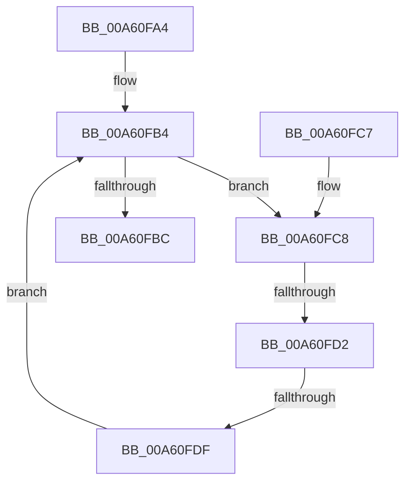

# PfTTraceListFree

- RVA: `0x00A60FA4`–`0x00A60FF0` (길이 `76` bytes)
- VA: `0x0000000140A60FA4`
- 실행 섹션: `PAGE`
- PDB 이름 있음: `예`; PDB Function 태그: `예`
- unwind 정보 RVA: `0x00083F28`
- 디코드: `23`개 명령, `76/76` bytes 표시
- 미해석 바이트: `0` (있으면 어셈블리에 `.byte`로 보존)

> 이 문서는 커널 이미지의 기계어와 PDB 기호를 분석해 생성했습니다. 4번과 5번은 함수 원형과 자료형을 바이너리 사용 방식에서 추정한 C 해석이며 원본 소스 복구 결과는 아닙니다.

## 1. Dependencies

- 직접 호출 지점: **1**; 고유 호출 대상: **1**
- 직접 호출자로 확인된 함수: **2**
- RIP 상대 이미지 참조: **0**

### Outgoing calls
- `0x00A60FE9` → [PfTFreeTraceDump](../../text/4B/PfTFreeTraceDump_function_004B3550.md) (function, `0x004B3550`)

### Direct callers
- [PfTCleanup](../75/PfTCleanup_function_00751208.md) at `0x0075133C`
- [PfTTraceListAdd](PfTTraceListAdd_function_00A60E00.md) at `0x00A60F2C`

### Static image references
- 디코드된 RIP-relative 메모리 참조가 없습니다.

## 2. Other-region calls and transfers

- 다른 실행 섹션으로 향하는 call: **1**
  - `0x00A60FE9` → [PfTFreeTraceDump](../../text/4B/PfTFreeTraceDump_function_004B3550.md) (`PAGE` → `.text`)
- call이 아닌 외부 분기/꼬리 이동: **2**
  - `0x00A60FCC` → [sub_00B3E2A4](../B3/Unknown_function_00B3E2A4.md) (`tail-transfer`)
  - `0x00A60FD9` → [sub_00B3E2A4](../B3/Unknown_function_00B3E2A4.md) (`tail-transfer`)

## 3. Assembly (complete function range)

```asm
00A60FA4  48 89 5C 24 08                  mov qword ptr [rsp + 8], rbx
00A60FA9  57                              push rdi
00A60FAA  48 83 EC 20                     sub rsp, 0x20
00A60FAE  48 8B DA                        mov rbx, rdx
00A60FB1  48 8B F9                        mov rdi, rcx
00A60FB4  48 8B 13                        mov rdx, qword ptr [rbx]
00A60FB7  48 3B D3                        cmp rdx, rbx
00A60FBA  75 0C                           jne 0x140a60fc8
00A60FBC  48 8B 5C 24 30                  mov rbx, qword ptr [rsp + 0x30]
00A60FC1  48 83 C4 20                     add rsp, 0x20
00A60FC5  5F                              pop rdi
00A60FC6  C3                              ret
00A60FC7  CC                              int3
00A60FC8  48 39 5A 08                     cmp qword ptr [rdx + 8], rbx
00A60FCC  0F 85 D2 D2 0D 00               jne 0x140b3e2a4
00A60FD2  48 8B 02                        mov rax, qword ptr [rdx]
00A60FD5  48 39 50 08                     cmp qword ptr [rax + 8], rdx
00A60FD9  0F 85 C5 D2 0D 00               jne 0x140b3e2a4
00A60FDF  48 89 03                        mov qword ptr [rbx], rax
00A60FE2  48 8B CF                        mov rcx, rdi
00A60FE5  48 89 58 08                     mov qword ptr [rax + 8], rbx
00A60FE9  E8 62 25 A5 FF                  call 0x1404b3550
00A60FEE  EB C4                           jmp 0x140a60fb4
```

## 4. C-style interpretation (structured pseudocode)

```c
__int64 __fastcall PfTTraceListFree(__int64 a1, __int64 a2)
{
    __int64 result;
    __int64 v_rsp;
    unsigned __int64 v_stack_p8;

    v_stack_p8 = v_rbx;
    v_rsp = (v_rsp) - (32);
loc_00A60FB4:
    if ((*(unsigned __int64 *)(a2)) != a2) goto loc_00A60FC8;
    v_rsp = (v_rsp) + (32);
    return result;
loc_00A60FC8:
    *(unsigned __int64 *)(v_stack_p8) = *(unsigned __int64 *)(*(unsigned __int64 *)(a2));
    *(unsigned __int64 *)(*(unsigned __int64 *)(*(unsigned __int64 *)(a2)) + 8) = v_stack_p8;
    result = PfTFreeTraceDump(a1, *(unsigned __int64 *)(a2), a3, a4);
    goto loc_00A60FB4;
}
```

## 5. (Beta) C Style

```c
int64_t PfTTraceListFree(int64_t Arg1, void *Arg2)
{
    uint8_t *arg2 = (uint8_t *)Arg2;

    int64_t result;
    int64_t local_rsp;
    uint64_t v_stack_p8;

    v_stack_p8 = local_rbx;
    local_rsp = (local_rsp) - (32);
loc_00A60FB4:
    if ((*(uint64_t *)(arg2)) != Arg2) goto loc_00A60FC8;
    local_rsp = (local_rsp) + (32);
    return result;
loc_00A60FC8:
    *(uint64_t *)(v_stack_p8) = *(uint64_t *)(*(uint64_t *)(arg2));
    *(uint64_t *)(*(uint64_t *)(*(uint64_t *)(arg2)) + 0x8) = v_stack_p8;
    result = PfTFreeTraceDump(Arg1, *(uint64_t *)(arg2), a3, a4);
    goto loc_00A60FB4;
}
```

### 관측된 메모리 오프셋

구조체 형식이 확인되지 않은 접근은 인자 기준의 오프셋으로만 기록했습니다.

| 기준 인자 | 오프셋 표현 | 폭 (bit) | 접근 |
|---|---:|---:|---|
| `Arg2` | `+ 0x0` | `64` | `R` |
| `Arg2` | `+ 0x0` | `64` | `W` |

## 6. Execution-region graph

[열기: 2D/3D 그래프와 함수 탐색 컨트롤 패널](../../../control-panel.html?section=page&rva=0x00A60FA4&view=graph)

- 2D 그래프는 위에서 아래로 흐르고, 3D 그래프는 빈 공간을 드래그해 회전합니다. Shift+드래그는 이동, 휠은 확대·축소, 함수 노드 선택은 대상 보고서 이동입니다.

### Static fallback


