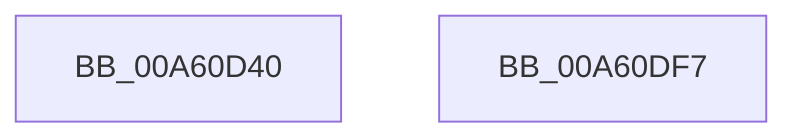

# PfpSectInfoHandleFullBuffer

- RVA: `0x00A60D40`–`0x00A60DF8` (길이 `184` bytes)
- VA: `0x0000000140A60D40`
- 실행 섹션: `PAGE`
- PDB 이름 있음: `예`; PDB Function 태그: `아니요`
- unwind 정보 RVA: `0x00060300`
- 디코드: `49`개 명령, `184/184` bytes 표시
- 미해석 바이트: `0` (있으면 어셈블리에 `.byte`로 보존)

> 이 문서는 커널 이미지의 기계어와 PDB 기호를 분석해 생성했습니다. 4번과 5번은 함수 원형과 자료형을 바이너리 사용 방식에서 추정한 C 해석이며 원본 소스 복구 결과는 아닙니다.

## 1. Dependencies

- 직접 호출 지점: **2**; 고유 호출 대상: **2**
- 직접 호출자로 확인된 함수: **0**
- RIP 상대 이미지 참조: **0**

### Outgoing calls
- `0x00A60D77` → [memset](../../text/6C/memset_function_006C6C40.md) (function, `0x006C6C40`)
- `0x00A60DD9` → [PfTTraceListAdd](PfTTraceListAdd_function_00A60E00.md) (function, `0x00A60E00`)

### Direct callers
- 이 함수 시작 RVA로 연결되는 직접 call은 확인되지 않았습니다. 간접 호출은 완전히 역산할 수 없습니다.

### Static image references
- 디코드된 RIP-relative 메모리 참조가 없습니다.

## 2. Other-region calls and transfers

- 다른 실행 섹션으로 향하는 call: **1**
  - `0x00A60D77` → [memset](../../text/6C/memset_function_006C6C40.md) (`PAGE` → `.text`)
- 별도 외부 분기/꼬리 이동을 확인하지 못했습니다.

## 3. Assembly (complete function range)

```asm
00A60D40  48 89 5C 24 08                  mov qword ptr [rsp + 8], rbx
00A60D45  48 89 6C 24 10                  mov qword ptr [rsp + 0x10], rbp
00A60D4A  48 89 74 24 18                  mov qword ptr [rsp + 0x18], rsi
00A60D4F  57                              push rdi
00A60D50  41 56                           push r14
00A60D52  41 57                           push r15
00A60D54  48 83 EC 20                     sub rsp, 0x20
00A60D58  8B 6A 20                        mov ebp, dword ptr [rdx + 0x20]
00A60D5B  4C 8B F2                        mov r14, rdx
00A60D5E  8B 7A 18                        mov edi, dword ptr [rdx + 0x18]
00A60D61  2B EA                           sub ebp, edx
00A60D63  8B 5A 2C                        mov ebx, dword ptr [rdx + 0x2c]
00A60D66  2B FA                           sub edi, edx
00A60D68  8B 72 28                        mov esi, dword ptr [rdx + 0x28]
00A60D6B  4C 8B F9                        mov r15, rcx
00A60D6E  33 D2                           xor edx, edx
00A60D70  49 8B CE                        mov rcx, r14
00A60D73  44 8D 42 40                     lea r8d, [rdx + 0x40]
00A60D77  E8 C4 5E C6 FF                  call 0x1406c6c40
00A60D7C  41 C7 46 10 2D 00 0D 00         mov dword ptr [r14 + 0x10], 0xd002d
00A60D84  49 8D 4E 20                     lea rcx, [r14 + 0x20]
00A60D88  C7 01 03 00 00 00               mov dword ptr [rcx], 3
00A60D8E  8D 47 F0                        lea eax, [rdi - 0x10]
00A60D91  41 89 46 18                     mov dword ptr [r14 + 0x18], eax
00A60D95  49 8B D6                        mov rdx, r14
00A60D98  41 C7 46 14 41 53 43 43         mov dword ptr [r14 + 0x14], 0x43435341
00A60DA0  41 C7 46 1C 01 00 00 00         mov dword ptr [r14 + 0x1c], 1
00A60DA8  41 8B 87 BC 02 00 00            mov eax, dword ptr [r15 + 0x2bc]
00A60DAF  41 89 46 24                     mov dword ptr [r14 + 0x24], eax
00A60DB3  41 8B 87 C4 02 00 00            mov eax, dword ptr [r15 + 0x2c4]
00A60DBA  41 89 46 28                     mov dword ptr [r14 + 0x28], eax
00A60DBE  41 8B C6                        mov eax, r14d
00A60DC1  2B C1                           sub eax, ecx
00A60DC3  41 89 76 30                     mov dword ptr [r14 + 0x30], esi
00A60DC7  83 C0 40                        add eax, 0x40
00A60DCA  41 89 6E 34                     mov dword ptr [r14 + 0x34], ebp
00A60DCE  41 89 46 2C                     mov dword ptr [r14 + 0x2c], eax
00A60DD2  49 8B CF                        mov rcx, r15
00A60DD5  41 89 5E 38                     mov dword ptr [r14 + 0x38], ebx
00A60DD9  E8 22 00 00 00                  call 0x140a60e00
00A60DDE  48 8B 5C 24 40                  mov rbx, qword ptr [rsp + 0x40]
00A60DE3  48 8B 6C 24 48                  mov rbp, qword ptr [rsp + 0x48]
00A60DE8  48 8B 74 24 50                  mov rsi, qword ptr [rsp + 0x50]
00A60DED  48 83 C4 20                     add rsp, 0x20
00A60DF1  41 5F                           pop r15
00A60DF3  41 5E                           pop r14
00A60DF5  5F                              pop rdi
00A60DF6  C3                              ret
00A60DF7  CC                              int3
```

## 4. C-style interpretation (structured pseudocode)

```c
__int64 __fastcall PfpSectInfoHandleFullBuffer(__int64 a1, __int64 a2)
{
    __int64 result;
    __int64 v_rbp;
    __int64 v_rdi;
    __int64 v_rsp;
    unsigned __int64 v_stack_p10;
    unsigned __int64 v_stack_p18;
    unsigned __int64 v_stack_p8;

    v_stack_p8 = v_rbx;
    v_stack_p10 = v_rbp;
    v_stack_p18 = v_rsi;
    v_rsp = (v_rsp) - (32);
    v_rbp = (unsigned int)(((unsigned int)(*(unsigned int *)(a2 + 32))) - ((unsigned int)(a2)));
    v_rdi = (unsigned int)(((unsigned int)(*(unsigned int *)(a2 + 24))) - ((unsigned int)(a2)));
    a2 = 0;
    result = memset(0, a2, a2 + 64, a4);
    *(unsigned int *)(a2 + 16) = 0xD002DULL;
    *(unsigned int *)(a2 + 32) = 3;
    *(unsigned int *)(a2 + 24) = (unsigned int)(v_rdi - 16);
    *(unsigned int *)(a2 + 20) = 0x43435341ULL;
    *(unsigned int *)(a2 + 28) = 1;
    *(unsigned int *)(a2 + 36) = (unsigned int)((unsigned int)(*(unsigned int *)(a1 + 700)));
    *(unsigned int *)(a2 + 40) = (unsigned int)((unsigned int)(*(unsigned int *)(a1 + 708)));
    result = (unsigned int)((0) - ((unsigned int)(a2 + 32)));
    *(unsigned int *)(a2 + 48) = (unsigned int)((unsigned int)(*(unsigned int *)(a2 + 40)));
    result = (unsigned int)((result) + (64));
    *(unsigned int *)(a2 + 52) = (unsigned int)(v_rbp);
    *(unsigned int *)(a2 + 44) = (unsigned int)(result);
    *(unsigned int *)(a2 + 56) = (unsigned int)((unsigned int)(*(unsigned int *)(a2 + 44)));
    result = PfTTraceListAdd(a1, 0, a2 + 64, a4);
    v_rsp = (v_rsp) + (32);
    return result;
}
```

## 5. (Beta) C Style

```c
int64_t PfpSectInfoHandleFullBuffer(void *Arg1, void *Arg2)
{
    uint8_t *arg1 = (uint8_t *)Arg1;
    uint8_t *arg2 = (uint8_t *)Arg2;

    int64_t result;
    int64_t local_rbp;
    int64_t local_rdi;
    int64_t local_rsp;
    uint64_t v_stack_p10;
    uint64_t v_stack_p18;
    uint64_t v_stack_p8;

    v_stack_p8 = local_rbx;
    v_stack_p10 = local_rbp;
    v_stack_p18 = local_rsi;
    local_rsp = (local_rsp) - (32);
    local_rbp = (uint32_t)(((uint32_t)(*(uint32_t *)(arg2 + 0x20))) - ((uint32_t)(Arg2)));
    local_rdi = (uint32_t)(((uint32_t)(*(uint32_t *)(arg2 + 0x18))) - ((uint32_t)(Arg2)));
    Arg2 = 0;
    result = memset(0, Arg2, Arg2 + 64, a4);
    *(uint32_t *)(arg2 + 0x10) = 0xD002DULL;
    *(uint32_t *)(arg2 + 0x20) = 3;
    *(uint32_t *)(arg2 + 0x18) = (uint32_t)(local_rdi - 16);
    *(uint32_t *)(arg2 + 0x14) = 0x43435341ULL;
    *(uint32_t *)(arg2 + 0x1C) = 1;
    *(uint32_t *)(arg2 + 0x24) = (uint32_t)((uint32_t)(*(uint32_t *)(arg1 + 0x2BC)));
    *(uint32_t *)(arg2 + 0x28) = (uint32_t)((uint32_t)(*(uint32_t *)(arg1 + 0x2C4)));
    result = (uint32_t)((0) - ((uint32_t)(Arg2 + 32)));
    *(uint32_t *)(arg2 + 0x30) = (uint32_t)((uint32_t)(*(uint32_t *)(arg2 + 0x28)));
    result = (uint32_t)((result) + (64));
    *(uint32_t *)(arg2 + 0x34) = (uint32_t)(local_rbp);
    *(uint32_t *)(arg2 + 0x2C) = (uint32_t)(result);
    *(uint32_t *)(arg2 + 0x38) = (uint32_t)((uint32_t)(*(uint32_t *)(arg2 + 0x2C)));
    result = PfTTraceListAdd(Arg1, 0, Arg2 + 64, a4);
    local_rsp = (local_rsp) + (32);
    return result;
}
```

### 관측된 메모리 오프셋

구조체 형식이 확인되지 않은 접근은 인자 기준의 오프셋으로만 기록했습니다.

| 기준 인자 | 오프셋 표현 | 폭 (bit) | 접근 |
|---|---:|---:|---|
| `Arg1` | `+ 0x2BC` | `32` | `R` |
| `Arg1` | `+ 0x2C4` | `32` | `R` |
| `Arg2` | `+ 0x0` | `32` | `W` |
| `Arg2` | `+ 0x10` | `32` | `W` |
| `Arg2` | `+ 0x14` | `32` | `W` |
| `Arg2` | `+ 0x18` | `32` | `R` |
| `Arg2` | `+ 0x18` | `32` | `W` |
| `Arg2` | `+ 0x1C` | `32` | `W` |
| `Arg2` | `+ 0x20` | `32` | `R` |
| `Arg2` | `+ 0x20` | `64` | `R` |
| `Arg2` | `+ 0x24` | `32` | `W` |
| `Arg2` | `+ 0x28` | `32` | `R` |
| `Arg2` | `+ 0x28` | `32` | `W` |
| `Arg2` | `+ 0x2C` | `32` | `R` |
| `Arg2` | `+ 0x2C` | `32` | `W` |
| `Arg2` | `+ 0x30` | `32` | `W` |
| `Arg2` | `+ 0x34` | `32` | `W` |
| `Arg2` | `+ 0x38` | `32` | `W` |

## 6. Execution-region graph

[열기: 2D/3D 그래프와 함수 탐색 컨트롤 패널](../../../control-panel.html?section=page&rva=0x00A60D40&view=graph)

- 2D 그래프는 위에서 아래로 흐르고, 3D 그래프는 빈 공간을 드래그해 회전합니다. Shift+드래그는 이동, 휠은 확대·축소, 함수 노드 선택은 대상 보고서 이동입니다.

### Static fallback


