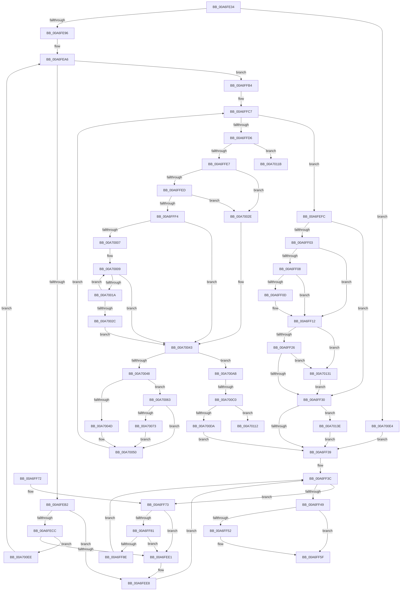

# PiControlGetDeviceStack

- RVA: `0x00A6FE34`–`0x00A7014A` (길이 `790` bytes)
- VA: `0x0000000140A6FE34`
- 실행 섹션: `PAGE`
- PDB 이름 있음: `예`; PDB Function 태그: `예`
- unwind 정보 RVA: `0x000B4F08`
- 디코드: `221`개 명령, `790/790` bytes 표시
- 미해석 바이트: `0` (있으면 어셈블리에 `.byte`로 보존)

> 이 문서는 커널 이미지의 기계어와 PDB 기호를 분석해 생성했습니다. 4번과 5번은 함수 원형과 자료형을 바이너리 사용 방식에서 추정한 C 해석이며 원본 소스 복구 결과는 아닙니다.

## 1. Dependencies

- 직접 호출 지점: **13**; 고유 호출 대상: **8**
- 직접 호출자로 확인된 함수: **1**
- RIP 상대 이미지 참조: **1**

### Outgoing calls
- `0x00A6FE84` → [IoGetDeviceAttachmentBaseRefWithTag](../../text/27/IoGetDeviceAttachmentBaseRefWithTag_function_00272788.md) (function, `0x00272788`)
- `0x00A6FE9E` → [IoGetAttachedDeviceReferenceWithTag](../../text/27/IoGetAttachedDeviceReferenceWithTag_function_00273B84.md) (function, `0x00273B84`)
- `0x00A6FEC2` → [ExAllocatePool2](../../poolcode/B8/ExAllocatePool2_function_00B820F0.md) (function, `0x00B820F0`)
- `0x00A6FEF0` → [ObfDereferenceObjectWithTag](../../text/2F/ObfDereferenceObjectWithTag_function_002F78E0.md) (function, `0x002F78E0`)
- `0x00A6FF5A` → [ObfDereferenceObjectWithTag](../../text/2F/ObfDereferenceObjectWithTag_function_002F78E0.md) (function, `0x002F78E0`)
- `0x00A6FFA3` → [ObfDereferenceObjectWithTag](../../text/2F/ObfDereferenceObjectWithTag_function_002F78E0.md) (function, `0x002F78E0`)
- `0x00A6FFAD` → [ExFreePoolWithTag](../../poolcode/B8/ExFreePoolWithTag_function_00B82870.md) (function, `0x00B82870`)
- `0x00A70034` → [RtlInitUnicodeString](../../text/42/RtlInitUnicodeString_function_0042A780.md) (function, `0x0042A780`)
- `0x00A7007D` → [memcpy](../../text/6C/memcpy_function_006C6840.md) (function, `0x006C6840`)
- `0x00A700CD` → [ExAllocatePool2](../../poolcode/B8/ExAllocatePool2_function_00B820F0.md) (function, `0x00B820F0`)
- `0x00A70108` → [IoGetLowerDeviceObjectWithTag](../../text/27/IoGetLowerDeviceObjectWithTag_function_00272660.md) (function, `0x00272660`)
- `0x00A70126` → [RtlInitUnicodeString](../../text/42/RtlInitUnicodeString_function_0042A780.md) (function, `0x0042A780`)
- `0x00A70140` → [ExFreePoolWithTag](../../poolcode/B8/ExFreePoolWithTag_function_00B82870.md) (function, `0x00B82870`)

### Direct callers
- [PiControlGetPropertyData](../8F/PiControlGetPropertyData_function_008FA330.md) at `0x008FA617`

### Static image references
- `0x00A7011B` → RVA `0x00B00250` (` ?? ::NNGAKEGL::`string'`; read)

## 2. Other-region calls and transfers

- 다른 실행 섹션으로 향하는 call: **13**
  - `0x00A6FE84` → [IoGetDeviceAttachmentBaseRefWithTag](../../text/27/IoGetDeviceAttachmentBaseRefWithTag_function_00272788.md) (`PAGE` → `.text`)
  - `0x00A6FE9E` → [IoGetAttachedDeviceReferenceWithTag](../../text/27/IoGetAttachedDeviceReferenceWithTag_function_00273B84.md) (`PAGE` → `.text`)
  - `0x00A6FEC2` → [ExAllocatePool2](../../poolcode/B8/ExAllocatePool2_function_00B820F0.md) (`PAGE` → `POOLCODE`)
  - `0x00A6FEF0` → [ObfDereferenceObjectWithTag](../../text/2F/ObfDereferenceObjectWithTag_function_002F78E0.md) (`PAGE` → `.text`)
  - `0x00A6FF5A` → [ObfDereferenceObjectWithTag](../../text/2F/ObfDereferenceObjectWithTag_function_002F78E0.md) (`PAGE` → `.text`)
  - `0x00A6FFA3` → [ObfDereferenceObjectWithTag](../../text/2F/ObfDereferenceObjectWithTag_function_002F78E0.md) (`PAGE` → `.text`)
  - `0x00A6FFAD` → [ExFreePoolWithTag](../../poolcode/B8/ExFreePoolWithTag_function_00B82870.md) (`PAGE` → `POOLCODE`)
  - `0x00A70034` → [RtlInitUnicodeString](../../text/42/RtlInitUnicodeString_function_0042A780.md) (`PAGE` → `.text`)
  - `0x00A7007D` → [memcpy](../../text/6C/memcpy_function_006C6840.md) (`PAGE` → `.text`)
  - `0x00A700CD` → [ExAllocatePool2](../../poolcode/B8/ExAllocatePool2_function_00B820F0.md) (`PAGE` → `POOLCODE`)
  - `0x00A70108` → [IoGetLowerDeviceObjectWithTag](../../text/27/IoGetLowerDeviceObjectWithTag_function_00272660.md) (`PAGE` → `.text`)
  - `0x00A70126` → [RtlInitUnicodeString](../../text/42/RtlInitUnicodeString_function_0042A780.md) (`PAGE` → `.text`)
  - `0x00A70140` → [ExFreePoolWithTag](../../poolcode/B8/ExFreePoolWithTag_function_00B82870.md) (`PAGE` → `POOLCODE`)
- call이 아닌 외부 분기/꼬리 이동: **3**
  - `0x00A700BA` → [sub_00B40124](../B4/Unknown_function_00B40124.md) (`tail-transfer`)
  - `0x00A70116` → [sub_00B40124](../B4/Unknown_function_00B40124.md) (`tail-transfer`)
  - `0x00A7012C` → [sub_00B40124 + 0x57](../B4/Unknown_function_00B40124.md) (`tail-transfer`)

## 3. Assembly (complete function range)

```asm
00A6FE34  4C 89 4C 24 20                  mov qword ptr [rsp + 0x20], r9
00A6FE39  4C 89 44 24 18                  mov qword ptr [rsp + 0x18], r8
00A6FE3E  89 54 24 10                     mov dword ptr [rsp + 0x10], edx
00A6FE42  55                              push rbp
00A6FE43  53                              push rbx
00A6FE44  56                              push rsi
00A6FE45  57                              push rdi
00A6FE46  41 54                           push r12
00A6FE48  41 55                           push r13
00A6FE4A  41 56                           push r14
00A6FE4C  41 57                           push r15
00A6FE4E  48 8B EC                        mov rbp, rsp
00A6FE51  48 83 EC 68                     sub rsp, 0x68
00A6FE55  48 8B 49 20                     mov rcx, qword ptr [rcx + 0x20]
00A6FE59  48 8D 45 D8                     lea rax, [rbp - 0x28]
00A6FE5D  33 FF                           xor edi, edi
00A6FE5F  48 89 45 E0                     mov qword ptr [rbp - 0x20], rax
00A6FE63  48 8D 45 D8                     lea rax, [rbp - 0x28]
00A6FE67  89 7D 48                        mov dword ptr [rbp + 0x48], edi
00A6FE6A  44 8B EA                        mov r13d, edx
00A6FE6D  48 89 45 D8                     mov qword ptr [rbp - 0x28], rax
00A6FE71  0F 57 C0                        xorps xmm0, xmm0
00A6FE74  BA 50 6E 70 43                  mov edx, 0x43706e50
00A6FE79  4D 8B F8                        mov r15, r8
00A6FE7C  8B DF                           mov ebx, edi
00A6FE7E  0F 11 45 E8                     movups xmmword ptr [rbp - 0x18], xmm0
00A6FE82  8B F7                           mov esi, edi
00A6FE84  E8 FF 28 80 FF                  call 0x140272788
00A6FE89  48 89 45 D0                     mov qword ptr [rbp - 0x30], rax
00A6FE8D  48 85 C0                        test rax, rax
00A6FE90  0F 84 4E 02 00 00               je 0x140a700e4
00A6FE96  BA 50 6E 70 43                  mov edx, 0x43706e50
00A6FE9B  48 8B C8                        mov rcx, rax
00A6FE9E  E8 E1 3C 80 FF                  call 0x140273b84
00A6FEA3  45 33 F6                        xor r14d, r14d
00A6FEA6  48 8B F8                        mov rdi, rax
00A6FEA9  48 85 C0                        test rax, rax
00A6FEAC  0F 84 02 01 00 00               je 0x140a6ffb4
00A6FEB2  BA 18 00 00 00                  mov edx, 0x18
00A6FEB7  B9 00 01 00 00                  mov ecx, 0x100
00A6FEBC  41 B8 50 6E 70 47               mov r8d, 0x47706e50
00A6FEC2  E8 29 22 11 00                  call 0x140b820f0
00A6FEC7  48 85 C0                        test rax, rax
00A6FECA  74 1C                           je 0x140a6fee8
00A6FECC  48 89 78 10                     mov qword ptr [rax + 0x10], rdi
00A6FED0  48 8D 55 D8                     lea rdx, [rbp - 0x28]
00A6FED4  48 8B 4D E0                     mov rcx, qword ptr [rbp - 0x20]
00A6FED8  48 39 11                        cmp qword ptr [rcx], rdx
00A6FEDB  0F 84 0D 02 00 00               je 0x140a700ee
00A6FEE1  B9 03 00 00 00                  mov ecx, 3
00A6FEE6  CD 29                           int 0x29
00A6FEE8  BA 50 6E 70 43                  mov edx, 0x43706e50
00A6FEED  48 8B CF                        mov rcx, rdi
00A6FEF0  E8 EB 79 88 FF                  call 0x1402f78e0
00A6FEF5  BB 9A 00 00 C0                  mov ebx, 0xc000009a
00A6FEFA  EB 40                           jmp 0x140a6ff3c
00A6FEFC  48 8B CE                        mov rcx, rsi
00A6FEFF  85 DB                           test ebx, ebx
00A6FF01  78 2D                           js 0x140a6ff30
00A6FF03  4D 85 E4                        test r12, r12
00A6FF06  74 0A                           je 0x140a6ff12
00A6FF08  41 3B D0                        cmp edx, r8d
00A6FF0B  72 05                           jb 0x140a6ff12
00A6FF0D  66 41 89 3C 24                  mov word ptr [r12], di
00A6FF12  48 8B 45 60                     mov rax, qword ptr [rbp + 0x60]
00A6FF16  45 03 F0                        add r14d, r8d
00A6FF19  44 89 30                        mov dword ptr [rax], r14d
00A6FF1C  48 39 7D 58                     cmp qword ptr [rbp + 0x58], rdi
00A6FF20  0F 84 0B 02 00 00               je 0x140a70131
00A6FF26  44 3B 75 50                     cmp r14d, dword ptr [rbp + 0x50]
00A6FF2A  0F 87 01 02 00 00               ja 0x140a70131
00A6FF30  48 85 C9                        test rcx, rcx
00A6FF33  0F 85 05 02 00 00               jne 0x140a7013e
00A6FF39  45 33 F6                        xor r14d, r14d
00A6FF3C  48 8B 7D D8                     mov rdi, qword ptr [rbp - 0x28]
00A6FF40  48 8D 45 D8                     lea rax, [rbp - 0x28]
00A6FF44  48 3B F8                        cmp rdi, rax
00A6FF47  75 2A                           jne 0x140a6ff73
00A6FF49  48 8B 45 D0                     mov rax, qword ptr [rbp - 0x30]
00A6FF4D  48 85 C0                        test rax, rax
00A6FF50  74 0D                           je 0x140a6ff5f
00A6FF52  BA 50 6E 70 43                  mov edx, 0x43706e50
00A6FF57  48 8B C8                        mov rcx, rax
00A6FF5A  E8 81 79 88 FF                  call 0x1402f78e0
00A6FF5F  8B C3                           mov eax, ebx
00A6FF61  48 83 C4 68                     add rsp, 0x68
00A6FF65  41 5F                           pop r15
00A6FF67  41 5E                           pop r14
00A6FF69  41 5D                           pop r13
00A6FF6B  41 5C                           pop r12
00A6FF6D  5F                              pop rdi
00A6FF6E  5E                              pop rsi
00A6FF6F  5B                              pop rbx
00A6FF70  5D                              pop rbp
00A6FF71  C3                              ret
00A6FF72  CC                              int3
00A6FF73  48 8D 45 D8                     lea rax, [rbp - 0x28]
00A6FF77  48 39 47 08                     cmp qword ptr [rdi + 8], rax
00A6FF7B  0F 85 60 FF FF FF               jne 0x140a6fee1
00A6FF81  48 8B 07                        mov rax, qword ptr [rdi]
00A6FF84  48 39 78 08                     cmp qword ptr [rax + 8], rdi
00A6FF88  0F 85 53 FF FF FF               jne 0x140a6fee1
00A6FF8E  48 89 45 D8                     mov qword ptr [rbp - 0x28], rax
00A6FF92  48 8D 4D D8                     lea rcx, [rbp - 0x28]
00A6FF96  48 89 48 08                     mov qword ptr [rax + 8], rcx
00A6FF9A  BA 50 6E 70 43                  mov edx, 0x43706e50
00A6FF9F  48 8B 4F 10                     mov rcx, qword ptr [rdi + 0x10]
00A6FFA3  E8 38 79 88 FF                  call 0x1402f78e0
00A6FFA8  33 D2                           xor edx, edx
00A6FFAA  48 8B CF                        mov rcx, rdi
00A6FFAD  E8 BE 28 11 00                  call 0x140b82870
00A6FFB2  EB 88                           jmp 0x140a6ff3c
00A6FFB4  41 8B D5                        mov edx, r13d
00A6FFB7  4D 8B E7                        mov r12, r15
00A6FFBA  4C 8B 6D D8                     mov r13, qword ptr [rbp - 0x28]
00A6FFBE  41 B8 02 00 00 00               mov r8d, 2
00A6FFC4  89 55 C8                        mov dword ptr [rbp - 0x38], edx
00A6FFC7  33 FF                           xor edi, edi
00A6FFC9  48 8D 45 D8                     lea rax, [rbp - 0x28]
00A6FFCD  4C 3B E8                        cmp r13, rax
00A6FFD0  0F 84 26 FF FF FF               je 0x140a6fefc
00A6FFD6  49 8B 45 10                     mov rax, qword ptr [r13 + 0x10]
00A6FFDA  4C 8B 78 08                     mov r15, qword ptr [rax + 8]
00A6FFDE  4D 85 FF                        test r15, r15
00A6FFE1  0F 84 34 01 00 00               je 0x140a7011b
00A6FFE7  49 39 7F 40                     cmp qword ptr [r15 + 0x40], rdi
00A6FFEB  74 41                           je 0x140a7002e
00A6FFED  66 45 39 47 38                  cmp word ptr [r15 + 0x38], r8w
00A6FFF2  72 3A                           jb 0x140a7002e
00A6FFF4  41 0F 10 47 38                  movups xmm0, xmmword ptr [r15 + 0x38]
00A6FFF9  66 0F 7E C7                     movd edi, xmm0
00A6FFFD  0F 11 45 E8                     movups xmmword ptr [rbp - 0x18], xmm0
00A70001  66 41 3B F8                     cmp di, r8w
00A70005  72 3C                           jb 0x140a70043
00A70007  33 D2                           xor edx, edx
00A70009  48 8B 45 F0                     mov rax, qword ptr [rbp - 0x10]
00A7000D  0F B7 CF                        movzx ecx, di
00A70010  48 D1 E9                        shr rcx, 1
00A70013  66 39 54 48 FE                  cmp word ptr [rax + rcx*2 - 2], dx
00A70018  75 29                           jne 0x140a70043
00A7001A  B8 FE FF 00 00                  mov eax, 0xfffe
00A7001F  66 03 F8                        add di, ax
00A70022  66 89 7D E8                     mov word ptr [rbp - 0x18], di
00A70026  66 41 3B F8                     cmp di, r8w
00A7002A  73 DD                           jae 0x140a70009
00A7002C  EB 15                           jmp 0x140a70043
00A7002E  33 D2                           xor edx, edx
00A70030  48 8D 4D E8                     lea rcx, [rbp - 0x18]
00A70034  E8 47 A7 9B FF                  call 0x14042a780
00A70039  0F B7 7D E8                     movzx edi, word ptr [rbp - 0x18]
00A7003D  41 B8 02 00 00 00               mov r8d, 2
00A70043  66 85 FF                        test di, di
00A70046  74 63                           je 0x140a700ab
00A70048  4D 85 E4                        test r12, r12
00A7004B  75 16                           jne 0x140a70063
00A7004D  8B 55 C8                        mov edx, dword ptr [rbp - 0x38]
00A70050  4D 8B 6D 00                     mov r13, qword ptr [r13]
00A70054  41 83 C6 02                     add r14d, 2
00A70058  0F B7 C7                        movzx eax, di
00A7005B  44 03 F0                        add r14d, eax
00A7005E  E9 64 FF FF FF                  jmp 0x140a6ffc7
00A70063  8B 55 C8                        mov edx, dword ptr [rbp - 0x38]
00A70066  44 0F B7 FF                     movzx r15d, di
00A7006A  49 8D 4F 02                     lea rcx, [r15 + 2]
00A7006E  48 3B D1                        cmp rdx, rcx
00A70071  72 DD                           jb 0x140a70050
00A70073  48 8B 55 F0                     mov rdx, qword ptr [rbp - 0x10]
00A70077  45 8B C7                        mov r8d, r15d
00A7007A  49 8B CC                        mov rcx, r12
00A7007D  E8 BE 67 C5 FF                  call 0x1406c6840
00A70082  8B 55 C8                        mov edx, dword ptr [rbp - 0x38]
00A70085  33 C0                           xor eax, eax
00A70087  49 D1 EF                        shr r15, 1
00A7008A  B9 FE FF FF FF                  mov ecx, 0xfffffffe
00A7008F  44 8D 40 02                     lea r8d, [rax + 2]
00A70093  4F 8D 24 7C                     lea r12, [r12 + r15*2]
00A70097  66 41 89 04 24                  mov word ptr [r12], ax
00A7009C  4D 03 E0                        add r12, r8
00A7009F  0F B7 C7                        movzx eax, di
00A700A2  2B C8                           sub ecx, eax
00A700A4  03 D1                           add edx, ecx
00A700A6  89 55 C8                        mov dword ptr [rbp - 0x38], edx
00A700A9  EB A5                           jmp 0x140a70050
00A700AB  33 FF                           xor edi, edi
00A700AD  41 B8 10 01 00 00               mov r8d, 0x110
00A700B3  44 89 45 48                     mov dword ptr [rbp + 0x48], r8d
00A700B7  48 85 F6                        test rsi, rsi
00A700BA  0F 85 64 00 0D 00               jne 0x140b40124
00A700C0  41 8B D0                        mov edx, r8d
00A700C3  41 8D 48 F0                     lea ecx, [r8 - 0x10]
00A700C7  41 B8 50 6E 70 47               mov r8d, 0x47706e50
00A700CD  E8 1E 20 11 00                  call 0x140b820f0
00A700D2  48 8B F0                        mov rsi, rax
00A700D5  48 85 C0                        test rax, rax
00A700D8  75 38                           jne 0x140a70112
00A700DA  BB 9A 00 00 C0                  mov ebx, 0xc000009a
00A700DF  E9 55 FE FF FF                  jmp 0x140a6ff39
00A700E4  BB 10 00 00 C0                  mov ebx, 0xc0000010
00A700E9  E9 4B FE FF FF                  jmp 0x140a6ff39
00A700EE  48 89 48 08                     mov qword ptr [rax + 8], rcx
00A700F2  48 8D 55 D8                     lea rdx, [rbp - 0x28]
00A700F6  48 89 10                        mov qword ptr [rax], rdx
00A700F9  BA 50 6E 70 43                  mov edx, 0x43706e50
00A700FE  48 89 01                        mov qword ptr [rcx], rax
00A70101  48 8B CF                        mov rcx, rdi
00A70104  48 89 45 E0                     mov qword ptr [rbp - 0x20], rax
00A70108  E8 53 25 80 FF                  call 0x140272660
00A7010D  E9 94 FD FF FF                  jmp 0x140a6fea6
00A70112  44 8B 45 48                     mov r8d, dword ptr [rbp + 0x48]
00A70116  E9 09 00 0D 00                  jmp 0x140b40124
00A7011B  48 8D 15 2E 01 09 00            lea rdx, [rip + 0x9012e]
00A70122  48 8D 4D E8                     lea rcx, [rbp - 0x18]
00A70126  E8 55 A6 9B FF                  call 0x14042a780
00A7012B  90                              nop
00A7012C  E9 4A 00 0D 00                  jmp 0x140b4017b
00A70131  BB 23 00 00 C0                  mov ebx, 0xc0000023
00A70136  48 8B CE                        mov rcx, rsi
00A70139  E9 F2 FD FF FF                  jmp 0x140a6ff30
00A7013E  33 D2                           xor edx, edx
00A70140  E8 2B 27 11 00                  call 0x140b82870
00A70145  E9 EF FD FF FF                  jmp 0x140a6ff39
```

## 4. C-style interpretation (structured pseudocode)

```c
__int64 __fastcall PiControlGetDeviceStack(__int64 a1, int a2, __int64 a3, __int64 a4)
{
    __int64 result;
    __int64 v_r12;
    __int64 v_r14;
    __int64 v_r15;
    __int64 v_rdi;
    __int64 v_rsp;
    unsigned __int64 v_stack_m50;
    unsigned __int64 v_stack_m58;
    unsigned __int64 v_stack_m60;
    unsigned __int64 v_stack_m68;
    unsigned __int64 v_stack_m70;
    unsigned int v_stack_m78;
    unsigned int v_stack_p10;
    unsigned __int64 v_stack_p18;
    unsigned __int64 v_stack_p20;
    unsigned int v_stack_p8;

    v_stack_p20 = a4;
    v_stack_p18 = a3;
    v_stack_p10 = a2;
    v_rsp = (v_rsp) - (104);
    v_rdi = 0;
    v_stack_m60 = v_stack_m68;
    v_stack_p8 = 0;
    v_stack_m68 = v_stack_m68;
    v_stack_m58 = v_xmm0;
    result = IoGetDeviceAttachmentBaseRefWithTag(*(unsigned __int64 *)(a1 + 32), (unsigned int)(0x43706E50ULL), a3, a4);
    v_stack_m70 = result;
    if (result == 0) goto loc_00A700E4;
    result = IoGetAttachedDeviceReferenceWithTag(result, (unsigned int)(0x43706E50ULL), a3, a4);
    v_r14 = 0;
loc_00A6FEA6:
    if (result == 0) goto loc_00A6FFB4;
    result = ExAllocatePool2(256, 24, (unsigned int)(0x47706E50ULL), a4);
    if (result == 0) goto loc_00A6FEE8;
    *(unsigned __int64 *)(result + 16) = result;
    if ((*(unsigned __int64 *)(v_stack_m60)) == v_stack_m68) goto loc_00A700EE;
loc_00A6FEE1:
loc_00A6FEE8:
    result = ObfDereferenceObjectWithTag(result, (unsigned int)(0x43706E50ULL), (unsigned int)(0x47706E50ULL), a4);
    goto loc_00A6FF3C;
loc_00A6FEFC:
    if (sign_flag) goto loc_00A6FF30;
    if (v_r12 == 0) goto loc_00A6FF12;
    if (((unsigned int)((unsigned int)(0x43706E50ULL))) >= ((unsigned int)((unsigned int)(0x47706E50ULL)))) {
        *(unsigned __int16 *)(v_r12) = (unsigned __int16)(result);
    }
    v_r14 = (unsigned int)((v_r14) + ((unsigned int)((unsigned int)(0x47706E50ULL))));
    *(unsigned int *)(v_stack_p20) = (unsigned int)(v_r14);
    if (v_stack_p18 == result) goto loc_00A70131;
    if (((unsigned int)(v_r14)) > v_stack_p10) goto loc_00A70131;
loc_00A6FF30:
    if (0 != 0) goto loc_00A7013E;
loc_00A6FF39:
    v_r14 = 0;
loc_00A6FF3C:
    if (v_stack_m68 != v_stack_m68) goto loc_00A6FF73;
    result = v_stack_m70;
    if (v_stack_m70 != 0) {
        a2 = 0x43706E50ULL;
        a1 = v_stack_m70;
        result = ObfDereferenceObjectWithTag(a1, a2, (unsigned int)(0x47706E50ULL), a4);
    }
    v_rsp = (v_rsp) + (104);
    return (unsigned int)((unsigned int)((unsigned int)(0xC000009AULL)));
loc_00A6FF73:
    if ((*(unsigned __int64 *)(v_stack_m68 + 8)) != v_stack_m68) goto loc_00A6FEE1;
    if ((*(unsigned __int64 *)(*(unsigned __int64 *)(v_stack_m68) + 8)) != v_stack_m68) goto loc_00A6FEE1;
    v_stack_m68 = *(unsigned __int64 *)(v_stack_m68);
    *(unsigned __int64 *)(*(unsigned __int64 *)(v_stack_m68) + 8) = v_stack_m68;
    result = ObfDereferenceObjectWithTag(*(unsigned __int64 *)(v_stack_m68 + 16), (unsigned int)(0x43706E50ULL), (unsigned int)(0x47706E50ULL), a4);
    a2 = 0;
    result = ExFreePoolWithTag(v_stack_m68, a2, (unsigned int)(0x47706E50ULL), a4);
    goto loc_00A6FF3C;
loc_00A6FFB4:
    v_stack_m78 = (unsigned int)((unsigned int)((unsigned int)((unsigned int)(a2))));
loc_00A6FFC7:
    v_rdi = 0;
    if (v_stack_m68 == v_stack_m68) goto loc_00A6FEFC;
    if (*(unsigned __int64 *)(*(unsigned __int64 *)(v_stack_m68 + 16) + 8) == 0) goto loc_00A7011B;
    if ((*(unsigned __int64 *)(*(unsigned __int64 *)(*(unsigned __int64 *)(v_stack_m68 + 16) + 8) + 64)) == 0) goto loc_00A7002E;
    if ((*(unsigned __int16 *)(*(unsigned __int64 *)(*(unsigned __int64 *)(v_stack_m68 + 16) + 8) + 56)) < 2) goto loc_00A7002E;
    v_stack_m58 = v_xmm0;
    if (0 < 2) goto loc_00A70043;
    a2 = 0;
loc_00A70009:
    a1 = (0) >> (1);
    if ((*(unsigned __int16 *)(v_stack_m50 + a1 * 2 - 2)) != 0) goto loc_00A70043;
    v_rdi = (unsigned __int16)((v_rdi) + ((unsigned __int16)((unsigned int)(0xFFFEULL))));
    v_stack_m58 = (unsigned __int16)(v_rdi);
    if (((unsigned __int16)(v_rdi)) >= 2) goto loc_00A70009;
    goto loc_00A70043;
loc_00A7002E:
    a2 = 0;
    result = RtlInitUnicodeString(v_stack_m58, a2, 2, a4);
loc_00A70043:
    if ((unsigned __int16)(v_stack_m58) == 0) goto loc_00A700AB;
    if (a3 != 0) goto loc_00A70063;
loc_00A70050:
    v_r14 = (unsigned int)((v_r14) + (2));
    v_r14 = (unsigned int)((v_r14) + ((unsigned int)((unsigned __int16)(v_stack_m58))));
    goto loc_00A6FFC7;
loc_00A70063:
    if (((unsigned int)(v_stack_m78)) < ((unsigned __int16)(v_stack_m58) + 2)) goto loc_00A70050;
    result = memcpy(a3, v_stack_m50, (unsigned int)((unsigned int)((unsigned __int16)(v_stack_m58))), a4);
    result = 0;
    v_r15 = ((unsigned __int16)(v_stack_m58)) >> (1);
    *(unsigned __int16 *)(a3 + v_r15 * 2) = 0;
    v_r12 = (a3 + v_r15 * 2) + (result + 2);
    a1 = (unsigned int)(((unsigned int)(0xFFFFFFFEULL)) - ((unsigned int)((unsigned __int16)(v_stack_m58))));
    a2 = (unsigned int)(((unsigned int)(v_stack_m78)) + ((unsigned int)(a1)));
    v_stack_m78 = a2;
    goto loc_00A70050;
loc_00A700AB:
    v_rdi = 0;
    v_stack_p8 = 272;
    result = ExAllocatePool2(272 - 16, 272, (unsigned int)(0x47706E50ULL), a4);
    if (result != 0) goto loc_00A70112;
    goto loc_00A6FF39;
loc_00A700E4:
    goto loc_00A6FF39;
loc_00A700EE:
    *(unsigned __int64 *)(result + 8) = 272 - 16;
    *(unsigned __int64 *)(result) = v_stack_m68;
    *(unsigned __int64 *)(272 - 16) = result;
    v_stack_m60 = result;
    result = IoGetLowerDeviceObjectWithTag(0, (unsigned int)(0x43706E50ULL), (unsigned int)(0x47706E50ULL), a4);
    goto loc_00A6FEA6;
loc_00A70112:
loc_00A7011B:
    result = RtlInitUnicodeString(v_stack_m58, v_rip + 590126, (unsigned int)(v_stack_p8), a4);
loc_00A70131:
    goto loc_00A6FF30;
loc_00A7013E:
    a2 = 0;
    result = ExFreePoolWithTag(result, a2, (unsigned int)(v_stack_p8), a4);
    goto loc_00A6FF39;
}
```

## 5. (Beta) C Style

```c
int64_t PiControlGetDeviceStack(void *Arg1, int32_t Arg2, int64_t Arg3, int64_t Arg4)
{
    uint8_t *arg1 = (uint8_t *)Arg1;

    int64_t result;
    int64_t local_r12;
    int64_t local_r14;
    int64_t local_r15;
    int64_t local_rdi;
    int64_t local_rsp;
    uint64_t v_stack_m50;
    uint64_t v_stack_m58;
    uint64_t v_stack_m60;
    uint64_t v_stack_m68;
    uint64_t v_stack_m70;
    uint32_t v_stack_m78;
    uint32_t v_stack_p10;
    uint64_t v_stack_p18;
    uint64_t v_stack_p20;
    uint32_t v_stack_p8;

    v_stack_p20 = Arg4;
    v_stack_p18 = Arg3;
    v_stack_p10 = Arg2;
    local_rsp = (local_rsp) - (104);
    local_rdi = 0;
    v_stack_m60 = v_stack_m68;
    v_stack_p8 = 0;
    v_stack_m68 = v_stack_m68;
    v_stack_m58 = v_xmm0;
    result = IoGetDeviceAttachmentBaseRefWithTag(*(uint64_t *)(arg1 + 0x20), (uint32_t)(0x43706E50ULL), Arg3, Arg4);
    v_stack_m70 = result;
    if (result == 0) goto loc_00A700E4;
    result = IoGetAttachedDeviceReferenceWithTag(result, (uint32_t)(0x43706E50ULL), Arg3, Arg4);
    local_r14 = 0;
loc_00A6FEA6:
    if (result == 0) goto loc_00A6FFB4;
    result = ExAllocatePool2(256, 24, (uint32_t)(0x47706E50ULL), Arg4);
    if (result == 0) goto loc_00A6FEE8;
    *(uint64_t *)(result + 0x10) = result;
    if ((*(uint64_t *)(v_stack_m60)) == v_stack_m68) goto loc_00A700EE;
loc_00A6FEE1:
loc_00A6FEE8:
    result = ObfDereferenceObjectWithTag(result, (uint32_t)(0x43706E50ULL), (uint32_t)(0x47706E50ULL), Arg4);
    goto loc_00A6FF3C;
loc_00A6FEFC:
    if (sign_flag) goto loc_00A6FF30;
    if (local_r12 == 0) goto loc_00A6FF12;
    if (((uint32_t)((uint32_t)(0x43706E50ULL))) >= ((uint32_t)((uint32_t)(0x47706E50ULL)))) {
        *(uint16_t *)(local_r12) = (uint16_t)(result);
    }
    local_r14 = (uint32_t)((local_r14) + ((uint32_t)((uint32_t)(0x47706E50ULL))));
    *(uint32_t *)(v_stack_p20) = (uint32_t)(local_r14);
    if (v_stack_p18 == result) goto loc_00A70131;
    if (((uint32_t)(local_r14)) > v_stack_p10) goto loc_00A70131;
loc_00A6FF30:
    if (0 != 0) goto loc_00A7013E;
loc_00A6FF39:
    local_r14 = 0;
loc_00A6FF3C:
    if (v_stack_m68 != v_stack_m68) goto loc_00A6FF73;
    result = v_stack_m70;
    if (v_stack_m70 != 0) {
        Arg2 = 0x43706E50ULL;
        Arg1 = v_stack_m70;
        result = ObfDereferenceObjectWithTag(Arg1, Arg2, (uint32_t)(0x47706E50ULL), Arg4);
    }
    local_rsp = (local_rsp) + (104);
    return (uint32_t)((uint32_t)((uint32_t)(0xC000009AULL)));
loc_00A6FF73:
    if ((*(uint64_t *)(v_stack_m68 + 0x8)) != v_stack_m68) goto loc_00A6FEE1;
    if ((*(uint64_t *)(*(uint64_t *)(v_stack_m68) + 0x8)) != v_stack_m68) goto loc_00A6FEE1;
    v_stack_m68 = *(uint64_t *)(v_stack_m68);
    *(uint64_t *)(*(uint64_t *)(v_stack_m68) + 0x8) = v_stack_m68;
    result = ObfDereferenceObjectWithTag(*(uint64_t *)(v_stack_m68 + 0x10), (uint32_t)(0x43706E50ULL), (uint32_t)(0x47706E50ULL), Arg4);
    Arg2 = 0;
    result = ExFreePoolWithTag(v_stack_m68, Arg2, (uint32_t)(0x47706E50ULL), Arg4);
    goto loc_00A6FF3C;
loc_00A6FFB4:
    v_stack_m78 = (uint32_t)((uint32_t)((uint32_t)((uint32_t)(Arg2))));
loc_00A6FFC7:
    local_rdi = 0;
    if (v_stack_m68 == v_stack_m68) goto loc_00A6FEFC;
    if (*(uint64_t *)(*(uint64_t *)(v_stack_m68 + 0x10) + 0x8) == 0) goto loc_00A7011B;
    if ((*(uint64_t *)(*(uint64_t *)(*(uint64_t *)(v_stack_m68 + 0x10) + 0x8) + 0x40)) == 0) goto loc_00A7002E;
    if ((*(uint16_t *)(*(uint64_t *)(*(uint64_t *)(v_stack_m68 + 0x10) + 0x8) + 0x38)) < 2) goto loc_00A7002E;
    v_stack_m58 = v_xmm0;
    if (0 < 2) goto loc_00A70043;
    Arg2 = 0;
loc_00A70009:
    Arg1 = (0) >> (1);
    if ((*(uint16_t *)(v_stack_m50 + arg1 * 2 - 0x2)) != 0) goto loc_00A70043;
    local_rdi = (uint16_t)((local_rdi) + ((uint16_t)((uint32_t)(0xFFFEULL))));
    v_stack_m58 = (uint16_t)(local_rdi);
    if (((uint16_t)(local_rdi)) >= 2) goto loc_00A70009;
    goto loc_00A70043;
loc_00A7002E:
    Arg2 = 0;
    result = RtlInitUnicodeString(v_stack_m58, Arg2, 2, Arg4);
loc_00A70043:
    if ((uint16_t)(v_stack_m58) == 0) goto loc_00A700AB;
    if (Arg3 != 0) goto loc_00A70063;
loc_00A70050:
    local_r14 = (uint32_t)((local_r14) + (2));
    local_r14 = (uint32_t)((local_r14) + ((uint32_t)((uint16_t)(v_stack_m58))));
    goto loc_00A6FFC7;
loc_00A70063:
    if (((uint32_t)(v_stack_m78)) < ((uint16_t)(v_stack_m58) + 2)) goto loc_00A70050;
    result = memcpy(Arg3, v_stack_m50, (uint32_t)((uint32_t)((uint16_t)(v_stack_m58))), Arg4);
    result = 0;
    local_r15 = ((uint16_t)(v_stack_m58)) >> (1);
    *(uint16_t *)(Arg3 + local_r15 * 2) = 0;
    local_r12 = (Arg3 + local_r15 * 2) + (result + 2);
    Arg1 = (uint32_t)(((uint32_t)(0xFFFFFFFEULL)) - ((uint32_t)((uint16_t)(v_stack_m58))));
    Arg2 = (uint32_t)(((uint32_t)(v_stack_m78)) + ((uint32_t)(Arg1)));
    v_stack_m78 = Arg2;
    goto loc_00A70050;
loc_00A700AB:
    local_rdi = 0;
    v_stack_p8 = 272;
    result = ExAllocatePool2(272 - 16, 272, (uint32_t)(0x47706E50ULL), Arg4);
    if (result != 0) goto loc_00A70112;
    goto loc_00A6FF39;
loc_00A700E4:
    goto loc_00A6FF39;
loc_00A700EE:
    *(uint64_t *)(result + 0x8) = 272 - 16;
    *(uint64_t *)(result) = v_stack_m68;
    *(uint64_t *)(272 - 0x10) = result;
    v_stack_m60 = result;
    result = IoGetLowerDeviceObjectWithTag(0, (uint32_t)(0x43706E50ULL), (uint32_t)(0x47706E50ULL), Arg4);
    goto loc_00A6FEA6;
loc_00A70112:
loc_00A7011B:
    result = RtlInitUnicodeString(v_stack_m58, v_rip + 590126, (uint32_t)(v_stack_p8), Arg4);
loc_00A70131:
    goto loc_00A6FF30;
loc_00A7013E:
    Arg2 = 0;
    result = ExFreePoolWithTag(result, Arg2, (uint32_t)(v_stack_p8), Arg4);
    goto loc_00A6FF39;
}
```

### 관측된 메모리 오프셋

구조체 형식이 확인되지 않은 접근은 인자 기준의 오프셋으로만 기록했습니다.

| 기준 인자 | 오프셋 표현 | 폭 (bit) | 접근 |
|---|---:|---:|---|
| `Arg1` | `+ 0x20` | `64` | `R` |

## 6. Execution-region graph

[열기: 2D/3D 그래프와 함수 탐색 컨트롤 패널](../../../control-panel.html?section=page&rva=0x00A6FE34&view=graph)

- 2D 그래프는 위에서 아래로 흐르고, 3D 그래프는 빈 공간을 드래그해 회전합니다. Shift+드래그는 이동, 휠은 확대·축소, 함수 노드 선택은 대상 보고서 이동입니다.

### Static fallback


