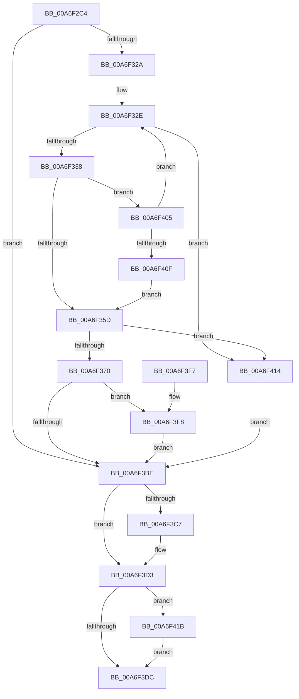

# PiGetDriverImageDirectory

- RVA: `0x00A6F2C4`–`0x00A6F422` (길이 `350` bytes)
- VA: `0x0000000140A6F2C4`
- 실행 섹션: `PAGE`
- PDB 이름 있음: `예`; PDB Function 태그: `아니요`
- unwind 정보 RVA: `0x000B4D74`
- 디코드: `90`개 명령, `350/350` bytes 표시
- 미해석 바이트: `0` (있으면 어셈블리에 `.byte`로 보존)

> 이 문서는 커널 이미지의 기계어와 PDB 기호를 분석해 생성했습니다. 4번과 5번은 함수 원형과 자료형을 바이너리 사용 방식에서 추정한 C 해석이며 원본 소스 복구 결과는 아닙니다.

## 1. Dependencies

- 직접 호출 지점: **5**; 고유 호출 대상: **5**
- 직접 호출자로 확인된 함수: **1**
- RIP 상대 이미지 참조: **0**

### Outgoing calls
- `0x00A6F30F` → [RtlInitUnicodeString](../../text/42/RtlInitUnicodeString_function_0042A780.md) (function, `0x0042A780`)
- `0x00A6F31B` → [IoQueryFullDriverPath](../../text/3F/IoQueryFullDriverPath_function_003FEDF0.md) (function, `0x003FEDF0`)
- `0x00A6F3B3` → [ZwOpenFile](../../text/6A/ZwOpenFile_function_006AD730.md) (function, `0x006AD730`)
- `0x00A6F3C7` → [ExFreePool](../../poolcode/B8/ExFreePool_function_00B82850.md) (function, `0x00B82850`)
- `0x00A6F41B` → [ZwClose](../../text/6A/ZwClose_function_006AD2B0.md) (function, `0x006AD2B0`)

### Direct callers
- [IoGetDriverDirectory](IoGetDriverDirectory_function_00A6F180.md) at `0x00A6F271`

### Static image references
- 디코드된 RIP-relative 메모리 참조가 없습니다.

## 2. Other-region calls and transfers

- 다른 실행 섹션으로 향하는 call: **5**
  - `0x00A6F30F` → [RtlInitUnicodeString](../../text/42/RtlInitUnicodeString_function_0042A780.md) (`PAGE` → `.text`)
  - `0x00A6F31B` → [IoQueryFullDriverPath](../../text/3F/IoQueryFullDriverPath_function_003FEDF0.md) (`PAGE` → `.text`)
  - `0x00A6F3B3` → [ZwOpenFile](../../text/6A/ZwOpenFile_function_006AD730.md) (`PAGE` → `.text`)
  - `0x00A6F3C7` → [ExFreePool](../../poolcode/B8/ExFreePool_function_00B82850.md) (`PAGE` → `POOLCODE`)
  - `0x00A6F41B` → [ZwClose](../../text/6A/ZwClose_function_006AD2B0.md) (`PAGE` → `.text`)
- 별도 외부 분기/꼬리 이동을 확인하지 못했습니다.

## 3. Assembly (complete function range)

```asm
00A6F2C4  48 89 5C 24 08                  mov qword ptr [rsp + 8], rbx
00A6F2C9  48 89 74 24 10                  mov qword ptr [rsp + 0x10], rsi
00A6F2CE  48 89 7C 24 20                  mov qword ptr [rsp + 0x20], rdi
00A6F2D3  55                              push rbp
00A6F2D4  48 8B EC                        mov rbp, rsp
00A6F2D7  48 81 EC 80 00 00 00            sub rsp, 0x80
00A6F2DE  0F 57 C0                        xorps xmm0, xmm0
00A6F2E1  33 C0                           xor eax, eax
00A6F2E3  48 8B FA                        mov rdi, rdx
00A6F2E6  48 89 45 F0                     mov qword ptr [rbp - 0x10], rax
00A6F2EA  48 8B D9                        mov rbx, rcx
00A6F2ED  89 45 F8                        mov dword ptr [rbp - 8], eax
00A6F2F0  0F 57 C9                        xorps xmm1, xmm1
00A6F2F3  48 8D 4D B0                     lea rcx, [rbp - 0x50]
00A6F2F7  33 F6                           xor esi, esi
00A6F2F9  33 D2                           xor edx, edx
00A6F2FB  0F 11 45 B0                     movups xmmword ptr [rbp - 0x50], xmm0
00A6F2FF  48 89 75 20                     mov qword ptr [rbp + 0x20], rsi
00A6F303  0F 11 4D C0                     movups xmmword ptr [rbp - 0x40], xmm1
00A6F307  0F 11 45 D0                     movups xmmword ptr [rbp - 0x30], xmm0
00A6F30B  0F 11 45 E0                     movups xmmword ptr [rbp - 0x20], xmm0
00A6F30F  E8 6C B4 9B FF                  call 0x14042a780
00A6F314  48 8D 55 B0                     lea rdx, [rbp - 0x50]
00A6F318  48 8B CB                        mov rcx, rbx
00A6F31B  E8 D0 FA 98 FF                  call 0x1403fedf0
00A6F320  8B D8                           mov ebx, eax
00A6F322  85 C0                           test eax, eax
00A6F324  0F 88 94 00 00 00               js 0x140a6f3be
00A6F32A  0F B7 45 B0                     movzx eax, word ptr [rbp - 0x50]
00A6F32E  66 83 F8 02                     cmp ax, 2
00A6F332  0F 82 DC 00 00 00               jb 0x140a6f414
00A6F338  4C 8B 45 B8                     mov r8, qword ptr [rbp - 0x48]
00A6F33C  B9 FE FF 00 00                  mov ecx, 0xfffe
00A6F341  66 03 C1                        add ax, cx
00A6F344  0F B7 C8                        movzx ecx, ax
00A6F347  48 D1 E9                        shr rcx, 1
00A6F34A  66 89 45 B0                     mov word ptr [rbp - 0x50], ax
00A6F34E  41 0F B7 14 48                  movzx edx, word ptr [r8 + rcx*2]
00A6F353  66 83 FA 5C                     cmp dx, 0x5c
00A6F357  0F 85 A8 00 00 00               jne 0x140a6f405
00A6F35D  66 41 89 34 48                  mov word ptr [r8 + rcx*2], si
00A6F362  0F B7 45 B0                     movzx eax, word ptr [rbp - 0x50]
00A6F366  66 83 F8 02                     cmp ax, 2
00A6F36A  0F 86 A4 00 00 00               jbe 0x140a6f414
00A6F370  48 8D 45 B0                     lea rax, [rbp - 0x50]
00A6F374  C7 44 24 28 21 00 00 00         mov dword ptr [rsp + 0x28], 0x21
00A6F37C  0F 57 C0                        xorps xmm0, xmm0
00A6F37F  48 89 45 E0                     mov qword ptr [rbp - 0x20], rax
00A6F383  4C 8D 4D C0                     lea r9, [rbp - 0x40]
00A6F387  C7 45 D0 30 00 00 00            mov dword ptr [rbp - 0x30], 0x30
00A6F38E  4C 8D 45 D0                     lea r8, [rbp - 0x30]
00A6F392  48 89 75 D8                     mov qword ptr [rbp - 0x28], rsi
00A6F396  BA 01 00 10 00                  mov edx, 0x100001
00A6F39B  C7 45 E8 40 02 00 00            mov dword ptr [rbp - 0x18], 0x240
00A6F3A2  48 8D 4D 20                     lea rcx, [rbp + 0x20]
00A6F3A6  C7 44 24 20 03 00 00 00         mov dword ptr [rsp + 0x20], 3
00A6F3AE  F3 0F 7F 45 F0                  movdqu xmmword ptr [rbp - 0x10], xmm0
00A6F3B3  E8 78 E3 C3 FF                  call 0x1406ad730
00A6F3B8  8B D8                           mov ebx, eax
00A6F3BA  85 C0                           test eax, eax
00A6F3BC  79 3A                           jns 0x140a6f3f8
00A6F3BE  48 8B 4D B8                     mov rcx, qword ptr [rbp - 0x48]
00A6F3C2  48 85 C9                        test rcx, rcx
00A6F3C5  74 0C                           je 0x140a6f3d3
00A6F3C7  E8 84 34 11 00                  call 0x140b82850
00A6F3CC  0F 57 C0                        xorps xmm0, xmm0
00A6F3CF  0F 11 45 B0                     movups xmmword ptr [rbp - 0x50], xmm0
00A6F3D3  48 8B 4D 20                     mov rcx, qword ptr [rbp + 0x20]
00A6F3D7  48 85 C9                        test rcx, rcx
00A6F3DA  75 3F                           jne 0x140a6f41b
00A6F3DC  4C 8D 9C 24 80 00 00 00         lea r11, [rsp + 0x80]
00A6F3E4  8B C3                           mov eax, ebx
00A6F3E6  49 8B 5B 10                     mov rbx, qword ptr [r11 + 0x10]
00A6F3EA  49 8B 73 18                     mov rsi, qword ptr [r11 + 0x18]
00A6F3EE  49 8B 7B 28                     mov rdi, qword ptr [r11 + 0x28]
00A6F3F2  49 8B E3                        mov rsp, r11
00A6F3F5  5D                              pop rbp
00A6F3F6  C3                              ret
00A6F3F7  CC                              int3
00A6F3F8  48 8B 45 20                     mov rax, qword ptr [rbp + 0x20]
00A6F3FC  48 89 07                        mov qword ptr [rdi], rax
00A6F3FF  48 89 75 20                     mov qword ptr [rbp + 0x20], rsi
00A6F403  EB B9                           jmp 0x140a6f3be
00A6F405  66 83 FA 2F                     cmp dx, 0x2f
00A6F409  0F 85 1F FF FF FF               jne 0x140a6f32e
00A6F40F  E9 49 FF FF FF                  jmp 0x140a6f35d
00A6F414  BB 0D 00 00 C0                  mov ebx, 0xc000000d
00A6F419  EB A3                           jmp 0x140a6f3be
00A6F41B  E8 90 DE C3 FF                  call 0x1406ad2b0
00A6F420  EB BA                           jmp 0x140a6f3dc
```

## 4. C-style interpretation (structured pseudocode)

```c
__int64 __fastcall PiGetDriverImageDirectory(__int64 a1, __int64 a2)
{
    __int64 result;
    __int64 v_rsi;
    __int64 v_rsp;
    unsigned int v_stack_m10;
    unsigned __int64 v_stack_m18;
    unsigned int v_stack_m20;
    unsigned __int64 v_stack_m28;
    unsigned __int64 v_stack_m30;
    unsigned __int64 v_stack_m38;
    unsigned __int64 v_stack_m48;
    unsigned __int64 v_stack_m50;
    unsigned __int64 v_stack_m58;
    unsigned int v_stack_m60;
    unsigned int v_stack_m68;
    unsigned __int64 v_stack_m8;
    unsigned __int64 v_stack_p10;
    unsigned __int64 v_stack_p18;
    unsigned __int64 v_stack_p20;
    unsigned __int64 v_stack_p8;

    v_stack_p8 = v_rbx;
    v_stack_p10 = v_rsi;
    v_stack_p20 = v_rdi;
    v_rsp = (v_rsp) - (128);
    result = 0;
    v_stack_m18 = 0;
    v_stack_m10 = 0;
    v_rsi = 0;
    a2 = 0;
    v_stack_m58 = v_xmm0;
    v_stack_p18 = 0;
    v_stack_m48 = v_xmm1;
    v_stack_m38 = v_xmm0;
    v_stack_m28 = v_xmm0;
    result = RtlInitUnicodeString(v_stack_m58, a2, a3, a4);
    result = IoQueryFullDriverPath(a1, v_stack_m58, a3, a4);
    if (sign_flag) goto loc_00A6F3BE;
loc_00A6F32E:
    if (((unsigned __int16)(v_stack_m58)) < 2) goto loc_00A6F414;
    result = (unsigned __int16)((v_stack_m58) + ((unsigned __int16)((unsigned int)(0xFFFEULL))));
    a1 = ((unsigned __int16)(result)) >> (1);
    v_stack_m58 = (unsigned __int16)(result);
    if (((unsigned __int16)(*(unsigned __int16 *)(v_stack_m50 + a1 * 2))) != 92) goto loc_00A6F405;
loc_00A6F35D:
    *(unsigned __int16 *)(v_stack_m50 + a1 * 2) = 0;
    if (((unsigned __int16)(v_stack_m58)) <= 2) goto loc_00A6F414;
    v_stack_m60 = 33;
    v_stack_m28 = v_stack_m58;
    v_stack_m38 = 48;
    v_stack_m30 = 0;
    v_stack_m20 = 576;
    v_stack_m68 = 3;
    v_stack_m18 = v_xmm0;
    result = ZwOpenFile(v_stack_p18, (unsigned int)(0x100001ULL), v_stack_m38, v_stack_m48);
    if (!sign_flag) goto loc_00A6F3F8;
loc_00A6F3BE:
    if (v_stack_m50 != 0) {
        result = ExFreePool(v_stack_m50, (unsigned int)(0x100001ULL), v_stack_m38, v_stack_m48);
        v_stack_m58 = v_xmm0;
    }
    if (v_stack_p18 != 0) goto loc_00A6F41B;
loc_00A6F3DC:
    return (unsigned int)((unsigned int)((unsigned int)((unsigned int)(result))));
loc_00A6F3F8:
    *(unsigned __int64 *)(*(unsigned __int64 *)(v_stack_m8 + 40)) = v_stack_p18;
    v_stack_p18 = *(unsigned __int64 *)(v_stack_m8 + 24);
    goto loc_00A6F3BE;
loc_00A6F405:
    if (((unsigned __int16)((unsigned int)(0x100001ULL))) != 47) goto loc_00A6F32E;
    goto loc_00A6F35D;
loc_00A6F414:
    goto loc_00A6F3BE;
loc_00A6F41B:
    result = ZwClose(v_stack_p18, (unsigned int)(0x100001ULL), v_stack_m38, v_stack_m48);
    goto loc_00A6F3DC;
}
```

## 5. (Beta) C Style

```c
int64_t PiGetDriverImageDirectory(int64_t Arg1, void *Arg2)
{
    uint8_t *arg2 = (uint8_t *)Arg2;

    int64_t result;
    int64_t local_rsi;
    int64_t local_rsp;
    uint32_t v_stack_m10;
    uint64_t v_stack_m18;
    uint32_t v_stack_m20;
    uint64_t v_stack_m28;
    uint64_t v_stack_m30;
    uint64_t v_stack_m38;
    uint64_t v_stack_m48;
    uint64_t v_stack_m50;
    uint64_t v_stack_m58;
    uint32_t v_stack_m60;
    uint32_t v_stack_m68;
    uint64_t v_stack_m8;
    uint64_t v_stack_p10;
    uint64_t v_stack_p18;
    uint64_t v_stack_p20;
    uint64_t v_stack_p8;

    v_stack_p8 = local_rbx;
    v_stack_p10 = local_rsi;
    v_stack_p20 = local_rdi;
    local_rsp = (local_rsp) - (128);
    result = 0;
    v_stack_m18 = 0;
    v_stack_m10 = 0;
    local_rsi = 0;
    Arg2 = 0;
    v_stack_m58 = v_xmm0;
    v_stack_p18 = 0;
    v_stack_m48 = v_xmm1;
    v_stack_m38 = v_xmm0;
    v_stack_m28 = v_xmm0;
    result = RtlInitUnicodeString(v_stack_m58, Arg2, a3, a4);
    result = IoQueryFullDriverPath(Arg1, v_stack_m58, a3, a4);
    if (sign_flag) goto loc_00A6F3BE;
loc_00A6F32E:
    if (((uint16_t)(v_stack_m58)) < 2) goto loc_00A6F414;
    result = (uint16_t)((v_stack_m58) + ((uint16_t)((uint32_t)(0xFFFEULL))));
    Arg1 = ((uint16_t)(result)) >> (1);
    v_stack_m58 = (uint16_t)(result);
    if (((uint16_t)(*(uint16_t *)(v_stack_m50 + Arg1 * 2))) != 92) goto loc_00A6F405;
loc_00A6F35D:
    *(uint16_t *)(v_stack_m50 + Arg1 * 2) = 0;
    if (((uint16_t)(v_stack_m58)) <= 2) goto loc_00A6F414;
    v_stack_m60 = 33;
    v_stack_m28 = v_stack_m58;
    v_stack_m38 = 48;
    v_stack_m30 = 0;
    v_stack_m20 = 576;
    v_stack_m68 = 3;
    v_stack_m18 = v_xmm0;
    result = ZwOpenFile(v_stack_p18, (uint32_t)(0x100001ULL), v_stack_m38, v_stack_m48);
    if (!sign_flag) goto loc_00A6F3F8;
loc_00A6F3BE:
    if (v_stack_m50 != 0) {
        result = ExFreePool(v_stack_m50, (uint32_t)(0x100001ULL), v_stack_m38, v_stack_m48);
        v_stack_m58 = v_xmm0;
    }
    if (v_stack_p18 != 0) goto loc_00A6F41B;
loc_00A6F3DC:
    return (uint32_t)((uint32_t)((uint32_t)((uint32_t)(result))));
loc_00A6F3F8:
    *(uint64_t *)(*(uint64_t *)(v_stack_m8 + 0x28)) = v_stack_p18;
    v_stack_p18 = *(uint64_t *)(v_stack_m8 + 0x18);
    goto loc_00A6F3BE;
loc_00A6F405:
    if (((uint16_t)((uint32_t)(0x100001ULL))) != 47) goto loc_00A6F32E;
    goto loc_00A6F35D;
loc_00A6F414:
    goto loc_00A6F3BE;
loc_00A6F41B:
    result = ZwClose(v_stack_p18, (uint32_t)(0x100001ULL), v_stack_m38, v_stack_m48);
    goto loc_00A6F3DC;
}
```

### 관측된 메모리 오프셋

구조체 형식이 확인되지 않은 접근은 인자 기준의 오프셋으로만 기록했습니다.

| 기준 인자 | 오프셋 표현 | 폭 (bit) | 접근 |
|---|---:|---:|---|
| `Arg2` | `+ 0x0` | `64` | `W` |

## 6. Execution-region graph

[열기: 2D/3D 그래프와 함수 탐색 컨트롤 패널](../../../control-panel.html?section=page&rva=0x00A6F2C4&view=graph)

- 2D 그래프는 위에서 아래로 흐르고, 3D 그래프는 빈 공간을 드래그해 회전합니다. Shift+드래그는 이동, 휠은 확대·축소, 함수 노드 선택은 대상 보고서 이동입니다.

### Static fallback


