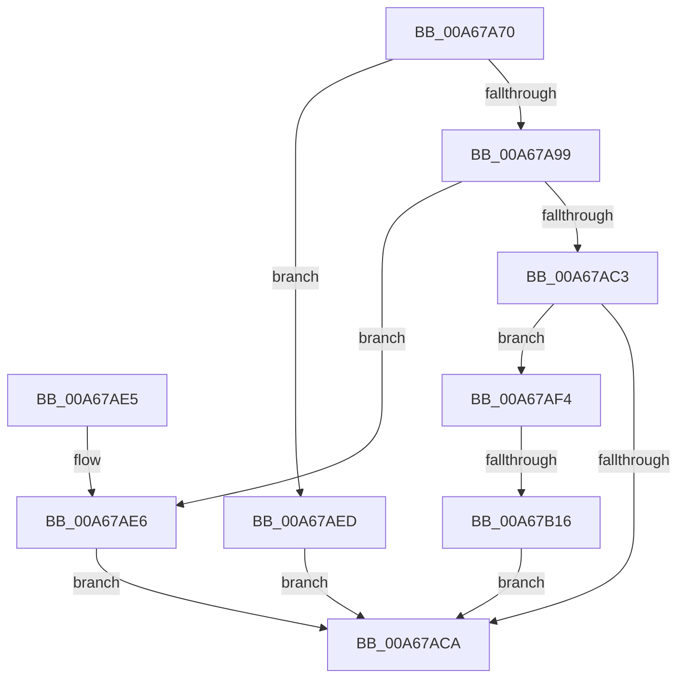

# PiGetStateRootPath

- RVA: `0x00A67A70`–`0x00A67B1D` (길이 `173` bytes)
- VA: `0x0000000140A67A70`
- 실행 섹션: `PAGE`
- PDB 이름 있음: `예`; PDB Function 태그: `예`
- unwind 정보 RVA: `0x000948CC`
- 디코드: `52`개 명령, `173/173` bytes 표시
- 미해석 바이트: `0` (있으면 어셈블리에 `.byte`로 보존)

> 이 문서는 커널 이미지의 기계어와 PDB 기호를 분석해 생성했습니다. 4번과 5번은 함수 원형과 자료형을 바이너리 사용 방식에서 추정한 C 해석이며 원본 소스 복구 결과는 아닙니다.

## 1. Dependencies

- 직접 호출 지점: **2**; 고유 호출 대상: **2**
- 직접 호출자로 확인된 함수: **5**
- RIP 상대 이미지 참조: **0**

### Outgoing calls
- `0x00A67AB8` → [RtlGetPersistedStateLocation](../8C/RtlGetPersistedStateLocation_function_008C8DE0.md) (function, `0x008C8DE0`)
- `0x00A67B05` → [ExAllocatePool2](../../poolcode/B8/ExAllocatePool2_function_00B820F0.md) (function, `0x00B820F0`)

### Direct callers
- [IoGetDeviceDirectory](../72/IoGetDeviceDirectory_function_00728370.md) at `0x0072847C`
- [PiGetDriverMutableStateDirectory](../72/PiGetDriverMutableStateDirectory_function_00729038.md) at `0x007290A7`
- [PiOpenDriverRedirectedStateRootKey](../72/PiOpenDriverRedirectedStateRootKey_function_0072935C.md) at `0x007293B4`
- [PiOpenDriverRedirectedStateKey](../96/PiOpenDriverRedirectedStateKey_function_00965D04.md) at `0x00965D98`
- [PiCreateDriverDataDirectoryRoot](../../init/C3/PiCreateDriverDataDirectoryRoot_function_00C329A8.md) at `0x00C32A0C`

### Static image references
- 디코드된 RIP-relative 메모리 참조가 없습니다.

## 2. Other-region calls and transfers

- 다른 실행 섹션으로 향하는 call: **1**
  - `0x00A67B05` → [ExAllocatePool2](../../poolcode/B8/ExAllocatePool2_function_00B820F0.md) (`PAGE` → `POOLCODE`)
- call이 아닌 외부 분기/꼬리 이동: **1**
  - `0x00A67B10` → [sub_00B3EB30](../B3/Unknown_function_00B3EB30.md) (`tail-transfer`)

## 3. Assembly (complete function range)

```asm
00A67A70  4C 8B DC                        mov r11, rsp
00A67A73  49 89 5B 08                     mov qword ptr [r11 + 8], rbx
00A67A77  49 89 6B 10                     mov qword ptr [r11 + 0x10], rbp
00A67A7B  49 89 73 18                     mov qword ptr [r11 + 0x18], rsi
00A67A7F  57                              push rdi
00A67A80  41 56                           push r14
00A67A82  41 57                           push r15
00A67A84  48 83 EC 40                     sub rsp, 0x40
00A67A88  49 8B F1                        mov rsi, r9
00A67A8B  41 8B E8                        mov ebp, r8d
00A67A8E  4C 8B F2                        mov r14, rdx
00A67A91  4C 8B F9                        mov r15, rcx
00A67A94  4D 85 C9                        test r9, r9
00A67A97  74 54                           je 0x140a67aed
00A67A99  83 64 24 78 00                  and dword ptr [rsp + 0x78], 0
00A67A9E  49 8D 43 20                     lea rax, [r11 + 0x20]
00A67AA2  49 89 43 D8                     mov qword ptr [r11 - 0x28], rax
00A67AA6  45 8B C8                        mov r9d, r8d
00A67AA9  83 64 24 28 00                  and dword ptr [rsp + 0x28], 0
00A67AAE  4C 8B C2                        mov r8, rdx
00A67AB1  49 83 63 C8 00                  and qword ptr [r11 - 0x38], 0
00A67AB6  33 D2                           xor edx, edx
00A67AB8  E8 23 13 E6 FF                  call 0x1408c8de0
00A67ABD  8B D8                           mov ebx, eax
00A67ABF  85 C0                           test eax, eax
00A67AC1  79 23                           jns 0x140a67ae6
00A67AC3  3D 05 00 00 80                  cmp eax, 0x80000005
00A67AC8  74 2A                           je 0x140a67af4
00A67ACA  48 8B 6C 24 68                  mov rbp, qword ptr [rsp + 0x68]
00A67ACF  8B C3                           mov eax, ebx
00A67AD1  48 8B 5C 24 60                  mov rbx, qword ptr [rsp + 0x60]
00A67AD6  48 8B 74 24 70                  mov rsi, qword ptr [rsp + 0x70]
00A67ADB  48 83 C4 40                     add rsp, 0x40
00A67ADF  41 5F                           pop r15
00A67AE1  41 5E                           pop r14
00A67AE3  5F                              pop rdi
00A67AE4  C3                              ret
00A67AE5  CC                              int3
00A67AE6  BB 01 00 00 C0                  mov ebx, 0xc0000001
00A67AEB  EB DD                           jmp 0x140a67aca
00A67AED  BB 0D 00 00 C0                  mov ebx, 0xc000000d
00A67AF2  EB D6                           jmp 0x140a67aca
00A67AF4  8B 5C 24 78                     mov ebx, dword ptr [rsp + 0x78]
00A67AF8  B9 00 01 00 00                  mov ecx, 0x100
00A67AFD  8B D3                           mov edx, ebx
00A67AFF  41 B8 50 70 69 6F               mov r8d, 0x6f697050
00A67B05  E8 E6 A5 11 00                  call 0x140b820f0
00A67B0A  48 8B F8                        mov rdi, rax
00A67B0D  48 85 C0                        test rax, rax
00A67B10  0F 85 1A 70 0D 00               jne 0x140b3eb30
00A67B16  BB 9A 00 00 C0                  mov ebx, 0xc000009a
00A67B1B  EB AD                           jmp 0x140a67aca
```

## 4. C-style interpretation (structured pseudocode)

```c
__int64 __fastcall PiGetStateRootPath(__int64 a1, __int64 a2, int a3, __int64 a4)
{
    __int64 result;
    __int64 v_rsp;
    unsigned int v_stack_m30;
    unsigned __int64 v_stack_p10;
    unsigned __int64 v_stack_p18;
    unsigned int v_stack_p20;
    unsigned int v_stack_p78;
    unsigned __int64 v_stack_p8;

    *(unsigned __int64 *)(v_rsp + 8) = v_rbx;
    *(unsigned __int64 *)(v_rsp + 16) = v_rbp;
    *(unsigned __int64 *)(v_rsp + 24) = v_rsi;
    v_rsp = (v_rsp) - (64);
    if (a4 == 0) goto loc_00A67AED;
    *(unsigned __int64 *)(v_rsp - 40) = v_rsp + 32;
    a2 = 0;
    result = RtlGetPersistedStateLocation(a1, a2, a2, (unsigned int)(a3));
    if (!sign_flag) goto loc_00A67AE6;
    if (((unsigned int)(result)) == 0x80000005ULL) goto loc_00A67AF4;
loc_00A67ACA:
    v_rsp = (v_rsp) + (64);
    return (unsigned int)((unsigned int)((unsigned int)((unsigned int)(result))));
loc_00A67AE6:
    goto loc_00A67ACA;
loc_00A67AED:
    goto loc_00A67ACA;
loc_00A67AF4:
    result = ExAllocatePool2(256, (unsigned int)((unsigned int)((unsigned int)(v_stack_p78))), (unsigned int)(0x6F697050ULL), (unsigned int)(a3));
    goto loc_00A67ACA;
}
```

## 5. (Beta) C Style

```c
int64_t PiGetStateRootPath(int64_t Arg1, int64_t Arg2, int32_t Arg3, int64_t Arg4)
{
    int64_t result;
    int64_t local_rsp;
    uint32_t v_stack_m30;
    uint64_t v_stack_p10;
    uint64_t v_stack_p18;
    uint32_t v_stack_p20;
    uint32_t v_stack_p78;
    uint64_t v_stack_p8;

    *(uint64_t *)(local_rsp + 0x8) = local_rbx;
    *(uint64_t *)(local_rsp + 0x10) = local_rbp;
    *(uint64_t *)(local_rsp + 0x18) = local_rsi;
    local_rsp = (local_rsp) - (64);
    if (Arg4 == 0) goto loc_00A67AED;
    *(uint64_t *)(local_rsp - 0x28) = local_rsp + 32;
    Arg2 = 0;
    result = RtlGetPersistedStateLocation(Arg1, Arg2, Arg2, (uint32_t)(Arg3));
    if (!sign_flag) goto loc_00A67AE6;
    if (((uint32_t)(result)) == 0x80000005ULL) goto loc_00A67AF4;
loc_00A67ACA:
    local_rsp = (local_rsp) + (64);
    return (uint32_t)((uint32_t)((uint32_t)((uint32_t)(result))));
loc_00A67AE6:
    goto loc_00A67ACA;
loc_00A67AED:
    goto loc_00A67ACA;
loc_00A67AF4:
    result = ExAllocatePool2(256, (uint32_t)((uint32_t)((uint32_t)(v_stack_p78))), (uint32_t)(0x6F697050ULL), (uint32_t)(Arg3));
    goto loc_00A67ACA;
}
```

## 6. Execution-region graph

[열기: 2D/3D 그래프와 함수 탐색 컨트롤 패널](../../../control-panel.html?section=page&rva=0x00A67A70&view=graph)

- 2D 그래프는 위에서 아래로 흐르고, 3D 그래프는 빈 공간을 드래그해 회전합니다. Shift+드래그는 이동, 휠은 확대·축소, 함수 노드 선택은 대상 보고서 이동입니다.

### Static fallback


