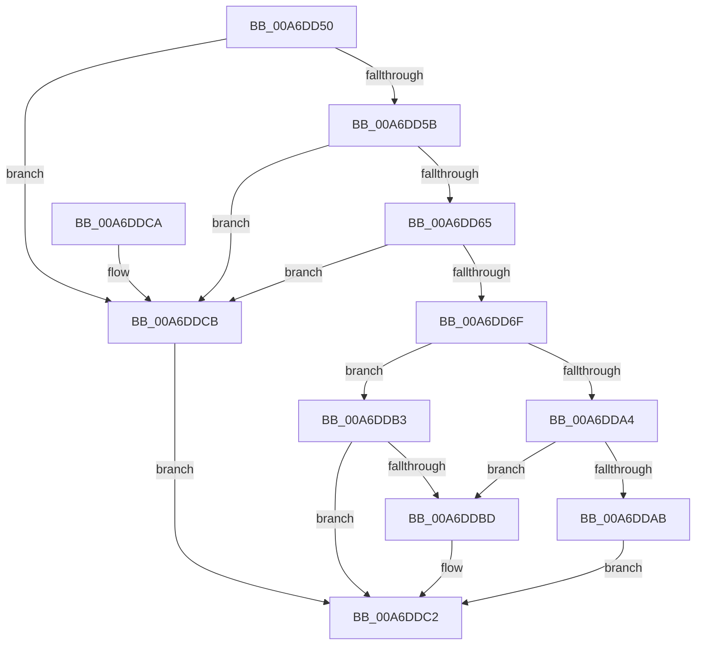

# PiPnpRtlGetDeviceRelationsList

- RVA: `0x00A6DD50`–`0x00A6DDD2` (길이 `130` bytes)
- VA: `0x0000000140A6DD50`
- 실행 섹션: `PAGE`
- PDB 이름 있음: `예`; PDB Function 태그: `아니요`
- unwind 정보 RVA: `0x000B492C`
- 디코드: `39`개 명령, `130/130` bytes 표시
- 미해석 바이트: `0` (있으면 어셈블리에 `.byte`로 보존)

> 이 문서는 커널 이미지의 기계어와 PDB 기호를 분석해 생성했습니다. 4번과 5번은 함수 원형과 자료형을 바이너리 사용 방식에서 추정한 C 해석이며 원본 소스 복구 결과는 아닙니다.

## 1. Dependencies

- 직접 호출 지점: **1**; 고유 호출 대상: **1**
- 직접 호출자로 확인된 함수: **0**
- RIP 상대 이미지 참조: **0**

### Outgoing calls
- `0x00A6DD99` → [ZwPlugPlayControl](../../text/6A/ZwPlugPlayControl_function_006AF890.md) (function, `0x006AF890`)

### Direct callers
- 이 함수 시작 RVA로 연결되는 직접 call은 확인되지 않았습니다. 간접 호출은 완전히 역산할 수 없습니다.

### Static image references
- 디코드된 RIP-relative 메모리 참조가 없습니다.

## 2. Other-region calls and transfers

- 다른 실행 섹션으로 향하는 call: **1**
  - `0x00A6DD99` → [ZwPlugPlayControl](../../text/6A/ZwPlugPlayControl_function_006AF890.md) (`PAGE` → `.text`)
- 별도 외부 분기/꼬리 이동을 확인하지 못했습니다.

## 3. Assembly (complete function range)

```asm
00A6DD50  40 53                           push rbx
00A6DD52  48 83 EC 40                     sub rsp, 0x40
00A6DD56  48 85 D2                        test rdx, rdx
00A6DD59  74 70                           je 0x140a6ddcb
00A6DD5B  48 8B 5C 24 78                  mov rbx, qword ptr [rsp + 0x78]
00A6DD60  48 85 DB                        test rbx, rbx
00A6DD63  74 66                           je 0x140a6ddcb
00A6DD65  83 BC 24 80 00 00 00 00         cmp dword ptr [rsp + 0x80], 0
00A6DD6D  75 5C                           jne 0x140a6ddcb
00A6DD6F  0F 10 02                        movups xmm0, xmmword ptr [rdx]
00A6DD72  8B 44 24 70                     mov eax, dword ptr [rsp + 0x70]
00A6DD76  48 8D 54 24 20                  lea rdx, [rsp + 0x20]
00A6DD7B  44 89 44 24 30                  mov dword ptr [rsp + 0x30], r8d
00A6DD80  41 B8 20 00 00 00               mov r8d, 0x20
00A6DD86  F3 0F 7F 44 24 20               movdqu xmmword ptr [rsp + 0x20], xmm0
00A6DD8C  4C 89 4C 24 38                  mov qword ptr [rsp + 0x38], r9
00A6DD91  89 44 24 34                     mov dword ptr [rsp + 0x34], eax
00A6DD95  41 8D 48 F0                     lea ecx, [r8 - 0x10]
00A6DD99  E8 F2 1A C4 FF                  call 0x1406af890
00A6DD9E  8B C8                           mov ecx, eax
00A6DDA0  85 C0                           test eax, eax
00A6DDA2  79 0F                           jns 0x140a6ddb3
00A6DDA4  3D 23 00 00 C0                  cmp eax, 0xc0000023
00A6DDA9  75 12                           jne 0x140a6ddbd
00A6DDAB  8B 44 24 34                     mov eax, dword ptr [rsp + 0x34]
00A6DDAF  89 03                           mov dword ptr [rbx], eax
00A6DDB1  EB 0F                           jmp 0x140a6ddc2
00A6DDB3  8B 44 24 34                     mov eax, dword ptr [rsp + 0x34]
00A6DDB7  89 03                           mov dword ptr [rbx], eax
00A6DDB9  85 C0                           test eax, eax
00A6DDBB  75 05                           jne 0x140a6ddc2
00A6DDBD  B9 34 00 00 C0                  mov ecx, 0xc0000034
00A6DDC2  8B C1                           mov eax, ecx
00A6DDC4  48 83 C4 40                     add rsp, 0x40
00A6DDC8  5B                              pop rbx
00A6DDC9  C3                              ret
00A6DDCA  CC                              int3
00A6DDCB  B9 0D 00 00 C0                  mov ecx, 0xc000000d
00A6DDD0  EB F0                           jmp 0x140a6ddc2
```

## 4. C-style interpretation (structured pseudocode)

```c
__int64 __fastcall PiPnpRtlGetDeviceRelationsList(__int64 a1, __int64 a2, int a3, __int64 a4, unsigned int a5, __int64 a6, unsigned int a7)
{
    __int64 result;
    __int64 v_rsp;
    unsigned __int64 v_stack_m10;
    unsigned int v_stack_m14;
    unsigned int v_stack_m18;
    unsigned __int64 v_stack_m28;

    v_rsp = (v_rsp) - (64);
    if (a2 == 0) goto loc_00A6DDCB;
    if (a6 == 0) goto loc_00A6DDCB;
    if (a7 != 0) goto loc_00A6DDCB;
    v_stack_m18 = a3;
    v_stack_m28 = v_xmm0;
    v_stack_m10 = a4;
    v_stack_m14 = (unsigned int)((unsigned int)(a5));
    result = ZwPlugPlayControl(32 - 16, v_stack_m28, 32, a4);
    if (!sign_flag) goto loc_00A6DDB3;
    if (((unsigned int)(result)) != 0xC0000023ULL) goto loc_00A6DDBD;
    *(unsigned int *)(a6) = (unsigned int)((unsigned int)(v_stack_m14));
    goto loc_00A6DDC2;
loc_00A6DDB3:
    *(unsigned int *)(a6) = (unsigned int)((unsigned int)(v_stack_m14));
    if ((unsigned int)((unsigned int)(v_stack_m14)) == 0) {
        a1 = 0xC0000034ULL;
    }
    v_rsp = (v_rsp) + (64);
    return (unsigned int)((unsigned int)(a1));
loc_00A6DDCB:
    goto loc_00A6DDC2;
}
```

## 5. (Beta) C Style

```c
int64_t PiPnpRtlGetDeviceRelationsList(int64_t Arg1, int64_t Arg2, int32_t Arg3, int64_t Arg4, uint32_t Arg5, int64_t Arg6, uint32_t Arg7)
{
    int64_t result;
    int64_t local_rsp;
    uint64_t v_stack_m10;
    uint32_t v_stack_m14;
    uint32_t v_stack_m18;
    uint64_t v_stack_m28;

    local_rsp = (local_rsp) - (64);
    if (Arg2 == 0) goto loc_00A6DDCB;
    if (Arg6 == 0) goto loc_00A6DDCB;
    if (Arg7 != 0) goto loc_00A6DDCB;
    v_stack_m18 = Arg3;
    v_stack_m28 = v_xmm0;
    v_stack_m10 = Arg4;
    v_stack_m14 = (uint32_t)((uint32_t)(Arg5));
    result = ZwPlugPlayControl(32 - 16, v_stack_m28, 32, Arg4);
    if (!sign_flag) goto loc_00A6DDB3;
    if (((uint32_t)(result)) != 0xC0000023ULL) goto loc_00A6DDBD;
    *(uint32_t *)(Arg6) = (uint32_t)((uint32_t)(v_stack_m14));
    goto loc_00A6DDC2;
loc_00A6DDB3:
    *(uint32_t *)(Arg6) = (uint32_t)((uint32_t)(v_stack_m14));
    if ((uint32_t)((uint32_t)(v_stack_m14)) == 0) {
        Arg1 = 0xC0000034ULL;
    }
    local_rsp = (local_rsp) + (64);
    return (uint32_t)((uint32_t)(Arg1));
loc_00A6DDCB:
    goto loc_00A6DDC2;
}
```

## 6. Execution-region graph

[열기: 2D/3D 그래프와 함수 탐색 컨트롤 패널](../../../control-panel.html?section=page&rva=0x00A6DD50&view=graph)

- 2D 그래프는 위에서 아래로 흐르고, 3D 그래프는 빈 공간을 드래그해 회전합니다. Shift+드래그는 이동, 휠은 확대·축소, 함수 노드 선택은 대상 보고서 이동입니다.

### Static fallback


