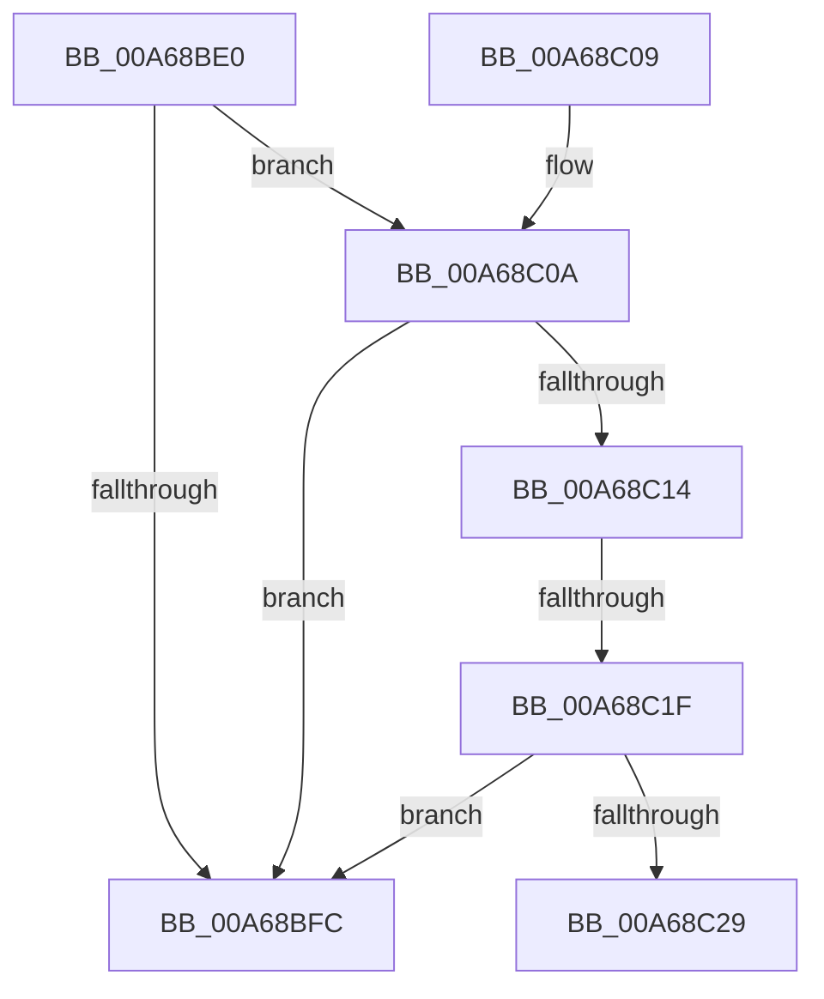

# PiResetProblemDevicesWorker

- RVA: `0x00A68BE0`–`0x00A68C37` (길이 `87` bytes)
- VA: `0x0000000140A68BE0`
- 실행 섹션: `PAGE`
- PDB 이름 있음: `예`; PDB Function 태그: `예`
- unwind 정보 RVA: `0x000B3FDC`
- 디코드: `25`개 명령, `87/87` bytes 표시
- 미해석 바이트: `0` (있으면 어셈블리에 `.byte`로 보존)

> 이 문서는 커널 이미지의 기계어와 PDB 기호를 분석해 생성했습니다. 4번과 5번은 함수 원형과 자료형을 바이너리 사용 방식에서 추정한 C 해석이며 원본 소스 복구 결과는 아닙니다.

## 1. Dependencies

- 직접 호출 지점: **0**; 고유 호출 대상: **0**
- 직접 호출자로 확인된 함수: **0**
- RIP 상대 이미지 참조: **0**

### Outgoing calls
- 직접 디코드된 call 명령이 없습니다.

### Direct callers
- 이 함수 시작 RVA로 연결되는 직접 call은 확인되지 않았습니다. 간접 호출은 완전히 역산할 수 없습니다.

### Static image references
- 디코드된 RIP-relative 메모리 참조가 없습니다.

## 2. Other-region calls and transfers

- 다른 실행 섹션으로 향하는 call: **0**
- call이 아닌 외부 분기/꼬리 이동: **2**
  - `0x00A68C19` → [sub_00B3ED66](../B3/Unknown_function_00B3ED66.md) (`tail-transfer`)
  - `0x00A68C32` → [sub_00B3ED66](../B3/Unknown_function_00B3ED66.md) (`tail-transfer`)

## 3. Assembly (complete function range)

```asm
00A68BE0  48 89 5C 24 08                  mov qword ptr [rsp + 8], rbx
00A68BE5  57                              push rdi
00A68BE6  48 83 EC 40                     sub rsp, 0x40
00A68BEA  F7 81 8C 01 00 00 00 20 00 00   test dword ptr [rcx + 0x18c], 0x2000
00A68BF4  48 8B FA                        mov rdi, rdx
00A68BF7  48 8B D9                        mov rbx, rcx
00A68BFA  75 0E                           jne 0x140a68c0a
00A68BFC  48 8B 5C 24 50                  mov rbx, qword ptr [rsp + 0x50]
00A68C01  33 C0                           xor eax, eax
00A68C03  48 83 C4 40                     add rsp, 0x40
00A68C07  5F                              pop rdi
00A68C08  C3                              ret
00A68C09  CC                              int3
00A68C0A  8B 02                           mov eax, dword ptr [rdx]
00A68C0C  39 81 94 01 00 00               cmp dword ptr [rcx + 0x194], eax
00A68C12  75 E8                           jne 0x140a68bfc
00A68C14  8B 42 08                        mov eax, dword ptr [rdx + 8]
00A68C17  85 C0                           test eax, eax
00A68C19  0F 84 47 61 0D 00               je 0x140b3ed66
00A68C1F  8B 89 80 02 00 00               mov ecx, dword ptr [rcx + 0x280]
00A68C25  3B C8                           cmp ecx, eax
00A68C27  73 D3                           jae 0x140a68bfc
00A68C29  8D 41 01                        lea eax, [rcx + 1]
00A68C2C  89 83 80 02 00 00               mov dword ptr [rbx + 0x280], eax
00A68C32  E9 2F 61 0D 00                  jmp 0x140b3ed66
```

## 4. C-style interpretation (structured pseudocode)

```c
__int64 __fastcall PiResetProblemDevicesWorker(__int64 a1, __int64 a2)
{
    __int64 result;
    __int64 v_rsp;
    unsigned __int64 v_stack_p8;

    v_stack_p8 = v_rbx;
    v_rsp = (v_rsp) - (64);
    if (((*(unsigned int *)(a1 + 396)) & (0x2000ULL)) != 0) goto loc_00A68C0A;
loc_00A68BFC:
    result = 0;
    v_rsp = (v_rsp) + (64);
    return result;
loc_00A68C0A:
    if ((*(unsigned int *)(a1 + 404)) != ((unsigned int)((unsigned int)(*(unsigned int *)(a2))))) goto loc_00A68BFC;
    if (((unsigned int)((unsigned int)(*(unsigned int *)(a1 + 640)))) >= ((unsigned int)((unsigned int)(*(unsigned int *)(a2 + 8))))) goto loc_00A68BFC;
    *(unsigned int *)(v_stack_p8 + 640) = (unsigned int)((unsigned int)(*(unsigned int *)(a1 + 640)) + 1);
}
```

## 5. (Beta) C Style

```c
int64_t PiResetProblemDevicesWorker(void *Arg1, void *Arg2)
{
    uint8_t *arg1 = (uint8_t *)Arg1;
    uint8_t *arg2 = (uint8_t *)Arg2;

    int64_t result;
    int64_t local_rsp;
    uint64_t v_stack_p8;

    v_stack_p8 = local_rbx;
    local_rsp = (local_rsp) - (64);
    if (((*(uint32_t *)(arg1 + 0x18C)) & (0x2000ULL)) != 0) goto loc_00A68C0A;
loc_00A68BFC:
    result = 0;
    local_rsp = (local_rsp) + (64);
    return result;
loc_00A68C0A:
    if ((*(uint32_t *)(arg1 + 0x194)) != ((uint32_t)((uint32_t)(*(uint32_t *)(arg2))))) goto loc_00A68BFC;
    if (((uint32_t)((uint32_t)(*(uint32_t *)(arg1 + 0x280)))) >= ((uint32_t)((uint32_t)(*(uint32_t *)(arg2 + 0x8))))) goto loc_00A68BFC;
    *(uint32_t *)(v_stack_p8 + 0x280) = (uint32_t)((uint32_t)(*(uint32_t *)(arg1 + 0x280)) + 1);
}
```

### 관측된 메모리 오프셋

구조체 형식이 확인되지 않은 접근은 인자 기준의 오프셋으로만 기록했습니다.

| 기준 인자 | 오프셋 표현 | 폭 (bit) | 접근 |
|---|---:|---:|---|
| `Arg1` | `+ 0x18C` | `32` | `R` |
| `Arg1` | `+ 0x194` | `32` | `R` |
| `Arg1` | `+ 0x280` | `32` | `R` |
| `Arg1` | `+ 0x280` | `32` | `W` |
| `Arg2` | `+ 0x0` | `32` | `R` |
| `Arg2` | `+ 0x8` | `32` | `R` |

## 6. Execution-region graph

[열기: 2D/3D 그래프와 함수 탐색 컨트롤 패널](../../../control-panel.html?section=page&rva=0x00A68BE0&view=graph)

- 2D 그래프는 위에서 아래로 흐르고, 3D 그래프는 빈 공간을 드래그해 회전합니다. Shift+드래그는 이동, 휠은 확대·축소, 함수 노드 선택은 대상 보고서 이동입니다.

### Static fallback


