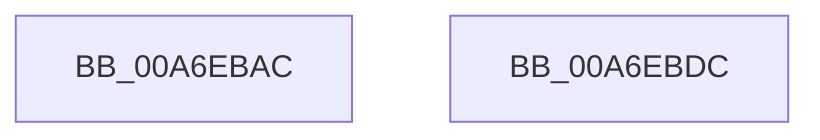

# PiUEventGatherEventData

- RVA: `0x00A6EBAC`–`0x00A6EBDD` (길이 `49` bytes)
- VA: `0x0000000140A6EBAC`
- 실행 섹션: `PAGE`
- PDB 이름 있음: `예`; PDB Function 태그: `아니요`
- unwind 정보 RVA: `0x0005C788`
- 디코드: `14`개 명령, `49/49` bytes 표시
- 미해석 바이트: `0` (있으면 어셈블리에 `.byte`로 보존)

> 이 문서는 커널 이미지의 기계어와 PDB 기호를 분석해 생성했습니다. 4번과 5번은 함수 원형과 자료형을 바이너리 사용 방식에서 추정한 C 해석이며 원본 소스 복구 결과는 아닙니다.

## 1. Dependencies

- 직접 호출 지점: **1**; 고유 호출 대상: **1**
- 직접 호출자로 확인된 함수: **5**
- RIP 상대 이미지 참조: **1**

### Outgoing calls
- `0x00A6EBD2` → [PnpExtractCategorySpecificEventData](PnpExtractCategorySpecificEventData_function_00A6EBE4.md) (function, `0x00A6EBE4`)

### Direct callers
- [PiUEventMovePendingEventToSynchronousQueue](../70/PiUEventMovePendingEventToSynchronousQueue_function_00700798.md) at `0x00700847`
- [PiUEventNotifyUserMode](../95/PiUEventNotifyUserMode_function_00954CB4.md) at `0x0095511B`
- [PiUEventNotifyUserMode](../95/PiUEventNotifyUserMode_function_00954CB4.md) at `0x00955186`
- [sub_00B1D4A4](../B1/Unknown_function_00B1D4A4.md) at `0x00B1D4B3`
- [sub_00B1D4A4](../B1/Unknown_function_00B1D4A4.md) at `0x00B1D55F`
- [sub_00B1D4A4](../B1/Unknown_function_00B1D4A4.md) at `0x00B1D62D`
- [sub_00B2EF58](../B2/Unknown_function_00B2EF58.md) at `0x00B2EF64`
- [sub_00B2EF58](../B2/Unknown_function_00B2EF58.md) at `0x00B2EFDF`
- [sub_00B2F090](../B2/Unknown_function_00B2F090.md) at `0x00B2F0A8`
- [sub_00B2F090](../B2/Unknown_function_00B2F090.md) at `0x00B2F14D`

### Static image references
- `0x00A6EBB4` → RVA `0x00AFCAD0` (` ?? ::NNGAKEGL::`string'`; read)

## 2. Other-region calls and transfers

- 다른 실행 섹션으로 향하는 call: **0**
- 별도 외부 분기/꼬리 이동을 확인하지 못했습니다.

## 3. Assembly (complete function range)

```asm
00A6EBAC  48 83 EC 28                     sub rsp, 0x28
00A6EBB0  48 8B 41 40                     mov rax, qword ptr [rcx + 0x40]
00A6EBB4  4C 8D 15 15 DF 08 00            lea r10, [rip + 0x8df15]
00A6EBBB  48 85 C0                        test rax, rax
00A6EBBE  4D 8B D8                        mov r11, r8
00A6EBC1  4D 8B C1                        mov r8, r9
00A6EBC4  4C 0F 45 D0                     cmovne r10, rax
00A6EBC8  48 83 C1 50                     add rcx, 0x50
00A6EBCC  4C 89 12                        mov qword ptr [rdx], r10
00A6EBCF  49 8B D3                        mov rdx, r11
00A6EBD2  E8 0D 00 00 00                  call 0x140a6ebe4
00A6EBD7  48 83 C4 28                     add rsp, 0x28
00A6EBDB  C3                              ret
00A6EBDC  CC                              int3
```

## 4. C-style interpretation (structured pseudocode)

```c
__int64 __fastcall PiUEventGatherEventData(__int64 a1, __int64 a2, __int64 a3, __int64 a4)
{
    __int64 result;
    __int64 v_r10;
    __int64 v_rsp;

    v_rsp = (v_rsp) - (40);
    v_r10 = v_rip + 581397;
    if (*(unsigned __int64 *)(a1 + 64) != 0) { v_r10 = *(unsigned __int64 *)(a1 + 64); }
    a1 = (a1) + (80);
    *(unsigned __int64 *)(a2) = v_r10;
    result = PnpExtractCategorySpecificEventData(a1, a3, a4, a4);
    v_rsp = (v_rsp) + (40);
    return result;
}
```

## 5. (Beta) C Style

```c
int64_t PiUEventGatherEventData(void *Arg1, void *Arg2, int64_t Arg3, int64_t Arg4)
{
    uint8_t *arg1 = (uint8_t *)Arg1;
    uint8_t *arg2 = (uint8_t *)Arg2;

    int64_t result;
    int64_t local_r10;
    int64_t local_rsp;

    local_rsp = (local_rsp) - (40);
    local_r10 = v_rip + 581397;
    if (*(uint64_t *)(arg1 + 0x40) != 0) { local_r10 = *(uint64_t *)(arg1 + 0x40); }
    Arg1 = (Arg1) + (80);
    *(uint64_t *)(arg2) = local_r10;
    result = PnpExtractCategorySpecificEventData(Arg1, Arg3, Arg4, Arg4);
    local_rsp = (local_rsp) + (40);
    return result;
}
```

### 관측된 메모리 오프셋

구조체 형식이 확인되지 않은 접근은 인자 기준의 오프셋으로만 기록했습니다.

| 기준 인자 | 오프셋 표현 | 폭 (bit) | 접근 |
|---|---:|---:|---|
| `Arg1` | `+ 0x40` | `64` | `R` |
| `Arg2` | `+ 0x0` | `64` | `W` |

## 6. Execution-region graph

[열기: 2D/3D 그래프와 함수 탐색 컨트롤 패널](../../../control-panel.html?section=page&rva=0x00A6EBAC&view=graph)

- 2D 그래프는 위에서 아래로 흐르고, 3D 그래프는 빈 공간을 드래그해 회전합니다. Shift+드래그는 이동, 휠은 확대·축소, 함수 노드 선택은 대상 보고서 이동입니다.

### Static fallback


