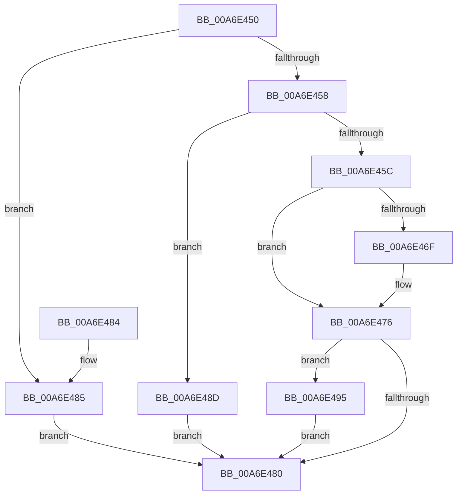

# PipDeviceObjectListElementAt

- RVA: `0x00A6E450`–`0x00A6E4A1` (길이 `81` bytes)
- VA: `0x0000000140A6E450`
- 실행 섹션: `PAGE`
- PDB 이름 있음: `예`; PDB Function 태그: `아니요`
- unwind 정보 RVA: `0x000DB714`
- 디코드: `27`개 명령, `81/81` bytes 표시
- 미해석 바이트: `0` (있으면 어셈블리에 `.byte`로 보존)

> 이 문서는 커널 이미지의 기계어와 PDB 기호를 분석해 생성했습니다. 4번과 5번은 함수 원형과 자료형을 바이너리 사용 방식에서 추정한 C 해석이며 원본 소스 복구 결과는 아닙니다.

## 1. Dependencies

- 직접 호출 지점: **0**; 고유 호출 대상: **0**
- 직접 호출자로 확인된 함수: **3**
- RIP 상대 이미지 참조: **0**

### Outgoing calls
- 직접 디코드된 call 명령이 없습니다.

### Direct callers
- [IopRemoveCurrentRelationFromList](../73/IopRemoveCurrentRelationFromList_function_0073DB30.md) at `0x0073DB74`
- [PipGrowDeviceObjectList](../A0/PipGrowDeviceObjectList_function_00A04620.md) at `0x00A04679`
- [IopEnumerateRelations](IopEnumerateRelations_function_00A6E3B4.md) at `0x00A6E40A`

### Static image references
- 디코드된 RIP-relative 메모리 참조가 없습니다.

## 2. Other-region calls and transfers

- 다른 실행 섹션으로 향하는 call: **0**
- 별도 외부 분기/꼬리 이동을 확인하지 못했습니다.

## 3. Assembly (complete function range)

```asm
00A6E450  45 33 D2                        xor r10d, r10d
00A6E453  48 85 C9                        test rcx, rcx
00A6E456  74 2D                           je 0x140a6e485
00A6E458  3B 11                           cmp edx, dword ptr [rcx]
00A6E45A  73 31                           jae 0x140a6e48d
00A6E45C  8B C2                           mov eax, edx
00A6E45E  48 8D 14 40                     lea rdx, [rax + rax*2]
00A6E462  48 8B 44 D1 10                  mov rax, qword ptr [rcx + rdx*8 + 0x10]
00A6E467  49 89 00                        mov qword ptr [r8], rax
00A6E46A  4D 85 C9                        test r9, r9
00A6E46D  74 07                           je 0x140a6e476
00A6E46F  8B 44 D1 18                     mov eax, dword ptr [rcx + rdx*8 + 0x18]
00A6E473  41 89 01                        mov dword ptr [r9], eax
00A6E476  48 8B 44 24 28                  mov rax, qword ptr [rsp + 0x28]
00A6E47B  48 85 C0                        test rax, rax
00A6E47E  75 15                           jne 0x140a6e495
00A6E480  41 8B C2                        mov eax, r10d
00A6E483  C3                              ret
00A6E484  CC                              int3
00A6E485  41 BA 0D 00 00 C0               mov r10d, 0xc000000d
00A6E48B  EB F3                           jmp 0x140a6e480
00A6E48D  41 BA 8C 00 00 C0               mov r10d, 0xc000008c
00A6E493  EB EB                           jmp 0x140a6e480
00A6E495  0F B6 4C D1 20                  movzx ecx, byte ptr [rcx + rdx*8 + 0x20]
00A6E49A  83 E1 01                        and ecx, 1
00A6E49D  89 08                           mov dword ptr [rax], ecx
00A6E49F  EB DF                           jmp 0x140a6e480
```

## 4. C-style interpretation (structured pseudocode)

```c
__int64 __fastcall PipDeviceObjectListElementAt(__int64 a1, int a2, __int64 a3, __int64 a4, __int64 a5)
{
    __int64 result;
    __int64 v_r10;

    v_r10 = 0;
    if (a1 == 0) goto loc_00A6E485;
    if (a2 >= (*(unsigned int *)(a1))) goto loc_00A6E48D;
    *(unsigned __int64 *)(a3) = *(unsigned __int64 *)(a1 + (unsigned int)(a2) + (unsigned int)(a2) * 2 * 8 + 16);
    result = *(unsigned __int64 *)(a1 + (unsigned int)(a2) + (unsigned int)(a2) * 2 * 8 + 16);
    if (a4 != 0) {
        result = *(unsigned int *)(a1 + (unsigned int)(a2) + (unsigned int)(a2) * 2 * 8 + 24);
        *(unsigned int *)(a4) = (unsigned int)(result);
    }
    if (a5 != 0) goto loc_00A6E495;
loc_00A6E480:
    return 0;
loc_00A6E485:
    goto loc_00A6E480;
loc_00A6E48D:
    goto loc_00A6E480;
loc_00A6E495:
    a1 = (unsigned int)((*(unsigned __int8 *)(a1 + (unsigned int)(a2) + (unsigned int)(a2) * 2 * 8 + 32)) & (1));
    *(unsigned int *)(0) = (unsigned int)(a1);
    goto loc_00A6E480;
}
```

## 5. (Beta) C Style

```c
int64_t PipDeviceObjectListElementAt(int64_t Arg1, int32_t Arg2, void *Arg3, int64_t Arg4, int64_t Arg5)
{
    uint8_t *arg3 = (uint8_t *)Arg3;

    int64_t result;
    int64_t local_r10;

    local_r10 = 0;
    if (Arg1 == 0) goto loc_00A6E485;
    if (Arg2 >= (*(uint32_t *)(Arg1))) goto loc_00A6E48D;
    *(uint64_t *)(arg3) = *(uint64_t *)(Arg1 + (uint32_t)(Arg2) + (uint32_t)(Arg2) * 2 * 8 + 0x10);
    result = *(uint64_t *)(Arg1 + (uint32_t)(Arg2) + (uint32_t)(Arg2) * 2 * 8 + 0x10);
    if (Arg4 != 0) {
        result = *(uint32_t *)(Arg1 + (uint32_t)(Arg2) + (uint32_t)(Arg2) * 2 * 8 + 0x18);
        *(uint32_t *)(Arg4) = (uint32_t)(result);
    }
    if (Arg5 != 0) goto loc_00A6E495;
loc_00A6E480:
    return 0;
loc_00A6E485:
    goto loc_00A6E480;
loc_00A6E48D:
    goto loc_00A6E480;
loc_00A6E495:
    Arg1 = (uint32_t)((*(uint8_t *)(Arg1 + (uint32_t)(Arg2) + (uint32_t)(Arg2) * 2 * 8 + 0x20)) & (1));
    *(uint32_t *)(0) = (uint32_t)(Arg1);
    goto loc_00A6E480;
}
```

### 관측된 메모리 오프셋

구조체 형식이 확인되지 않은 접근은 인자 기준의 오프셋으로만 기록했습니다.

| 기준 인자 | 오프셋 표현 | 폭 (bit) | 접근 |
|---|---:|---:|---|
| `Arg3` | `+ 0x0` | `64` | `W` |

## 6. Execution-region graph

[열기: 2D/3D 그래프와 함수 탐색 컨트롤 패널](../../../control-panel.html?section=page&rva=0x00A6E450&view=graph)

- 2D 그래프는 위에서 아래로 흐르고, 3D 그래프는 빈 공간을 드래그해 회전합니다. Shift+드래그는 이동, 휠은 확대·축소, 함수 노드 선택은 대상 보고서 이동입니다.

### Static fallback


