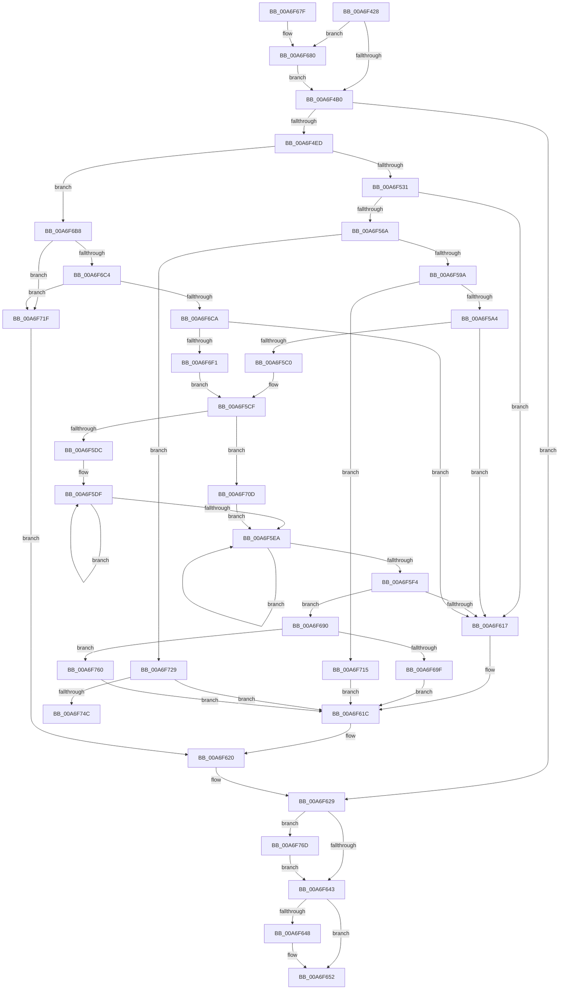

# PipMakeGloballyUniqueId

- RVA: `0x00A6F428`–`0x00A6F77C` (길이 `852` bytes)
- VA: `0x0000000140A6F428`
- 실행 섹션: `PAGE`
- PDB 이름 있음: `예`; PDB Function 태그: `예`
- unwind 정보 RVA: `0x000B4D8C`
- 디코드: `212`개 명령, `852/852` bytes 표시
- 미해석 바이트: `0` (있으면 어셈블리에 `.byte`로 보존)

> 이 문서는 커널 이미지의 기계어와 PDB 기호를 분석해 생성했습니다. 4번과 5번은 함수 원형과 자료형을 바이너리 사용 방식에서 추정한 C 해석이며 원본 소스 복구 결과는 아닙니다.

## 1. Dependencies

- 직접 호출 지점: **19**; 고유 호출 대상: **14**
- 직접 호출자로 확인된 함수: **2**
- RIP 상대 이미지 참조: **7**

### Outgoing calls
- `0x00A6F4A2` → [ExAcquireResourceSharedLite](../../text/21/ExAcquireResourceSharedLite_function_00211BC0.md) (function, `0x00211BC0`)
- `0x00A6F4DE` → [_CmOpenDeviceRegKey](../8E/_CmOpenDeviceRegKey_function_008EE540.md) (function, `0x008EE540`)
- `0x00A6F522` → [ZwQueryValueKey](../../text/6A/ZwQueryValueKey_function_006AD3B0.md) (function, `0x006AD3B0`)
- `0x00A6F559` → [ExAllocatePool2](../../poolcode/B8/ExAllocatePool2_function_00B820F0.md) (function, `0x00B820F0`)
- `0x00A6F58B` → [ZwQueryValueKey](../../text/6A/ZwQueryValueKey_function_006AD3B0.md) (function, `0x006AD3B0`)
- `0x00A6F5B3` → [ExAllocatePool2](../../poolcode/B8/ExAllocatePool2_function_00B820F0.md) (function, `0x00B820F0`)
- `0x00A6F5CA` → [RtlStringCbCopyW](../../text/43/RtlStringCbCopyW_function_0043B910.md) (function, `0x0043B910`)
- `0x00A6F60A` → [ExAllocatePool2](../../poolcode/B8/ExAllocatePool2_function_00B820F0.md) (function, `0x00B820F0`)
- `0x00A6F624` → [ZwClose](../../text/6A/ZwClose_function_006AD2B0.md) (function, `0x006AD2B0`)
- `0x00A6F630` → [ExReleaseResourceLite](../../text/25/ExReleaseResourceLite_function_0025FA10.md) (function, `0x0025FA10`)
- `0x00A6F635` → [KeLeaveCriticalRegion](../../text/25/KeLeaveCriticalRegion_function_0025D8B0.md) (function, `0x0025D8B0`)
- `0x00A6F64D` → [ExFreePoolWithTag](../../poolcode/B8/ExFreePoolWithTag_function_00B82870.md) (function, `0x00B82870`)
- `0x00A6F65F` → [_security_check_cookie](../../text/6A/_security_check_cookie_function_006AC640.md) (function, `0x006AC640`)
- `0x00A6F6AE` → [RtlStringCchPrintfW](../../text/48/RtlStringCchPrintfW_function_00482D5C.md) (function, `0x00482D5C`)
- `0x00A6F6E0` → [ExAllocatePool2](../../poolcode/B8/ExAllocatePool2_function_00B820F0.md) (function, `0x00B820F0`)
- `0x00A6F703` → [RtlStringCbPrintfW](../../text/40/RtlStringCbPrintfW_function_0040FB40.md) (function, `0x0040FB40`)
- `0x00A6F73B` → [RtlUpcaseUnicodeString](../96/RtlUpcaseUnicodeString_function_00960780.md) (function, `0x00960780`)
- `0x00A6F763` → [RtlStringCchCopyW](../../text/26/RtlStringCchCopyW_function_0026E9A4.md) (function, `0x0026E9A4`)
- `0x00A6F772` → [ExFreePoolWithTag](../../poolcode/B8/ExFreePoolWithTag_function_00B82870.md) (function, `0x00B82870`)

### Direct callers
- [PiProcessNewDeviceNode](../A2/PiProcessNewDeviceNode_function_00A28F20.md) at `0x00A291D9`
- [PiProcessNewDeviceNode](../A2/PiProcessNewDeviceNode_function_00A28F20.md) at `0x00A2945D`
- [PiCreateDriverSwDeviceCallback](../AB/PiCreateDriverSwDeviceCallback_function_00ABB420.md) at `0x00ABBB6A`

### Static image references
- `0x00A6F444` → RVA `0x00E0A740` (`.data`; read)
- `0x00A6F46B` → RVA `0x00F8C600` (`.data`; read)
- `0x00A6F4D7` → RVA `0x00E66398` (`.data`; read)
- `0x00A6F4F1` → RVA `0x00AFDE70` (` ?? ::NNGAKEGL::`string'`; read)
- `0x00A6F531` → RVA `0x00AFDEA0` (` ?? ::NNGAKEGL::`string'`; read)
- `0x00A6F6A7` → RVA `0x00AFDE40` (` ?? ::NNGAKEGL::`string'`; read)
- `0x00A6F6F4` → RVA `0x00AFDE90` (` ?? ::NNGAKEGL::`string'`; read)

## 2. Other-region calls and transfers

- 다른 실행 섹션으로 향하는 call: **17**
  - `0x00A6F4A2` → [ExAcquireResourceSharedLite](../../text/21/ExAcquireResourceSharedLite_function_00211BC0.md) (`PAGE` → `.text`)
  - `0x00A6F522` → [ZwQueryValueKey](../../text/6A/ZwQueryValueKey_function_006AD3B0.md) (`PAGE` → `.text`)
  - `0x00A6F559` → [ExAllocatePool2](../../poolcode/B8/ExAllocatePool2_function_00B820F0.md) (`PAGE` → `POOLCODE`)
  - `0x00A6F58B` → [ZwQueryValueKey](../../text/6A/ZwQueryValueKey_function_006AD3B0.md) (`PAGE` → `.text`)
  - `0x00A6F5B3` → [ExAllocatePool2](../../poolcode/B8/ExAllocatePool2_function_00B820F0.md) (`PAGE` → `POOLCODE`)
  - `0x00A6F5CA` → [RtlStringCbCopyW](../../text/43/RtlStringCbCopyW_function_0043B910.md) (`PAGE` → `.text`)
  - `0x00A6F60A` → [ExAllocatePool2](../../poolcode/B8/ExAllocatePool2_function_00B820F0.md) (`PAGE` → `POOLCODE`)
  - `0x00A6F624` → [ZwClose](../../text/6A/ZwClose_function_006AD2B0.md) (`PAGE` → `.text`)
  - `0x00A6F630` → [ExReleaseResourceLite](../../text/25/ExReleaseResourceLite_function_0025FA10.md) (`PAGE` → `.text`)
  - `0x00A6F635` → [KeLeaveCriticalRegion](../../text/25/KeLeaveCriticalRegion_function_0025D8B0.md) (`PAGE` → `.text`)
  - `0x00A6F64D` → [ExFreePoolWithTag](../../poolcode/B8/ExFreePoolWithTag_function_00B82870.md) (`PAGE` → `POOLCODE`)
  - `0x00A6F65F` → [_security_check_cookie](../../text/6A/_security_check_cookie_function_006AC640.md) (`PAGE` → `.text`)
  - `0x00A6F6AE` → [RtlStringCchPrintfW](../../text/48/RtlStringCchPrintfW_function_00482D5C.md) (`PAGE` → `.text`)
  - `0x00A6F6E0` → [ExAllocatePool2](../../poolcode/B8/ExAllocatePool2_function_00B820F0.md) (`PAGE` → `POOLCODE`)
  - `0x00A6F703` → [RtlStringCbPrintfW](../../text/40/RtlStringCbPrintfW_function_0040FB40.md) (`PAGE` → `.text`)
  - `0x00A6F763` → [RtlStringCchCopyW](../../text/26/RtlStringCchCopyW_function_0026E9A4.md) (`PAGE` → `.text`)
  - `0x00A6F772` → [ExFreePoolWithTag](../../poolcode/B8/ExFreePoolWithTag_function_00B82870.md) (`PAGE` → `POOLCODE`)
- call이 아닌 외부 분기/꼬리 이동: **1**
  - `0x00A6F75B` → [sub_00B3FE90 + 0xC](../B3/Unknown_function_00B3FE90.md) (`tail-transfer`)

## 3. Assembly (complete function range)

```asm
00A6F428  48 89 5C 24 20                  mov qword ptr [rsp + 0x20], rbx
00A6F42D  55                              push rbp
00A6F42E  56                              push rsi
00A6F42F  57                              push rdi
00A6F430  41 54                           push r12
00A6F432  41 55                           push r13
00A6F434  41 56                           push r14
00A6F436  41 57                           push r15
00A6F438  48 8D 6C 24 D9                  lea rbp, [rsp - 0x27]
00A6F43D  48 81 EC C0 00 00 00            sub rsp, 0xc0
00A6F444  48 8B 05 F5 B2 39 00            mov rax, qword ptr [rip + 0x39b2f5]
00A6F44B  48 33 C4                        xor rax, rsp
00A6F44E  48 89 45 17                     mov qword ptr [rbp + 0x17], rax
00A6F452  45 33 ED                        xor r13d, r13d
00A6F455  48 89 55 FF                     mov qword ptr [rbp - 1], rdx
00A6F459  44 89 6D C7                     mov dword ptr [rbp - 0x39], r13d
00A6F45D  0F 57 C0                        xorps xmm0, xmm0
00A6F460  4C 89 6D E7                     mov qword ptr [rbp - 0x19], r13
00A6F464  48 8B D9                        mov rbx, rcx
00A6F467  44 89 6D B7                     mov dword ptr [rbp - 0x49], r13d
00A6F46B  48 8D 0D 8E D1 51 00            lea rcx, [rip + 0x51d18e]
00A6F472  0F 11 45 CF                     movups xmmword ptr [rbp - 0x31], xmm0
00A6F476  65 48 8B 04 25 88 01 00 00      mov rax, qword ptr gs:[0x188]
00A6F47F  49 83 CE FF                     or r14, 0xffffffffffffffff
00A6F483  B2 01                           mov dl, 1
00A6F485  4C 89 45 BF                     mov qword ptr [rbp - 0x41], r8
00A6F489  4D 8B E0                        mov r12, r8
00A6F48C  4C 89 6D DF                     mov qword ptr [rbp - 0x21], r13
00A6F490  45 8B FD                        mov r15d, r13d
00A6F493  41 8B FD                        mov edi, r13d
00A6F496  66 44 01 B0 E4 01 00 00         add word ptr [rax + 0x1e4], r14w
00A6F49E  41 8B F5                        mov esi, r13d
00A6F4A1  90                              nop
00A6F4A2  E8 19 27 7A FF                  call 0x140211bc0
00A6F4A7  48 85 DB                        test rbx, rbx
00A6F4AA  0F 85 D0 01 00 00               jne 0x140a6f680
00A6F4B0  49 8B 55 30                     mov rdx, qword ptr [r13 + 0x30]
00A6F4B4  48 8D 45 E7                     lea rax, [rbp - 0x19]
00A6F4B8  33 C9                           xor ecx, ecx
00A6F4BA  45 33 C9                        xor r9d, r9d
00A6F4BD  48 89 4C 24 38                  mov qword ptr [rsp + 0x38], rcx
00A6F4C2  48 89 44 24 30                  mov qword ptr [rsp + 0x30], rax
00A6F4C7  88 4C 24 28                     mov byte ptr [rsp + 0x28], cl
00A6F4CB  44 8D 41 10                     lea r8d, [rcx + 0x10]
00A6F4CF  C7 44 24 20 1F 00 02 00         mov dword ptr [rsp + 0x20], 0x2001f
00A6F4D7  48 8B 0D BA 6E 3F 00            mov rcx, qword ptr [rip + 0x3f6eba]
00A6F4DE  E8 5D F0 E7 FF                  call 0x1408ee540
00A6F4E3  8B D8                           mov ebx, eax
00A6F4E5  85 C0                           test eax, eax
00A6F4E7  0F 88 3C 01 00 00               js 0x140a6f629
00A6F4ED  48 8B 4D E7                     mov rcx, qword ptr [rbp - 0x19]
00A6F4F1  48 8D 05 78 E9 08 00            lea rax, [rip + 0x8e978]
00A6F4F8  48 89 45 D7                     mov qword ptr [rbp - 0x29], rax
00A6F4FC  4C 8D 4D 07                     lea r9, [rbp + 7]
00A6F500  48 8D 45 B7                     lea rax, [rbp - 0x49]
00A6F504  C7 45 CF 1C 00 1E 00            mov dword ptr [rbp - 0x31], 0x1e001c
00A6F50B  48 89 44 24 28                  mov qword ptr [rsp + 0x28], rax
00A6F510  48 8D 55 CF                     lea rdx, [rbp - 0x31]
00A6F514  41 B8 02 00 00 00               mov r8d, 2
00A6F51A  C7 44 24 20 10 00 00 00         mov dword ptr [rsp + 0x20], 0x10
00A6F522  E8 89 DE C3 FF                  call 0x1406ad3b0
00A6F527  8B D8                           mov ebx, eax
00A6F529  85 C0                           test eax, eax
00A6F52B  0F 89 87 01 00 00               jns 0x140a6f6b8
00A6F531  48 8D 05 68 E9 08 00            lea rax, [rip + 0x8e968]
00A6F538  C7 45 CF 1C 00 1E 00            mov dword ptr [rbp - 0x31], 0x1e001c
00A6F53F  BA 42 00 00 00                  mov edx, 0x42
00A6F544  48 89 45 D7                     mov qword ptr [rbp - 0x29], rax
00A6F548  41 BC 50 70 65 6E               mov r12d, 0x6e657050
00A6F54E  89 55 B7                        mov dword ptr [rbp - 0x49], edx
00A6F551  45 8B C4                        mov r8d, r12d
00A6F554  B9 00 01 00 00                  mov ecx, 0x100
00A6F559  E8 92 2B 11 00                  call 0x140b820f0
00A6F55E  48 8B F0                        mov rsi, rax
00A6F561  48 85 C0                        test rax, rax
00A6F564  0F 84 AD 00 00 00               je 0x140a6f617
00A6F56A  48 8B 4D E7                     mov rcx, qword ptr [rbp - 0x19]
00A6F56E  48 8D 45 B7                     lea rax, [rbp - 0x49]
00A6F572  48 89 44 24 28                  mov qword ptr [rsp + 0x28], rax
00A6F577  48 8D 55 CF                     lea rdx, [rbp - 0x31]
00A6F57B  8B 45 B7                        mov eax, dword ptr [rbp - 0x49]
00A6F57E  4C 8B CE                        mov r9, rsi
00A6F581  41 B8 02 00 00 00               mov r8d, 2
00A6F587  89 44 24 20                     mov dword ptr [rsp + 0x20], eax
00A6F58B  E8 20 DE C3 FF                  call 0x1406ad3b0
00A6F590  8B D8                           mov ebx, eax
00A6F592  85 C0                           test eax, eax
00A6F594  0F 88 8F 01 00 00               js 0x140a6f729
00A6F59A  83 7E 04 01                     cmp dword ptr [rsi + 4], 1
00A6F59E  0F 85 71 01 00 00               jne 0x140a6f715
00A6F5A4  44 8B 6E 08                     mov r13d, dword ptr [rsi + 8]
00A6F5A8  45 8B C4                        mov r8d, r12d
00A6F5AB  41 8B D5                        mov edx, r13d
00A6F5AE  B9 00 01 00 00                  mov ecx, 0x100
00A6F5B3  E8 38 2B 11 00                  call 0x140b820f0
00A6F5B8  48 8B F8                        mov rdi, rax
00A6F5BB  48 85 C0                        test rax, rax
00A6F5BE  74 57                           je 0x140a6f617
00A6F5C0  4C 8D 46 0C                     lea r8, [rsi + 0xc]
00A6F5C4  41 8B D5                        mov edx, r13d
00A6F5C7  48 8B C8                        mov rcx, rax
00A6F5CA  E8 41 C3 9C FF                  call 0x14043b910
00A6F5CF  4C 8B 6D FF                     mov r13, qword ptr [rbp - 1]
00A6F5D3  4D 85 ED                        test r13, r13
00A6F5D6  0F 84 31 01 00 00               je 0x140a6f70d
00A6F5DC  49 8B C6                        mov rax, r14
00A6F5DF  48 FF C0                        inc rax
00A6F5E2  66 45 39 7C 45 00               cmp word ptr [r13 + rax*2], r15w
00A6F5E8  75 F5                           jne 0x140a6f5df
00A6F5EA  49 FF C6                        inc r14
00A6F5ED  66 46 39 3C 77                  cmp word ptr [rdi + r14*2], r15w
00A6F5F2  75 F6                           jne 0x140a6f5ea
00A6F5F4  83 C0 02                        add eax, 2
00A6F5F7  45 8B C4                        mov r8d, r12d
00A6F5FA  41 03 C6                        add eax, r14d
00A6F5FD  B9 00 01 00 00                  mov ecx, 0x100
00A6F602  8B D0                           mov edx, eax
00A6F604  48 03 D2                        add rdx, rdx
00A6F607  89 45 B7                        mov dword ptr [rbp - 0x49], eax
00A6F60A  E8 E1 2A 11 00                  call 0x140b820f0
00A6F60F  4C 8B F8                        mov r15, rax
00A6F612  48 85 C0                        test rax, rax
00A6F615  75 79                           jne 0x140a6f690
00A6F617  BB 9A 00 00 C0                  mov ebx, 0xc000009a
00A6F61C  4C 8B 65 BF                     mov r12, qword ptr [rbp - 0x41]
00A6F620  48 8B 4D E7                     mov rcx, qword ptr [rbp - 0x19]
00A6F624  E8 87 DC C3 FF                  call 0x1406ad2b0
00A6F629  48 8D 0D D0 CF 51 00            lea rcx, [rip + 0x51cfd0]
00A6F630  E8 DB 03 7F FF                  call 0x14025fa10
00A6F635  E8 76 E2 7E FF                  call 0x14025d8b0
00A6F63A  48 85 F6                        test rsi, rsi
00A6F63D  0F 85 2A 01 00 00               jne 0x140a6f76d
00A6F643  48 85 FF                        test rdi, rdi
00A6F646  74 0A                           je 0x140a6f652
00A6F648  33 D2                           xor edx, edx
00A6F64A  48 8B CF                        mov rcx, rdi
00A6F64D  E8 1E 32 11 00                  call 0x140b82870
00A6F652  4D 89 3C 24                     mov qword ptr [r12], r15
00A6F656  8B C3                           mov eax, ebx
00A6F658  48 8B 4D 17                     mov rcx, qword ptr [rbp + 0x17]
00A6F65C  48 33 CC                        xor rcx, rsp
00A6F65F  E8 DC CF C3 FF                  call 0x1406ac640
00A6F664  48 8B 9C 24 18 01 00 00         mov rbx, qword ptr [rsp + 0x118]
00A6F66C  48 81 C4 C0 00 00 00            add rsp, 0xc0
00A6F673  41 5F                           pop r15
00A6F675  41 5E                           pop r14
00A6F677  41 5D                           pop r13
00A6F679  41 5C                           pop r12
00A6F67B  5F                              pop rdi
00A6F67C  5E                              pop rsi
00A6F67D  5D                              pop rbp
00A6F67E  C3                              ret
00A6F67F  CC                              int3
00A6F680  48 8B 83 38 01 00 00            mov rax, qword ptr [rbx + 0x138]
00A6F687  4C 8B 68 28                     mov r13, qword ptr [rax + 0x28]
00A6F68B  E9 20 FE FF FF                  jmp 0x140a6f4b0
00A6F690  8B 55 B7                        mov edx, dword ptr [rbp - 0x49]
00A6F693  49 8B CF                        mov rcx, r15
00A6F696  4D 85 ED                        test r13, r13
00A6F699  0F 84 C1 00 00 00               je 0x140a6f760
00A6F69F  4C 8B CF                        mov r9, rdi
00A6F6A2  4C 89 6C 24 20                  mov qword ptr [rsp + 0x20], r13
00A6F6A7  4C 8D 05 92 E7 08 00            lea r8, [rip + 0x8e792]
00A6F6AE  E8 A9 36 A1 FF                  call 0x140482d5c
00A6F6B3  E9 64 FF FF FF                  jmp 0x140a6f61c
00A6F6B8  41 B9 04 00 00 00               mov r9d, 4
00A6F6BE  44 39 4D 0B                     cmp dword ptr [rbp + 0xb], r9d
00A6F6C2  75 5B                           jne 0x140a6f71f
00A6F6C4  44 39 4D 0F                     cmp dword ptr [rbp + 0xf], r9d
00A6F6C8  75 55                           jne 0x140a6f71f
00A6F6CA  44 8B 6D 13                     mov r13d, dword ptr [rbp + 0x13]
00A6F6CE  41 8D 51 0E                     lea edx, [r9 + 0xe]
00A6F6D2  41 BC 50 70 65 6E               mov r12d, 0x6e657050
00A6F6D8  B9 00 01 00 00                  mov ecx, 0x100
00A6F6DD  45 8B C4                        mov r8d, r12d
00A6F6E0  E8 0B 2A 11 00                  call 0x140b820f0
00A6F6E5  48 8B F8                        mov rdi, rax
00A6F6E8  48 85 C0                        test rax, rax
00A6F6EB  0F 84 26 FF FF FF               je 0x140a6f617
00A6F6F1  45 8B CD                        mov r9d, r13d
00A6F6F4  4C 8D 05 95 E7 08 00            lea r8, [rip + 0x8e795]
00A6F6FB  BA 12 00 00 00                  mov edx, 0x12
00A6F700  48 8B C8                        mov rcx, rax
00A6F703  E8 38 04 9A FF                  call 0x14040fb40
00A6F708  E9 C2 FE FF FF                  jmp 0x140a6f5cf
00A6F70D  49 8B C7                        mov rax, r15
00A6F710  E9 D5 FE FF FF                  jmp 0x140a6f5ea
00A6F715  BB 0D 00 00 C0                  mov ebx, 0xc000000d
00A6F71A  E9 FD FE FF FF                  jmp 0x140a6f61c
00A6F71F  BB 0D 00 00 C0                  mov ebx, 0xc000000d
00A6F724  E9 F7 FE FF FF                  jmp 0x140a6f620
00A6F729  49 8D 55 28                     lea rdx, [r13 + 0x28]
00A6F72D  C7 45 B7 1F 00 00 00            mov dword ptr [rbp - 0x49], 0x1f
00A6F734  41 B0 01                        mov r8b, 1
00A6F737  48 8D 4D CF                     lea rcx, [rbp - 0x31]
00A6F73B  E8 40 10 EF FF                  call 0x140960780
00A6F740  33 D2                           xor edx, edx
00A6F742  8B D8                           mov ebx, eax
00A6F744  85 C0                           test eax, eax
00A6F746  0F 88 D0 FE FF FF               js 0x140a6f61c
00A6F74C  0F B7 45 CF                     movzx eax, word ptr [rbp - 0x31]
00A6F750  48 8B 4D D7                     mov rcx, qword ptr [rbp - 0x29]
00A6F754  48 D1 E8                        shr rax, 1
00A6F757  4C 8D 04 41                     lea r8, [rcx + rax*2]
00A6F75B  E9 3C 07 0D 00                  jmp 0x140b3fe9c
00A6F760  4C 8B C7                        mov r8, rdi
00A6F763  E8 3C F2 7F FF                  call 0x14026e9a4
00A6F768  E9 AF FE FF FF                  jmp 0x140a6f61c
00A6F76D  33 D2                           xor edx, edx
00A6F76F  48 8B CE                        mov rcx, rsi
00A6F772  E8 F9 30 11 00                  call 0x140b82870
00A6F777  E9 C7 FE FF FF                  jmp 0x140a6f643
```

## 4. C-style interpretation (structured pseudocode)

```c
__int64 __fastcall PipMakeGloballyUniqueId(__int64 a1, __int64 a2, __int64 a3, int a4)
{
    __int64 result;
    __int64 v_r13;
    __int64 v_r14;
    __int64 v_rsp;
    unsigned __int64 v_stack_m48;
    unsigned int v_stack_m4C;
    unsigned int v_stack_m50;
    unsigned int v_stack_m54;
    unsigned __int64 v_stack_m58;
    unsigned __int64 v_stack_m5F;
    unsigned __int64 v_stack_m60;
    unsigned __int64 v_stack_m78;
    unsigned __int64 v_stack_m80;
    unsigned __int64 v_stack_m88;
    unsigned __int64 v_stack_m90;
    unsigned int v_stack_m98;
    unsigned __int64 v_stack_mA0;
    unsigned int v_stack_mA8;
    unsigned __int64 v_stack_mC0;
    unsigned __int64 v_stack_mC8;
    unsigned __int8 v_stack_mD0;
    unsigned int v_stack_mD8;
    unsigned __int64 v_stack_p20;

    v_stack_p20 = v_rbx;
    v_rsp = (v_rsp) - (192);
    result = (*(unsigned __int64 *)(v_rip + 3781365)) ^ (v_rsp);
    v_stack_m48 = result;
    v_r13 = 0;
    v_stack_m60 = a2;
    v_stack_m98 = 0;
    v_stack_m78 = 0;
    v_stack_mA8 = 0;
    v_stack_m90 = v_xmm0;
    v_r14 = (v_r14) | (-1);
    v_stack_mA0 = a3;
    v_stack_m80 = 0;
    result = ExAcquireResourceSharedLite(v_rip + 5362062, 1, a3, a4);
    if (a1 != 0) goto loc_00A6F680;
loc_00A6F4B0:
    a1 = 0;
    a4 = 0;
    v_stack_mC0 = 0;
    v_stack_mC8 = v_stack_m78;
    v_stack_mD0 = 0;
    v_stack_mD8 = 0x2001FULL;
    result = _CmOpenDeviceRegKey(*(unsigned __int64 *)(v_rip + 4157114), *(unsigned __int64 *)(v_r13 + 48), a1 + 16, a4);
    if (sign_flag) goto loc_00A6F629;
    v_stack_m88 = v_rip + 584056;
    v_stack_m90 = 0x1E001CULL;
    v_stack_mD0 = v_stack_mA8;
    v_stack_mD8 = 16;
    result = ZwQueryValueKey(v_stack_m78, v_stack_m90, 2, v_stack_m58);
    if (!sign_flag) goto loc_00A6F6B8;
    v_stack_m90 = 0x1E001CULL;
    v_stack_m88 = v_rip + 584040;
    v_stack_mA8 = 66;
    result = ExAllocatePool2(256, 66, (unsigned int)((unsigned int)((unsigned int)(0x6E657050ULL))), v_stack_m58);
    if (result == 0) goto loc_00A6F617;
    v_stack_mD0 = v_stack_mA8;
    v_stack_mD8 = (unsigned int)((unsigned int)(v_stack_mA8));
    result = ZwQueryValueKey(v_stack_m78, v_stack_m90, 2, result);
    if (sign_flag) goto loc_00A6F729;
    if ((*(unsigned int *)(result + 4)) != 1) goto loc_00A6F715;
    result = ExAllocatePool2(256, (unsigned int)((unsigned int)((unsigned int)(*(unsigned int *)(result + 8)))), (unsigned int)((unsigned int)((unsigned int)(0x6E657050ULL))), result);
    if (result == 0) goto loc_00A6F617;
    result = RtlStringCbCopyW(result, (unsigned int)((unsigned int)((unsigned int)(*(unsigned int *)(result + 8)))), result + 12, result);
loc_00A6F5CF:
    if (v_stack_m60 == 0) goto loc_00A6F70D;
loc_00A6F5DF:
    result = (v_r14) + 1;
    if ((*(unsigned __int16 *)(v_stack_m60 + result * 2)) != 0) goto loc_00A6F5DF;
loc_00A6F5EA:
    v_r14 = (v_r14) + 1;
    if ((*(unsigned __int16 *)(result + v_r14 * 2)) != 0) goto loc_00A6F5EA;
    result = (unsigned int)((result) + (2));
    result = (unsigned int)((result) + ((unsigned int)(v_r14)));
    a2 = ((unsigned int)((unsigned int)(result))) + ((unsigned int)((unsigned int)(result)));
    v_stack_mA8 = (unsigned int)(result);
    result = ExAllocatePool2(256, a2, (unsigned int)((unsigned int)((unsigned int)(0x6E657050ULL))), result);
    if (result != 0) goto loc_00A6F690;
loc_00A6F617:
loc_00A6F61C:
loc_00A6F620:
    result = ZwClose(v_stack_m78, a2, (unsigned int)((unsigned int)((unsigned int)(0x6E657050ULL))), result);
loc_00A6F629:
    result = ExReleaseResourceLite(v_rip + 5361616, a2, (unsigned int)((unsigned int)((unsigned int)(0x6E657050ULL))), result);
    result = KeLeaveCriticalRegion(v_rip + 5361616, a2, (unsigned int)((unsigned int)((unsigned int)(0x6E657050ULL))), result);
    if (result != 0) goto loc_00A6F76D;
loc_00A6F643:
    if (result != 0) {
        a2 = 0;
        a1 = result;
        result = ExFreePoolWithTag(a1, a2, (unsigned int)((unsigned int)((unsigned int)(0x6E657050ULL))), result);
    }
    *(unsigned __int64 *)(v_stack_mA0) = result;
    a1 = (v_stack_m48) ^ (v_rsp);
    result = _security_check_cookie(a1, a2, (unsigned int)((unsigned int)((unsigned int)(0x6E657050ULL))), result);
    v_rsp = (v_rsp) + (192);
    return result;
loc_00A6F680:
    goto loc_00A6F4B0;
loc_00A6F690:
    if (*(unsigned __int64 *)(*(unsigned __int64 *)(v_stack_p20 + 312) + 40) == 0) goto loc_00A6F760;
    v_stack_p20 = *(unsigned __int64 *)(*(unsigned __int64 *)(v_stack_p20 + 312) + 40);
    result = RtlStringCchPrintfW(result, (unsigned int)(v_stack_mA8), v_rip + 583570, result);
    goto loc_00A6F61C;
loc_00A6F6B8:
    if (v_stack_m54 != 4) goto loc_00A6F71F;
    if (v_stack_m50 != 4) goto loc_00A6F71F;
    result = ExAllocatePool2(256, 4 + 14, (unsigned int)((unsigned int)((unsigned int)(0x6E657050ULL))), 4);
    if (result == 0) goto loc_00A6F617;
    result = RtlStringCbPrintfW(result, 18, v_rip + 583573, (unsigned int)((unsigned int)((unsigned int)(v_stack_m4C))));
    goto loc_00A6F5CF;
loc_00A6F70D:
    goto loc_00A6F5EA;
loc_00A6F715:
    goto loc_00A6F61C;
loc_00A6F71F:
    goto loc_00A6F620;
loc_00A6F729:
    v_stack_mA8 = 31;
    result = RtlUpcaseUnicodeString(v_stack_m90, (unsigned int)(v_stack_m4C) + 40, 1, (unsigned int)((unsigned int)((unsigned int)(v_stack_m4C))));
    a2 = 0;
    if (sign_flag) goto loc_00A6F61C;
    result = (v_stack_m90) >> (1);
loc_00A6F760:
    result = RtlStringCchCopyW(v_stack_m88, a2, result, (unsigned int)((unsigned int)((unsigned int)(v_stack_m4C))));
    goto loc_00A6F61C;
loc_00A6F76D:
    a2 = 0;
    result = ExFreePoolWithTag(result, a2, result, (unsigned int)((unsigned int)((unsigned int)(v_stack_m4C))));
    goto loc_00A6F643;
}
```

## 5. (Beta) C Style

```c
int64_t PipMakeGloballyUniqueId(int64_t Arg1, int64_t Arg2, int64_t Arg3, int32_t Arg4)
{
    int64_t result;
    int64_t local_r13;
    int64_t local_r14;
    int64_t local_rsp;
    uint64_t v_stack_m48;
    uint32_t v_stack_m4C;
    uint32_t v_stack_m50;
    uint32_t v_stack_m54;
    uint64_t v_stack_m58;
    uint64_t v_stack_m5F;
    uint64_t v_stack_m60;
    uint64_t v_stack_m78;
    uint64_t v_stack_m80;
    uint64_t v_stack_m88;
    uint64_t v_stack_m90;
    uint32_t v_stack_m98;
    uint64_t v_stack_mA0;
    uint32_t v_stack_mA8;
    uint64_t v_stack_mC0;
    uint64_t v_stack_mC8;
    uint8_t v_stack_mD0;
    uint32_t v_stack_mD8;
    uint64_t v_stack_p20;

    v_stack_p20 = local_rbx;
    local_rsp = (local_rsp) - (192);
    result = (*(uint64_t *)(v_rip + 0x39B2F5)) ^ (local_rsp);
    v_stack_m48 = result;
    local_r13 = 0;
    v_stack_m60 = Arg2;
    v_stack_m98 = 0;
    v_stack_m78 = 0;
    v_stack_mA8 = 0;
    v_stack_m90 = v_xmm0;
    local_r14 = (local_r14) | (-1);
    v_stack_mA0 = Arg3;
    v_stack_m80 = 0;
    result = ExAcquireResourceSharedLite(v_rip + 5362062, 1, Arg3, Arg4);
    if (Arg1 != 0) goto loc_00A6F680;
loc_00A6F4B0:
    Arg1 = 0;
    Arg4 = 0;
    v_stack_mC0 = 0;
    v_stack_mC8 = v_stack_m78;
    v_stack_mD0 = 0;
    v_stack_mD8 = 0x2001FULL;
    result = _CmOpenDeviceRegKey(*(uint64_t *)(v_rip + 0x3F6EBA), *(uint64_t *)(local_r13 + 0x30), Arg1 + 16, Arg4);
    if (sign_flag) goto loc_00A6F629;
    v_stack_m88 = v_rip + 584056;
    v_stack_m90 = 0x1E001CULL;
    v_stack_mD0 = v_stack_mA8;
    v_stack_mD8 = 16;
    result = ZwQueryValueKey(v_stack_m78, v_stack_m90, 2, v_stack_m58);
    if (!sign_flag) goto loc_00A6F6B8;
    v_stack_m90 = 0x1E001CULL;
    v_stack_m88 = v_rip + 584040;
    v_stack_mA8 = 66;
    result = ExAllocatePool2(256, 66, (uint32_t)((uint32_t)((uint32_t)(0x6E657050ULL))), v_stack_m58);
    if (result == 0) goto loc_00A6F617;
    v_stack_mD0 = v_stack_mA8;
    v_stack_mD8 = (uint32_t)((uint32_t)(v_stack_mA8));
    result = ZwQueryValueKey(v_stack_m78, v_stack_m90, 2, result);
    if (sign_flag) goto loc_00A6F729;
    if ((*(uint32_t *)(result + 0x4)) != 1) goto loc_00A6F715;
    result = ExAllocatePool2(256, (uint32_t)((uint32_t)((uint32_t)(*(uint32_t *)(result + 0x8)))), (uint32_t)((uint32_t)((uint32_t)(0x6E657050ULL))), result);
    if (result == 0) goto loc_00A6F617;
    result = RtlStringCbCopyW(result, (uint32_t)((uint32_t)((uint32_t)(*(uint32_t *)(result + 0x8)))), result + 12, result);
loc_00A6F5CF:
    if (v_stack_m60 == 0) goto loc_00A6F70D;
loc_00A6F5DF:
    result = (local_r14) + 1;
    if ((*(uint16_t *)(v_stack_m60 + result * 2)) != 0) goto loc_00A6F5DF;
loc_00A6F5EA:
    local_r14 = (local_r14) + 1;
    if ((*(uint16_t *)(result + local_r14 * 2)) != 0) goto loc_00A6F5EA;
    result = (uint32_t)((result) + (2));
    result = (uint32_t)((result) + ((uint32_t)(local_r14)));
    Arg2 = ((uint32_t)((uint32_t)(result))) + ((uint32_t)((uint32_t)(result)));
    v_stack_mA8 = (uint32_t)(result);
    result = ExAllocatePool2(256, Arg2, (uint32_t)((uint32_t)((uint32_t)(0x6E657050ULL))), result);
    if (result != 0) goto loc_00A6F690;
loc_00A6F617:
loc_00A6F61C:
loc_00A6F620:
    result = ZwClose(v_stack_m78, Arg2, (uint32_t)((uint32_t)((uint32_t)(0x6E657050ULL))), result);
loc_00A6F629:
    result = ExReleaseResourceLite(v_rip + 5361616, Arg2, (uint32_t)((uint32_t)((uint32_t)(0x6E657050ULL))), result);
    result = KeLeaveCriticalRegion(v_rip + 5361616, Arg2, (uint32_t)((uint32_t)((uint32_t)(0x6E657050ULL))), result);
    if (result != 0) goto loc_00A6F76D;
loc_00A6F643:
    if (result != 0) {
        Arg2 = 0;
        Arg1 = result;
        result = ExFreePoolWithTag(Arg1, Arg2, (uint32_t)((uint32_t)((uint32_t)(0x6E657050ULL))), result);
    }
    *(uint64_t *)(v_stack_mA0) = result;
    Arg1 = (v_stack_m48) ^ (local_rsp);
    result = _security_check_cookie(Arg1, Arg2, (uint32_t)((uint32_t)((uint32_t)(0x6E657050ULL))), result);
    local_rsp = (local_rsp) + (192);
    return result;
loc_00A6F680:
    goto loc_00A6F4B0;
loc_00A6F690:
    if (*(uint64_t *)(*(uint64_t *)(v_stack_p20 + 0x138) + 0x28) == 0) goto loc_00A6F760;
    v_stack_p20 = *(uint64_t *)(*(uint64_t *)(v_stack_p20 + 0x138) + 0x28);
    result = RtlStringCchPrintfW(result, (uint32_t)(v_stack_mA8), v_rip + 583570, result);
    goto loc_00A6F61C;
loc_00A6F6B8:
    if (v_stack_m54 != 4) goto loc_00A6F71F;
    if (v_stack_m50 != 4) goto loc_00A6F71F;
    result = ExAllocatePool2(256, 4 + 14, (uint32_t)((uint32_t)((uint32_t)(0x6E657050ULL))), 4);
    if (result == 0) goto loc_00A6F617;
    result = RtlStringCbPrintfW(result, 18, v_rip + 583573, (uint32_t)((uint32_t)((uint32_t)(v_stack_m4C))));
    goto loc_00A6F5CF;
loc_00A6F70D:
    goto loc_00A6F5EA;
loc_00A6F715:
    goto loc_00A6F61C;
loc_00A6F71F:
    goto loc_00A6F620;
loc_00A6F729:
    v_stack_mA8 = 31;
    result = RtlUpcaseUnicodeString(v_stack_m90, (uint32_t)(v_stack_m4C) + 40, 1, (uint32_t)((uint32_t)((uint32_t)(v_stack_m4C))));
    Arg2 = 0;
    if (sign_flag) goto loc_00A6F61C;
    result = (v_stack_m90) >> (1);
loc_00A6F760:
    result = RtlStringCchCopyW(v_stack_m88, Arg2, result, (uint32_t)((uint32_t)((uint32_t)(v_stack_m4C))));
    goto loc_00A6F61C;
loc_00A6F76D:
    Arg2 = 0;
    result = ExFreePoolWithTag(result, Arg2, result, (uint32_t)((uint32_t)((uint32_t)(v_stack_m4C))));
    goto loc_00A6F643;
}
```

## 6. Execution-region graph

[열기: 2D/3D 그래프와 함수 탐색 컨트롤 패널](../../../control-panel.html?section=page&rva=0x00A6F428&view=graph)

- 2D 그래프는 위에서 아래로 흐르고, 3D 그래프는 빈 공간을 드래그해 회전합니다. Shift+드래그는 이동, 휠은 확대·축소, 함수 노드 선택은 대상 보고서 이동입니다.

### Static fallback


