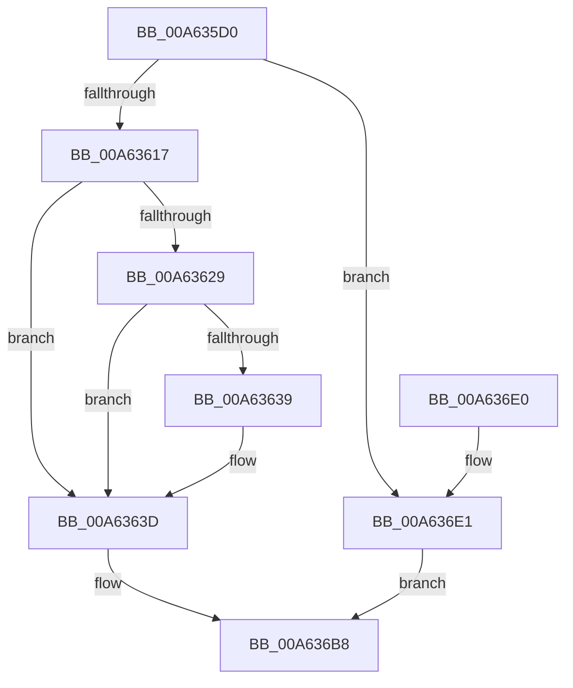

# PnpAsynchronousCall

- RVA: `0x00A635D0`–`0x00A636E8` (길이 `280` bytes)
- VA: `0x0000000140A635D0`
- 실행 섹션: `PAGE`
- PDB 이름 있음: `예`; PDB Function 태그: `아니요`
- unwind 정보 RVA: `0x00075210`
- 디코드: `71`개 명령, `280/280` bytes 표시
- 미해석 바이트: `0` (있으면 어셈블리에 `.byte`로 보존)

> 이 문서는 커널 이미지의 기계어와 PDB 기호를 분석해 생성했습니다. 4번과 5번은 함수 원형과 자료형을 바이너리 사용 방식에서 추정한 C 해석이며 원본 소스 복구 결과는 아닙니다.

## 1. Dependencies

- 직접 호출 지점: **5**; 고유 호출 대상: **5**
- 직접 호출자로 확인된 함수: **2**
- RIP 상대 이미지 참조: **0**

### Outgoing calls
- `0x00A635F9` → [IoGetAttachedDeviceReferenceWithTag](../../text/27/IoGetAttachedDeviceReferenceWithTag_function_00273B84.md) (function, `0x00273B84`)
- `0x00A63606` → [IoAllocateIrp](../../text/20/IoAllocateIrp_function_002065D0.md) (function, `0x002065D0`)
- `0x00A6361F` → [IovUtilWatermarkIrp](../../text/48/IovUtilWatermarkIrp_function_0048E1A4.md) (function, `0x0048E1A4`)
- `0x00A636B1` → [IofCallDriver](../../text/29/IofCallDriver_function_0029B4B0.md) (function, `0x0029B4B0`)
- `0x00A636C0` → [ObfDereferenceObjectWithTag](../../text/2F/ObfDereferenceObjectWithTag_function_002F78E0.md) (function, `0x002F78E0`)

### Direct callers
- [PnpSendIrp](../../text/27/PnpSendIrp_function_00271DF4.md) at `0x00271E89`
- [PiIrpQueryRemoveDevice](../73/PiIrpQueryRemoveDevice_function_0073E088.md) at `0x0073E145`

### Static image references
- 디코드된 RIP-relative 메모리 참조가 없습니다.

## 2. Other-region calls and transfers

- 다른 실행 섹션으로 향하는 call: **5**
  - `0x00A635F9` → [IoGetAttachedDeviceReferenceWithTag](../../text/27/IoGetAttachedDeviceReferenceWithTag_function_00273B84.md) (`PAGE` → `.text`)
  - `0x00A63606` → [IoAllocateIrp](../../text/20/IoAllocateIrp_function_002065D0.md) (`PAGE` → `.text`)
  - `0x00A6361F` → [IovUtilWatermarkIrp](../../text/48/IovUtilWatermarkIrp_function_0048E1A4.md) (`PAGE` → `.text`)
  - `0x00A636B1` → [IofCallDriver](../../text/29/IofCallDriver_function_0029B4B0.md) (`PAGE` → `.text`)
  - `0x00A636C0` → [ObfDereferenceObjectWithTag](../../text/2F/ObfDereferenceObjectWithTag_function_002F78E0.md) (`PAGE` → `.text`)
- 별도 외부 분기/꼬리 이동을 확인하지 못했습니다.

## 3. Assembly (complete function range)

```asm
00A635D0  48 89 5C 24 08                  mov qword ptr [rsp + 8], rbx
00A635D5  48 89 6C 24 10                  mov qword ptr [rsp + 0x10], rbp
00A635DA  48 89 74 24 18                  mov qword ptr [rsp + 0x18], rsi
00A635DF  57                              push rdi
00A635E0  41 56                           push r14
00A635E2  41 57                           push r15
00A635E4  48 83 EC 20                     sub rsp, 0x20
00A635E8  48 8B EA                        mov rbp, rdx
00A635EB  4D 8B F1                        mov r14, r9
00A635EE  BA 50 6E 70 69                  mov edx, 0x69706e50
00A635F3  4D 8B F8                        mov r15, r8
00A635F6  48 8B F9                        mov rdi, rcx
00A635F9  E8 86 05 81 FF                  call 0x140273b84
00A635FE  33 D2                           xor edx, edx
00A63600  48 8B F0                        mov rsi, rax
00A63603  8A 48 4C                        mov cl, byte ptr [rax + 0x4c]
00A63606  E8 C5 2F 7A FF                  call 0x1402065d0
00A6360B  48 8B D8                        mov rbx, rax
00A6360E  48 85 C0                        test rax, rax
00A63611  0F 84 CA 00 00 00               je 0x140a636e1
00A63617  BA 01 00 00 00                  mov edx, 1
00A6361C  48 8B C8                        mov rcx, rax
00A6361F  E8 80 AB A2 FF                  call 0x14048e1a4
00A63624  48 85 FF                        test rdi, rdi
00A63627  74 14                           je 0x140a6363d
00A63629  48 8B 8F 38 01 00 00            mov rcx, qword ptr [rdi + 0x138]
00A63630  48 8B 41 28                     mov rax, qword ptr [rcx + 0x28]
00A63634  48 85 C0                        test rax, rax
00A63637  74 04                           je 0x140a6363d
00A63639  48 89 58 48                     mov qword ptr [rax + 0x48], rbx
00A6363D  48 83 63 38 00                  and qword ptr [rbx + 0x38], 0
00A63642  48 8B D3                        mov rdx, rbx
00A63645  0F 10 45 00                     movups xmm0, xmmword ptr [rbp]
00A63649  C7 43 30 BB 00 00 C0            mov dword ptr [rbx + 0x30], 0xc00000bb
00A63650  48 8B CE                        mov rcx, rsi
00A63653  65 48 8B 04 25 88 01 00 00      mov rax, qword ptr gs:[0x188]
00A6365C  48 83 63 48 00                  and qword ptr [rbx + 0x48], 0
00A63661  48 83 63 50 00                  and qword ptr [rbx + 0x50], 0
00A63666  0F 10 4D 10                     movups xmm1, xmmword ptr [rbp + 0x10]
00A6366A  48 89 83 98 00 00 00            mov qword ptr [rbx + 0x98], rax
00A63671  48 8B 83 B8 00 00 00            mov rax, qword ptr [rbx + 0xb8]
00A63678  C6 43 40 00                     mov byte ptr [rbx + 0x40], 0
00A6367C  0F 11 40 B8                     movups xmmword ptr [rax - 0x48], xmm0
00A63680  0F 10 45 20                     movups xmm0, xmmword ptr [rbp + 0x20]
00A63684  0F 11 48 C8                     movups xmmword ptr [rax - 0x38], xmm1
00A63688  0F 10 4D 30                     movups xmm1, xmmword ptr [rbp + 0x30]
00A6368C  0F 11 40 D8                     movups xmmword ptr [rax - 0x28], xmm0
00A63690  F2 0F 10 45 40                  movsd xmm0, qword ptr [rbp + 0x40]
00A63695  0F 11 48 E8                     movups xmmword ptr [rax - 0x18], xmm1
00A63699  F2 0F 11 40 F8                  movsd qword ptr [rax - 8], xmm0
00A6369E  48 8B 83 B8 00 00 00            mov rax, qword ptr [rbx + 0xb8]
00A636A5  4C 89 78 F0                     mov qword ptr [rax - 0x10], r15
00A636A9  4C 89 70 F8                     mov qword ptr [rax - 8], r14
00A636AD  C6 40 BB E0                     mov byte ptr [rax - 0x45], 0xe0
00A636B1  E8 FA 7D 83 FF                  call 0x14029b4b0
00A636B6  8B D8                           mov ebx, eax
00A636B8  BA 50 6E 70 69                  mov edx, 0x69706e50
00A636BD  48 8B CE                        mov rcx, rsi
00A636C0  E8 1B 42 89 FF                  call 0x1402f78e0
00A636C5  48 8B 6C 24 48                  mov rbp, qword ptr [rsp + 0x48]
00A636CA  8B C3                           mov eax, ebx
00A636CC  48 8B 5C 24 40                  mov rbx, qword ptr [rsp + 0x40]
00A636D1  48 8B 74 24 50                  mov rsi, qword ptr [rsp + 0x50]
00A636D6  48 83 C4 20                     add rsp, 0x20
00A636DA  41 5F                           pop r15
00A636DC  41 5E                           pop r14
00A636DE  5F                              pop rdi
00A636DF  C3                              ret
00A636E0  CC                              int3
00A636E1  BB 9A 00 00 C0                  mov ebx, 0xc000009a
00A636E6  EB D0                           jmp 0x140a636b8
```

## 4. C-style interpretation (structured pseudocode)

```c
__int64 __fastcall PnpAsynchronousCall(__int64 a1, __int64 a2, __int64 a3, __int64 a4)
{
    __int64 result;
    __int64 v_rsp;
    unsigned __int64 v_stack_p10;
    unsigned __int64 v_stack_p18;
    unsigned __int64 v_stack_p8;

    v_stack_p8 = v_rbx;
    v_stack_p10 = v_rbp;
    v_stack_p18 = v_rsi;
    v_rsp = (v_rsp) - (32);
    result = IoGetAttachedDeviceReferenceWithTag(a1, (unsigned int)(0x69706E50ULL), a3, a4);
    a2 = 0;
    result = IoAllocateIrp(*(unsigned __int8 *)(result + 76), a2, a3, a4);
    if (result == 0) goto loc_00A636E1;
    result = IovUtilWatermarkIrp(result, 1, a3, a4);
    if (a1 == 0) goto loc_00A6363D;
    if (*(unsigned __int64 *)(*(unsigned __int64 *)(a1 + 312) + 40) != 0) {
        *(unsigned __int64 *)(*(unsigned __int64 *)(*(unsigned __int64 *)(a1 + 312) + 40) + 72) = result;
    }
    *(unsigned int *)(result + 48) = 0xC00000BBULL;
    *(unsigned __int64 *)(result + 152) = *(unsigned __int64 *)(gs_base + (0 + 392));
    *(unsigned __int8 *)(result + 64) = 0;
    *(unsigned __int64 *)(*(unsigned __int64 *)(result + 184) - 72) = v_xmm0;
    *(unsigned __int64 *)(*(unsigned __int64 *)(result + 184) - 56) = v_xmm1;
    *(unsigned __int64 *)(*(unsigned __int64 *)(result + 184) - 40) = v_xmm0;
    *(unsigned __int64 *)(*(unsigned __int64 *)(result + 184) - 24) = v_xmm1;
    *(unsigned __int64 *)(*(unsigned __int64 *)(result + 184) - 8) = v_xmm0;
    *(unsigned __int64 *)(*(unsigned __int64 *)(result + 184) - 16) = a3;
    *(unsigned __int64 *)(*(unsigned __int64 *)(result + 184) - 8) = a4;
    *(unsigned __int8 *)(*(unsigned __int64 *)(result + 184) - 69) = 224;
    result = IofCallDriver(result, result, a3, a4);
loc_00A636B8:
    result = ObfDereferenceObjectWithTag(result, (unsigned int)(0x69706E50ULL), a3, a4);
    v_rsp = (v_rsp) + (32);
    return (unsigned int)((unsigned int)((unsigned int)((unsigned int)(result))));
loc_00A636E1:
    goto loc_00A636B8;
}
```

## 5. (Beta) C Style

```c
int64_t PnpAsynchronousCall(int64_t Arg1, void *Arg2, int64_t Arg3, int64_t Arg4)
{
    uint8_t *arg2 = (uint8_t *)Arg2;

    int64_t result;
    int64_t local_rsp;
    uint64_t v_stack_p10;
    uint64_t v_stack_p18;
    uint64_t v_stack_p8;

    v_stack_p8 = local_rbx;
    v_stack_p10 = local_rbp;
    v_stack_p18 = local_rsi;
    local_rsp = (local_rsp) - (32);
    result = IoGetAttachedDeviceReferenceWithTag(Arg1, (uint32_t)(0x69706E50ULL), Arg3, Arg4);
    Arg2 = 0;
    result = IoAllocateIrp(*(uint8_t *)(result + 0x4C), Arg2, Arg3, Arg4);
    if (result == 0) goto loc_00A636E1;
    result = IovUtilWatermarkIrp(result, 1, Arg3, Arg4);
    if (Arg1 == 0) goto loc_00A6363D;
    if (*(uint64_t *)(*(uint64_t *)(Arg1 + 0x138) + 0x28) != 0) {
        *(uint64_t *)(*(uint64_t *)(*(uint64_t *)(Arg1 + 0x138) + 0x28) + 0x48) = result;
    }
    *(uint32_t *)(result + 0x30) = 0xC00000BBULL;
    *(uint64_t *)(result + 0x98) = *(uint64_t *)(gs_base + (0 + 0x188));
    *(uint8_t *)(result + 0x40) = 0;
    *(uint64_t *)(*(uint64_t *)(result + 0xB8) - 0x48) = v_xmm0;
    *(uint64_t *)(*(uint64_t *)(result + 0xB8) - 0x38) = v_xmm1;
    *(uint64_t *)(*(uint64_t *)(result + 0xB8) - 0x28) = v_xmm0;
    *(uint64_t *)(*(uint64_t *)(result + 0xB8) - 0x18) = v_xmm1;
    *(uint64_t *)(*(uint64_t *)(result + 0xB8) - 0x8) = v_xmm0;
    *(uint64_t *)(*(uint64_t *)(result + 0xB8) - 0x10) = Arg3;
    *(uint64_t *)(*(uint64_t *)(result + 0xB8) - 0x8) = Arg4;
    *(uint8_t *)(*(uint64_t *)(result + 0xB8) - 0x45) = 224;
    result = IofCallDriver(result, result, Arg3, Arg4);
loc_00A636B8:
    result = ObfDereferenceObjectWithTag(result, (uint32_t)(0x69706E50ULL), Arg3, Arg4);
    local_rsp = (local_rsp) + (32);
    return (uint32_t)((uint32_t)((uint32_t)((uint32_t)(result))));
loc_00A636E1:
    goto loc_00A636B8;
}
```

### 관측된 메모리 오프셋

구조체 형식이 확인되지 않은 접근은 인자 기준의 오프셋으로만 기록했습니다.

| 기준 인자 | 오프셋 표현 | 폭 (bit) | 접근 |
|---|---:|---:|---|
| `Arg2` | `+ 0x0` | `128` | `R` |
| `Arg2` | `+ 0x10` | `128` | `R` |
| `Arg2` | `+ 0x20` | `128` | `R` |
| `Arg2` | `+ 0x30` | `128` | `R` |
| `Arg2` | `+ 0x40` | `64` | `R` |

## 6. Execution-region graph

[열기: 2D/3D 그래프와 함수 탐색 컨트롤 패널](../../../control-panel.html?section=page&rva=0x00A635D0&view=graph)

- 2D 그래프는 위에서 아래로 흐르고, 3D 그래프는 빈 공간을 드래그해 회전합니다. Shift+드래그는 이동, 휠은 확대·축소, 함수 노드 선택은 대상 보고서 이동입니다.

### Static fallback


