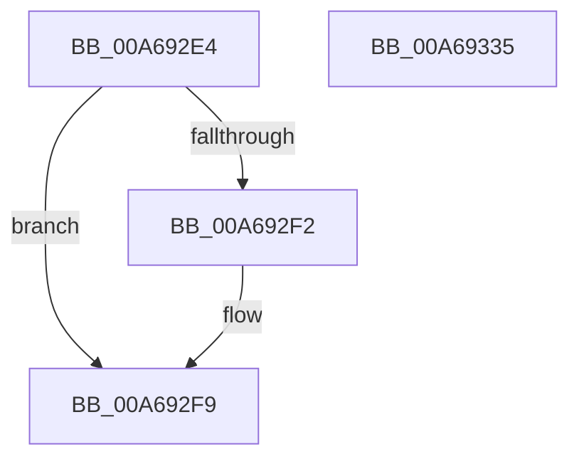

# PnpCtxRegCreateKey

- RVA: `0x00A692E4`–`0x00A69336` (길이 `82` bytes)
- VA: `0x0000000140A692E4`
- 실행 섹션: `PAGE`
- PDB 이름 있음: `예`; PDB Function 태그: `아니요`
- unwind 정보 RVA: `0x0006C2A4`
- 디코드: `18`개 명령, `82/82` bytes 표시
- 미해석 바이트: `0` (있으면 어셈블리에 `.byte`로 보존)

> 이 문서는 커널 이미지의 기계어와 PDB 기호를 분석해 생성했습니다. 4번과 5번은 함수 원형과 자료형을 바이너리 사용 방식에서 추정한 C 해석이며 원본 소스 복구 결과는 아닙니다.

## 1. Dependencies

- 직접 호출 지점: **1**; 고유 호출 대상: **1**
- 직접 호출자로 확인된 함수: **10**
- RIP 상대 이미지 참조: **0**

### Outgoing calls
- `0x00A6932B` → [SysCtxRegCreateKey](SysCtxRegCreateKey_function_00A6933C.md) (function, `0x00A6933C`)

### Direct callers
- [PipUpdateDeviceProducts](../../text/5A/PipUpdateDeviceProducts_function_005A46C0.md) at `0x005A4BAD`
- [PiDrvDbOverlayCopyKeys](../74/PiDrvDbOverlayCopyKeys_function_007413FC.md) at `0x0074151C`
- [PiDrvDbOverlayNodeHive](../74/PiDrvDbOverlayNodeHive_function_00741990.md) at `0x00741CFC`
- [CmAddPanelDeviceWorker](../82/CmAddPanelDeviceWorker_function_0082DF30.md) at `0x0082DFB8`
- [sub_00B240D8](../B2/Unknown_function_00B240D8.md) at `0x00B24109`
- [sub_00B24164](../B2/Unknown_function_00B24164.md) at `0x00B241EC`
- [IopInitializeBootDrivers](../../init/C2/IopInitializeBootDrivers_function_00C2E6F4.md) at `0x00C2F18D`
- [PipMigratePnpState](../../init/C3/PipMigratePnpState_function_00C317D4.md) at `0x00C319E9`
- [PipMigratePnpState](../../init/C3/PipMigratePnpState_function_00C317D4.md) at `0x00C31BA6`
- [PipCommitPendingOsExtensionResource](../../init/C3/PipCommitPendingOsExtensionResource_function_00C35960.md) at `0x00C35A65`
- [PipCommitPendingOsExtensionResource](../../init/C3/PipCommitPendingOsExtensionResource_function_00C35960.md) at `0x00C35AA2`
- [PipCommitPendingService](../../init/C3/PipCommitPendingService_function_00C35B70.md) at `0x00C35D1A`
- [PipCommitPendingService](../../init/C3/PipCommitPendingService_function_00C35B70.md) at `0x00C35D5F`

### Static image references
- 디코드된 RIP-relative 메모리 참조가 없습니다.

## 2. Other-region calls and transfers

- 다른 실행 섹션으로 향하는 call: **0**
- 별도 외부 분기/꼬리 이동을 확인하지 못했습니다.

## 3. Assembly (complete function range)

```asm
00A692E4  48 83 EC 58                     sub rsp, 0x58
00A692E8  48 8B C1                        mov rax, rcx
00A692EB  33 C9                           xor ecx, ecx
00A692ED  48 85 C0                        test rax, rax
00A692F0  74 07                           je 0x140a692f9
00A692F2  48 8B 88 E0 00 00 00            mov rcx, qword ptr [rax + 0xe0]
00A692F9  48 8B 84 24 98 00 00 00         mov rax, qword ptr [rsp + 0x98]
00A69301  48 89 44 24 40                  mov qword ptr [rsp + 0x40], rax
00A69306  48 8B 84 24 90 00 00 00         mov rax, qword ptr [rsp + 0x90]
00A6930E  48 89 44 24 38                  mov qword ptr [rsp + 0x38], rax
00A69313  48 8B 84 24 88 00 00 00         mov rax, qword ptr [rsp + 0x88]
00A6931B  48 89 44 24 28                  mov qword ptr [rsp + 0x28], rax
00A69320  8B 84 24 80 00 00 00            mov eax, dword ptr [rsp + 0x80]
00A69327  89 44 24 20                     mov dword ptr [rsp + 0x20], eax
00A6932B  E8 0C 00 00 00                  call 0x140a6933c
00A69330  48 83 C4 58                     add rsp, 0x58
00A69334  C3                              ret
00A69335  CC                              int3
```

## 4. C-style interpretation (structured pseudocode)

```c
__int64 __fastcall PnpCtxRegCreateKey(__int64 a1, __int64 a2, __int64 a3, __int64 a4, unsigned int a5, __int64 a6, __int64 a7, __int64 a8)
{
    __int64 result;
    __int64 v_rsp;
    unsigned __int64 v_stack_m18;
    unsigned __int64 v_stack_m20;
    unsigned __int64 v_stack_m30;
    unsigned int v_stack_m38;

    v_rsp = (v_rsp) - (88);
    a1 = 0;
    if (0 != 0) {
        a1 = *(unsigned __int64 *)(a1 + 224);
    }
    v_stack_m18 = a8;
    v_stack_m20 = a7;
    v_stack_m30 = a6;
    v_stack_m38 = (unsigned int)((unsigned int)(a5));
    result = SysCtxRegCreateKey(a1, a2, a3, a4);
    v_rsp = (v_rsp) + (88);
    return result;
}
```

## 5. (Beta) C Style

```c
int64_t PnpCtxRegCreateKey(int64_t Arg1, int64_t Arg2, int64_t Arg3, int64_t Arg4, uint32_t Arg5, int64_t Arg6, int64_t Arg7, int64_t Arg8)
{
    int64_t result;
    int64_t local_rsp;
    uint64_t v_stack_m18;
    uint64_t v_stack_m20;
    uint64_t v_stack_m30;
    uint32_t v_stack_m38;

    local_rsp = (local_rsp) - (88);
    Arg1 = 0;
    if (0 != 0) {
        Arg1 = *(uint64_t *)(Arg1 + 0xE0);
    }
    v_stack_m18 = Arg8;
    v_stack_m20 = Arg7;
    v_stack_m30 = Arg6;
    v_stack_m38 = (uint32_t)((uint32_t)(Arg5));
    result = SysCtxRegCreateKey(Arg1, Arg2, Arg3, Arg4);
    local_rsp = (local_rsp) + (88);
    return result;
}
```

## 6. Execution-region graph

[열기: 2D/3D 그래프와 함수 탐색 컨트롤 패널](../../../control-panel.html?section=page&rva=0x00A692E4&view=graph)

- 2D 그래프는 위에서 아래로 흐르고, 3D 그래프는 빈 공간을 드래그해 회전합니다. Shift+드래그는 이동, 휠은 확대·축소, 함수 노드 선택은 대상 보고서 이동입니다.

### Static fallback


