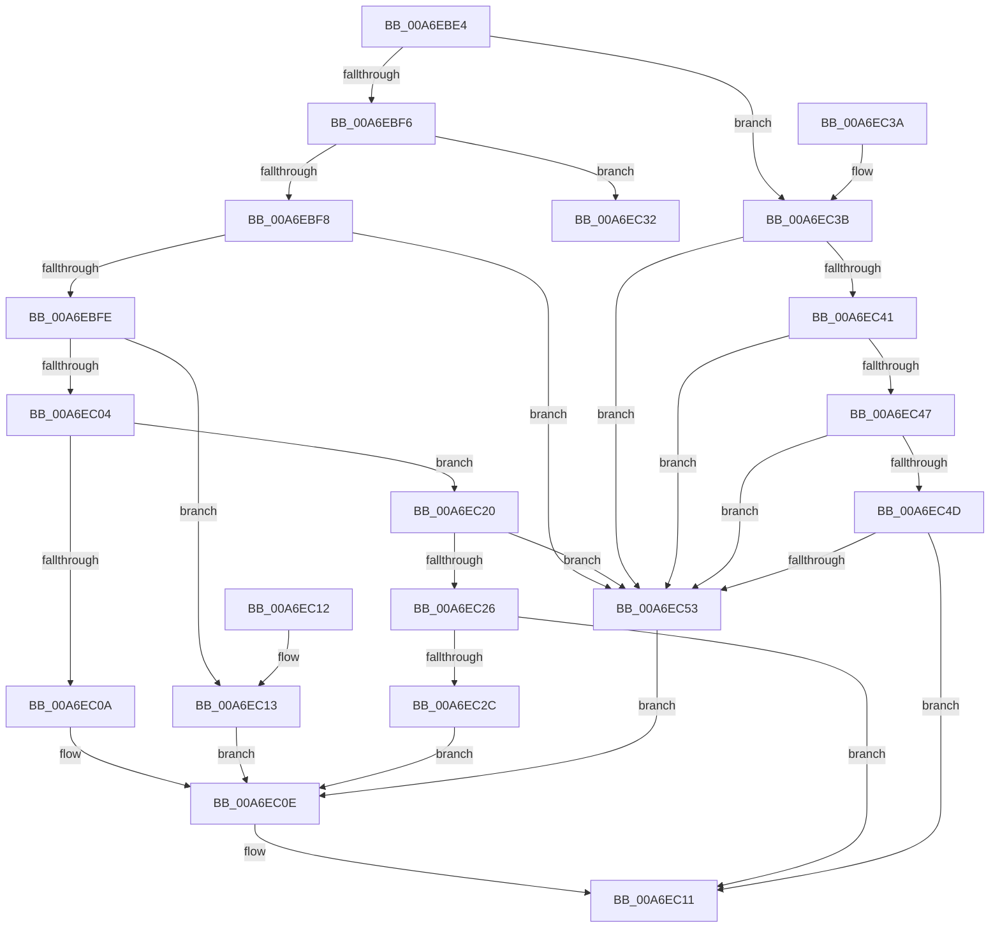

# PnpExtractCategorySpecificEventData

- RVA: `0x00A6EBE4`–`0x00A6EC59` (길이 `117` bytes)
- VA: `0x0000000140A6EBE4`
- 실행 섹션: `PAGE`
- PDB 이름 있음: `예`; PDB Function 태그: `아니요`
- unwind 정보 RVA: `0x000DB714`
- 디코드: `40`개 명령, `117/117` bytes 표시
- 미해석 바이트: `0` (있으면 어셈블리에 `.byte`로 보존)

> 이 문서는 커널 이미지의 기계어와 PDB 기호를 분석해 생성했습니다. 4번과 5번은 함수 원형과 자료형을 바이너리 사용 방식에서 추정한 C 해석이며 원본 소스 복구 결과는 아닙니다.

## 1. Dependencies

- 직접 호출 지점: **0**; 고유 호출 대상: **0**
- 직접 호출자로 확인된 함수: **1**
- RIP 상대 이미지 참조: **0**

### Outgoing calls
- 직접 디코드된 call 명령이 없습니다.

### Direct callers
- [PiUEventGatherEventData](PiUEventGatherEventData_function_00A6EBAC.md) at `0x00A6EBD2`

### Static image references
- 디코드된 RIP-relative 메모리 참조가 없습니다.

## 2. Other-region calls and transfers

- 다른 실행 섹션으로 향하는 call: **0**
- 별도 외부 분기/꼬리 이동을 확인하지 못했습니다.

## 3. Assembly (complete function range)

```asm
00A6EBE4  48 83 22 00                     and qword ptr [rdx], 0
00A6EBE8  49 83 20 00                     and qword ptr [r8], 0
00A6EBEC  44 8B 49 10                     mov r9d, dword ptr [rcx + 0x10]
00A6EBF0  41 83 F9 07                     cmp r9d, 7
00A6EBF4  7F 45                           jg 0x140a6ec3b
00A6EBF6  74 3A                           je 0x140a6ec32
00A6EBF8  41 83 E9 01                     sub r9d, 1
00A6EBFC  74 55                           je 0x140a6ec53
00A6EBFE  41 83 E9 01                     sub r9d, 1
00A6EC02  74 0F                           je 0x140a6ec13
00A6EC04  41 83 E9 01                     sub r9d, 1
00A6EC08  75 16                           jne 0x140a6ec20
00A6EC0A  48 8D 41 38                     lea rax, [rcx + 0x38]
00A6EC0E  49 89 00                        mov qword ptr [r8], rax
00A6EC11  C3                              ret
00A6EC12  CC                              int3
00A6EC13  48 8D 41 30                     lea rax, [rcx + 0x30]
00A6EC17  48 89 02                        mov qword ptr [rdx], rax
00A6EC1A  48 8D 41 40                     lea rax, [rcx + 0x40]
00A6EC1E  EB EE                           jmp 0x140a6ec0e
00A6EC20  41 83 E9 01                     sub r9d, 1
00A6EC24  74 2D                           je 0x140a6ec53
00A6EC26  41 83 F9 02                     cmp r9d, 2
00A6EC2A  75 E5                           jne 0x140a6ec11
00A6EC2C  48 8D 41 34                     lea rax, [rcx + 0x34]
00A6EC30  EB DC                           jmp 0x140a6ec0e
00A6EC32  48 8D 41 30                     lea rax, [rcx + 0x30]
00A6EC36  48 89 02                        mov qword ptr [rdx], rax
00A6EC39  C3                              ret
00A6EC3A  CC                              int3
00A6EC3B  41 83 E9 08                     sub r9d, 8
00A6EC3F  74 12                           je 0x140a6ec53
00A6EC41  41 83 E9 01                     sub r9d, 1
00A6EC45  74 0C                           je 0x140a6ec53
00A6EC47  41 83 E9 01                     sub r9d, 1
00A6EC4B  74 06                           je 0x140a6ec53
00A6EC4D  41 83 F9 01                     cmp r9d, 1
00A6EC51  75 BE                           jne 0x140a6ec11
00A6EC53  48 8D 41 30                     lea rax, [rcx + 0x30]
00A6EC57  EB B5                           jmp 0x140a6ec0e
```

## 4. C-style interpretation (structured pseudocode)

```c
__int64 __fastcall PnpExtractCategorySpecificEventData(__int64 a1, __int64 a2, __int64 a3)
{
    if (((unsigned int)((unsigned int)(*(unsigned int *)(a1 + 16)))) > 7) goto loc_00A6EC3B;
    if (((unsigned int)((unsigned int)(*(unsigned int *)(a1 + 16)))) == 7) goto loc_00A6EC32;
    a4 = (unsigned int)(((unsigned int)(*(unsigned int *)(a1 + 16))) - (1));
    if (condition_is_equal) goto loc_00A6EC53;
    a4 = (unsigned int)((a4) - (1));
    if (condition_is_equal) goto loc_00A6EC13;
    a4 = (unsigned int)((a4) - (1));
    if (condition_is_not_equal) goto loc_00A6EC20;
loc_00A6EC0E:
    *(unsigned __int64 *)(a3) = a1 + 56;
loc_00A6EC11:
    return a1 + 56;
loc_00A6EC13:
    *(unsigned __int64 *)(a2) = a1 + 48;
    goto loc_00A6EC0E;
loc_00A6EC20:
    a4 = (unsigned int)((a4) - (1));
    if (condition_is_equal) goto loc_00A6EC53;
    if (((unsigned int)(a4)) != 2) goto loc_00A6EC11;
    goto loc_00A6EC0E;
loc_00A6EC32:
    *(unsigned __int64 *)(a2) = a1 + 48;
    return a1 + 48;
loc_00A6EC3B:
    a4 = (unsigned int)((a4) - (8));
    if (condition_is_equal) goto loc_00A6EC53;
    a4 = (unsigned int)((a4) - (1));
    if (condition_is_equal) goto loc_00A6EC53;
    a4 = (unsigned int)((a4) - (1));
    if (condition_is_equal) goto loc_00A6EC53;
    if (((unsigned int)(a4)) != 1) goto loc_00A6EC11;
loc_00A6EC53:
    goto loc_00A6EC0E;
}
```

## 5. (Beta) C Style

```c
void *PnpExtractCategorySpecificEventData(void *Arg1, void *Arg2, void *Arg3)
{
    uint8_t *arg1 = (uint8_t *)Arg1;
    uint8_t *arg2 = (uint8_t *)Arg2;
    uint8_t *arg3 = (uint8_t *)Arg3;

    if (((uint32_t)((uint32_t)(*(uint32_t *)(arg1 + 0x10)))) > 7) goto loc_00A6EC3B;
    if (((uint32_t)((uint32_t)(*(uint32_t *)(arg1 + 0x10)))) == 7) goto loc_00A6EC32;
    a4 = (uint32_t)(((uint32_t)(*(uint32_t *)(arg1 + 0x10))) - (1));
    if (condition_is_equal) goto loc_00A6EC53;
    a4 = (uint32_t)((a4) - (1));
    if (condition_is_equal) goto loc_00A6EC13;
    a4 = (uint32_t)((a4) - (1));
    if (condition_is_not_equal) goto loc_00A6EC20;
loc_00A6EC0E:
    *(void **)(arg3) = Arg1 + 56;
loc_00A6EC11:
    return Arg1 + 56;
loc_00A6EC13:
    *(void **)(arg2) = Arg1 + 48;
    goto loc_00A6EC0E;
loc_00A6EC20:
    a4 = (uint32_t)((a4) - (1));
    if (condition_is_equal) goto loc_00A6EC53;
    if (((uint32_t)(a4)) != 2) goto loc_00A6EC11;
    goto loc_00A6EC0E;
loc_00A6EC32:
    *(void **)(arg2) = Arg1 + 48;
    return Arg1 + 48;
loc_00A6EC3B:
    a4 = (uint32_t)((a4) - (8));
    if (condition_is_equal) goto loc_00A6EC53;
    a4 = (uint32_t)((a4) - (1));
    if (condition_is_equal) goto loc_00A6EC53;
    a4 = (uint32_t)((a4) - (1));
    if (condition_is_equal) goto loc_00A6EC53;
    if (((uint32_t)(a4)) != 1) goto loc_00A6EC11;
loc_00A6EC53:
    goto loc_00A6EC0E;
}
```

### 관측된 메모리 오프셋

구조체 형식이 확인되지 않은 접근은 인자 기준의 오프셋으로만 기록했습니다.

| 기준 인자 | 오프셋 표현 | 폭 (bit) | 접근 |
|---|---:|---:|---|
| `Arg1` | `+ 0x10` | `32` | `R` |
| `Arg1` | `+ 0x30` | `64` | `R` |
| `Arg1` | `+ 0x34` | `64` | `R` |
| `Arg1` | `+ 0x38` | `64` | `R` |
| `Arg1` | `+ 0x40` | `64` | `R` |
| `Arg2` | `+ 0x0` | `64` | `R/W` |
| `Arg2` | `+ 0x0` | `64` | `W` |
| `Arg3` | `+ 0x0` | `64` | `R/W` |
| `Arg3` | `+ 0x0` | `64` | `W` |

## 6. Execution-region graph

[열기: 2D/3D 그래프와 함수 탐색 컨트롤 패널](../../../control-panel.html?section=page&rva=0x00A6EBE4&view=graph)

- 2D 그래프는 위에서 아래로 흐르고, 3D 그래프는 빈 공간을 드래그해 회전합니다. Shift+드래그는 이동, 휠은 확대·축소, 함수 노드 선택은 대상 보고서 이동입니다.

### Static fallback


