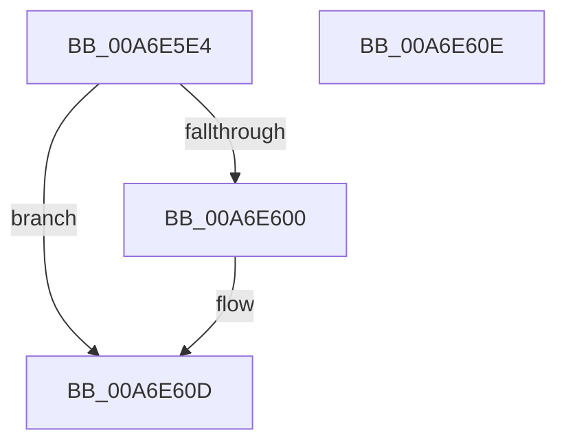

# PoEnergyContextInitialize

- RVA: `0x00A6E5E4`–`0x00A6E60F` (길이 `43` bytes)
- VA: `0x0000000140A6E5E4`
- 실행 섹션: `PAGE`
- PDB 이름 있음: `예`; PDB Function 태그: `아니요`
- unwind 정보 RVA: `0x000DB714`
- 디코드: `9`개 명령, `43/43` bytes 표시
- 미해석 바이트: `0` (있으면 어셈블리에 `.byte`로 보존)

> 이 문서는 커널 이미지의 기계어와 PDB 기호를 분석해 생성했습니다. 4번과 5번은 함수 원형과 자료형을 바이너리 사용 방식에서 추정한 C 해석이며 원본 소스 복구 결과는 아닙니다.

## 1. Dependencies

- 직접 호출 지점: **0**; 고유 호출 대상: **0**
- 직접 호출자로 확인된 함수: **2**
- RIP 상대 이미지 참조: **1**

### Outgoing calls
- 직접 디코드된 call 명령이 없습니다.

### Direct callers
- [PspAllocateProcess](../A1/PspAllocateProcess_function_00A13B3C.md) at `0x00A1429E`
- [PopEtInit](../../init/C4/PopEtInit_function_00C43018.md) at `0x00C4316D`

### Static image references
- `0x00A6E5F4` → RVA `0x00E67A30` (`.data`; read)

## 2. Other-region calls and transfers

- 다른 실행 섹션으로 향하는 call: **0**
- 별도 외부 분기/꼬리 이동을 확인하지 못했습니다.

## 3. Assembly (complete function range)

```asm
00A6E5E4  48 83 A1 C0 01 00 00 00         and qword ptr [rcx + 0x1c0], 0
00A6E5EC  48 83 A1 B8 01 00 00 00         and qword ptr [rcx + 0x1b8], 0
00A6E5F4  48 8B 05 35 94 3F 00            mov rax, qword ptr [rip + 0x3f9435]
00A6E5FB  48 85 C0                        test rax, rax
00A6E5FE  74 0D                           je 0x140a6e60d
00A6E600  48 05 18 03 00 00               add rax, 0x318
00A6E606  48 89 81 C8 01 00 00            mov qword ptr [rcx + 0x1c8], rax
00A6E60D  C3                              ret
00A6E60E  CC                              int3
```

## 4. C-style interpretation (structured pseudocode)

```c
__int64 __fastcall PoEnergyContextInitialize(__int64 a1)
{
    __int64 result;

    result = *(unsigned __int64 *)(v_rip + 4166709);
    if (*(unsigned __int64 *)(v_rip + 4166709) != 0) {
        result = (*(unsigned __int64 *)(v_rip + 4166709)) + (792);
        *(unsigned __int64 *)(a1 + 456) = result;
    }
    return result;
}
```

## 5. (Beta) C Style

```c
int64_t PoEnergyContextInitialize(void *Arg1)
{
    uint8_t *arg1 = (uint8_t *)Arg1;

    int64_t result;

    result = *(uint64_t *)(v_rip + 0x3F9435);
    if (*(uint64_t *)(v_rip + 0x3F9435) != 0) {
        result = (*(uint64_t *)(v_rip + 0x3F9435)) + (792);
        *(uint64_t *)(arg1 + 0x1C8) = result;
    }
    return result;
}
```

### 관측된 메모리 오프셋

구조체 형식이 확인되지 않은 접근은 인자 기준의 오프셋으로만 기록했습니다.

| 기준 인자 | 오프셋 표현 | 폭 (bit) | 접근 |
|---|---:|---:|---|
| `Arg1` | `+ 0x1B8` | `64` | `R/W` |
| `Arg1` | `+ 0x1C0` | `64` | `R/W` |
| `Arg1` | `+ 0x1C8` | `64` | `W` |

## 6. Execution-region graph

[열기: 2D/3D 그래프와 함수 탐색 컨트롤 패널](../../../control-panel.html?section=page&rva=0x00A6E5E4&view=graph)

- 2D 그래프는 위에서 아래로 흐르고, 3D 그래프는 빈 공간을 드래그해 회전합니다. Shift+드래그는 이동, 휠은 확대·축소, 함수 노드 선택은 대상 보고서 이동입니다.

### Static fallback


