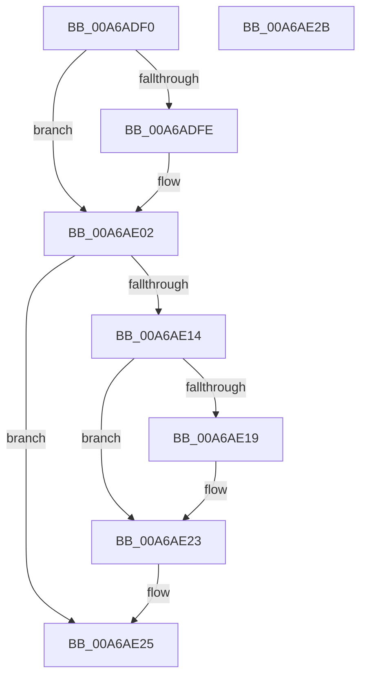

# PoRequestShutdownEvent

- RVA: `0x00A6ADF0`–`0x00A6AE2C` (길이 `60` bytes)
- VA: `0x0000000140A6ADF0`
- 실행 섹션: `PAGE`
- PDB 이름 있음: `예`; PDB Function 태그: `아니요`
- unwind 정보 RVA: `0x0005CF00`
- 디코드: `19`개 명령, `60/60` bytes 표시
- 미해석 바이트: `0` (있으면 어셈블리에 `.byte`로 보존)

> 이 문서는 커널 이미지의 기계어와 PDB 기호를 분석해 생성했습니다. 4번과 5번은 함수 원형과 자료형을 바이너리 사용 방식에서 추정한 C 해석이며 원본 소스 복구 결과는 아닙니다.

## 1. Dependencies

- 직접 호출 지점: **1**; 고유 호출 대상: **1**
- 직접 호출자로 확인된 함수: **0**
- RIP 상대 이미지 참조: **1**

### Outgoing calls
- `0x00A6AE0B` → [PopRequestShutdownWait](PopRequestShutdownWait_function_00A6AE34.md) (function, `0x00A6AE34`)

### Direct callers
- 이 함수 시작 RVA로 연결되는 직접 call은 확인되지 않았습니다. 간접 호출은 완전히 역산할 수 없습니다.

### Static image references
- `0x00A6AE19` → RVA `0x00F0E080` (`.data`; read)

## 2. Other-region calls and transfers

- 다른 실행 섹션으로 향하는 call: **0**
- 별도 외부 분기/꼬리 이동을 확인하지 못했습니다.

## 3. Assembly (complete function range)

```asm
00A6ADF0  40 53                           push rbx
00A6ADF2  48 83 EC 20                     sub rsp, 0x20
00A6ADF6  48 8B D9                        mov rbx, rcx
00A6ADF9  48 85 C9                        test rcx, rcx
00A6ADFC  74 04                           je 0x140a6ae02
00A6ADFE  48 83 21 00                     and qword ptr [rcx], 0
00A6AE02  65 48 8B 0C 25 88 01 00 00      mov rcx, qword ptr gs:[0x188]
00A6AE0B  E8 24 00 00 00                  call 0x140a6ae34
00A6AE10  85 C0                           test eax, eax
00A6AE12  78 11                           js 0x140a6ae25
00A6AE14  48 85 DB                        test rbx, rbx
00A6AE17  74 0A                           je 0x140a6ae23
00A6AE19  48 8D 05 60 32 4A 00            lea rax, [rip + 0x4a3260]
00A6AE20  48 89 03                        mov qword ptr [rbx], rax
00A6AE23  33 C0                           xor eax, eax
00A6AE25  48 83 C4 20                     add rsp, 0x20
00A6AE29  5B                              pop rbx
00A6AE2A  C3                              ret
00A6AE2B  CC                              int3
```

## 4. C-style interpretation (structured pseudocode)

```c
__int64 __fastcall PoRequestShutdownEvent(__int64 a1)
{
    __int64 result;
    __int64 v_rsp;

    v_rsp = (v_rsp) - (32);
    if (a1 != 0) {
    }
    result = PopRequestShutdownWait(*(unsigned __int64 *)(gs_base + (0 + 392)), a2, a3, a4);
    if (sign_flag) goto loc_00A6AE25;
    if (a1 != 0) {
        result = v_rip + 4862560;
        *(unsigned __int64 *)(a1) = result;
    }
    result = 0;
loc_00A6AE25:
    v_rsp = (v_rsp) + (32);
    return result;
}
```

## 5. (Beta) C Style

```c
int64_t PoRequestShutdownEvent(int64_t Arg1)
{
    int64_t result;
    int64_t local_rsp;

    local_rsp = (local_rsp) - (32);
    if (Arg1 != 0) {
    }
    result = PopRequestShutdownWait(*(uint64_t *)(gs_base + (0 + 0x188)), a2, a3, a4);
    if (sign_flag) goto loc_00A6AE25;
    if (Arg1 != 0) {
        result = v_rip + 4862560;
        *(uint64_t *)(Arg1) = result;
    }
    result = 0;
loc_00A6AE25:
    local_rsp = (local_rsp) + (32);
    return result;
}
```

## 6. Execution-region graph

[열기: 2D/3D 그래프와 함수 탐색 컨트롤 패널](../../../control-panel.html?section=page&rva=0x00A6ADF0&view=graph)

- 2D 그래프는 위에서 아래로 흐르고, 3D 그래프는 빈 공간을 드래그해 회전합니다. Shift+드래그는 이동, 휠은 확대·축소, 함수 노드 선택은 대상 보고서 이동입니다.

### Static fallback


