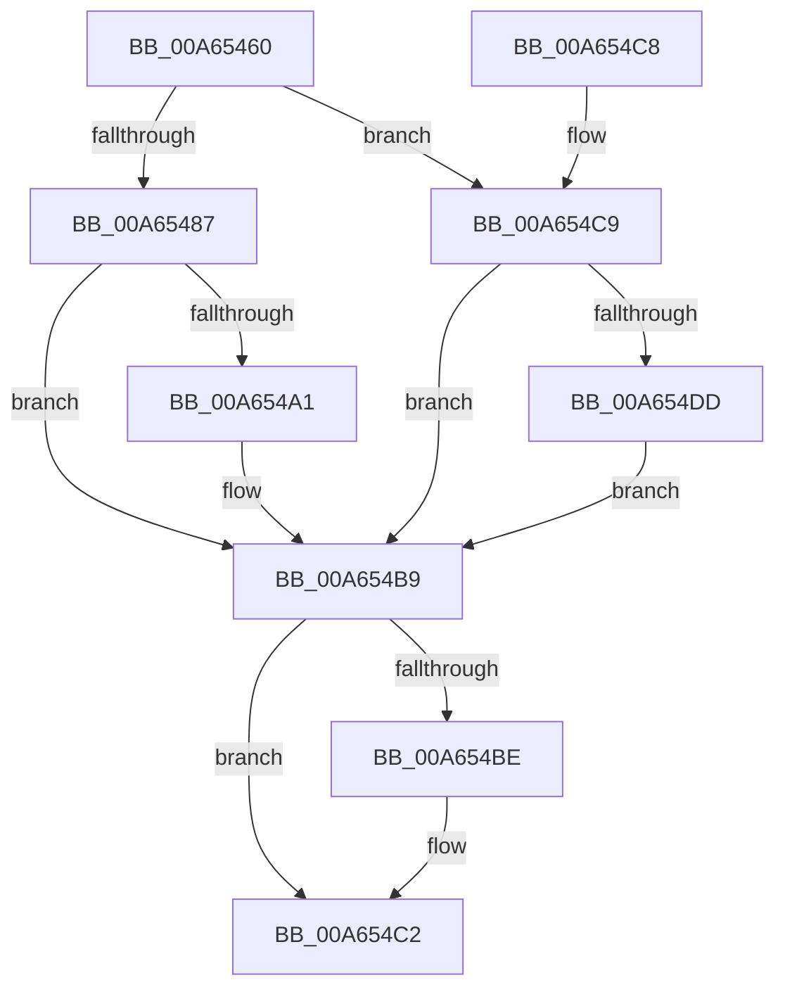

# PopAcquireUmpoPushLock

- RVA: `0x00A65460`–`0x00A654F5` (길이 `149` bytes)
- VA: `0x0000000140A65460`
- 실행 섹션: `PAGE`
- PDB 이름 있음: `예`; PDB Function 태그: `아니요`
- unwind 정보 RVA: `0x000B38A0`
- 디코드: `37`개 명령, `149/149` bytes 표시
- 미해석 바이트: `0` (있으면 어셈블리에 `.byte`로 보존)

> 이 문서는 커널 이미지의 기계어와 PDB 기호를 분석해 생성했습니다. 4번과 5번은 함수 원형과 자료형을 바이너리 사용 방식에서 추정한 C 해석이며 원본 소스 복구 결과는 아닙니다.

## 1. Dependencies

- 직접 호출 지점: **4**; 고유 호출 대상: **3**
- 직접 호출자로 확인된 함수: **2**
- RIP 상대 이미지 참조: **2**

### Outgoing calls
- `0x00A65487` → [KeAbPreAcquire](../../text/21/KeAbPreAcquire_function_00210230.md) (function, `0x00210230`)
- `0x00A654B4` → [ExfAcquirePushLockSharedEx](../../text/21/ExfAcquirePushLockSharedEx_function_0021044C.md) (function, `0x0021044C`)
- `0x00A654C9` → [KeAbPreAcquire](../../text/21/KeAbPreAcquire_function_00210230.md) (function, `0x00210230`)
- `0x00A654EE` → [ExfAcquirePushLockExclusiveEx](../../text/20/ExfAcquirePushLockExclusiveEx_function_0020FC90.md) (function, `0x0020FC90`)

### Direct callers
- [PopUmpoSendPowerMessage](../../text/23/PopUmpoSendPowerMessage_function_00230730.md) at `0x0023078F`
- [sub_00B39570](../B3/Unknown_function_00B39570.md) at `0x00B396D5`

### Static image references
- `0x00A6547E` → RVA `0x00F084B8` (`.data`; read)
- `0x00A654CE` → RVA `0x00F084B8` (`.data`; read/write)

## 2. Other-region calls and transfers

- 다른 실행 섹션으로 향하는 call: **4**
  - `0x00A65487` → [KeAbPreAcquire](../../text/21/KeAbPreAcquire_function_00210230.md) (`PAGE` → `.text`)
  - `0x00A654B4` → [ExfAcquirePushLockSharedEx](../../text/21/ExfAcquirePushLockSharedEx_function_0021044C.md) (`PAGE` → `.text`)
  - `0x00A654C9` → [KeAbPreAcquire](../../text/21/KeAbPreAcquire_function_00210230.md) (`PAGE` → `.text`)
  - `0x00A654EE` → [ExfAcquirePushLockExclusiveEx](../../text/20/ExfAcquirePushLockExclusiveEx_function_0020FC90.md) (`PAGE` → `.text`)
- 별도 외부 분기/꼬리 이동을 확인하지 못했습니다.

## 3. Assembly (complete function range)

```asm
00A65460  40 57                           push rdi
00A65462  48 83 EC 20                     sub rsp, 0x20
00A65466  65 48 8B 04 25 88 01 00 00      mov rax, qword ptr gs:[0x188]
00A6546F  45 33 C0                        xor r8d, r8d
00A65472  33 D2                           xor edx, edx
00A65474  66 FF 88 E4 01 00 00            dec word ptr [rax + 0x1e4]
00A6547B  90                              nop
00A6547C  84 C9                           test cl, cl
00A6547E  48 8D 0D 33 30 4A 00            lea rcx, [rip + 0x4a3033]
00A65485  75 42                           jne 0x140a654c9
00A65487  E8 A4 AD 7A FF                  call 0x140210230
00A6548C  48 8B F8                        mov rdi, rax
00A6548F  B9 11 00 00 00                  mov ecx, 0x11
00A65494  33 C0                           xor eax, eax
00A65496  F0 48 0F B1 0D 19 30 4A 00      lock cmpxchg qword ptr [rip + 0x4a3019], rcx
00A6549F  74 18                           je 0x140a654b9
00A654A1  4C 8D 0D 10 30 4A 00            lea r9, [rip + 0x4a3010]
00A654A8  4C 8B C7                        mov r8, rdi
00A654AB  33 D2                           xor edx, edx
00A654AD  48 8D 0D 04 30 4A 00            lea rcx, [rip + 0x4a3004]
00A654B4  E8 93 AF 7A FF                  call 0x14021044c
00A654B9  48 85 FF                        test rdi, rdi
00A654BC  74 04                           je 0x140a654c2
00A654BE  C6 47 0A 01                     mov byte ptr [rdi + 0xa], 1
00A654C2  48 83 C4 20                     add rsp, 0x20
00A654C6  5F                              pop rdi
00A654C7  C3                              ret
00A654C8  CC                              int3
00A654C9  E8 62 AD 7A FF                  call 0x140210230
00A654CE  F0 48 0F BA 2D E0 2F 4A 00 00   lock bts qword ptr [rip + 0x4a2fe0], 0
00A654D8  48 8B F8                        mov rdi, rax
00A654DB  73 DC                           jae 0x140a654b9
00A654DD  4C 8D 05 D4 2F 4A 00            lea r8, [rip + 0x4a2fd4]
00A654E4  48 8B D0                        mov rdx, rax
00A654E7  48 8D 0D CA 2F 4A 00            lea rcx, [rip + 0x4a2fca]
00A654EE  E8 9D A7 7A FF                  call 0x14020fc90
00A654F3  EB C4                           jmp 0x140a654b9
```

## 4. C-style interpretation (structured pseudocode)

```c
__int64 __fastcall PopAcquireUmpoPushLock(unsigned __int8 a1, int a2, int a3)
{
    __int64 result;
    __int64 v_rsp;

    v_rsp = (v_rsp) - (32);
    a3 = 0;
    a2 = 0;
    if (a1 != 0) goto loc_00A654C9;
    result = KeAbPreAcquire(v_rip + 4862003, a2, a3, a4);
    result = 0;
    if (!(condition_is_equal)) {
        a4 = v_rip + 4861968;
        a3 = 0;
        a2 = 0;
        a1 = v_rip + 4861956;
        result = ExfAcquirePushLockSharedEx(a1, a2, a3, a4);
    }
    if (result != 0) {
        *(unsigned __int8 *)(result + 10) = 1;
    }
    v_rsp = (v_rsp) + (32);
    return result;
loc_00A654C9:
    result = KeAbPreAcquire(a1, a2, a3, a4);
    if (condition_is_above_or_equal) goto loc_00A654B9;
    result = ExfAcquirePushLockExclusiveEx(v_rip + 4861898, result, v_rip + 4861908, a4);
    goto loc_00A654B9;
}
```

## 5. (Beta) C Style

```c
int64_t PopAcquireUmpoPushLock(uint8_t Arg1, int32_t Arg2, int32_t Arg3)
{
    int64_t result;
    int64_t local_rsp;

    local_rsp = (local_rsp) - (32);
    Arg3 = 0;
    Arg2 = 0;
    if (Arg1 != 0) goto loc_00A654C9;
    result = KeAbPreAcquire(v_rip + 4862003, Arg2, Arg3, a4);
    result = 0;
    if (!(condition_is_equal)) {
        a4 = v_rip + 4861968;
        Arg3 = 0;
        Arg2 = 0;
        Arg1 = v_rip + 4861956;
        result = ExfAcquirePushLockSharedEx(Arg1, Arg2, Arg3, a4);
    }
    if (result != 0) {
        *(uint8_t *)(result + 0xA) = 1;
    }
    local_rsp = (local_rsp) + (32);
    return result;
loc_00A654C9:
    result = KeAbPreAcquire(Arg1, Arg2, Arg3, a4);
    if (condition_is_above_or_equal) goto loc_00A654B9;
    result = ExfAcquirePushLockExclusiveEx(v_rip + 4861898, result, v_rip + 4861908, a4);
    goto loc_00A654B9;
}
```

## 6. Execution-region graph

[열기: 2D/3D 그래프와 함수 탐색 컨트롤 패널](../../../control-panel.html?section=page&rva=0x00A65460&view=graph)

- 2D 그래프는 위에서 아래로 흐르고, 3D 그래프는 빈 공간을 드래그해 회전합니다. Shift+드래그는 이동, 휠은 확대·축소, 함수 노드 선택은 대상 보고서 이동입니다.

### Static fallback


