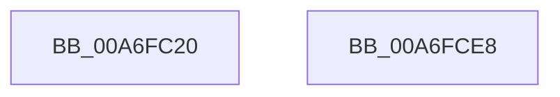

# PopDiagTraceFxComponentRegistration

- RVA: `0x00A6FC20`–`0x00A6FCE9` (길이 `201` bytes)
- VA: `0x0000000140A6FC20`
- 실행 섹션: `PAGE`
- PDB 이름 있음: `예`; PDB Function 태그: `아니요`
- unwind 정보 RVA: `0x000B4EB4`
- 디코드: `46`개 명령, `201/201` bytes 표시
- 미해석 바이트: `0` (있으면 어셈블리에 `.byte`로 보존)

> 이 문서는 커널 이미지의 기계어와 PDB 기호를 분석해 생성했습니다. 4번과 5번은 함수 원형과 자료형을 바이너리 사용 방식에서 추정한 C 해석이며 원본 소스 복구 결과는 아닙니다.

## 1. Dependencies

- 직접 호출 지점: **2**; 고유 호출 대상: **2**
- 직접 호출자로 확인된 함수: **1**
- RIP 상대 이미지 참조: **2**

### Outgoing calls
- `0x00A6FCCE` → [EtwWrite](../../text/41/EtwWrite_function_0041C720.md) (function, `0x0041C720`)
- `0x00A6FCDA` → [_security_check_cookie](../../text/6A/_security_check_cookie_function_006AC640.md) (function, `0x006AC640`)

### Direct callers
- [PopFxTraceDeviceRegistration](PopFxTraceDeviceRegistration_function_00A6F888.md) at `0x00A6FABB`

### Static image references
- `0x00A6FC37` → RVA `0x00E0A740` (`.data`; read)
- `0x00A6FCC2` → RVA `0x00F0B408` (`.data`; read)

## 2. Other-region calls and transfers

- 다른 실행 섹션으로 향하는 call: **2**
  - `0x00A6FCCE` → [EtwWrite](../../text/41/EtwWrite_function_0041C720.md) (`PAGE` → `.text`)
  - `0x00A6FCDA` → [_security_check_cookie](../../text/6A/_security_check_cookie_function_006AC640.md) (`PAGE` → `.text`)
- 별도 외부 분기/꼬리 이동을 확인하지 못했습니다.

## 3. Assembly (complete function range)

```asm
00A6FC20  44 89 44 24 18                  mov dword ptr [rsp + 0x18], r8d
00A6FC25  48 89 54 24 10                  mov qword ptr [rsp + 0x10], rdx
00A6FC2A  55                              push rbp
00A6FC2B  48 8D 6C 24 C1                  lea rbp, [rsp - 0x3f]
00A6FC30  48 81 EC B0 00 00 00            sub rsp, 0xb0
00A6FC37  48 8B 05 02 AB 39 00            mov rax, qword ptr [rip + 0x39ab02]
00A6FC3E  48 33 C4                        xor rax, rsp
00A6FC41  48 89 45 2F                     mov qword ptr [rbp + 0x2f], rax
00A6FC45  41 0F B6 C1                     movzx eax, r9b
00A6FC49  48 8B D1                        mov rdx, rcx
00A6FC4C  89 45 BF                        mov dword ptr [rbp - 0x41], eax
00A6FC4F  45 33 C0                        xor r8d, r8d
00A6FC52  48 8D 45 57                     lea rax, [rbp + 0x57]
00A6FC56  48 C7 45 D7 08 00 00 00         mov qword ptr [rbp - 0x29], 8
00A6FC5E  48 89 45 CF                     mov qword ptr [rbp - 0x31], rax
00A6FC62  48 8D 45 5F                     lea rax, [rbp + 0x5f]
00A6FC66  48 89 45 DF                     mov qword ptr [rbp - 0x21], rax
00A6FC6A  48 8D 45 BF                     lea rax, [rbp - 0x41]
00A6FC6E  48 89 45 EF                     mov qword ptr [rbp - 0x11], rax
00A6FC72  45 8D 48 06                     lea r9d, [r8 + 6]
00A6FC76  48 8D 45 6F                     lea rax, [rbp + 0x6f]
00A6FC7A  48 C7 45 E7 04 00 00 00         mov qword ptr [rbp - 0x19], 4
00A6FC82  48 89 45 FF                     mov qword ptr [rbp - 1], rax
00A6FC86  48 8D 45 77                     lea rax, [rbp + 0x77]
00A6FC8A  48 89 45 0F                     mov qword ptr [rbp + 0xf], rax
00A6FC8E  48 8B 45 7F                     mov rax, qword ptr [rbp + 0x7f]
00A6FC92  48 89 45 1F                     mov qword ptr [rbp + 0x1f], rax
00A6FC96  8B 45 77                        mov eax, dword ptr [rbp + 0x77]
00A6FC99  48 C7 45 F7 04 00 00 00         mov qword ptr [rbp - 9], 4
00A6FCA1  48 C7 45 07 04 00 00 00         mov qword ptr [rbp + 7], 4
00A6FCA9  48 C7 45 17 04 00 00 00         mov qword ptr [rbp + 0x17], 4
00A6FCB1  8D 0C 40                        lea ecx, [rax + rax*2]
00A6FCB4  44 89 45 2B                     mov dword ptr [rbp + 0x2b], r8d
00A6FCB8  C1 E1 03                        shl ecx, 3
00A6FCBB  48 8D 45 CF                     lea rax, [rbp - 0x31]
00A6FCBF  89 4D 27                        mov dword ptr [rbp + 0x27], ecx
00A6FCC2  48 8B 0D 3F B7 49 00            mov rcx, qword ptr [rip + 0x49b73f]
00A6FCC9  48 89 44 24 20                  mov qword ptr [rsp + 0x20], rax
00A6FCCE  E8 4D CA 9A FF                  call 0x14041c720
00A6FCD3  48 8B 4D 2F                     mov rcx, qword ptr [rbp + 0x2f]
00A6FCD7  48 33 CC                        xor rcx, rsp
00A6FCDA  E8 61 C9 C3 FF                  call 0x1406ac640
00A6FCDF  48 81 C4 B0 00 00 00            add rsp, 0xb0
00A6FCE6  5D                              pop rbp
00A6FCE7  C3                              ret
00A6FCE8  CC                              int3
```

## 4. C-style interpretation (structured pseudocode)

```c
__int64 __fastcall PopDiagTraceFxComponentRegistration(__int64 a1, __int64 a2, int a3, unsigned __int8 a4, __int64 a5, unsigned int a6, __int64 a7)
{
    __int64 result;
    __int64 v_rsp;
    unsigned __int64 v_stack_m18;
    unsigned int v_stack_m1C;
    unsigned int v_stack_m20;
    unsigned __int64 v_stack_m28;
    unsigned __int64 v_stack_m30;
    unsigned __int64 v_stack_m38;
    unsigned __int64 v_stack_m40;
    unsigned __int64 v_stack_m47;
    unsigned __int64 v_stack_m48;
    unsigned __int64 v_stack_m50;
    unsigned __int64 v_stack_m58;
    unsigned __int64 v_stack_m60;
    unsigned __int64 v_stack_m68;
    unsigned __int64 v_stack_m70;
    unsigned __int64 v_stack_m78;
    unsigned int v_stack_m88;
    unsigned __int64 v_stack_m98;
    unsigned __int64 v_stack_p10;
    unsigned int v_stack_p18;

    v_stack_p18 = a3;
    v_stack_p10 = a2;
    v_rsp = (v_rsp) - (176);
    result = (*(unsigned __int64 *)(v_rip + 3779330)) ^ (v_rsp);
    v_stack_m18 = result;
    v_stack_m88 = a4;
    a3 = 0;
    v_stack_m70 = 8;
    v_stack_m78 = v_stack_p10;
    v_stack_m68 = v_stack_p18;
    v_stack_m58 = v_stack_m88;
    v_stack_m60 = 4;
    v_stack_m48 = a5;
    v_stack_m38 = a6;
    v_stack_m28 = a7;
    v_stack_m50 = 4;
    v_stack_m40 = 4;
    v_stack_m30 = 4;
    v_stack_m1C = 0;
    a1 = (unsigned int)(((unsigned int)(a6) + (unsigned int)(a6) * 2) << (3));
    v_stack_m20 = (unsigned int)(a1);
    v_stack_m98 = v_stack_m78;
    result = EtwWrite(*(unsigned __int64 *)(v_rip + 4831039), a1, a3, a3 + 6);
    a1 = (v_stack_m18) ^ (v_rsp);
    result = _security_check_cookie(a1, a1, a3, a3 + 6);
    v_rsp = (v_rsp) + (176);
    return result;
}
```

## 5. (Beta) C Style

```c
int64_t PopDiagTraceFxComponentRegistration(int64_t Arg1, int64_t Arg2, int32_t Arg3, uint8_t Arg4, int64_t Arg5, void *Arg6, int64_t Arg7)
{
    uint8_t *arg6 = (uint8_t *)Arg6;

    int64_t result;
    int64_t local_rsp;
    uint64_t v_stack_m18;
    uint32_t v_stack_m1C;
    uint32_t v_stack_m20;
    uint64_t v_stack_m28;
    uint64_t v_stack_m30;
    uint64_t v_stack_m38;
    uint64_t v_stack_m40;
    uint64_t v_stack_m47;
    uint64_t v_stack_m48;
    uint64_t v_stack_m50;
    uint64_t v_stack_m58;
    uint64_t v_stack_m60;
    uint64_t v_stack_m68;
    uint64_t v_stack_m70;
    uint64_t v_stack_m78;
    uint32_t v_stack_m88;
    uint64_t v_stack_m98;
    uint64_t v_stack_p10;
    uint32_t v_stack_p18;

    v_stack_p18 = Arg3;
    v_stack_p10 = Arg2;
    local_rsp = (local_rsp) - (176);
    result = (*(uint64_t *)(v_rip + 0x39AB02)) ^ (local_rsp);
    v_stack_m18 = result;
    v_stack_m88 = Arg4;
    Arg3 = 0;
    v_stack_m70 = 8;
    v_stack_m78 = v_stack_p10;
    v_stack_m68 = v_stack_p18;
    v_stack_m58 = v_stack_m88;
    v_stack_m60 = 4;
    v_stack_m48 = Arg5;
    v_stack_m38 = Arg6;
    v_stack_m28 = Arg7;
    v_stack_m50 = 4;
    v_stack_m40 = 4;
    v_stack_m30 = 4;
    v_stack_m1C = 0;
    Arg1 = (uint32_t)(((uint32_t)(Arg6) + (uint32_t)(Arg6) * 2) << (3));
    v_stack_m20 = (uint32_t)(Arg1);
    v_stack_m98 = v_stack_m78;
    result = EtwWrite(*(uint64_t *)(v_rip + 0x49B73F), Arg1, Arg3, Arg3 + 6);
    Arg1 = (v_stack_m18) ^ (local_rsp);
    result = _security_check_cookie(Arg1, Arg1, Arg3, Arg3 + 6);
    local_rsp = (local_rsp) + (176);
    return result;
}
```

### 관측된 메모리 오프셋

구조체 형식이 확인되지 않은 접근은 인자 기준의 오프셋으로만 기록했습니다.

| 기준 인자 | 오프셋 표현 | 폭 (bit) | 접근 |
|---|---:|---:|---|
| `Arg6` | `+ 0x0 + rax*2` | `32` | `R` |

## 6. Execution-region graph

[열기: 2D/3D 그래프와 함수 탐색 컨트롤 패널](../../../control-panel.html?section=page&rva=0x00A6FC20&view=graph)

- 2D 그래프는 위에서 아래로 흐르고, 3D 그래프는 빈 공간을 드래그해 회전합니다. Shift+드래그는 이동, 휠은 확대·축소, 함수 노드 선택은 대상 보고서 이동입니다.

### Static fallback


