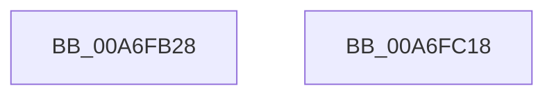

# PopDiagTraceFxDeviceRegistration

- RVA: `0x00A6FB28`–`0x00A6FC19` (길이 `241` bytes)
- VA: `0x0000000140A6FB28`
- 실행 섹션: `PAGE`
- PDB 이름 있음: `예`; PDB Function 태그: `아니요`
- unwind 정보 RVA: `0x000B4E9C`
- 디코드: `55`개 명령, `241/241` bytes 표시
- 미해석 바이트: `0` (있으면 어셈블리에 `.byte`로 보존)

> 이 문서는 커널 이미지의 기계어와 PDB 기호를 분석해 생성했습니다. 4번과 5번은 함수 원형과 자료형을 바이너리 사용 방식에서 추정한 C 해석이며 원본 소스 복구 결과는 아닙니다.

## 1. Dependencies

- 직접 호출 지점: **2**; 고유 호출 대상: **2**
- 직접 호출자로 확인된 함수: **1**
- RIP 상대 이미지 참조: **2**

### Outgoing calls
- `0x00A6FBFE` → [EtwWrite](../../text/41/EtwWrite_function_0041C720.md) (function, `0x0041C720`)
- `0x00A6FC0A` → [_security_check_cookie](../../text/6A/_security_check_cookie_function_006AC640.md) (function, `0x006AC640`)

### Direct callers
- [PopFxTraceDeviceRegistration](PopFxTraceDeviceRegistration_function_00A6F888.md) at `0x00A6F942`

### Static image references
- `0x00A6FB3F` → RVA `0x00E0A740` (`.data`; read)
- `0x00A6FBBE` → RVA `0x00F0B408` (`.data`; read)

## 2. Other-region calls and transfers

- 다른 실행 섹션으로 향하는 call: **2**
  - `0x00A6FBFE` → [EtwWrite](../../text/41/EtwWrite_function_0041C720.md) (`PAGE` → `.text`)
  - `0x00A6FC0A` → [_security_check_cookie](../../text/6A/_security_check_cookie_function_006AC640.md) (`PAGE` → `.text`)
- 별도 외부 분기/꼬리 이동을 확인하지 못했습니다.

## 3. Assembly (complete function range)

```asm
00A6FB28  4C 89 44 24 18                  mov qword ptr [rsp + 0x18], r8
00A6FB2D  48 89 54 24 10                  mov qword ptr [rsp + 0x10], rdx
00A6FB32  55                              push rbp
00A6FB33  48 8D 6C 24 C9                  lea rbp, [rsp - 0x37]
00A6FB38  48 81 EC D0 00 00 00            sub rsp, 0xd0
00A6FB3F  48 8B 05 FA AB 39 00            mov rax, qword ptr [rip + 0x39abfa]
00A6FB46  48 33 C4                        xor rax, rsp
00A6FB49  48 89 45 27                     mov qword ptr [rbp + 0x27], rax
00A6FB4D  41 FE C9                        dec r9b
00A6FB50  48 C7 45 CF 01 00 00 00         mov qword ptr [rbp - 0x31], 1
00A6FB58  48 8B D1                        mov rdx, rcx
00A6FB5B  44 88 4D 97                     mov byte ptr [rbp - 0x69], r9b
00A6FB5F  48 8B 4D 6F                     mov rcx, qword ptr [rbp + 0x6f]
00A6FB63  41 B9 08 00 00 00               mov r9d, 8
00A6FB69  45 33 DB                        xor r11d, r11d
00A6FB6C  4C 89 4D AF                     mov qword ptr [rbp - 0x51], r9
00A6FB70  4C 89 4D BF                     mov qword ptr [rbp - 0x41], r9
00A6FB74  48 C7 45 DF 04 00 00 00         mov qword ptr [rbp - 0x21], 4
00A6FB7C  44 0F B7 01                     movzx r8d, word ptr [rcx]
00A6FB80  41 0F B7 C0                     movzx eax, r8w
00A6FB84  44 89 45 FF                     mov dword ptr [rbp - 1], r8d
00A6FB88  66 D1 E8                        shr ax, 1
00A6FB8B  45 33 C0                        xor r8d, r8d
00A6FB8E  66 89 45 9B                     mov word ptr [rbp - 0x65], ax
00A6FB92  48 8D 45 4F                     lea rax, [rbp + 0x4f]
00A6FB96  48 89 45 A7                     mov qword ptr [rbp - 0x59], rax
00A6FB9A  48 8D 45 57                     lea rax, [rbp + 0x57]
00A6FB9E  48 89 45 B7                     mov qword ptr [rbp - 0x49], rax
00A6FBA2  48 8D 45 97                     lea rax, [rbp - 0x69]
00A6FBA6  48 89 45 C7                     mov qword ptr [rbp - 0x39], rax
00A6FBAA  48 8D 45 67                     lea rax, [rbp + 0x67]
00A6FBAE  48 89 45 D7                     mov qword ptr [rbp - 0x29], rax
00A6FBB2  48 8D 45 9B                     lea rax, [rbp - 0x65]
00A6FBB6  48 89 45 E7                     mov qword ptr [rbp - 0x19], rax
00A6FBBA  48 8B 41 08                     mov rax, qword ptr [rcx + 8]
00A6FBBE  48 8B 0D 43 B8 49 00            mov rcx, qword ptr [rip + 0x49b843]
00A6FBC5  48 89 45 F7                     mov qword ptr [rbp - 9], rax
00A6FBC9  48 8D 45 77                     lea rax, [rbp + 0x77]
00A6FBCD  48 89 45 07                     mov qword ptr [rbp + 7], rax
00A6FBD1  48 8B 45 7F                     mov rax, qword ptr [rbp + 0x7f]
00A6FBD5  48 89 45 17                     mov qword ptr [rbp + 0x17], rax
00A6FBD9  48 8D 45 A7                     lea rax, [rbp - 0x59]
00A6FBDD  48 89 44 24 20                  mov qword ptr [rsp + 0x20], rax
00A6FBE2  48 C7 45 EF 02 00 00 00         mov qword ptr [rbp - 0x11], 2
00A6FBEA  44 89 5D 03                     mov dword ptr [rbp + 3], r11d
00A6FBEE  48 C7 45 0F 04 00 00 00         mov qword ptr [rbp + 0xf], 4
00A6FBF6  48 C7 45 1F 0C 00 00 00         mov qword ptr [rbp + 0x1f], 0xc
00A6FBFE  E8 1D CB 9A FF                  call 0x14041c720
00A6FC03  48 8B 4D 27                     mov rcx, qword ptr [rbp + 0x27]
00A6FC07  48 33 CC                        xor rcx, rsp
00A6FC0A  E8 31 CA C3 FF                  call 0x1406ac640
00A6FC0F  48 81 C4 D0 00 00 00            add rsp, 0xd0
00A6FC16  5D                              pop rbp
00A6FC17  C3                              ret
00A6FC18  CC                              int3
```

## 4. C-style interpretation (structured pseudocode)

```c
__int64 __fastcall PopDiagTraceFxDeviceRegistration(__int64 a1, __int64 a2, __int64 a3, unsigned __int8 a4, __int64 a5, __int64 a6, __int64 a7, __int64 a8)
{
    __int64 result;
    __int64 v_r11;
    __int64 v_rsp;
    unsigned __int64 v_stack_m18;
    unsigned __int64 v_stack_m20;
    unsigned __int64 v_stack_m28;
    unsigned __int64 v_stack_m30;
    unsigned __int64 v_stack_m38;
    unsigned int v_stack_m3C;
    unsigned __int64 v_stack_m3F;
    unsigned int v_stack_m40;
    unsigned __int64 v_stack_m48;
    unsigned __int64 v_stack_m50;
    unsigned __int64 v_stack_m58;
    unsigned __int64 v_stack_m60;
    unsigned __int64 v_stack_m68;
    unsigned __int64 v_stack_m70;
    unsigned __int64 v_stack_m78;
    unsigned __int64 v_stack_m80;
    unsigned __int64 v_stack_m88;
    unsigned __int64 v_stack_m90;
    unsigned __int64 v_stack_m98;
    unsigned __int16 v_stack_mA4;
    unsigned __int8 v_stack_mA8;
    unsigned __int64 v_stack_mB8;
    unsigned __int64 v_stack_p10;
    unsigned __int64 v_stack_p18;

    v_stack_p18 = a3;
    v_stack_p10 = a2;
    v_rsp = (v_rsp) - (208);
    result = (*(unsigned __int64 *)(v_rip + 3779578)) ^ (v_rsp);
    v_stack_m18 = result;
    a4 = (unsigned __int8)((a4) - 1);
    v_stack_m70 = 1;
    v_stack_mA8 = a4;
    v_r11 = 0;
    v_stack_m90 = 8;
    v_stack_m80 = 8;
    v_stack_m60 = 4;
    v_stack_m40 = (unsigned int)(*(unsigned __int16 *)(a6));
    result = (unsigned __int16)(((unsigned __int16)(*(unsigned __int16 *)(a6))) >> (1));
    a3 = 0;
    v_stack_mA4 = (unsigned __int16)(result);
    v_stack_m98 = v_stack_p10;
    v_stack_m88 = v_stack_p18;
    v_stack_m78 = v_stack_mA8;
    v_stack_m68 = a5;
    v_stack_m58 = v_stack_mA4;
    v_stack_m48 = *(unsigned __int64 *)(a6 + 8);
    v_stack_m38 = a7;
    v_stack_m28 = a8;
    v_stack_mB8 = v_stack_m98;
    v_stack_m50 = 2;
    v_stack_m3C = 0;
    v_stack_m30 = 4;
    v_stack_m20 = 12;
    result = EtwWrite(*(unsigned __int64 *)(v_rip + 4831299), a1, a3, 8);
    a1 = (v_stack_m18) ^ (v_rsp);
    result = _security_check_cookie(a1, a1, a3, 8);
    v_rsp = (v_rsp) + (208);
    return result;
}
```

## 5. (Beta) C Style

```c
int64_t PopDiagTraceFxDeviceRegistration(int64_t Arg1, int64_t Arg2, int64_t Arg3, uint8_t Arg4, int64_t Arg5, void *Arg6, int64_t Arg7, int64_t Arg8)
{
    uint8_t *arg6 = (uint8_t *)Arg6;

    int64_t result;
    int64_t local_r11;
    int64_t local_rsp;
    uint64_t v_stack_m18;
    uint64_t v_stack_m20;
    uint64_t v_stack_m28;
    uint64_t v_stack_m30;
    uint64_t v_stack_m38;
    uint32_t v_stack_m3C;
    uint64_t v_stack_m3F;
    uint32_t v_stack_m40;
    uint64_t v_stack_m48;
    uint64_t v_stack_m50;
    uint64_t v_stack_m58;
    uint64_t v_stack_m60;
    uint64_t v_stack_m68;
    uint64_t v_stack_m70;
    uint64_t v_stack_m78;
    uint64_t v_stack_m80;
    uint64_t v_stack_m88;
    uint64_t v_stack_m90;
    uint64_t v_stack_m98;
    uint16_t v_stack_mA4;
    uint8_t v_stack_mA8;
    uint64_t v_stack_mB8;
    uint64_t v_stack_p10;
    uint64_t v_stack_p18;

    v_stack_p18 = Arg3;
    v_stack_p10 = Arg2;
    local_rsp = (local_rsp) - (208);
    result = (*(uint64_t *)(v_rip + 0x39ABFA)) ^ (local_rsp);
    v_stack_m18 = result;
    Arg4 = (uint8_t)((Arg4) - 1);
    v_stack_m70 = 1;
    v_stack_mA8 = Arg4;
    local_r11 = 0;
    v_stack_m90 = 8;
    v_stack_m80 = 8;
    v_stack_m60 = 4;
    v_stack_m40 = (uint32_t)(*(uint16_t *)(arg6));
    result = (uint16_t)(((uint16_t)(*(uint16_t *)(arg6))) >> (1));
    Arg3 = 0;
    v_stack_mA4 = (uint16_t)(result);
    v_stack_m98 = v_stack_p10;
    v_stack_m88 = v_stack_p18;
    v_stack_m78 = v_stack_mA8;
    v_stack_m68 = Arg5;
    v_stack_m58 = v_stack_mA4;
    v_stack_m48 = *(uint64_t *)(arg6 + 0x8);
    v_stack_m38 = Arg7;
    v_stack_m28 = Arg8;
    v_stack_mB8 = v_stack_m98;
    v_stack_m50 = 2;
    v_stack_m3C = 0;
    v_stack_m30 = 4;
    v_stack_m20 = 12;
    result = EtwWrite(*(uint64_t *)(v_rip + 0x49B843), Arg1, Arg3, 8);
    Arg1 = (v_stack_m18) ^ (local_rsp);
    result = _security_check_cookie(Arg1, Arg1, Arg3, 8);
    local_rsp = (local_rsp) + (208);
    return result;
}
```

### 관측된 메모리 오프셋

구조체 형식이 확인되지 않은 접근은 인자 기준의 오프셋으로만 기록했습니다.

| 기준 인자 | 오프셋 표현 | 폭 (bit) | 접근 |
|---|---:|---:|---|
| `Arg6` | `+ 0x0` | `16` | `R` |
| `Arg6` | `+ 0x8` | `64` | `R` |

## 6. Execution-region graph

[열기: 2D/3D 그래프와 함수 탐색 컨트롤 패널](../../../control-panel.html?section=page&rva=0x00A6FB28&view=graph)

- 2D 그래프는 위에서 아래로 흐르고, 3D 그래프는 빈 공간을 드래그해 회전합니다. Shift+드래그는 이동, 휠은 확대·축소, 함수 노드 선택은 대상 보고서 이동입니다.

### Static fallback


