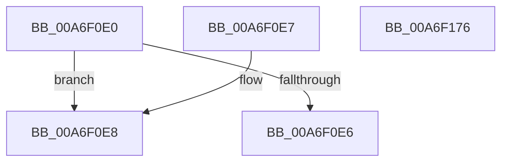

# PopEtInternerEntryInitialize

- RVA: `0x00A6F0E0`–`0x00A6F177` (길이 `151` bytes)
- VA: `0x0000000140A6F0E0`
- 실행 섹션: `PAGE`
- PDB 이름 있음: `예`; PDB Function 태그: `아니요`
- unwind 정보 RVA: `0x000DB714`
- 디코드: `39`개 명령, `151/151` bytes 표시
- 미해석 바이트: `0` (있으면 어셈블리에 `.byte`로 보존)

> 이 문서는 커널 이미지의 기계어와 PDB 기호를 분석해 생성했습니다. 4번과 5번은 함수 원형과 자료형을 바이너리 사용 방식에서 추정한 C 해석이며 원본 소스 복구 결과는 아닙니다.

## 1. Dependencies

- 직접 호출 지점: **0**; 고유 호출 대상: **0**
- 직접 호출자로 확인된 함수: **0**
- RIP 상대 이미지 참조: **0**

### Outgoing calls
- 직접 디코드된 call 명령이 없습니다.

### Direct callers
- 이 함수 시작 RVA로 연결되는 직접 call은 확인되지 않았습니다. 간접 호출은 완전히 역산할 수 없습니다.

### Static image references
- 디코드된 RIP-relative 메모리 참조가 없습니다.

## 2. Other-region calls and transfers

- 다른 실행 섹션으로 향하는 call: **0**
- 별도 외부 분기/꼬리 이동을 확인하지 못했습니다.

## 3. Assembly (complete function range)

```asm
00A6F0E0  49 83 38 58                     cmp qword ptr [r8], 0x58
00A6F0E4  74 02                           je 0x140a6f0e8
00A6F0E6  C3                              ret
00A6F0E7  CC                              int3
00A6F0E8  49 8B 40 08                     mov rax, qword ptr [r8 + 8]
00A6F0EC  48 8B 48 08                     mov rcx, qword ptr [rax + 8]
00A6F0F0  48 89 4A 20                     mov qword ptr [rdx + 0x20], rcx
00A6F0F4  49 8B 40 08                     mov rax, qword ptr [r8 + 8]
00A6F0F8  48 8B 48 28                     mov rcx, qword ptr [rax + 0x28]
00A6F0FC  48 89 4A 28                     mov qword ptr [rdx + 0x28], rcx
00A6F100  49 8B 40 08                     mov rax, qword ptr [r8 + 8]
00A6F104  48 8B 48 48                     mov rcx, qword ptr [rax + 0x48]
00A6F108  48 89 4A 48                     mov qword ptr [rdx + 0x48], rcx
00A6F10C  49 8B 40 08                     mov rax, qword ptr [r8 + 8]
00A6F110  0F B7 48 50                     movzx ecx, word ptr [rax + 0x50]
00A6F114  66 89 4A 56                     mov word ptr [rdx + 0x56], cx
00A6F118  49 8B 40 08                     mov rax, qword ptr [r8 + 8]
00A6F11C  48 8B 48 68                     mov rcx, qword ptr [rax + 0x68]
00A6F120  48 89 4A 30                     mov qword ptr [rdx + 0x30], rcx
00A6F124  49 8B 40 08                     mov rax, qword ptr [r8 + 8]
00A6F128  0F B7 48 70                     movzx ecx, word ptr [rax + 0x70]
00A6F12C  66 D1 E9                        shr cx, 1
00A6F12F  66 89 4A 50                     mov word ptr [rdx + 0x50], cx
00A6F133  49 8B 40 08                     mov rax, qword ptr [r8 + 8]
00A6F137  48 8B 88 88 00 00 00            mov rcx, qword ptr [rax + 0x88]
00A6F13E  48 89 4A 38                     mov qword ptr [rdx + 0x38], rcx
00A6F142  49 8B 40 08                     mov rax, qword ptr [r8 + 8]
00A6F146  0F B7 88 90 00 00 00            movzx ecx, word ptr [rax + 0x90]
00A6F14D  66 D1 E9                        shr cx, 1
00A6F150  66 89 4A 52                     mov word ptr [rdx + 0x52], cx
00A6F154  49 8B 40 08                     mov rax, qword ptr [r8 + 8]
00A6F158  48 8B 88 A8 00 00 00            mov rcx, qword ptr [rax + 0xa8]
00A6F15F  48 89 4A 40                     mov qword ptr [rdx + 0x40], rcx
00A6F163  49 8B 40 08                     mov rax, qword ptr [r8 + 8]
00A6F167  0F B7 88 B0 00 00 00            movzx ecx, word ptr [rax + 0xb0]
00A6F16E  66 D1 E9                        shr cx, 1
00A6F171  66 89 4A 54                     mov word ptr [rdx + 0x54], cx
00A6F175  C3                              ret
00A6F176  CC                              int3
```

## 4. C-style interpretation (structured pseudocode)

```c
__int64 __fastcall PopEtInternerEntryInitialize(__int64 a1, __int64 a2, __int64 a3)
{
    if ((*(unsigned __int64 *)(a3)) == 88) goto loc_00A6F0E8;
    return result;
loc_00A6F0E8:
    *(unsigned __int64 *)(a2 + 32) = *(unsigned __int64 *)(*(unsigned __int64 *)(a3 + 8) + 8);
    *(unsigned __int64 *)(a2 + 40) = *(unsigned __int64 *)(*(unsigned __int64 *)(a3 + 8) + 40);
    *(unsigned __int64 *)(a2 + 72) = *(unsigned __int64 *)(*(unsigned __int64 *)(a3 + 8) + 72);
    *(unsigned __int16 *)(a2 + 86) = (unsigned __int16)(*(unsigned __int16 *)(*(unsigned __int64 *)(a3 + 8) + 80));
    *(unsigned __int64 *)(a2 + 48) = *(unsigned __int64 *)(*(unsigned __int64 *)(a3 + 8) + 104);
    a1 = (unsigned __int16)((*(unsigned __int16 *)(*(unsigned __int64 *)(a3 + 8) + 112)) >> (1));
    *(unsigned __int16 *)(a2 + 80) = (unsigned __int16)(a1);
    *(unsigned __int64 *)(a2 + 56) = *(unsigned __int64 *)(*(unsigned __int64 *)(a3 + 8) + 136);
    a1 = (unsigned __int16)((*(unsigned __int16 *)(*(unsigned __int64 *)(a3 + 8) + 144)) >> (1));
    *(unsigned __int16 *)(a2 + 82) = (unsigned __int16)(a1);
    *(unsigned __int64 *)(a2 + 64) = *(unsigned __int64 *)(*(unsigned __int64 *)(a3 + 8) + 168);
    a1 = (unsigned __int16)((*(unsigned __int16 *)(*(unsigned __int64 *)(a3 + 8) + 176)) >> (1));
    *(unsigned __int16 *)(a2 + 84) = (unsigned __int16)(a1);
    return *(unsigned __int64 *)(a3 + 8);
}
```

## 5. (Beta) C Style

```c
int64_t PopEtInternerEntryInitialize(int64_t Arg1, void *Arg2, void *Arg3)
{
    uint8_t *arg2 = (uint8_t *)Arg2;
    uint8_t *arg3 = (uint8_t *)Arg3;

    if ((*(uint64_t *)(arg3)) == 88) goto loc_00A6F0E8;
    return result;
loc_00A6F0E8:
    *(uint64_t *)(arg2 + 0x20) = *(uint64_t *)(*(uint64_t *)(arg3 + 0x8) + 0x8);
    *(uint64_t *)(arg2 + 0x28) = *(uint64_t *)(*(uint64_t *)(arg3 + 0x8) + 0x28);
    *(uint64_t *)(arg2 + 0x48) = *(uint64_t *)(*(uint64_t *)(arg3 + 0x8) + 0x48);
    *(uint16_t *)(arg2 + 0x56) = (uint16_t)(*(uint16_t *)(*(uint64_t *)(arg3 + 0x8) + 0x50));
    *(uint64_t *)(arg2 + 0x30) = *(uint64_t *)(*(uint64_t *)(arg3 + 0x8) + 0x68);
    Arg1 = (uint16_t)((*(uint16_t *)(*(uint64_t *)(arg3 + 0x8) + 0x70)) >> (1));
    *(uint16_t *)(arg2 + 0x50) = (uint16_t)(Arg1);
    *(uint64_t *)(arg2 + 0x38) = *(uint64_t *)(*(uint64_t *)(arg3 + 0x8) + 0x88);
    Arg1 = (uint16_t)((*(uint16_t *)(*(uint64_t *)(arg3 + 0x8) + 0x90)) >> (1));
    *(uint16_t *)(arg2 + 0x52) = (uint16_t)(Arg1);
    *(uint64_t *)(arg2 + 0x40) = *(uint64_t *)(*(uint64_t *)(arg3 + 0x8) + 0xA8);
    Arg1 = (uint16_t)((*(uint16_t *)(*(uint64_t *)(arg3 + 0x8) + 0xB0)) >> (1));
    *(uint16_t *)(arg2 + 0x54) = (uint16_t)(Arg1);
    return *(uint64_t *)(arg3 + 0x8);
}
```

### 관측된 메모리 오프셋

구조체 형식이 확인되지 않은 접근은 인자 기준의 오프셋으로만 기록했습니다.

| 기준 인자 | 오프셋 표현 | 폭 (bit) | 접근 |
|---|---:|---:|---|
| `Arg2` | `+ 0x20` | `64` | `W` |
| `Arg2` | `+ 0x28` | `64` | `W` |
| `Arg2` | `+ 0x30` | `64` | `W` |
| `Arg2` | `+ 0x38` | `64` | `W` |
| `Arg2` | `+ 0x40` | `64` | `W` |
| `Arg2` | `+ 0x48` | `64` | `W` |
| `Arg2` | `+ 0x50` | `16` | `W` |
| `Arg2` | `+ 0x52` | `16` | `W` |
| `Arg2` | `+ 0x54` | `16` | `W` |
| `Arg2` | `+ 0x56` | `16` | `W` |
| `Arg3` | `+ 0x0` | `64` | `R` |
| `Arg3` | `+ 0x8` | `64` | `R` |

## 6. Execution-region graph

[열기: 2D/3D 그래프와 함수 탐색 컨트롤 패널](../../../control-panel.html?section=page&rva=0x00A6F0E0&view=graph)

- 2D 그래프는 위에서 아래로 흐르고, 3D 그래프는 빈 공간을 드래그해 회전합니다. Shift+드래그는 이동, 휠은 확대·축소, 함수 노드 선택은 대상 보고서 이동입니다.

### Static fallback


