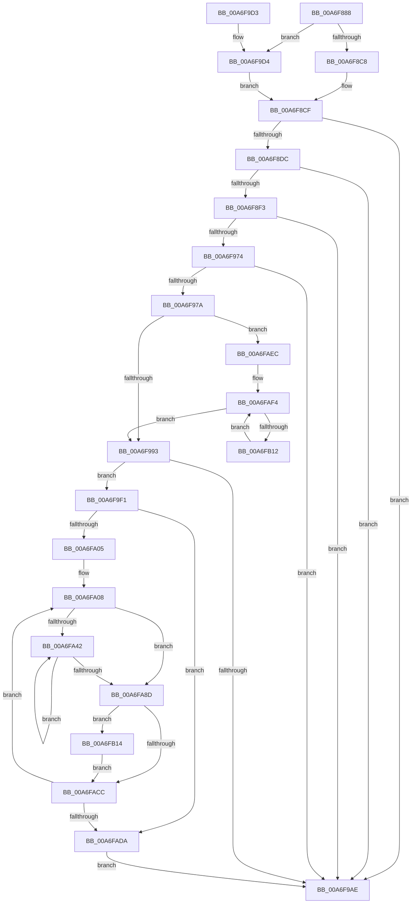

# PopFxTraceDeviceRegistration

- RVA: `0x00A6F888`–`0x00A6FB1F` (길이 `663` bytes)
- VA: `0x0000000140A6F888`
- 실행 섹션: `PAGE`
- PDB 이름 있음: `예`; PDB Function 태그: `아니요`
- unwind 정보 RVA: `0x000B4E78`
- 디코드: `164`개 명령, `663/663` bytes 표시
- 미해석 바이트: `0` (있으면 어셈블리에 `.byte`로 보존)

> 이 문서는 커널 이미지의 기계어와 PDB 기호를 분석해 생성했습니다. 4번과 5번은 함수 원형과 자료형을 바이너리 사용 방식에서 추정한 C 해석이며 원본 소스 복구 결과는 아닙니다.

## 1. Dependencies

- 직접 호출 지점: **12**; 고유 호출 대상: **11**
- 직접 호출자로 확인된 함수: **2**
- RIP 상대 이미지 참조: **7**

### Outgoing calls
- `0x00A6F8E6` → [EtwEventEnabled](../../text/39/EtwEventEnabled_function_00392450.md) (function, `0x00392450`)
- `0x00A6F907` → [PopPepGetDeviceVetoMasks](../../text/4C/PopPepGetDeviceVetoMasks_function_004CC214.md) (function, `0x004CC214`)
- `0x00A6F942` → [PopDiagTraceFxDeviceRegistration](PopDiagTraceFxDeviceRegistration_function_00A6FB28.md) (function, `0x00A6FB28`)
- `0x00A6F96B` → [EtwEventEnabled](../../text/39/EtwEventEnabled_function_00392450.md) (function, `0x00392450`)
- `0x00A6F9A1` → [ExAllocatePool2](../../poolcode/B8/ExAllocatePool2_function_00B820F0.md) (function, `0x00B820F0`)
- `0x00A6F9B6` → [_security_check_cookie](../../text/6A/_security_check_cookie_function_006AC640.md) (function, `0x006AC640`)
- `0x00A6F9E0` → [PopFxAddLogEntry](../../text/39/PopFxAddLogEntry_function_00390B94.md) (function, `0x00390B94`)
- `0x00A6FA23` → [memset](../../text/6C/memset_function_006C6C40.md) (function, `0x006C6C40`)
- `0x00A6FA31` → [PopPepGetComponentVetoMasks](../../text/4B/PopPepGetComponentVetoMasks_function_004B35F4.md) (function, `0x004B35F4`)
- `0x00A6FABB` → [PopDiagTraceFxComponentRegistration](PopDiagTraceFxComponentRegistration_function_00A6FC20.md) (function, `0x00A6FC20`)
- `0x00A6FAE2` → [ExFreePoolWithTag](../../poolcode/B8/ExFreePoolWithTag_function_00B82870.md) (function, `0x00B82870`)
- `0x00A6FB18` → [PopFxTracePerfRegistration](../AD/PopFxTracePerfRegistration_function_00AD81B0.md) (function, `0x00AD81B0`)

### Direct callers
- [PopDiagTraceFxRundown](../../text/43/PopDiagTraceFxRundown_function_0043A028.md) at `0x0043A19D`
- [PopFxRegisterDevice](../75/PopFxRegisterDevice_function_00759B80.md) at `0x00759D83`

### Static image references
- `0x00A6F89C` → RVA `0x00E0A740` (`.data`; read)
- `0x00A6F8C8` → RVA `0x0001ABE0` (`.rdata`; read)
- `0x00A6F8CF` → RVA `0x00E67858` (`.data`; read)
- `0x00A6F8DC` → RVA `0x00F0B408` (`.data`; read)
- `0x00A6F947` → RVA `0x0001ABD0` (`.rdata`; read)
- `0x00A6F951` → RVA `0x0001ABC0` (`.rdata`; read)
- `0x00A6F9E5` → RVA `0x0001ABF0` (`.rdata`; read)

## 2. Other-region calls and transfers

- 다른 실행 섹션으로 향하는 call: **9**
  - `0x00A6F8E6` → [EtwEventEnabled](../../text/39/EtwEventEnabled_function_00392450.md) (`PAGE` → `.text`)
  - `0x00A6F907` → [PopPepGetDeviceVetoMasks](../../text/4C/PopPepGetDeviceVetoMasks_function_004CC214.md) (`PAGE` → `.text`)
  - `0x00A6F96B` → [EtwEventEnabled](../../text/39/EtwEventEnabled_function_00392450.md) (`PAGE` → `.text`)
  - `0x00A6F9A1` → [ExAllocatePool2](../../poolcode/B8/ExAllocatePool2_function_00B820F0.md) (`PAGE` → `POOLCODE`)
  - `0x00A6F9B6` → [_security_check_cookie](../../text/6A/_security_check_cookie_function_006AC640.md) (`PAGE` → `.text`)
  - `0x00A6F9E0` → [PopFxAddLogEntry](../../text/39/PopFxAddLogEntry_function_00390B94.md) (`PAGE` → `.text`)
  - `0x00A6FA23` → [memset](../../text/6C/memset_function_006C6C40.md) (`PAGE` → `.text`)
  - `0x00A6FA31` → [PopPepGetComponentVetoMasks](../../text/4B/PopPepGetComponentVetoMasks_function_004B35F4.md) (`PAGE` → `.text`)
  - `0x00A6FAE2` → [ExFreePoolWithTag](../../poolcode/B8/ExFreePoolWithTag_function_00B82870.md) (`PAGE` → `POOLCODE`)
- 별도 외부 분기/꼬리 이동을 확인하지 못했습니다.

## 3. Assembly (complete function range)

```asm
00A6F888  48 89 5C 24 18                  mov qword ptr [rsp + 0x18], rbx
00A6F88D  55                              push rbp
00A6F88E  56                              push rsi
00A6F88F  57                              push rdi
00A6F890  41 54                           push r12
00A6F892  41 55                           push r13
00A6F894  41 56                           push r14
00A6F896  41 57                           push r15
00A6F898  48 83 EC 70                     sub rsp, 0x70
00A6F89C  48 8B 05 9D AE 39 00            mov rax, qword ptr [rip + 0x39ae9d]
00A6F8A3  48 33 C4                        xor rax, rsp
00A6F8A6  48 89 44 24 60                  mov qword ptr [rsp + 0x60], rax
00A6F8AB  88 54 24 40                     mov byte ptr [rsp + 0x40], dl
00A6F8AF  40 8A F2                        mov sil, dl
00A6F8B2  48 8D 99 64 03 00 00            lea rbx, [rcx + 0x364]
00A6F8B9  48 8B E9                        mov rbp, rcx
00A6F8BC  4C 8D 79 30                     lea r15, [rcx + 0x30]
00A6F8C0  84 D2                           test dl, dl
00A6F8C2  0F 84 0C 01 00 00               je 0x140a6f9d4
00A6F8C8  48 8D 3D 11 B3 5A FF            lea rdi, [rip - 0xa54cef]
00A6F8CF  80 3D 82 7F 3F 00 00            cmp byte ptr [rip + 0x3f7f82], 0
00A6F8D6  0F 84 D2 00 00 00               je 0x140a6f9ae
00A6F8DC  48 8B 0D 25 BB 49 00            mov rcx, qword ptr [rip + 0x49bb25]
00A6F8E3  48 8B D7                        mov rdx, rdi
00A6F8E6  E8 65 2B 92 FF                  call 0x140392450
00A6F8EB  84 C0                           test al, al
00A6F8ED  0F 84 BB 00 00 00               je 0x140a6f9ae
00A6F8F3  48 8B 4D 38                     mov rcx, qword ptr [rbp + 0x38]
00A6F8F7  48 8D 54 24 50                  lea rdx, [rsp + 0x50]
00A6F8FC  33 C0                           xor eax, eax
00A6F8FE  48 89 44 24 50                  mov qword ptr [rsp + 0x50], rax
00A6F903  89 44 24 58                     mov dword ptr [rsp + 0x58], eax
00A6F907  E8 08 C9 A5 FF                  call 0x1404cc214
00A6F90C  44 8B 4D 20                     mov r9d, dword ptr [rbp + 0x20]
00A6F910  48 8D 44 24 50                  lea rax, [rsp + 0x50]
00A6F915  49 8B 17                        mov rdx, qword ptr [r15]
00A6F918  48 8B CF                        mov rcx, rdi
00A6F91B  48 89 44 24 38                  mov qword ptr [rsp + 0x38], rax
00A6F920  8B 03                           mov eax, dword ptr [rbx]
00A6F922  89 44 24 30                     mov dword ptr [rsp + 0x30], eax
00A6F926  4C 8D 82 80 00 00 00            lea r8, [rdx + 0x80]
00A6F92D  4C 89 44 24 28                  mov qword ptr [rsp + 0x28], r8
00A6F932  4C 8B 45 40                     mov r8, qword ptr [rbp + 0x40]
00A6F936  44 89 4C 24 20                  mov dword ptr [rsp + 0x20], r9d
00A6F93B  44 8B 8A 9C 00 00 00            mov r9d, dword ptr [rdx + 0x9c]
00A6F942  E8 E1 01 00 00                  call 0x140a6fb28
00A6F947  48 8D 0D 82 B2 5A FF            lea rcx, [rip - 0xa54d7e]
00A6F94E  40 84 F6                        test sil, sil
00A6F951  48 8D 05 68 B2 5A FF            lea rax, [rip - 0xa54d98]
00A6F958  48 0F 44 C1                     cmove rax, rcx
00A6F95C  48 8B 0D A5 BA 49 00            mov rcx, qword ptr [rip + 0x49baa5]
00A6F963  48 8B D0                        mov rdx, rax
00A6F966  48 89 44 24 48                  mov qword ptr [rsp + 0x48], rax
00A6F96B  E8 E0 2A 92 FF                  call 0x140392450
00A6F970  84 C0                           test al, al
00A6F972  74 3A                           je 0x140a6f9ae
00A6F974  8B 3B                           mov edi, dword ptr [rbx]
00A6F976  85 FF                           test edi, edi
00A6F978  74 34                           je 0x140a6f9ae
00A6F97A  48 8B 95 68 03 00 00            mov rdx, qword ptr [rbp + 0x368]
00A6F981  48 8B 02                        mov rax, qword ptr [rdx]
00A6F984  8B 98 9C 00 00 00               mov ebx, dword ptr [rax + 0x9c]
00A6F98A  83 FF 01                        cmp edi, 1
00A6F98D  0F 87 59 01 00 00               ja 0x140a6faec
00A6F993  6B D3 1C                        imul edx, ebx, 0x1c
00A6F996  B9 00 01 00 00                  mov ecx, 0x100
00A6F99B  41 B8 50 46 58 4D               mov r8d, 0x4d584650
00A6F9A1  E8 4A 27 11 00                  call 0x140b820f0
00A6F9A6  48 8B F0                        mov rsi, rax
00A6F9A9  48 85 C0                        test rax, rax
00A6F9AC  75 43                           jne 0x140a6f9f1
00A6F9AE  48 8B 4C 24 60                  mov rcx, qword ptr [rsp + 0x60]
00A6F9B3  48 33 CC                        xor rcx, rsp
00A6F9B6  E8 85 CC C3 FF                  call 0x1406ac640
00A6F9BB  48 8B 9C 24 C0 00 00 00         mov rbx, qword ptr [rsp + 0xc0]
00A6F9C3  48 83 C4 70                     add rsp, 0x70
00A6F9C7  41 5F                           pop r15
00A6F9C9  41 5E                           pop r14
00A6F9CB  41 5D                           pop r13
00A6F9CD  41 5C                           pop r12
00A6F9CF  5F                              pop rdi
00A6F9D0  5E                              pop rsi
00A6F9D1  5D                              pop rbp
00A6F9D2  C3                              ret
00A6F9D3  CC                              int3
00A6F9D4  44 8B 0B                        mov r9d, dword ptr [rbx]
00A6F9D7  33 D2                           xor edx, edx
00A6F9D9  49 8B 0F                        mov rcx, qword ptr [r15]
00A6F9DC  44 8D 42 01                     lea r8d, [rdx + 1]
00A6F9E0  E8 AF 11 92 FF                  call 0x140390b94
00A6F9E5  48 8D 3D 04 B2 5A FF            lea rdi, [rip - 0xa54dfc]
00A6F9EC  E9 DE FE FF FF                  jmp 0x140a6f8cf
00A6F9F1  8B CB                           mov ecx, ebx
00A6F9F3  33 DB                           xor ebx, ebx
00A6F9F5  48 8D 14 49                     lea rdx, [rcx + rcx*2]
00A6F9F9  4C 8D 2C D0                     lea r13, [rax + rdx*8]
00A6F9FD  85 FF                           test edi, edi
00A6F9FF  0F 84 D5 00 00 00               je 0x140a6fada
00A6FA05  45 33 E4                        xor r12d, r12d
00A6FA08  48 8B 85 68 03 00 00            mov rax, qword ptr [rbp + 0x368]
00A6FA0F  33 D2                           xor edx, edx
00A6FA11  49 8B CD                        mov rcx, r13
00A6FA14  4D 8B 34 04                     mov r14, qword ptr [r12 + rax]
00A6FA18  45 8B 86 9C 00 00 00            mov r8d, dword ptr [r14 + 0x9c]
00A6FA1F  49 C1 E0 02                     shl r8, 2
00A6FA23  E8 18 72 C5 FF                  call 0x1406c6c40
00A6FA28  48 8B 4D 38                     mov rcx, qword ptr [rbp + 0x38]
00A6FA2C  4D 8B C5                        mov r8, r13
00A6FA2F  8B D3                           mov edx, ebx
00A6FA31  E8 BE 3B A4 FF                  call 0x1404b35f4
00A6FA36  45 33 C9                        xor r9d, r9d
00A6FA39  45 39 8E 9C 00 00 00            cmp dword ptr [r14 + 0x9c], r9d
00A6FA40  76 4B                           jbe 0x140a6fa8d
00A6FA42  49 8B 86 A0 00 00 00            mov rax, qword ptr [r14 + 0xa0]
00A6FA49  4F 8D 04 49                     lea r8, [r9 + r9*2]
00A6FA4D  4A 8B 0C C0                     mov rcx, qword ptr [rax + r8*8]
00A6FA51  4A 89 0C C6                     mov qword ptr [rsi + r8*8], rcx
00A6FA55  49 8B 86 A0 00 00 00            mov rax, qword ptr [r14 + 0xa0]
00A6FA5C  4A 8B 4C C0 08                  mov rcx, qword ptr [rax + r8*8 + 8]
00A6FA61  4A 89 4C C6 08                  mov qword ptr [rsi + r8*8 + 8], rcx
00A6FA66  49 8B 86 A0 00 00 00            mov rax, qword ptr [r14 + 0xa0]
00A6FA6D  42 8B 4C C0 10                  mov ecx, dword ptr [rax + r8*8 + 0x10]
00A6FA72  42 89 4C C6 10                  mov dword ptr [rsi + r8*8 + 0x10], ecx
00A6FA77  43 8B 44 8D 00                  mov eax, dword ptr [r13 + r9*4]
00A6FA7C  41 FF C1                        inc r9d
00A6FA7F  42 89 44 C6 14                  mov dword ptr [rsi + r8*8 + 0x14], eax
00A6FA84  45 3B 8E 9C 00 00 00            cmp r9d, dword ptr [r14 + 0x9c]
00A6FA8B  72 B5                           jb 0x140a6fa42
00A6FA8D  45 8B 4E 58                     mov r9d, dword ptr [r14 + 0x58]
00A6FA91  44 8B C3                        mov r8d, ebx
00A6FA94  41 8B 8E 98 00 00 00            mov ecx, dword ptr [r14 + 0x98]
00A6FA9B  41 8B 86 9C 00 00 00            mov eax, dword ptr [r14 + 0x9c]
00A6FAA2  49 8B 17                        mov rdx, qword ptr [r15]
00A6FAA5  48 89 74 24 30                  mov qword ptr [rsp + 0x30], rsi
00A6FAAA  89 44 24 28                     mov dword ptr [rsp + 0x28], eax
00A6FAAE  89 4C 24 20                     mov dword ptr [rsp + 0x20], ecx
00A6FAB2  48 8B 4C 24 48                  mov rcx, qword ptr [rsp + 0x48]
00A6FAB7  41 C1 E9 1F                     shr r9d, 0x1f
00A6FABB  E8 60 01 00 00                  call 0x140a6fc20
00A6FAC0  49 8B 8E A8 01 00 00            mov rcx, qword ptr [r14 + 0x1a8]
00A6FAC7  48 85 C9                        test rcx, rcx
00A6FACA  75 48                           jne 0x140a6fb14
00A6FACC  FF C3                           inc ebx
00A6FACE  49 83 C4 08                     add r12, 8
00A6FAD2  3B DF                           cmp ebx, edi
00A6FAD4  0F 82 2E FF FF FF               jb 0x140a6fa08
00A6FADA  BA 50 46 58 4D                  mov edx, 0x4d584650
00A6FADF  48 8B CE                        mov rcx, rsi
00A6FAE2  E8 89 2D 11 00                  call 0x140b82870
00A6FAE7  E9 C2 FE FF FF                  jmp 0x140a6f9ae
00A6FAEC  48 83 C2 08                     add rdx, 8
00A6FAF0  44 8D 47 FF                     lea r8d, [rdi - 1]
00A6FAF4  48 8B 02                        mov rax, qword ptr [rdx]
00A6FAF7  48 8D 52 08                     lea rdx, [rdx + 8]
00A6FAFB  8B 88 9C 00 00 00               mov ecx, dword ptr [rax + 0x9c]
00A6FB01  3B CB                           cmp ecx, ebx
00A6FB03  0F 46 CB                        cmovbe ecx, ebx
00A6FB06  8B D9                           mov ebx, ecx
00A6FB08  49 83 E8 01                     sub r8, 1
00A6FB0C  0F 84 81 FE FF FF               je 0x140a6f993
00A6FB12  EB E0                           jmp 0x140a6faf4
00A6FB14  8A 54 24 40                     mov dl, byte ptr [rsp + 0x40]
00A6FB18  E8 93 86 06 00                  call 0x140ad81b0
00A6FB1D  EB AD                           jmp 0x140a6facc
```

## 4. C-style interpretation (structured pseudocode)

```c
__int64 __fastcall PopFxTraceDeviceRegistration(__int64 a1, unsigned __int8 a2)
{
    __int64 result;
    __int64 v_r12;
    __int64 v_rbx;
    __int64 v_rsp;
    unsigned __int64 v_stack_m48;
    unsigned int v_stack_m50;
    unsigned __int64 v_stack_m58;
    unsigned __int64 v_stack_m60;
    unsigned __int8 v_stack_m68;
    unsigned __int64 v_stack_m70;
    unsigned int v_stack_m78;
    unsigned __int64 v_stack_m80;
    unsigned int v_stack_m88;
    unsigned __int64 v_stack_p18;
    unsigned int v_stack_p20;
    unsigned int v_stack_p28;
    unsigned __int64 v_stack_p30;
    unsigned __int8 v_stack_p40;
    unsigned __int64 v_stack_p48;

    v_stack_p18 = v_rbx;
    v_rsp = (v_rsp) - (112);
    result = (*(unsigned __int64 *)(v_rip + 3780253)) ^ (v_rsp);
    v_stack_m48 = result;
    v_stack_m68 = a2;
    if (a2 == 0) goto loc_00A6F9D4;
loc_00A6F8CF:
    if ((*(unsigned __int8 *)(v_rip + 4161410)) == 0) goto loc_00A6F9AE;
    result = EtwEventEnabled(*(unsigned __int64 *)(v_rip + 4832037), v_rip - 10833135, a3, a4);
    if ((unsigned __int8)(result) == 0) goto loc_00A6F9AE;
    result = 0;
    v_stack_m58 = 0;
    v_stack_m50 = 0;
    result = PopPepGetDeviceVetoMasks(*(unsigned __int64 *)(a1 + 56), v_stack_m58, a3, a4);
    v_stack_m70 = v_stack_m58;
    v_stack_m78 = (unsigned int)((unsigned int)(*(unsigned int *)(a1 + 868)));
    v_stack_m80 = *(unsigned __int64 *)(a1 + 48) + 128;
    v_stack_m88 = (unsigned int)((unsigned int)(*(unsigned int *)(a1 + 32)));
    result = PopDiagTraceFxDeviceRegistration(v_rip - 10833135, *(unsigned __int64 *)(a1 + 48), *(unsigned __int64 *)(a1 + 64), (unsigned int)(*(unsigned int *)(*(unsigned __int64 *)(a1 + 48) + 156)));
    result = v_rip - 10833304;
    if (a2 == 0) { result = v_rip - 10833278; }
    v_stack_m60 = result;
    result = EtwEventEnabled(*(unsigned __int64 *)(v_rip + 4831909), result, *(unsigned __int64 *)(a1 + 64), (unsigned int)(*(unsigned int *)(*(unsigned __int64 *)(a1 + 48) + 156)));
    if ((unsigned __int8)(result) == 0) goto loc_00A6F9AE;
    if ((unsigned int)((unsigned int)(*(unsigned int *)(a1 + 868))) == 0) goto loc_00A6F9AE;
    if (((unsigned int)((unsigned int)(*(unsigned int *)(a1 + 868)))) > 1) goto loc_00A6FAEC;
loc_00A6F993:
    a2 = (unsigned int)((*(unsigned __int64 *)(a1 + 872)) * ((unsigned int)((unsigned int)(*(unsigned int *)(*(unsigned __int64 *)(*(unsigned __int64 *)(a1 + 872)) + 156)))));
    result = ExAllocatePool2(256, a2, (unsigned int)(0x4D584650ULL), (unsigned int)(*(unsigned int *)(*(unsigned __int64 *)(a1 + 48) + 156)));
    if (result != 0) goto loc_00A6F9F1;
loc_00A6F9AE:
    a1 = (v_stack_m48) ^ (v_rsp);
    result = _security_check_cookie(a1, a2, (unsigned int)(0x4D584650ULL), (unsigned int)(*(unsigned int *)(*(unsigned __int64 *)(a1 + 48) + 156)));
    v_rsp = (v_rsp) + (112);
    return result;
loc_00A6F9D4:
    a2 = 0;
    result = PopFxAddLogEntry(*(unsigned __int64 *)(a1 + 48), a2, a2 + 1, (unsigned int)(*(unsigned int *)(v_stack_p18)));
    goto loc_00A6F8CF;
loc_00A6F9F1:
    v_rbx = 0;
    if ((unsigned int)(v_rip - 10833404) == 0) goto loc_00A6FADA;
    v_r12 = 0;
loc_00A6FA08:
    a2 = 0;
    a3 = ((unsigned int)(*(unsigned int *)(*(unsigned __int64 *)(v_r12 + *(unsigned __int64 *)(a1 + 872) * 1) + 156))) << (2);
    result = memset(result + (unsigned int)((unsigned int)(v_stack_p18)) + (unsigned int)((unsigned int)(v_stack_p18)) * 2 * 8, a2, a3, (unsigned int)(*(unsigned int *)(v_stack_p18)));
    result = PopPepGetComponentVetoMasks(*(unsigned __int64 *)(a1 + 56), 0, result + (unsigned int)((unsigned int)(v_stack_p18)) + (unsigned int)((unsigned int)(v_stack_p18)) * 2 * 8, (unsigned int)(*(unsigned int *)(v_stack_p18)));
    a4 = 0;
    if ((*(unsigned int *)(*(unsigned __int64 *)(v_r12 + *(unsigned __int64 *)(a1 + 872) * 1) + 156)) <= 0) goto loc_00A6FA8D;
loc_00A6FA42:
    *(unsigned __int64 *)(result + a4 + a4 * 2 * 8) = *(unsigned __int64 *)(*(unsigned __int64 *)(*(unsigned __int64 *)(v_r12 + *(unsigned __int64 *)(a1 + 872) * 1) + 160) + a4 + a4 * 2 * 8);
    *(unsigned __int64 *)(result + a4 + a4 * 2 * 8 + 8) = *(unsigned __int64 *)(*(unsigned __int64 *)(*(unsigned __int64 *)(v_r12 + *(unsigned __int64 *)(a1 + 872) * 1) + 160) + a4 + a4 * 2 * 8 + 8);
    *(unsigned int *)(result + a4 + a4 * 2 * 8 + 16) = (unsigned int)((unsigned int)(*(unsigned int *)(*(unsigned __int64 *)(*(unsigned __int64 *)(v_r12 + *(unsigned __int64 *)(a1 + 872) * 1) + 160) + a4 + a4 * 2 * 8 + 16)));
    a4 = (unsigned int)((a4) + 1);
    *(unsigned int *)(result + a4 + a4 * 2 * 8 + 20) = (unsigned int)((unsigned int)(*(unsigned int *)(result + (unsigned int)((unsigned int)(v_stack_p18)) + (unsigned int)((unsigned int)(v_stack_p18)) * 2 * 8 + a4 * 4)));
    if (((unsigned int)(a4)) < (*(unsigned int *)(*(unsigned __int64 *)(v_r12 + *(unsigned __int64 *)(a1 + 872) * 1) + 156))) goto loc_00A6FA42;
loc_00A6FA8D:
    v_stack_p30 = result;
    v_stack_p28 = (unsigned int)((unsigned int)(*(unsigned int *)(*(unsigned __int64 *)(v_r12 + *(unsigned __int64 *)(a1 + 872) * 1) + 156)));
    v_stack_p20 = (unsigned int)((unsigned int)(*(unsigned int *)(*(unsigned __int64 *)(v_r12 + *(unsigned __int64 *)(a1 + 872) * 1) + 152)));
    a4 = (unsigned int)(((unsigned int)(*(unsigned int *)(*(unsigned __int64 *)(v_r12 + *(unsigned __int64 *)(a1 + 872) * 1) + 88))) >> (31));
    result = PopDiagTraceFxComponentRegistration(v_stack_p48, *(unsigned __int64 *)(a1 + 48), 0, a4);
    if (*(unsigned __int64 *)(*(unsigned __int64 *)(v_r12 + *(unsigned __int64 *)(a1 + 872) * 1) + 424) != 0) goto loc_00A6FB14;
loc_00A6FACC:
    v_rbx = (unsigned int)((v_rbx) + 1);
    v_r12 = (v_r12) + (8);
    if (((unsigned int)(v_rbx)) < ((unsigned int)(v_rip - 10833404))) goto loc_00A6FA08;
loc_00A6FADA:
    result = ExFreePoolWithTag(result, (unsigned int)(0x4D584650ULL), 0, a4);
    goto loc_00A6F9AE;
loc_00A6FAEC:
    a2 = ((unsigned int)(0x4D584650ULL)) + (8);
loc_00A6FAF4:
    a1 = (unsigned int)(*(unsigned int *)(*(unsigned __int64 *)(a2) + 156));
    if (((unsigned int)((unsigned int)(*(unsigned int *)(*(unsigned __int64 *)(a2) + 156)))) <= ((unsigned int)(v_rbx))) { a1 = (unsigned int)(v_rbx); }
    a3 = (v_rip - 10833404 - 1) - (1);
    if (condition_is_equal) goto loc_00A6F993;
    goto loc_00A6FAF4;
loc_00A6FB14:
    result = PopFxTracePerfRegistration(a1, v_stack_p40, a3, a4);
    goto loc_00A6FACC;
}
```

## 5. (Beta) C Style

```c
int64_t PopFxTraceDeviceRegistration(void *Arg1, uint8_t Arg2)
{
    uint8_t *arg1 = (uint8_t *)Arg1;

    int64_t result;
    int64_t local_r12;
    int64_t local_rbx;
    int64_t local_rsp;
    uint64_t v_stack_m48;
    uint32_t v_stack_m50;
    uint64_t v_stack_m58;
    uint64_t v_stack_m60;
    uint8_t v_stack_m68;
    uint64_t v_stack_m70;
    uint32_t v_stack_m78;
    uint64_t v_stack_m80;
    uint32_t v_stack_m88;
    uint64_t v_stack_p18;
    uint32_t v_stack_p20;
    uint32_t v_stack_p28;
    uint64_t v_stack_p30;
    uint8_t v_stack_p40;
    uint64_t v_stack_p48;

    v_stack_p18 = local_rbx;
    local_rsp = (local_rsp) - (112);
    result = (*(uint64_t *)(v_rip + 0x39AE9D)) ^ (local_rsp);
    v_stack_m48 = result;
    v_stack_m68 = Arg2;
    if (Arg2 == 0) goto loc_00A6F9D4;
loc_00A6F8CF:
    if ((*(uint8_t *)(v_rip + 0x3F7F82)) == 0) goto loc_00A6F9AE;
    result = EtwEventEnabled(*(uint64_t *)(v_rip + 0x49BB25), v_rip - 10833135, a3, a4);
    if ((uint8_t)(result) == 0) goto loc_00A6F9AE;
    result = 0;
    v_stack_m58 = 0;
    v_stack_m50 = 0;
    result = PopPepGetDeviceVetoMasks(*(uint64_t *)(arg1 + 0x38), v_stack_m58, a3, a4);
    v_stack_m70 = v_stack_m58;
    v_stack_m78 = (uint32_t)((uint32_t)(*(uint32_t *)(arg1 + 0x364)));
    v_stack_m80 = *(uint64_t *)(arg1 + 0x30) + 128;
    v_stack_m88 = (uint32_t)((uint32_t)(*(uint32_t *)(arg1 + 0x20)));
    result = PopDiagTraceFxDeviceRegistration(v_rip - 10833135, *(uint64_t *)(arg1 + 0x30), *(uint64_t *)(arg1 + 0x40), (uint32_t)(*(uint32_t *)(*(uint64_t *)(arg1 + 0x30) + 0x9C)));
    result = v_rip - 10833304;
    if (Arg2 == 0) { result = v_rip - 10833278; }
    v_stack_m60 = result;
    result = EtwEventEnabled(*(uint64_t *)(v_rip + 0x49BAA5), result, *(uint64_t *)(arg1 + 0x40), (uint32_t)(*(uint32_t *)(*(uint64_t *)(arg1 + 0x30) + 0x9C)));
    if ((uint8_t)(result) == 0) goto loc_00A6F9AE;
    if ((uint32_t)((uint32_t)(*(uint32_t *)(arg1 + 0x364))) == 0) goto loc_00A6F9AE;
    if (((uint32_t)((uint32_t)(*(uint32_t *)(arg1 + 0x364)))) > 1) goto loc_00A6FAEC;
loc_00A6F993:
    Arg2 = (uint32_t)((*(uint64_t *)(arg1 + 0x368)) * ((uint32_t)((uint32_t)(*(uint32_t *)(*(uint64_t *)(*(uint64_t *)(arg1 + 0x368)) + 0x9C)))));
    result = ExAllocatePool2(256, Arg2, (uint32_t)(0x4D584650ULL), (uint32_t)(*(uint32_t *)(*(uint64_t *)(arg1 + 0x30) + 0x9C)));
    if (result != 0) goto loc_00A6F9F1;
loc_00A6F9AE:
    Arg1 = (v_stack_m48) ^ (local_rsp);
    result = _security_check_cookie(Arg1, Arg2, (uint32_t)(0x4D584650ULL), (uint32_t)(*(uint32_t *)(*(uint64_t *)(arg1 + 0x30) + 0x9C)));
    local_rsp = (local_rsp) + (112);
    return result;
loc_00A6F9D4:
    Arg2 = 0;
    result = PopFxAddLogEntry(*(uint64_t *)(arg1 + 0x30), Arg2, Arg2 + 1, (uint32_t)(*(uint32_t *)(v_stack_p18)));
    goto loc_00A6F8CF;
loc_00A6F9F1:
    local_rbx = 0;
    if ((uint32_t)(v_rip - 10833404) == 0) goto loc_00A6FADA;
    local_r12 = 0;
loc_00A6FA08:
    Arg2 = 0;
    a3 = ((uint32_t)(*(uint32_t *)(*(uint64_t *)(local_r12 + *(uint64_t *)(arg1 + 0x368) * 1) + 0x9C))) << (2);
    result = memset(result + (uint32_t)((uint32_t)(v_stack_p18)) + (uint32_t)((uint32_t)(v_stack_p18)) * 2 * 8, Arg2, a3, (uint32_t)(*(uint32_t *)(v_stack_p18)));
    result = PopPepGetComponentVetoMasks(*(uint64_t *)(arg1 + 0x38), 0, result + (uint32_t)((uint32_t)(v_stack_p18)) + (uint32_t)((uint32_t)(v_stack_p18)) * 2 * 8, (uint32_t)(*(uint32_t *)(v_stack_p18)));
    a4 = 0;
    if ((*(uint32_t *)(*(uint64_t *)(local_r12 + *(uint64_t *)(arg1 + 0x368) * 1) + 0x9C)) <= 0) goto loc_00A6FA8D;
loc_00A6FA42:
    *(uint64_t *)(result + a4 + a4 * 2 * 8) = *(uint64_t *)(*(uint64_t *)(*(uint64_t *)(local_r12 + *(uint64_t *)(arg1 + 0x368) * 1) + 0xA0) + a4 + a4 * 2 * 8);
    *(uint64_t *)(result + a4 + a4 * 2 * 8 + 0x8) = *(uint64_t *)(*(uint64_t *)(*(uint64_t *)(local_r12 + *(uint64_t *)(arg1 + 0x368) * 1) + 0xA0) + a4 + a4 * 2 * 8 + 0x8);
    *(uint32_t *)(result + a4 + a4 * 2 * 8 + 0x10) = (uint32_t)((uint32_t)(*(uint32_t *)(*(uint64_t *)(*(uint64_t *)(local_r12 + *(uint64_t *)(arg1 + 0x368) * 1) + 0xA0) + a4 + a4 * 2 * 8 + 0x10)));
    a4 = (uint32_t)((a4) + 1);
    *(uint32_t *)(result + a4 + a4 * 2 * 8 + 0x14) = (uint32_t)((uint32_t)(*(uint32_t *)(result + (uint32_t)((uint32_t)(v_stack_p18)) + (uint32_t)((uint32_t)(v_stack_p18)) * 2 * 8 + a4 * 4)));
    if (((uint32_t)(a4)) < (*(uint32_t *)(*(uint64_t *)(local_r12 + *(uint64_t *)(arg1 + 0x368) * 1) + 0x9C))) goto loc_00A6FA42;
loc_00A6FA8D:
    v_stack_p30 = result;
    v_stack_p28 = (uint32_t)((uint32_t)(*(uint32_t *)(*(uint64_t *)(local_r12 + *(uint64_t *)(arg1 + 0x368) * 1) + 0x9C)));
    v_stack_p20 = (uint32_t)((uint32_t)(*(uint32_t *)(*(uint64_t *)(local_r12 + *(uint64_t *)(arg1 + 0x368) * 1) + 0x98)));
    a4 = (uint32_t)(((uint32_t)(*(uint32_t *)(*(uint64_t *)(local_r12 + *(uint64_t *)(arg1 + 0x368) * 1) + 0x58))) >> (31));
    result = PopDiagTraceFxComponentRegistration(v_stack_p48, *(uint64_t *)(arg1 + 0x30), 0, a4);
    if (*(uint64_t *)(*(uint64_t *)(local_r12 + *(uint64_t *)(arg1 + 0x368) * 1) + 0x1A8) != 0) goto loc_00A6FB14;
loc_00A6FACC:
    local_rbx = (uint32_t)((local_rbx) + 1);
    local_r12 = (local_r12) + (8);
    if (((uint32_t)(local_rbx)) < ((uint32_t)(v_rip - 10833404))) goto loc_00A6FA08;
loc_00A6FADA:
    result = ExFreePoolWithTag(result, (uint32_t)(0x4D584650ULL), 0, a4);
    goto loc_00A6F9AE;
loc_00A6FAEC:
    Arg2 = ((uint32_t)(0x4D584650ULL)) + (8);
loc_00A6FAF4:
    Arg1 = (uint32_t)(*(uint32_t *)(*(uint64_t *)(Arg2) + 0x9C));
    if (((uint32_t)((uint32_t)(*(uint32_t *)(*(uint64_t *)(Arg2) + 0x9C)))) <= ((uint32_t)(local_rbx))) { Arg1 = (uint32_t)(local_rbx); }
    a3 = (v_rip - 10833404 - 1) - (1);
    if (condition_is_equal) goto loc_00A6F993;
    goto loc_00A6FAF4;
loc_00A6FB14:
    result = PopFxTracePerfRegistration(Arg1, v_stack_p40, a3, a4);
    goto loc_00A6FACC;
}
```

### 관측된 메모리 오프셋

구조체 형식이 확인되지 않은 접근은 인자 기준의 오프셋으로만 기록했습니다.

| 기준 인자 | 오프셋 표현 | 폭 (bit) | 접근 |
|---|---:|---:|---|
| `Arg1` | `+ 0x0` | `32` | `R` |
| `Arg1` | `+ 0x0` | `64` | `R` |
| `Arg1` | `+ 0x20` | `32` | `R` |
| `Arg1` | `+ 0x30` | `64` | `R` |
| `Arg1` | `+ 0x38` | `64` | `R` |
| `Arg1` | `+ 0x40` | `64` | `R` |
| `Arg1` | `+ 0x364` | `64` | `R` |
| `Arg1` | `+ 0x368` | `64` | `R` |

## 6. Execution-region graph

[열기: 2D/3D 그래프와 함수 탐색 컨트롤 패널](../../../control-panel.html?section=page&rva=0x00A6F888&view=graph)

- 2D 그래프는 위에서 아래로 흐르고, 3D 그래프는 빈 공간을 드래그해 회전합니다. Shift+드래그는 이동, 휠은 확대·축소, 함수 노드 선택은 대상 보고서 이동입니다.

### Static fallback


