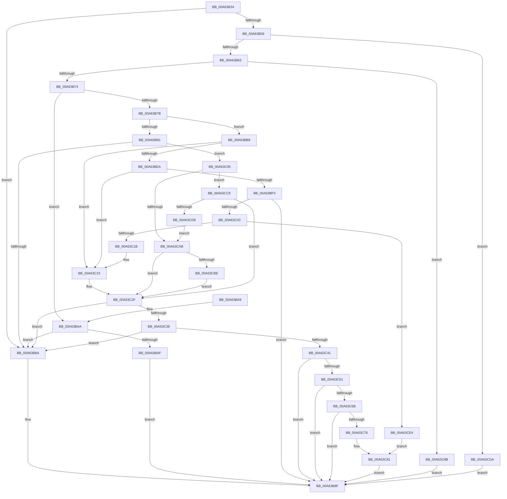

# PopManageTransitionRecordRequest

- RVA: `0x00A63B34`–`0x00A63CEE` (길이 `442` bytes)
- VA: `0x0000000140A63B34`
- 실행 섹션: `PAGE`
- PDB 이름 있음: `예`; PDB Function 태그: `아니요`
- unwind 정보 RVA: `0x000B3654`
- 디코드: `119`개 명령, `442/442` bytes 표시
- 미해석 바이트: `0` (있으면 어셈블리에 `.byte`로 보존)

> 이 문서는 커널 이미지의 기계어와 PDB 기호를 분석해 생성했습니다. 4번과 5번은 함수 원형과 자료형을 바이너리 사용 방식에서 추정한 C 해석이며 원본 소스 복구 결과는 아닙니다.

## 1. Dependencies

- 직접 호출 지점: **6**; 고유 호출 대상: **5**
- 직접 호출자로 확인된 함수: **1**
- RIP 상대 이미지 참조: **1**

### Outgoing calls
- `0x00A63BAF` → [PoDelistPowerStateTransitionBlocker](../../pagelk/B7/PoDelistPowerStateTransitionBlocker_function_00B795D4.md) (function, `0x00B795D4`)
- `0x00A63BF8` → [PsLookupProcessByProcessId](../8A/PsLookupProcessByProcessId_function_008A2AA0.md) (function, `0x008A2AA0`)
- `0x00A63C0C` → [PsLookupThreadByThreadId](../86/PsLookupThreadByThreadId_function_00868300.md) (function, `0x00868300`)
- `0x00A63C50` → [PopPushPowerStateTransitionRecordWithCallback](../../text/43/PopPushPowerStateTransitionRecordWithCallback_function_00430A04.md) (function, `0x00430A04`)
- `0x00A63C79` → [ObfDereferenceObject](../../text/2F/ObfDereferenceObject_function_002F9350.md) (function, `0x002F9350`)
- `0x00A63C81` → [ObfDereferenceObject](../../text/2F/ObfDereferenceObject_function_002F9350.md) (function, `0x002F9350`)

### Direct callers
- [PopPowerInformationInternal](../A8/PopPowerInformationInternal_function_00A8B7C0.md) at `0x00A8D00E`

### Static image references
- `0x00A63B63` → RVA `0x00F0BEF4` (`.data`; read)

## 2. Other-region calls and transfers

- 다른 실행 섹션으로 향하는 call: **4**
  - `0x00A63BAF` → [PoDelistPowerStateTransitionBlocker](../../pagelk/B7/PoDelistPowerStateTransitionBlocker_function_00B795D4.md) (`PAGE` → `PAGELK`)
  - `0x00A63C50` → [PopPushPowerStateTransitionRecordWithCallback](../../text/43/PopPushPowerStateTransitionRecordWithCallback_function_00430A04.md) (`PAGE` → `.text`)
  - `0x00A63C79` → [ObfDereferenceObject](../../text/2F/ObfDereferenceObject_function_002F9350.md) (`PAGE` → `.text`)
  - `0x00A63C81` → [ObfDereferenceObject](../../text/2F/ObfDereferenceObject_function_002F9350.md) (`PAGE` → `.text`)
- 별도 외부 분기/꼬리 이동을 확인하지 못했습니다.

## 3. Assembly (complete function range)

```asm
00A63B34  48 89 5C 24 08                  mov qword ptr [rsp + 8], rbx
00A63B39  55                              push rbp
00A63B3A  56                              push rsi
00A63B3B  57                              push rdi
00A63B3C  41 54                           push r12
00A63B3E  41 55                           push r13
00A63B40  41 56                           push r14
00A63B42  41 57                           push r15
00A63B44  48 83 EC 40                     sub rsp, 0x40
00A63B48  45 33 ED                        xor r13d, r13d
00A63B4B  45 33 C9                        xor r9d, r9d
00A63B4E  48 8B FA                        mov rdi, rdx
00A63B51  44 8A E1                        mov r12b, cl
00A63B54  48 85 D2                        test rdx, rdx
00A63B57  74 31                           je 0x140a63b8a
00A63B59  41 83 F8 38                     cmp r8d, 0x38
00A63B5D  0F 82 77 01 00 00               jb 0x140a63cda
00A63B63  8B 05 8B 83 4A 00               mov eax, dword ptr [rip + 0x4a838b]
00A63B69  FF C8                           dec eax
00A63B6B  83 F8 01                        cmp eax, 1
00A63B6E  0F 87 17 01 00 00               ja 0x140a63c8b
00A63B74  8B 4A 08                        mov ecx, dword ptr [rdx + 8]
00A63B77  85 C9                           test ecx, ecx
00A63B79  75 2F                           jne 0x140a63baa
00A63B7B  41 80 FC 01                     cmp r12b, 1
00A63B7F  74 37                           je 0x140a63bb8
00A63B81  45 84 E4                        test r12b, r12b
00A63B84  0F 84 0B 01 00 00               je 0x140a63c95
00A63B8A  BB 0D 00 00 C0                  mov ebx, 0xc000000d
00A63B8F  8B C3                           mov eax, ebx
00A63B91  48 8B 9C 24 80 00 00 00         mov rbx, qword ptr [rsp + 0x80]
00A63B99  48 83 C4 40                     add rsp, 0x40
00A63B9D  41 5F                           pop r15
00A63B9F  41 5E                           pop r14
00A63BA1  41 5D                           pop r13
00A63BA3  41 5C                           pop r12
00A63BA5  5F                              pop rdi
00A63BA6  5E                              pop rsi
00A63BA7  5D                              pop rbp
00A63BA8  C3                              ret
00A63BA9  CC                              int3
00A63BAA  83 F9 01                        cmp ecx, 1
00A63BAD  75 DB                           jne 0x140a63b8a
00A63BAF  E8 20 5A 11 00                  call 0x140b795d4
00A63BB4  8B D8                           mov ebx, eax
00A63BB6  EB D7                           jmp 0x140a63b8f
00A63BB8  65 48 8B 04 25 88 01 00 00      mov rax, qword ptr gs:[0x188]
00A63BC1  4C 8D 7A 10                     lea r15, [rdx + 0x10]
00A63BC5  65 48 8B 34 25 88 01 00 00      mov rsi, qword ptr gs:[0x188]
00A63BCE  48 89 74 24 30                  mov qword ptr [rsp + 0x30], rsi
00A63BD3  48 8B 88 B8 00 00 00            mov rcx, qword ptr [rax + 0xb8]
00A63BDA  48 89 8C 24 98 00 00 00         mov qword ptr [rsp + 0x98], rcx
00A63BE2  49 8B 0F                        mov rcx, qword ptr [r15]
00A63BE5  48 85 C9                        test rcx, rcx
00A63BE8  74 39                           je 0x140a63c23
00A63BEA  4C 39 4A 18                     cmp qword ptr [rdx + 0x18], r9
00A63BEE  74 33                           je 0x140a63c23
00A63BF0  48 8D 94 24 98 00 00 00         lea rdx, [rsp + 0x98]
00A63BF8  E8 A3 EE E3 FF                  call 0x1408a2aa0
00A63BFD  8B D8                           mov ebx, eax
00A63BFF  85 C0                           test eax, eax
00A63C01  78 8C                           js 0x140a63b8f
00A63C03  48 8B 4F 18                     mov rcx, qword ptr [rdi + 0x18]
00A63C07  48 8D 54 24 30                  lea rdx, [rsp + 0x30]
00A63C0C  E8 EF 46 E0 FF                  call 0x140868300
00A63C11  8B D8                           mov ebx, eax
00A63C13  85 C0                           test eax, eax
00A63C15  0F 88 C9 00 00 00               js 0x140a63ce4
00A63C1B  48 8B 74 24 30                  mov rsi, qword ptr [rsp + 0x30]
00A63C20  45 8B CD                        mov r9d, r13d
00A63C23  4C 8B B4 24 98 00 00 00         mov r14, qword ptr [rsp + 0x98]
00A63C2B  48 8D 6F 18                     lea rbp, [rdi + 0x18]
00A63C2F  4D 85 F6                        test r14, r14
00A63C32  0F 84 52 FF FF FF               je 0x140a63b8a
00A63C38  48 85 F6                        test rsi, rsi
00A63C3B  0F 84 49 FF FF FF               je 0x140a63b8a
00A63C41  4C 8B 47 20                     mov r8, qword ptr [rdi + 0x20]
00A63C45  48 8B D6                        mov rdx, rsi
00A63C48  49 8B CE                        mov rcx, r14
00A63C4B  4C 89 6C 24 20                  mov qword ptr [rsp + 0x20], r13
00A63C50  E8 AF CD 9C FF                  call 0x140430a04
00A63C55  8B D8                           mov ebx, eax
00A63C57  41 80 FC 01                     cmp r12b, 1
00A63C5B  0F 85 2E FF FF FF               jne 0x140a63b8f
00A63C61  49 83 3F 00                     cmp qword ptr [r15], 0
00A63C65  0F 84 24 FF FF FF               je 0x140a63b8f
00A63C6B  48 83 7D 00 00                  cmp qword ptr [rbp], 0
00A63C70  0F 84 19 FF FF FF               je 0x140a63b8f
00A63C76  49 8B CE                        mov rcx, r14
00A63C79  E8 D2 56 89 FF                  call 0x1402f9350
00A63C7E  48 8B CE                        mov rcx, rsi
00A63C81  E8 CA 56 89 FF                  call 0x1402f9350
00A63C86  E9 04 FF FF FF                  jmp 0x140a63b8f
00A63C8B  BB D3 02 00 C0                  mov ebx, 0xc00002d3
00A63C90  E9 FA FE FF FF                  jmp 0x140a63b8f
00A63C95  48 8D 42 10                     lea rax, [rdx + 0x10]
00A63C99  4C 8B 30                        mov r14, qword ptr [rax]
00A63C9C  48 8D 4A 18                     lea rcx, [rdx + 0x18]
00A63CA0  8B 52 28                        mov edx, dword ptr [rdx + 0x28]
00A63CA3  48 8B 31                        mov rsi, qword ptr [rcx]
00A63CA6  83 FA 01                        cmp edx, 1
00A63CA9  75 1E                           jne 0x140a63cc9
00A63CAB  4C 8B 47 30                     mov r8, qword ptr [rdi + 0x30]
00A63CAF  4C 8B F8                        mov r15, rax
00A63CB2  48 8B E9                        mov rbp, rcx
00A63CB5  4D 85 C0                        test r8, r8
00A63CB8  0F 84 71 FF FF FF               je 0x140a63c2f
00A63CBE  4D 8B E8                        mov r13, r8
00A63CC1  44 8B CA                        mov r9d, edx
00A63CC4  E9 66 FF FF FF                  jmp 0x140a63c2f
00A63CC9  4C 8B F8                        mov r15, rax
00A63CCC  48 8B E9                        mov rbp, rcx
00A63CCF  83 FA 02                        cmp edx, 2
00A63CD2  0F 85 57 FF FF FF               jne 0x140a63c2f
00A63CD8  EB D1                           jmp 0x140a63cab
00A63CDA  BB 23 00 00 C0                  mov ebx, 0xc0000023
00A63CDF  E9 AB FE FF FF                  jmp 0x140a63b8f
00A63CE4  48 8B 8C 24 98 00 00 00         mov rcx, qword ptr [rsp + 0x98]
00A63CEC  EB 93                           jmp 0x140a63c81
```

## 4. C-style interpretation (structured pseudocode)

```c
__int64 __fastcall PopManageTransitionRecordRequest(unsigned __int8 a1, __int64 a2, int a3, int a4)
{
    __int64 result;
    __int64 v_r13;
    __int64 v_rsp;
    unsigned __int64 v_stack_p20;
    unsigned __int64 v_stack_p30;
    unsigned __int64 v_stack_p8;
    unsigned __int64 v_stack_p98;

    v_stack_p8 = v_rbx;
    v_rsp = (v_rsp) - (64);
    v_r13 = 0;
    a4 = 0;
    if (a2 == 0) goto loc_00A63B8A;
    if (a3 < 56) goto loc_00A63CDA;
    result = (unsigned int)(((unsigned int)(*(unsigned int *)(v_rip + 4883339))) - 1);
    if (((unsigned int)(result)) > 1) goto loc_00A63C8B;
    if ((unsigned int)((unsigned int)(*(unsigned int *)(a2 + 8))) != 0) goto loc_00A63BAA;
    if (a1 == 1) goto loc_00A63BB8;
    if (a1 == 0) goto loc_00A63C95;
loc_00A63B8A:
loc_00A63B8F:
    v_rsp = (v_rsp) + (64);
    return (unsigned int)((unsigned int)((unsigned int)(0xC000000DULL)));
loc_00A63BAA:
    if (((unsigned int)((unsigned int)(*(unsigned int *)(a2 + 8)))) != 1) goto loc_00A63B8A;
    result = PoDelistPowerStateTransitionBlocker((unsigned int)(*(unsigned int *)(a2 + 8)), a2, a3, a4);
    goto loc_00A63B8F;
loc_00A63BB8:
    v_stack_p30 = *(unsigned __int64 *)(gs_base + (0 + 392));
    v_stack_p98 = *(unsigned __int64 *)(*(unsigned __int64 *)(gs_base + (0 + 392)) + 184);
    if (*(unsigned __int64 *)(a2 + 16) == 0) goto loc_00A63C23;
    if ((*(unsigned __int64 *)(a2 + 24)) == 0) goto loc_00A63C23;
    result = PsLookupProcessByProcessId(*(unsigned __int64 *)(a2 + 16), v_stack_p98, a3, a4);
    if (sign_flag) goto loc_00A63B8F;
    result = PsLookupThreadByThreadId(*(unsigned __int64 *)(a2 + 24), v_stack_p30, a3, a4);
    if (sign_flag) goto loc_00A63CE4;
loc_00A63C23:
loc_00A63C2F:
    if (v_stack_p98 == 0) goto loc_00A63B8A;
    if (v_stack_p30 == 0) goto loc_00A63B8A;
    v_stack_p20 = 0;
    result = PopPushPowerStateTransitionRecordWithCallback(v_stack_p98, v_stack_p30, *(unsigned __int64 *)(a2 + 32), 0);
    if (a1 != 1) goto loc_00A63B8F;
    if ((*(unsigned __int64 *)(a2 + 16)) == 0) goto loc_00A63B8F;
    if ((*(unsigned __int64 *)(a2 + 24)) == 0) goto loc_00A63B8F;
    result = ObfDereferenceObject(v_stack_p98, v_stack_p30, *(unsigned __int64 *)(a2 + 32), 0);
loc_00A63C81:
    result = ObfDereferenceObject(v_stack_p30, v_stack_p30, *(unsigned __int64 *)(a2 + 32), 0);
    goto loc_00A63B8F;
loc_00A63C8B:
    goto loc_00A63B8F;
loc_00A63C95:
    if (((unsigned int)((unsigned int)(*(unsigned int *)(v_stack_p30 + 40)))) != 1) goto loc_00A63CC9;
loc_00A63CAB:
    if (*(unsigned __int64 *)(a2 + 48) == 0) goto loc_00A63C2F;
    goto loc_00A63C2F;
loc_00A63CC9:
    if (((unsigned int)((unsigned int)(*(unsigned int *)(v_stack_p30 + 40)))) != 2) goto loc_00A63C2F;
    goto loc_00A63CAB;
loc_00A63CDA:
    goto loc_00A63B8F;
loc_00A63CE4:
    goto loc_00A63C81;
}
```

## 5. (Beta) C Style

```c
int64_t PopManageTransitionRecordRequest(uint8_t Arg1, void *Arg2, int32_t Arg3, int32_t Arg4)
{
    uint8_t *arg2 = (uint8_t *)Arg2;

    int64_t result;
    int64_t local_r13;
    int64_t local_rsp;
    uint64_t v_stack_p20;
    uint64_t v_stack_p30;
    uint64_t v_stack_p8;
    uint64_t v_stack_p98;

    v_stack_p8 = local_rbx;
    local_rsp = (local_rsp) - (64);
    local_r13 = 0;
    Arg4 = 0;
    if (Arg2 == NULL) goto loc_00A63B8A;
    if (Arg3 < 56) goto loc_00A63CDA;
    result = (uint32_t)(((uint32_t)(*(uint32_t *)(v_rip + 0x4A838B))) - 1);
    if (((uint32_t)(result)) > 1) goto loc_00A63C8B;
    if ((uint32_t)((uint32_t)(*(uint32_t *)(arg2 + 0x8))) != 0) goto loc_00A63BAA;
    if (Arg1 == 1) goto loc_00A63BB8;
    if (Arg1 == 0) goto loc_00A63C95;
loc_00A63B8A:
loc_00A63B8F:
    local_rsp = (local_rsp) + (64);
    return (uint32_t)((uint32_t)((uint32_t)(0xC000000DULL)));
loc_00A63BAA:
    if (((uint32_t)((uint32_t)(*(uint32_t *)(arg2 + 0x8)))) != 1) goto loc_00A63B8A;
    result = PoDelistPowerStateTransitionBlocker((uint32_t)(*(uint32_t *)(arg2 + 0x8)), Arg2, Arg3, Arg4);
    goto loc_00A63B8F;
loc_00A63BB8:
    v_stack_p30 = *(uint64_t *)(gs_base + (0 + 0x188));
    v_stack_p98 = *(uint64_t *)(*(uint64_t *)(gs_base + (0 + 0x188)) + 0xB8);
    if (*(uint64_t *)(arg2 + 0x10) == 0) goto loc_00A63C23;
    if ((*(uint64_t *)(arg2 + 0x18)) == 0) goto loc_00A63C23;
    result = PsLookupProcessByProcessId(*(uint64_t *)(arg2 + 0x10), v_stack_p98, Arg3, Arg4);
    if (sign_flag) goto loc_00A63B8F;
    result = PsLookupThreadByThreadId(*(uint64_t *)(arg2 + 0x18), v_stack_p30, Arg3, Arg4);
    if (sign_flag) goto loc_00A63CE4;
loc_00A63C23:
loc_00A63C2F:
    if (v_stack_p98 == 0) goto loc_00A63B8A;
    if (v_stack_p30 == 0) goto loc_00A63B8A;
    v_stack_p20 = 0;
    result = PopPushPowerStateTransitionRecordWithCallback(v_stack_p98, v_stack_p30, *(uint64_t *)(arg2 + 0x20), 0);
    if (Arg1 != 1) goto loc_00A63B8F;
    if ((*(uint64_t *)(arg2 + 0x10)) == 0) goto loc_00A63B8F;
    if ((*(uint64_t *)(arg2 + 0x18)) == 0) goto loc_00A63B8F;
    result = ObfDereferenceObject(v_stack_p98, v_stack_p30, *(uint64_t *)(arg2 + 0x20), 0);
loc_00A63C81:
    result = ObfDereferenceObject(v_stack_p30, v_stack_p30, *(uint64_t *)(arg2 + 0x20), 0);
    goto loc_00A63B8F;
loc_00A63C8B:
    goto loc_00A63B8F;
loc_00A63C95:
    if (((uint32_t)((uint32_t)(*(uint32_t *)(v_stack_p30 + 0x28)))) != 1) goto loc_00A63CC9;
loc_00A63CAB:
    if (*(uint64_t *)(arg2 + 0x30) == 0) goto loc_00A63C2F;
    goto loc_00A63C2F;
loc_00A63CC9:
    if (((uint32_t)((uint32_t)(*(uint32_t *)(v_stack_p30 + 0x28)))) != 2) goto loc_00A63C2F;
    goto loc_00A63CAB;
loc_00A63CDA:
    goto loc_00A63B8F;
loc_00A63CE4:
    goto loc_00A63C81;
}
```

### 관측된 메모리 오프셋

구조체 형식이 확인되지 않은 접근은 인자 기준의 오프셋으로만 기록했습니다.

| 기준 인자 | 오프셋 표현 | 폭 (bit) | 접근 |
|---|---:|---:|---|
| `Arg2` | `+ 0x18` | `64` | `R` |
| `Arg2` | `+ 0x20` | `64` | `R` |
| `Arg2` | `+ 0x30` | `64` | `R` |

## 6. Execution-region graph

[열기: 2D/3D 그래프와 함수 탐색 컨트롤 패널](../../../control-panel.html?section=page&rva=0x00A63B34&view=graph)

- 2D 그래프는 위에서 아래로 흐르고, 3D 그래프는 빈 공간을 드래그해 회전합니다. Shift+드래그는 이동, 휠은 확대·축소, 함수 노드 선택은 대상 보고서 이동입니다.

### Static fallback


