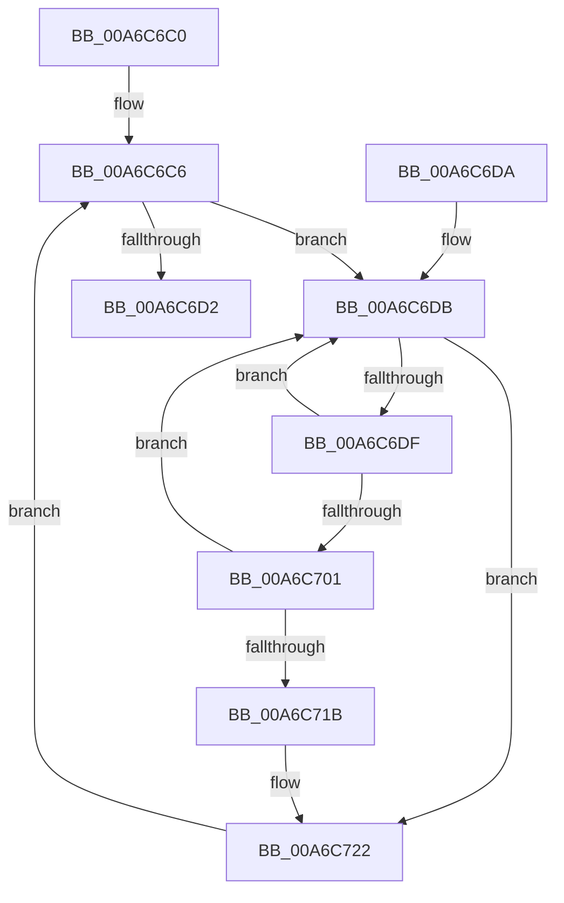

# PopPolicyWorkerNotify

- RVA: `0x00A6C6C0`–`0x00A6C73B` (길이 `123` bytes)
- VA: `0x0000000140A6C6C0`
- 실행 섹션: `PAGE`
- PDB 이름 있음: `예`; PDB Function 태그: `아니요`
- unwind 정보 RVA: `0x000B449C`
- 디코드: `36`개 명령, `123/123` bytes 표시
- 미해석 바이트: `0` (있으면 어셈블리에 `.byte`로 보존)

> 이 문서는 커널 이미지의 기계어와 PDB 기호를 분석해 생성했습니다. 4번과 5번은 함수 원형과 자료형을 바이너리 사용 방식에서 추정한 C 해석이며 원본 소스 복구 결과는 아닙니다.

## 1. Dependencies

- 직접 호출 지점: **2**; 고유 호출 대상: **2**
- 직접 호출자로 확인된 함수: **0**
- RIP 상대 이미지 참조: **2**

### Outgoing calls
- `0x00A6C704` → [guard_dispatch_icall](../../text/6B/guard_dispatch_icall_function_006BAAD0.md) (function, `0x006BAAD0`)
- `0x00A6C734` → [KeDelayExecutionThread](../../text/20/KeDelayExecutionThread_function_00209550.md) (function, `0x00209550`)

### Direct callers
- 이 함수 시작 RVA로 연결되는 직접 call은 확인되지 않았습니다. 간접 호출은 완전히 역산할 수 없습니다.

### Static image references
- `0x00A6C6C8` → RVA `0x00F0C8C8` (`.data`; read/write)
- `0x00A6C6EB` → RVA `0x00002FA0` (`.rdata`; read)

## 2. Other-region calls and transfers

- 다른 실행 섹션으로 향하는 call: **2**
  - `0x00A6C704` → [guard_dispatch_icall](../../text/6B/guard_dispatch_icall_function_006BAAD0.md) (`PAGE` → `.text`)
  - `0x00A6C734` → [KeDelayExecutionThread](../../text/20/KeDelayExecutionThread_function_00209550.md) (`PAGE` → `.text`)
- 별도 외부 분기/꼬리 이동을 확인하지 못했습니다.

## 3. Assembly (complete function range)

```asm
00A6C6C0  40 53                           push rbx
00A6C6C2  48 83 EC 20                     sub rsp, 0x20
00A6C6C6  33 DB                           xor ebx, ebx
00A6C6C8  87 1D FA 01 4A 00               xchg dword ptr [rip + 0x4a01fa], ebx
00A6C6CE  85 DB                           test ebx, ebx
00A6C6D0  75 09                           jne 0x140a6c6db
00A6C6D2  33 C0                           xor eax, eax
00A6C6D4  48 83 C4 20                     add rsp, 0x20
00A6C6D8  5B                              pop rbx
00A6C6D9  C3                              ret
00A6C6DA  CC                              int3
00A6C6DB  85 DB                           test ebx, ebx
00A6C6DD  74 43                           je 0x140a6c722
00A6C6DF  0F BC C3                        bsf eax, ebx
00A6C6E2  8B C8                           mov ecx, eax
00A6C6E4  0F B3 C3                        btr ebx, eax
00A6C6E7  89 44 24 30                     mov dword ptr [rsp + 0x30], eax
00A6C6EB  48 8D 05 AE 68 59 FF            lea rax, [rip - 0xa69752]
00A6C6F2  48 C1 E1 04                     shl rcx, 4
00A6C6F6  48 03 C8                        add rcx, rax
00A6C6F9  48 8B 01                        mov rax, qword ptr [rcx]
00A6C6FC  48 85 C0                        test rax, rax
00A6C6FF  74 DA                           je 0x140a6c6db
00A6C701  8B 49 08                        mov ecx, dword ptr [rcx + 8]
00A6C704  E8 C7 E3 C4 FF                  call 0x1406baad0
00A6C709  65 48 8B 04 25 88 01 00 00      mov rax, qword ptr gs:[0x188]
00A6C712  83 B8 E4 01 00 00 00            cmp dword ptr [rax + 0x1e4], 0
00A6C719  74 C0                           je 0x140a6c6db
00A6C71B  B9 20 00 00 00                  mov ecx, 0x20
00A6C720  CD 29                           int 0x29
00A6C722  4C 8D 44 24 38                  lea r8, [rsp + 0x38]
00A6C727  48 C7 44 24 38 60 79 FE FF      mov qword ptr [rsp + 0x38], 0xfffffffffffe7960
00A6C730  33 D2                           xor edx, edx
00A6C732  33 C9                           xor ecx, ecx
00A6C734  E8 17 CE 79 FF                  call 0x140209550
00A6C739  EB 8B                           jmp 0x140a6c6c6
```

## 4. C-style interpretation (structured pseudocode)

```c
__int64 __fastcall PopPolicyWorkerNotify(__int64 a1, int a2)
{
    __int64 result;
    __int64 v_rbx;
    __int64 v_rsp;
    unsigned int v_stack_p30;
    unsigned __int64 v_stack_p38;

    v_rsp = (v_rsp) - (32);
loc_00A6C6C6:
    v_rbx = 0;
    if (0 != 0) goto loc_00A6C6DB;
    result = 0;
    v_rsp = (v_rsp) + (32);
    return result;
loc_00A6C6DB:
    if (0 == 0) goto loc_00A6C722;
    v_stack_p30 = 0;
    a1 = (0) << (4);
    a1 = (a1) + (v_rip - 10917714);
    if (*(unsigned __int64 *)(a1) == 0) goto loc_00A6C6DB;
    result = guard_dispatch_icall((unsigned int)(*(unsigned int *)(a1 + 8)), a2, a3, a4);
    if ((*(unsigned int *)(*(unsigned __int64 *)(gs_base + (0 + 392)) + 484)) == 0) goto loc_00A6C6DB;
loc_00A6C722:
    v_stack_p38 = 0xFFFFFFFFFFFE7960ULL;
    a2 = 0;
    a1 = 0;
    result = KeDelayExecutionThread(a1, a2, v_stack_p38, a4);
    goto loc_00A6C6C6;
}
```

## 5. (Beta) C Style

```c
int64_t PopPolicyWorkerNotify(int64_t Arg1, int32_t Arg2)
{
    int64_t result;
    int64_t local_rbx;
    int64_t local_rsp;
    uint32_t v_stack_p30;
    uint64_t v_stack_p38;

    local_rsp = (local_rsp) - (32);
loc_00A6C6C6:
    local_rbx = 0;
    if (0 != 0) goto loc_00A6C6DB;
    result = 0;
    local_rsp = (local_rsp) + (32);
    return result;
loc_00A6C6DB:
    if (0 == 0) goto loc_00A6C722;
    v_stack_p30 = 0;
    Arg1 = (0) << (4);
    Arg1 = (Arg1) + (v_rip - 10917714);
    if (*(uint64_t *)(Arg1) == 0) goto loc_00A6C6DB;
    result = guard_dispatch_icall((uint32_t)(*(uint32_t *)(Arg1 + 0x8)), Arg2, a3, a4);
    if ((*(uint32_t *)(*(uint64_t *)(gs_base + (0 + 0x188)) + 0x1E4)) == 0) goto loc_00A6C6DB;
loc_00A6C722:
    v_stack_p38 = 0xFFFFFFFFFFFE7960ULL;
    Arg2 = 0;
    Arg1 = 0;
    result = KeDelayExecutionThread(Arg1, Arg2, v_stack_p38, a4);
    goto loc_00A6C6C6;
}
```

## 6. Execution-region graph

[열기: 2D/3D 그래프와 함수 탐색 컨트롤 패널](../../../control-panel.html?section=page&rva=0x00A6C6C0&view=graph)

- 2D 그래프는 위에서 아래로 흐르고, 3D 그래프는 빈 공간을 드래그해 회전합니다. Shift+드래그는 이동, 휠은 확대·축소, 함수 노드 선택은 대상 보고서 이동입니다.

### Static fallback


