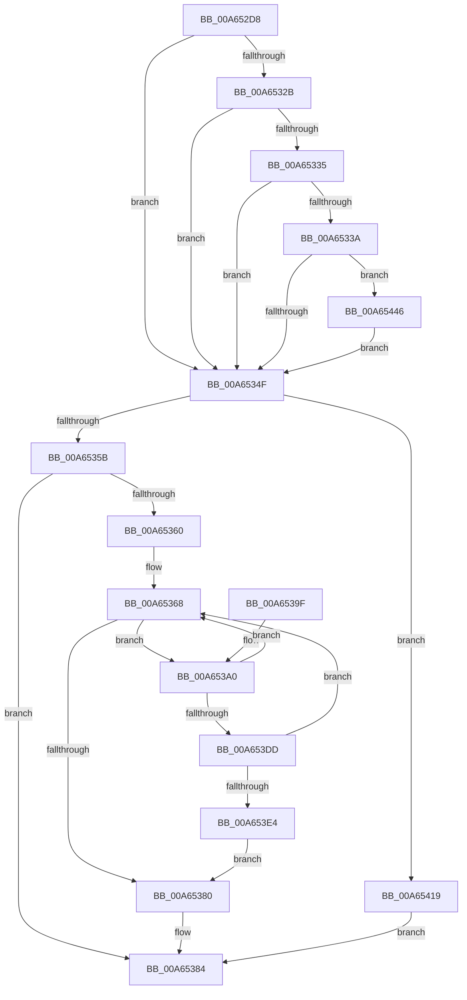

# PopPowerRequestHandleRequestUpdate

- RVA: `0x00A652D8`–`0x00A65458` (길이 `384` bytes)
- VA: `0x0000000140A652D8`
- 실행 섹션: `PAGE`
- PDB 이름 있음: `예`; PDB Function 태그: `아니요`
- unwind 정보 RVA: `0x000B3884`
- 디코드: `101`개 명령, `384/384` bytes 표시
- 미해석 바이트: `0` (있으면 어셈블리에 `.byte`로 보존)

> 이 문서는 커널 이미지의 기계어와 PDB 기호를 분석해 생성했습니다. 4번과 5번은 함수 원형과 자료형을 바이너리 사용 방식에서 추정한 C 해석이며 원본 소스 복구 결과는 아닙니다.

## 1. Dependencies

- 직접 호출 지점: **8**; 고유 호출 대상: **5**
- 직접 호출자로 확인된 함수: **2**
- RIP 상대 이미지 참조: **4**

### Outgoing calls
- `0x00A653A7` → [PopReleaseRwLock](../../text/2D/PopReleaseRwLock_function_002DFBBC.md) (function, `0x002DFBBC`)
- `0x00A653B6` → [guard_dispatch_icall](../../text/6B/guard_dispatch_icall_function_006BAAD0.md) (function, `0x006BAAD0`)
- `0x00A653C2` → [PopAcquireRwLockExclusive](../../text/43/PopAcquireRwLockExclusive_function_00430B44.md) (function, `0x00430B44`)
- `0x00A6540F` → [KeSetTimer2](../../text/3A/KeSetTimer2_function_003A08E0.md) (function, `0x003A08E0`)
- `0x00A65420` → [PopReleaseRwLock](../../text/2D/PopReleaseRwLock_function_002DFBBC.md) (function, `0x002DFBBC`)
- `0x00A65430` → [guard_dispatch_icall](../../text/6B/guard_dispatch_icall_function_006BAAD0.md) (function, `0x006BAAD0`)
- `0x00A6543C` → [PopAcquireRwLockExclusive](../../text/43/PopAcquireRwLockExclusive_function_00430B44.md) (function, `0x00430B44`)
- `0x00A6544E` → [PopUmpoSendPowerRequestAction](../76/PopUmpoSendPowerRequestAction_function_007692D4.md) (function, `0x007692D4`)

### Direct callers
- [PopPowerRequestCallbackWorker](../../text/47/PopPowerRequestCallbackWorker_function_00477AD0.md) at `0x00477BD9`
- [PopPowerRequestDebounceTimerWorker](../75/PopPowerRequestDebounceTimerWorker_function_00754A40.md) at `0x00754A6C`

### Static image references
- `0x00A652F4` → RVA `0x00E019C0` (`.data`; read)
- `0x00A6533A` → RVA `0x00F0EFB0` (`.data`; read)
- `0x00A653A0` → RVA `0x00F0ED20` (`.data`; read)
- `0x00A65408` → RVA `0x00F0EE40` (`.data`; read)

## 2. Other-region calls and transfers

- 다른 실행 섹션으로 향하는 call: **7**
  - `0x00A653A7` → [PopReleaseRwLock](../../text/2D/PopReleaseRwLock_function_002DFBBC.md) (`PAGE` → `.text`)
  - `0x00A653B6` → [guard_dispatch_icall](../../text/6B/guard_dispatch_icall_function_006BAAD0.md) (`PAGE` → `.text`)
  - `0x00A653C2` → [PopAcquireRwLockExclusive](../../text/43/PopAcquireRwLockExclusive_function_00430B44.md) (`PAGE` → `.text`)
  - `0x00A6540F` → [KeSetTimer2](../../text/3A/KeSetTimer2_function_003A08E0.md) (`PAGE` → `.text`)
  - `0x00A65420` → [PopReleaseRwLock](../../text/2D/PopReleaseRwLock_function_002DFBBC.md) (`PAGE` → `.text`)
  - `0x00A65430` → [guard_dispatch_icall](../../text/6B/guard_dispatch_icall_function_006BAAD0.md) (`PAGE` → `.text`)
  - `0x00A6543C` → [PopAcquireRwLockExclusive](../../text/43/PopAcquireRwLockExclusive_function_00430B44.md) (`PAGE` → `.text`)
- 별도 외부 분기/꼬리 이동을 확인하지 못했습니다.

## 3. Assembly (complete function range)

```asm
00A652D8  48 8B C4                        mov rax, rsp
00A652DB  48 89 58 08                     mov qword ptr [rax + 8], rbx
00A652DF  48 89 68 10                     mov qword ptr [rax + 0x10], rbp
00A652E3  48 89 70 18                     mov qword ptr [rax + 0x18], rsi
00A652E7  48 89 78 20                     mov qword ptr [rax + 0x20], rdi
00A652EB  41 56                           push r14
00A652ED  48 83 EC 30                     sub rsp, 0x30
00A652F1  48 63 EA                        movsxd rbp, edx
00A652F4  48 8D 05 C5 C6 39 00            lea rax, [rip + 0x39c6c5]
00A652FB  41 8A F0                        mov sil, r8b
00A652FE  48 8B F9                        mov rdi, rcx
00A65301  48 8D 1C 6D 00 00 00 00         lea rbx, [rbp*2]
00A65309  48 03 DD                        add rbx, rbp
00A6530C  48 C1 E3 04                     shl rbx, 4
00A65310  48 03 D8                        add rbx, rax
00A65313  8B 43 08                        mov eax, dword ptr [rbx + 8]
00A65316  44 8D 40 01                     lea r8d, [rax + 1]
00A6531A  FF C8                           dec eax
00A6531C  40 84 F6                        test sil, sil
00A6531F  41 0F 45 C0                     cmovne eax, r8d
00A65323  89 43 08                        mov dword ptr [rbx + 8], eax
00A65326  48 85 C9                        test rcx, rcx
00A65329  74 24                           je 0x140a6534f
00A6532B  48 83 B9 88 00 00 00 00         cmp qword ptr [rcx + 0x88], 0
00A65333  74 1A                           je 0x140a6534f
00A65335  83 FD 03                        cmp ebp, 3
00A65338  77 15                           ja 0x140a6534f
00A6533A  80 3D 6F 9C 4A 00 00            cmp byte ptr [rip + 0x4a9c6f], 0
00A65341  40 88 B4 0D 99 00 00 00         mov byte ptr [rbp + rcx + 0x99], sil
00A65349  0F 85 F7 00 00 00               jne 0x140a65446
00A6534F  8B 4B 0C                        mov ecx, dword ptr [rbx + 0xc]
00A65352  F6 C1 01                        test cl, 1
00A65355  0F 84 BE 00 00 00               je 0x140a65419
00A6535B  F6 C1 04                        test cl, 4
00A6535E  75 24                           jne 0x140a65384
00A65360  83 C9 04                        or ecx, 4
00A65363  89 4B 0C                        mov dword ptr [rbx + 0xc], ecx
00A65366  33 FF                           xor edi, edi
00A65368  83 E1 02                        and ecx, 2
00A6536B  83 7B 08 00                     cmp dword ptr [rbx + 8], 0
00A6536F  44 8B F1                        mov r14d, ecx
00A65372  40 0F 95 C6                     setne sil
00A65376  85 C9                           test ecx, ecx
00A65378  0F 95 C0                        setne al
00A6537B  40 3A C6                        cmp al, sil
00A6537E  75 20                           jne 0x140a653a0
00A65380  83 63 0C FB                     and dword ptr [rbx + 0xc], 0xfffffffb
00A65384  48 8B 5C 24 40                  mov rbx, qword ptr [rsp + 0x40]
00A65389  48 8B 6C 24 48                  mov rbp, qword ptr [rsp + 0x48]
00A6538E  48 8B 74 24 50                  mov rsi, qword ptr [rsp + 0x50]
00A65393  48 8B 7C 24 58                  mov rdi, qword ptr [rsp + 0x58]
00A65398  48 83 C4 30                     add rsp, 0x30
00A6539C  41 5E                           pop r14
00A6539E  C3                              ret
00A6539F  CC                              int3
00A653A0  48 8D 0D 79 99 4A 00            lea rcx, [rip + 0x4a9979]
00A653A7  E8 10 A8 87 FF                  call 0x1402dfbbc
00A653AC  48 8B 03                        mov rax, qword ptr [rbx]
00A653AF  44 8A C6                        mov r8b, sil
00A653B2  8B D5                           mov edx, ebp
00A653B4  33 C9                           xor ecx, ecx
00A653B6  E8 15 57 C5 FF                  call 0x1406baad0
00A653BB  48 8D 0D 5E 99 4A 00            lea rcx, [rip + 0x4a995e]
00A653C2  E8 7D B7 9C FF                  call 0x140430b44
00A653C7  8B 43 0C                        mov eax, dword ptr [rbx + 0xc]
00A653CA  83 E0 FD                        and eax, 0xfffffffd
00A653CD  40 0F B6 CE                     movzx ecx, sil
00A653D1  03 C9                           add ecx, ecx
00A653D3  0B C8                           or ecx, eax
00A653D5  89 4B 0C                        mov dword ptr [rbx + 0xc], ecx
00A653D8  45 85 F6                        test r14d, r14d
00A653DB  74 8B                           je 0x140a65368
00A653DD  FF C7                           inc edi
00A653DF  83 FF 03                        cmp edi, 3
00A653E2  72 84                           jb 0x140a65368
00A653E4  FF 43 08                        inc dword ptr [rbx + 8]
00A653E7  4C 8D 4C 24 20                  lea r9, [rsp + 0x20]
00A653EC  48 83 64 24 20 00               and qword ptr [rsp + 0x20], 0
00A653F2  83 C9 08                        or ecx, 8
00A653F5  48 83 4C 24 28 FF               or qword ptr [rsp + 0x28], 0xffffffffffffffff
00A653FB  45 33 C0                        xor r8d, r8d
00A653FE  89 4B 0C                        mov dword ptr [rbx + 0xc], ecx
00A65401  48 C7 C2 80 0F 05 FD            mov rdx, 0xfffffffffd050f80
00A65408  48 8D 0D 31 9A 4A 00            lea rcx, [rip + 0x4a9a31]
00A6540F  E8 CC B4 93 FF                  call 0x1403a08e0
00A65414  E9 67 FF FF FF                  jmp 0x140a65380
00A65419  48 8D 0D 00 99 4A 00            lea rcx, [rip + 0x4a9900]
00A65420  E8 97 A7 87 FF                  call 0x1402dfbbc
00A65425  48 8B 03                        mov rax, qword ptr [rbx]
00A65428  44 8A C6                        mov r8b, sil
00A6542B  8B D5                           mov edx, ebp
00A6542D  48 8B CF                        mov rcx, rdi
00A65430  E8 9B 56 C5 FF                  call 0x1406baad0
00A65435  48 8D 0D E4 98 4A 00            lea rcx, [rip + 0x4a98e4]
00A6543C  E8 03 B7 9C FF                  call 0x140430b44
00A65441  E9 3E FF FF FF                  jmp 0x140a65384
00A65446  8B 49 24                        mov ecx, dword ptr [rcx + 0x24]
00A65449  44 8A C6                        mov r8b, sil
00A6544C  8B D5                           mov edx, ebp
00A6544E  E8 81 3E D0 FF                  call 0x1407692d4
00A65453  E9 F7 FE FF FF                  jmp 0x140a6534f
```

## 4. C-style interpretation (structured pseudocode)

```c
__int64 __fastcall PopPowerRequestHandleRequestUpdate(__int64 a1, int a2, unsigned __int8 a3)
{
    __int64 result;
    __int64 v_rbx;
    __int64 v_rdi;
    __int64 v_rsi;
    __int64 v_rsp;
    unsigned __int64 v_stack_p10;
    unsigned __int64 v_stack_p18;
    unsigned __int64 v_stack_p20;
    unsigned __int64 v_stack_p28;
    unsigned __int64 v_stack_p8;

    *(unsigned __int64 *)(v_rsp + 8) = v_rbx;
    *(unsigned __int64 *)(v_rsp + 16) = v_rbp;
    *(unsigned __int64 *)(v_rsp + 24) = v_rsi;
    *(unsigned __int64 *)(v_rsp + 32) = v_rdi;
    v_rsp = (v_rsp) - (48);
    v_rbx = ((int)(a2) * 2) + ((int)(a2));
    v_rbx = (v_rbx) << (4);
    v_rbx = (v_rbx) + (v_rip + 3786437);
    result = (unsigned int)(((unsigned int)(*(unsigned int *)(v_rbx + 8))) - 1);
    if (a3 != 0) { result = (unsigned int)((unsigned int)(*(unsigned int *)(v_rbx + 8)) + 1); }
    *(unsigned int *)(v_rbx + 8) = (unsigned int)(result);
    if (a1 == 0) goto loc_00A6534F;
    if ((*(unsigned __int64 *)(a1 + 136)) == 0) goto loc_00A6534F;
    if (((unsigned int)((int)(a2))) > 3) goto loc_00A6534F;
    *(unsigned __int8 *)((int)(a2) + a1 * 1 + 153) = a3;
    if ((*(unsigned __int8 *)(v_rip + 4889711)) != 0) goto loc_00A65446;
loc_00A6534F:
    if ((((unsigned __int8)((unsigned int)(*(unsigned int *)(v_rbx + 12)))) & (1)) == 0) goto loc_00A65419;
    if ((((unsigned __int8)((unsigned int)(*(unsigned int *)(v_rbx + 12)))) & (4)) != 0) goto loc_00A65384;
    a1 = (unsigned int)(((unsigned int)(*(unsigned int *)(v_rbx + 12))) | (4));
    *(unsigned int *)(v_rbx + 12) = (unsigned int)(a1);
    v_rdi = 0;
loc_00A65368:
    a1 = (unsigned int)((a1) & (2));
    v_rsi = ((*(unsigned int *)(v_rbx + 8)) != 0) ? 1 : 0;
    result = ((unsigned int)(a1) != 0) ? 1 : 0;
    if (((unsigned __int8)(result)) != ((unsigned __int8)(v_rsi))) goto loc_00A653A0;
loc_00A65380:
loc_00A65384:
    v_rsp = (v_rsp) + (48);
    return result;
loc_00A653A0:
    result = PopReleaseRwLock(v_rip + 4888953, a2, (unsigned int)(*(unsigned int *)(v_rbx + 8)) + 1, a4);
    a1 = 0;
    result = guard_dispatch_icall(a1, (unsigned int)((unsigned int)(v_stack_p10)), (unsigned __int8)(v_stack_p18), a4);
    result = PopAcquireRwLockExclusive(v_rip + 4888926, (unsigned int)((unsigned int)(v_stack_p10)), (unsigned __int8)(v_stack_p18), a4);
    result = (unsigned int)(((unsigned int)(*(unsigned int *)(v_stack_p8 + 12))) & (0xFFFFFFFDULL));
    a1 = (unsigned int)(((unsigned __int8)(v_stack_p18)) + ((unsigned int)((unsigned __int8)(v_stack_p18))));
    a1 = (unsigned int)((a1) | ((unsigned int)(result)));
    *(unsigned int *)(v_stack_p8 + 12) = (unsigned int)(a1);
    if ((unsigned int)((unsigned int)((unsigned int)(a1))) == 0) goto loc_00A65368;
    v_rdi = (unsigned int)((v_stack_p20) + 1);
    if (((unsigned int)(v_rdi)) < 3) goto loc_00A65368;
    a1 = (unsigned int)((a1) | (8));
    a3 = 0;
    *(unsigned int *)(v_stack_p8 + 12) = (unsigned int)(a1);
    result = KeSetTimer2(v_rip + 4889137, 0xFFFFFFFFFD050F80ULL, a3, v_stack_p20);
    goto loc_00A65380;
loc_00A65419:
    result = PopReleaseRwLock(v_rip + 4888832, 0xFFFFFFFFFD050F80ULL, a3, v_stack_p20);
    result = guard_dispatch_icall(v_rdi, (unsigned int)((unsigned int)(v_stack_p10)), (unsigned __int8)(v_stack_p18), v_stack_p20);
    result = PopAcquireRwLockExclusive(v_rip + 4888804, (unsigned int)((unsigned int)(v_stack_p10)), (unsigned __int8)(v_stack_p18), v_stack_p20);
    goto loc_00A65384;
loc_00A65446:
    result = PopUmpoSendPowerRequestAction((unsigned int)(*(unsigned int *)(v_rip + 4888804 + 36)), (unsigned int)((unsigned int)(v_stack_p10)), (unsigned __int8)(v_stack_p18), v_stack_p20);
    goto loc_00A6534F;
}
```

## 5. (Beta) C Style

```c
int64_t PopPowerRequestHandleRequestUpdate(int64_t Arg1, int32_t Arg2, uint8_t Arg3)
{
    int64_t result;
    int64_t local_rbx;
    int64_t local_rdi;
    int64_t local_rsi;
    int64_t local_rsp;
    uint64_t v_stack_p10;
    uint64_t v_stack_p18;
    uint64_t v_stack_p20;
    uint64_t v_stack_p28;
    uint64_t v_stack_p8;

    *(uint64_t *)(local_rsp + 0x8) = local_rbx;
    *(uint64_t *)(local_rsp + 0x10) = local_rbp;
    *(uint64_t *)(local_rsp + 0x18) = local_rsi;
    *(uint64_t *)(local_rsp + 0x20) = local_rdi;
    local_rsp = (local_rsp) - (48);
    local_rbx = ((int32_t)(Arg2) * 2) + ((int32_t)(Arg2));
    local_rbx = (local_rbx) << (4);
    local_rbx = (local_rbx) + (v_rip + 3786437);
    result = (uint32_t)(((uint32_t)(*(uint32_t *)(local_rbx + 0x8))) - 1);
    if (Arg3 != 0) { result = (uint32_t)((uint32_t)(*(uint32_t *)(local_rbx + 0x8)) + 1); }
    *(uint32_t *)(local_rbx + 0x8) = (uint32_t)(result);
    if (Arg1 == 0) goto loc_00A6534F;
    if ((*(uint64_t *)(Arg1 + 0x88)) == 0) goto loc_00A6534F;
    if (((uint32_t)((int32_t)(Arg2))) > 3) goto loc_00A6534F;
    *(uint8_t *)((int32_t)(Arg2) + Arg1 * 1 + 0x99) = Arg3;
    if ((*(uint8_t *)(v_rip + 0x4A9C6F)) != 0) goto loc_00A65446;
loc_00A6534F:
    if ((((uint8_t)((uint32_t)(*(uint32_t *)(local_rbx + 0xC)))) & (1)) == 0) goto loc_00A65419;
    if ((((uint8_t)((uint32_t)(*(uint32_t *)(local_rbx + 0xC)))) & (4)) != 0) goto loc_00A65384;
    Arg1 = (uint32_t)(((uint32_t)(*(uint32_t *)(local_rbx + 0xC))) | (4));
    *(uint32_t *)(local_rbx + 0xC) = (uint32_t)(Arg1);
    local_rdi = 0;
loc_00A65368:
    Arg1 = (uint32_t)((Arg1) & (2));
    local_rsi = ((*(uint32_t *)(local_rbx + 0x8)) != 0) ? 1 : 0;
    result = ((uint32_t)(Arg1) != 0) ? 1 : 0;
    if (((uint8_t)(result)) != ((uint8_t)(local_rsi))) goto loc_00A653A0;
loc_00A65380:
loc_00A65384:
    local_rsp = (local_rsp) + (48);
    return result;
loc_00A653A0:
    result = PopReleaseRwLock(v_rip + 4888953, Arg2, (uint32_t)(*(uint32_t *)(local_rbx + 0x8)) + 1, a4);
    Arg1 = 0;
    result = guard_dispatch_icall(Arg1, (uint32_t)((uint32_t)(v_stack_p10)), (uint8_t)(v_stack_p18), a4);
    result = PopAcquireRwLockExclusive(v_rip + 4888926, (uint32_t)((uint32_t)(v_stack_p10)), (uint8_t)(v_stack_p18), a4);
    result = (uint32_t)(((uint32_t)(*(uint32_t *)(v_stack_p8 + 0xC))) & (0xFFFFFFFDULL));
    Arg1 = (uint32_t)(((uint8_t)(v_stack_p18)) + ((uint32_t)((uint8_t)(v_stack_p18))));
    Arg1 = (uint32_t)((Arg1) | ((uint32_t)(result)));
    *(uint32_t *)(v_stack_p8 + 0xC) = (uint32_t)(Arg1);
    if ((uint32_t)((uint32_t)((uint32_t)(Arg1))) == 0) goto loc_00A65368;
    local_rdi = (uint32_t)((v_stack_p20) + 1);
    if (((uint32_t)(local_rdi)) < 3) goto loc_00A65368;
    Arg1 = (uint32_t)((Arg1) | (8));
    Arg3 = 0;
    *(uint32_t *)(v_stack_p8 + 0xC) = (uint32_t)(Arg1);
    result = KeSetTimer2(v_rip + 4889137, 0xFFFFFFFFFD050F80ULL, Arg3, v_stack_p20);
    goto loc_00A65380;
loc_00A65419:
    result = PopReleaseRwLock(v_rip + 4888832, 0xFFFFFFFFFD050F80ULL, Arg3, v_stack_p20);
    result = guard_dispatch_icall(local_rdi, (uint32_t)((uint32_t)(v_stack_p10)), (uint8_t)(v_stack_p18), v_stack_p20);
    result = PopAcquireRwLockExclusive(v_rip + 4888804, (uint32_t)((uint32_t)(v_stack_p10)), (uint8_t)(v_stack_p18), v_stack_p20);
    goto loc_00A65384;
loc_00A65446:
    result = PopUmpoSendPowerRequestAction((uint32_t)(*(uint32_t *)(v_rip + 0x4A98E4 + 0x24)), (uint32_t)((uint32_t)(v_stack_p10)), (uint8_t)(v_stack_p18), v_stack_p20);
    goto loc_00A6534F;
}
```

## 6. Execution-region graph

[열기: 2D/3D 그래프와 함수 탐색 컨트롤 패널](../../../control-panel.html?section=page&rva=0x00A652D8&view=graph)

- 2D 그래프는 위에서 아래로 흐르고, 3D 그래프는 빈 공간을 드래그해 회전합니다. Shift+드래그는 이동, 휠은 확대·축소, 함수 노드 선택은 대상 보고서 이동입니다.

### Static fallback


