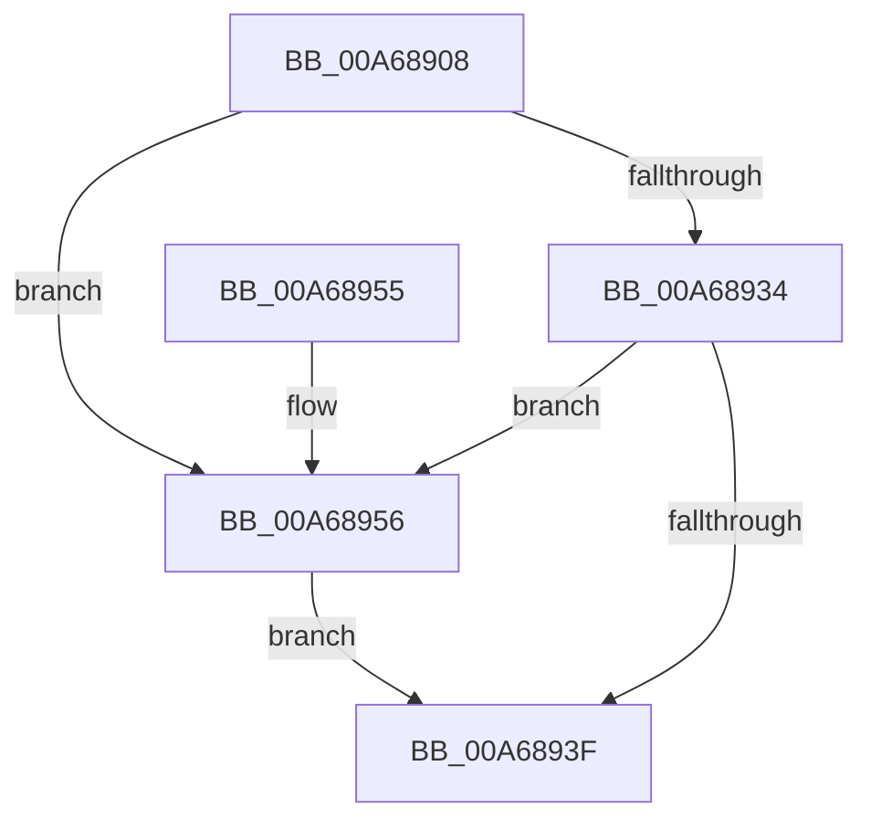

# PopReleaseUmpoPushLock

- RVA: `0x00A68908`–`0x00A68964` (길이 `92` bytes)
- VA: `0x0000000140A68908`
- 실행 섹션: `PAGE`
- PDB 이름 있음: `예`; PDB Function 태그: `아니요`
- unwind 정보 RVA: `0x00064C74`
- 디코드: `22`개 명령, `92/92` bytes 표시
- 미해석 바이트: `0` (있으면 어셈블리에 `.byte`로 보존)

> 이 문서는 커널 이미지의 기계어와 PDB 기호를 분석해 생성했습니다. 4번과 5번은 함수 원형과 자료형을 바이너리 사용 방식에서 추정한 C 해석이며 원본 소스 복구 결과는 아닙니다.

## 1. Dependencies

- 직접 호출 지점: **3**; 고유 호출 대상: **3**
- 직접 호출자로 확인된 함수: **2**
- RIP 상대 이미지 참조: **1**

### Outgoing calls
- `0x00A68946` → [KeAbPostRelease](../../text/2E/KeAbPostRelease_function_002E1600.md) (function, `0x002E1600`)
- `0x00A6894B` → [KeLeaveCriticalRegion](../../text/25/KeLeaveCriticalRegion_function_0025D8B0.md) (function, `0x0025D8B0`)
- `0x00A6895D` → [ExfReleasePushLock](../../text/26/ExfReleasePushLock_function_002638D0.md) (function, `0x002638D0`)

### Direct callers
- [PopUmpoSendPowerMessage](../../text/23/PopUmpoSendPowerMessage_function_00230730.md) at `0x0023080F`
- [sub_00B39570](../B3/Unknown_function_00B39570.md) at `0x00B396E8`

### Static image references
- `0x00A6890C` → RVA `0x00F084B8` (`.data`; read)

## 2. Other-region calls and transfers

- 다른 실행 섹션으로 향하는 call: **3**
  - `0x00A68946` → [KeAbPostRelease](../../text/2E/KeAbPostRelease_function_002E1600.md) (`PAGE` → `.text`)
  - `0x00A6894B` → [KeLeaveCriticalRegion](../../text/25/KeLeaveCriticalRegion_function_0025D8B0.md) (`PAGE` → `.text`)
  - `0x00A6895D` → [ExfReleasePushLock](../../text/26/ExfReleasePushLock_function_002638D0.md) (`PAGE` → `.text`)
- 별도 외부 분기/꼬리 이동을 확인하지 못했습니다.

## 3. Assembly (complete function range)

```asm
00A68908  48 83 EC 28                     sub rsp, 0x28
00A6890C  0F 0D 0D A5 FB 49 00            prefetchw byte ptr [rip + 0x49fba5]
00A68913  48 8B 05 9E FB 49 00            mov rax, qword ptr [rip + 0x49fb9e]
00A6891A  45 33 C0                        xor r8d, r8d
00A6891D  48 8B C8                        mov rcx, rax
00A68920  48 83 E1 F0                     and rcx, 0xfffffffffffffff0
00A68924  48 83 F9 10                     cmp rcx, 0x10
00A68928  48 8D 50 F0                     lea rdx, [rax - 0x10]
00A6892C  49 0F 46 D0                     cmovbe rdx, r8
00A68930  A8 02                           test al, 2
00A68932  75 22                           jne 0x140a68956
00A68934  F0 48 0F B1 15 7B FB 49 00      lock cmpxchg qword ptr [rip + 0x49fb7b], rdx
00A6893D  75 17                           jne 0x140a68956
00A6893F  48 8D 0D 72 FB 49 00            lea rcx, [rip + 0x49fb72]
00A68946  E8 B5 8C 87 FF                  call 0x1402e1600
00A6894B  E8 60 4F 7F FF                  call 0x14025d8b0
00A68950  48 83 C4 28                     add rsp, 0x28
00A68954  C3                              ret
00A68955  CC                              int3
00A68956  48 8D 0D 5B FB 49 00            lea rcx, [rip + 0x49fb5b]
00A6895D  E8 6E AF 7F FF                  call 0x1402638d0
00A68962  EB DB                           jmp 0x140a6893f
```

## 4. C-style interpretation (structured pseudocode)

```c
__int64 __fastcall PopReleaseUmpoPushLock(__int64 a1, __int64 a2, int a3)
{
    __int64 result;
    __int64 v_rsp;

    v_rsp = (v_rsp) - (40);
    a3 = 0;
    a1 = (*(unsigned __int64 *)(v_rip + 4848542)) & (-16);
    a2 = *(unsigned __int64 *)(v_rip + 4848542) - 16;
    if (a1 <= 16) { a2 = 0; }
    if ((((unsigned __int8)(*(unsigned __int64 *)(v_rip + 4848542))) & (2)) != 0) goto loc_00A68956;
    if ((((unsigned __int8)(*(unsigned __int64 *)(v_rip + 4848542))) & (2)) != 0) goto loc_00A68956;
loc_00A6893F:
    result = KeAbPostRelease(v_rip + 4848498, a2, a3, a4);
    result = KeLeaveCriticalRegion(v_rip + 4848498, a2, a3, a4);
    v_rsp = (v_rsp) + (40);
    return result;
loc_00A68956:
    result = ExfReleasePushLock(v_rip + 4848475, a2, a3, a4);
    goto loc_00A6893F;
}
```

## 5. (Beta) C Style

```c
int64_t PopReleaseUmpoPushLock(int64_t Arg1, int64_t Arg2, int32_t Arg3)
{
    int64_t result;
    int64_t local_rsp;

    local_rsp = (local_rsp) - (40);
    Arg3 = 0;
    Arg1 = (*(uint64_t *)(v_rip + 0x49FB9E)) & (-16);
    Arg2 = *(uint64_t *)(v_rip + 0x49FB9E) - 16;
    if (Arg1 <= 16) { Arg2 = 0; }
    if ((((uint8_t)(*(uint64_t *)(v_rip + 0x49FB9E))) & (2)) != 0) goto loc_00A68956;
    if ((((uint8_t)(*(uint64_t *)(v_rip + 0x49FB9E))) & (2)) != 0) goto loc_00A68956;
loc_00A6893F:
    result = KeAbPostRelease(v_rip + 4848498, Arg2, Arg3, a4);
    result = KeLeaveCriticalRegion(v_rip + 4848498, Arg2, Arg3, a4);
    local_rsp = (local_rsp) + (40);
    return result;
loc_00A68956:
    result = ExfReleasePushLock(v_rip + 4848475, Arg2, Arg3, a4);
    goto loc_00A6893F;
}
```

## 6. Execution-region graph

[열기: 2D/3D 그래프와 함수 탐색 컨트롤 패널](../../../control-panel.html?section=page&rva=0x00A68908&view=graph)

- 2D 그래프는 위에서 아래로 흐르고, 3D 그래프는 빈 공간을 드래그해 회전합니다. Shift+드래그는 이동, 휠은 확대·축소, 함수 노드 선택은 대상 보고서 이동입니다.

### Static fallback


