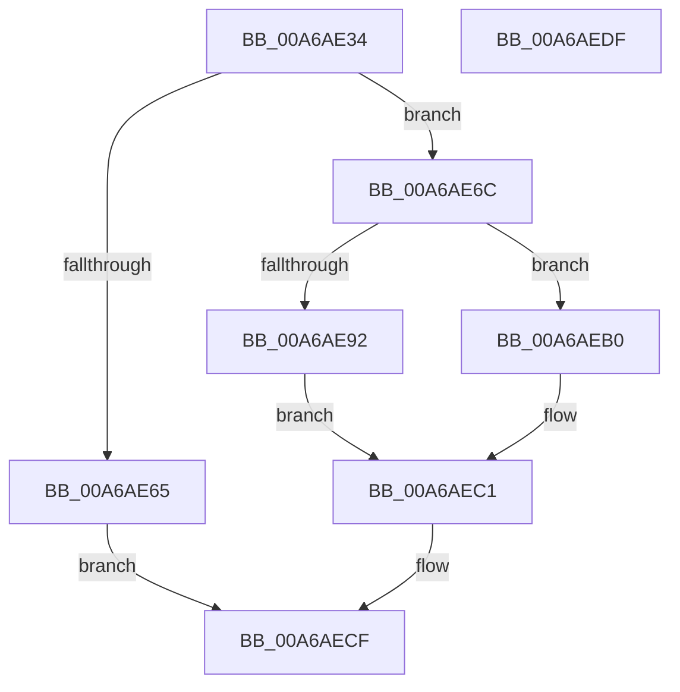

# PopRequestShutdownWait

- RVA: `0x00A6AE34`–`0x00A6AEE0` (길이 `172` bytes)
- VA: `0x0000000140A6AE34`
- 실행 섹션: `PAGE`
- PDB 이름 있음: `예`; PDB Function 태그: `아니요`
- unwind 정보 RVA: `0x00060BC4`
- 디코드: `43`개 명령, `172/172` bytes 표시
- 미해석 바이트: `0` (있으면 어셈블리에 `.byte`로 보존)

> 이 문서는 커널 이미지의 기계어와 PDB 기호를 분석해 생성했습니다. 4번과 5번은 함수 원형과 자료형을 바이너리 사용 방식에서 추정한 C 해석이며 원본 소스 복구 결과는 아닙니다.

## 1. Dependencies

- 직접 호출 지점: **6**; 고유 호출 대상: **6**
- 직접 호출자로 확인된 함수: **2**
- RIP 상대 이미지 참조: **4**

### Outgoing calls
- `0x00A6AE56` → [ExAllocatePool2](../../poolcode/B8/ExAllocatePool2_function_00B820F0.md) (function, `0x00B820F0`)
- `0x00A6AE78` → [ObfReferenceObjectWithTag](../../text/21/ObfReferenceObjectWithTag_function_00210710.md) (function, `0x00210710`)
- `0x00A6AE84` → [ExAcquireFastMutex](../../text/20/ExAcquireFastMutex_function_0020E5A0.md) (function, `0x0020E5A0`)
- `0x00A6AE9A` → [ObfDereferenceObjectWithTag](../../text/2F/ObfDereferenceObjectWithTag_function_002F78E0.md) (function, `0x002F78E0`)
- `0x00A6AEA4` → [ExFreePoolWithTag](../../poolcode/B8/ExFreePoolWithTag_function_00B82870.md) (function, `0x00B82870`)
- `0x00A6AEC8` → [ExReleaseFastMutex](../../text/25/ExReleaseFastMutex_function_002519C0.md) (function, `0x002519C0`)

### Direct callers
- [SepRmCommandServerThread](SepRmCommandServerThread_function_00A6A8D0.md) at `0x00A6A951`
- [PoRequestShutdownEvent](PoRequestShutdownEvent_function_00A6ADF0.md) at `0x00A6AE0B`

### Static image references
- `0x00A6AE7D` → RVA `0x00F0E0A0` (`.data`; read)
- `0x00A6AE89` → RVA `0x00E676D0` (`.data`; read)
- `0x00A6AEB0` → RVA `0x00F0E0D8` (`.data`; read)
- `0x00A6AEBA` → RVA `0x00F0E0D8` (`.data`; write)

## 2. Other-region calls and transfers

- 다른 실행 섹션으로 향하는 call: **6**
  - `0x00A6AE56` → [ExAllocatePool2](../../poolcode/B8/ExAllocatePool2_function_00B820F0.md) (`PAGE` → `POOLCODE`)
  - `0x00A6AE78` → [ObfReferenceObjectWithTag](../../text/21/ObfReferenceObjectWithTag_function_00210710.md) (`PAGE` → `.text`)
  - `0x00A6AE84` → [ExAcquireFastMutex](../../text/20/ExAcquireFastMutex_function_0020E5A0.md) (`PAGE` → `.text`)
  - `0x00A6AE9A` → [ObfDereferenceObjectWithTag](../../text/2F/ObfDereferenceObjectWithTag_function_002F78E0.md) (`PAGE` → `.text`)
  - `0x00A6AEA4` → [ExFreePoolWithTag](../../poolcode/B8/ExFreePoolWithTag_function_00B82870.md) (`PAGE` → `POOLCODE`)
  - `0x00A6AEC8` → [ExReleaseFastMutex](../../text/25/ExReleaseFastMutex_function_002519C0.md) (`PAGE` → `.text`)
- 별도 외부 분기/꼬리 이동을 확인하지 못했습니다.

## 3. Assembly (complete function range)

```asm
00A6AE34  48 89 5C 24 08                  mov qword ptr [rsp + 8], rbx
00A6AE39  48 89 74 24 10                  mov qword ptr [rsp + 0x10], rsi
00A6AE3E  57                              push rdi
00A6AE3F  48 83 EC 20                     sub rsp, 0x20
00A6AE43  48 8B F1                        mov rsi, rcx
00A6AE46  BA 10 00 00 00                  mov edx, 0x10
00A6AE4B  B9 00 01 00 00                  mov ecx, 0x100
00A6AE50  41 B8 50 6F 53 4C               mov r8d, 0x4c536f50
00A6AE56  E8 95 72 11 00                  call 0x140b820f0
00A6AE5B  33 FF                           xor edi, edi
00A6AE5D  48 8B D8                        mov rbx, rax
00A6AE60  48 85 C0                        test rax, rax
00A6AE63  75 07                           jne 0x140a6ae6c
00A6AE65  B8 17 00 00 C0                  mov eax, 0xc0000017
00A6AE6A  EB 63                           jmp 0x140a6aecf
00A6AE6C  BA 50 6F 53 64                  mov edx, 0x64536f50
00A6AE71  48 89 70 08                     mov qword ptr [rax + 8], rsi
00A6AE75  48 8B CE                        mov rcx, rsi
00A6AE78  E8 93 58 7A FF                  call 0x140210710
00A6AE7D  48 8D 0D 1C 32 4A 00            lea rcx, [rip + 0x4a321c]
00A6AE84  E8 17 37 7A FF                  call 0x14020e5a0
00A6AE89  40 38 3D 40 C8 3F 00            cmp byte ptr [rip + 0x3fc840], dil
00A6AE90  75 1E                           jne 0x140a6aeb0
00A6AE92  BA 50 6F 53 64                  mov edx, 0x64536f50
00A6AE97  48 8B CE                        mov rcx, rsi
00A6AE9A  E8 41 CA 88 FF                  call 0x1402f78e0
00A6AE9F  33 D2                           xor edx, edx
00A6AEA1  48 8B CB                        mov rcx, rbx
00A6AEA4  E8 C7 79 11 00                  call 0x140b82870
00A6AEA9  BF 01 00 00 C0                  mov edi, 0xc0000001
00A6AEAE  EB 11                           jmp 0x140a6aec1
00A6AEB0  48 8B 15 21 32 4A 00            mov rdx, qword ptr [rip + 0x4a3221]
00A6AEB7  48 89 13                        mov qword ptr [rbx], rdx
00A6AEBA  48 89 1D 17 32 4A 00            mov qword ptr [rip + 0x4a3217], rbx
00A6AEC1  48 8D 0D D8 31 4A 00            lea rcx, [rip + 0x4a31d8]
00A6AEC8  E8 F3 6A 7E FF                  call 0x1402519c0
00A6AECD  8B C7                           mov eax, edi
00A6AECF  48 8B 5C 24 30                  mov rbx, qword ptr [rsp + 0x30]
00A6AED4  48 8B 74 24 38                  mov rsi, qword ptr [rsp + 0x38]
00A6AED9  48 83 C4 20                     add rsp, 0x20
00A6AEDD  5F                              pop rdi
00A6AEDE  C3                              ret
00A6AEDF  CC                              int3
```

## 4. C-style interpretation (structured pseudocode)

```c
__int64 __fastcall PopRequestShutdownWait(__int64 a1)
{
    __int64 result;
    __int64 v_rdi;
    __int64 v_rsp;
    unsigned __int64 v_stack_p10;
    unsigned __int64 v_stack_p8;

    v_stack_p8 = v_rbx;
    v_stack_p10 = v_rsi;
    v_rsp = (v_rsp) - (32);
    result = ExAllocatePool2(256, 16, (unsigned int)(0x4C536F50ULL), a4);
    v_rdi = 0;
    if (result != 0) goto loc_00A6AE6C;
    goto loc_00A6AECF;
loc_00A6AE6C:
    *(unsigned __int64 *)((unsigned int)(0xC0000017ULL) + 8) = a1;
    result = ObfReferenceObjectWithTag(a1, (unsigned int)(0x64536F50ULL), (unsigned int)(0x4C536F50ULL), a4);
    result = ExAcquireFastMutex(v_rip + 4862492, (unsigned int)(0x64536F50ULL), (unsigned int)(0x4C536F50ULL), a4);
    if ((*(unsigned __int8 *)(v_rip + 4180032)) != 0) goto loc_00A6AEB0;
    result = ObfDereferenceObjectWithTag(a1, (unsigned int)(0x64536F50ULL), (unsigned int)(0x4C536F50ULL), a4);
    a2 = 0;
    result = ExFreePoolWithTag(result, a2, (unsigned int)(0x4C536F50ULL), a4);
    goto loc_00A6AEC1;
loc_00A6AEB0:
    *(unsigned __int64 *)(result) = *(unsigned __int64 *)(v_rip + 4862497);
    *(unsigned __int64 *)(v_rip + 4862487) = result;
loc_00A6AEC1:
    result = ExReleaseFastMutex(v_rip + 4862424, *(unsigned __int64 *)(v_rip + 4862497), (unsigned int)(0x4C536F50ULL), a4);
loc_00A6AECF:
    v_rsp = (v_rsp) + (32);
    return (unsigned int)((unsigned int)((unsigned int)(0xC0000001ULL)));
}
```

## 5. (Beta) C Style

```c
int64_t PopRequestShutdownWait(int64_t Arg1)
{
    int64_t result;
    int64_t local_rdi;
    int64_t local_rsp;
    uint64_t v_stack_p10;
    uint64_t v_stack_p8;

    v_stack_p8 = local_rbx;
    v_stack_p10 = local_rsi;
    local_rsp = (local_rsp) - (32);
    result = ExAllocatePool2(256, 16, (uint32_t)(0x4C536F50ULL), a4);
    local_rdi = 0;
    if (result != 0) goto loc_00A6AE6C;
    goto loc_00A6AECF;
loc_00A6AE6C:
    *(uint64_t *)((uint32_t)(0xC0000017ULL) + 0x8) = Arg1;
    result = ObfReferenceObjectWithTag(Arg1, (uint32_t)(0x64536F50ULL), (uint32_t)(0x4C536F50ULL), a4);
    result = ExAcquireFastMutex(v_rip + 4862492, (uint32_t)(0x64536F50ULL), (uint32_t)(0x4C536F50ULL), a4);
    if ((*(uint8_t *)(v_rip + 0x3FC840)) != 0) goto loc_00A6AEB0;
    result = ObfDereferenceObjectWithTag(Arg1, (uint32_t)(0x64536F50ULL), (uint32_t)(0x4C536F50ULL), a4);
    a2 = 0;
    result = ExFreePoolWithTag(result, a2, (uint32_t)(0x4C536F50ULL), a4);
    goto loc_00A6AEC1;
loc_00A6AEB0:
    *(uint64_t *)(result) = *(uint64_t *)(v_rip + 0x4A3221);
    *(uint64_t *)(v_rip + 0x4A3217) = result;
loc_00A6AEC1:
    result = ExReleaseFastMutex(v_rip + 4862424, *(uint64_t *)(v_rip + 0x4A3221), (uint32_t)(0x4C536F50ULL), a4);
loc_00A6AECF:
    local_rsp = (local_rsp) + (32);
    return (uint32_t)((uint32_t)((uint32_t)(0xC0000001ULL)));
}
```

## 6. Execution-region graph

[열기: 2D/3D 그래프와 함수 탐색 컨트롤 패널](../../../control-panel.html?section=page&rva=0x00A6AE34&view=graph)

- 2D 그래프는 위에서 아래로 흐르고, 3D 그래프는 빈 공간을 드래그해 회전합니다. Shift+드래그는 이동, 휠은 확대·축소, 함수 노드 선택은 대상 보고서 이동입니다.

### Static fallback


