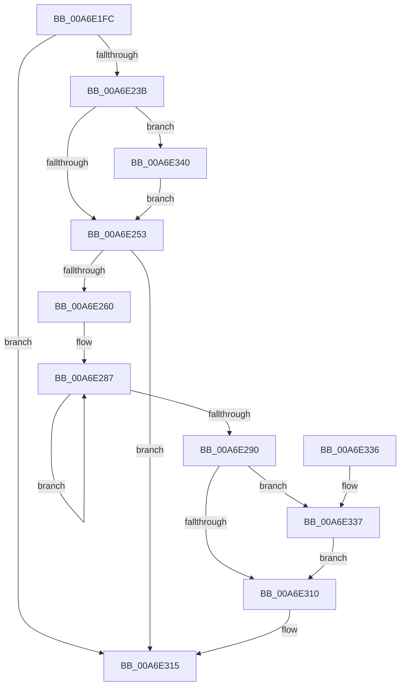

# PpmEventTraceProfileSetting

- RVA: `0x00A6E1FC`–`0x00A6E34C` (길이 `336` bytes)
- VA: `0x0000000140A6E1FC`
- 실행 섹션: `PAGE`
- PDB 이름 있음: `예`; PDB Function 태그: `아니요`
- unwind 정보 RVA: `0x000B49B8`
- 디코드: `83`개 명령, `336/336` bytes 표시
- 미해석 바이트: `0` (있으면 어셈블리에 `.byte`로 보존)

> 이 문서는 커널 이미지의 기계어와 PDB 기호를 분석해 생성했습니다. 4번과 5번은 함수 원형과 자료형을 바이너리 사용 방식에서 추정한 C 해석이며 원본 소스 복구 결과는 아닙니다.

## 1. Dependencies

- 직접 호출 지점: **3**; 고유 호출 대상: **3**
- 직접 호출자로 확인된 함수: **1**
- RIP 상대 이미지 참조: **5**

### Outgoing calls
- `0x00A6E253` → [EtwEventEnabled](../../text/39/EtwEventEnabled_function_00392450.md) (function, `0x00392450`)
- `0x00A6E310` → [EtwWrite](../../text/41/EtwWrite_function_0041C720.md) (function, `0x0041C720`)
- `0x00A6E31C` → [_security_check_cookie](../../text/6A/_security_check_cookie_function_006AC640.md) (function, `0x006AC640`)

### Direct callers
- [PpmSetProfilePolicySetting](../91/PpmSetProfilePolicySetting_function_00915A44.md) at `0x00915D8F`
- [PpmSetProfilePolicySetting](../91/PpmSetProfilePolicySetting_function_00915A44.md) at `0x00915E5E`

### Static image references
- `0x00A6E21A` → RVA `0x00E0A740` (`.data`; read)
- `0x00A6E228` → RVA `0x00E67A39` (`.data`; read)
- `0x00A6E23F` → RVA `0x0001ABA0` (`.rdata`; read)
- `0x00A6E246` → RVA `0x00F083E8` (`.data`; read)
- `0x00A6E2E9` → RVA `0x0001AB90` (`.rdata`; read)

## 2. Other-region calls and transfers

- 다른 실행 섹션으로 향하는 call: **3**
  - `0x00A6E253` → [EtwEventEnabled](../../text/39/EtwEventEnabled_function_00392450.md) (`PAGE` → `.text`)
  - `0x00A6E310` → [EtwWrite](../../text/41/EtwWrite_function_0041C720.md) (`PAGE` → `.text`)
  - `0x00A6E31C` → [_security_check_cookie](../../text/6A/_security_check_cookie_function_006AC640.md) (`PAGE` → `.text`)
- 별도 외부 분기/꼬리 이동을 확인하지 못했습니다.

## 3. Assembly (complete function range)

```asm
00A6E1FC  48 8B C4                        mov rax, rsp
00A6E1FF  48 89 58 10                     mov qword ptr [rax + 0x10], rbx
00A6E203  48 89 70 18                     mov qword ptr [rax + 0x18], rsi
00A6E207  44 88 48 20                     mov byte ptr [rax + 0x20], r9b
00A6E20B  88 48 08                        mov byte ptr [rax + 8], cl
00A6E20E  55                              push rbp
00A6E20F  48 8D 68 C1                     lea rbp, [rax - 0x3f]
00A6E213  48 81 EC C0 00 00 00            sub rsp, 0xc0
00A6E21A  48 8B 05 1F C5 39 00            mov rax, qword ptr [rip + 0x39c51f]
00A6E221  48 33 C4                        xor rax, rsp
00A6E224  48 89 45 27                     mov qword ptr [rbp + 0x27], rax
00A6E228  80 3D 0A 98 3F 00 00            cmp byte ptr [rip + 0x3f980a], 0
00A6E22F  49 8B F0                        mov rsi, r8
00A6E232  48 8B DA                        mov rbx, rdx
00A6E235  0F 84 DA 00 00 00               je 0x140a6e315
00A6E23B  80 7D 7F 00                     cmp byte ptr [rbp + 0x7f], 0
00A6E23F  48 8D 15 5A C9 5A FF            lea rdx, [rip - 0xa536a6]
00A6E246  48 8B 0D 9B A1 49 00            mov rcx, qword ptr [rip + 0x49a19b]
00A6E24D  0F 85 ED 00 00 00               jne 0x140a6e340
00A6E253  E8 F8 41 92 FF                  call 0x140392450
00A6E258  84 C0                           test al, al
00A6E25A  0F 84 B5 00 00 00               je 0x140a6e315
00A6E260  33 C0                           xor eax, eax
00A6E262  48 89 5D C7                     mov qword ptr [rbp - 0x39], rbx
00A6E266  39 45 77                        cmp dword ptr [rbp + 0x77], eax
00A6E269  BA 01 00 00 00                  mov edx, 1
00A6E26E  89 55 BF                        mov dword ptr [rbp - 0x41], edx
00A6E271  0F 95 C0                        setne al
00A6E274  83 65 C3 00                     and dword ptr [rbp - 0x3d], 0
00A6E278  89 45 A7                        mov dword ptr [rbp - 0x59], eax
00A6E27B  48 8D 45 47                     lea rax, [rbp + 0x47]
00A6E27F  48 89 45 B7                     mov qword ptr [rbp - 0x49], rax
00A6E283  48 83 C8 FF                     or rax, 0xffffffffffffffff
00A6E287  48 FF C0                        inc rax
00A6E28A  80 3C 03 00                     cmp byte ptr [rbx + rax], 0
00A6E28E  75 F7                           jne 0x140a6e287
00A6E290  83 65 D3 00                     and dword ptr [rbp - 0x2d], 0
00A6E294  03 C2                           add eax, edx
00A6E296  83 65 E3 00                     and dword ptr [rbp - 0x1d], 0
00A6E29A  B9 04 00 00 00                  mov ecx, 4
00A6E29F  83 65 F3 00                     and dword ptr [rbp - 0xd], 0
00A6E2A3  45 33 C0                        xor r8d, r8d
00A6E2A6  83 65 03 00                     and dword ptr [rbp + 3], 0
00A6E2AA  83 65 13 00                     and dword ptr [rbp + 0x13], 0
00A6E2AE  83 65 23 00                     and dword ptr [rbp + 0x23], 0
00A6E2B2  44 8D 49 03                     lea r9d, [rcx + 3]
00A6E2B6  89 45 CF                        mov dword ptr [rbp - 0x31], eax
00A6E2B9  48 8D 45 A7                     lea rax, [rbp - 0x59]
00A6E2BD  48 89 45 D7                     mov qword ptr [rbp - 0x29], rax
00A6E2C1  48 8D 45 5F                     lea rax, [rbp + 0x5f]
00A6E2C5  48 89 45 E7                     mov qword ptr [rbp - 0x19], rax
00A6E2C9  48 8D 45 6F                     lea rax, [rbp + 0x6f]
00A6E2CD  48 89 45 07                     mov qword ptr [rbp + 7], rax
00A6E2D1  48 8B 45 67                     mov rax, qword ptr [rbp + 0x67]
00A6E2D5  48 89 45 17                     mov qword ptr [rbp + 0x17], rax
00A6E2D9  8B 45 6F                        mov eax, dword ptr [rbp + 0x6f]
00A6E2DC  89 45 1F                        mov dword ptr [rbp + 0x1f], eax
00A6E2DF  48 8D 45 B7                     lea rax, [rbp - 0x49]
00A6E2E3  89 4D DF                        mov dword ptr [rbp - 0x21], ecx
00A6E2E6  89 55 EF                        mov dword ptr [rbp - 0x11], edx
00A6E2E9  48 8D 15 A0 C8 5A FF            lea rdx, [rip - 0xa53760]
00A6E2F0  89 4D 0F                        mov dword ptr [rbp + 0xf], ecx
00A6E2F3  48 8B 0D EE A0 49 00            mov rcx, qword ptr [rip + 0x49a0ee]
00A6E2FA  48 89 44 24 20                  mov qword ptr [rsp + 0x20], rax
00A6E2FF  48 89 75 F7                     mov qword ptr [rbp - 9], rsi
00A6E303  C7 45 FF 10 00 00 00            mov dword ptr [rbp - 1], 0x10
00A6E30A  44 38 45 7F                     cmp byte ptr [rbp + 0x7f], r8b
00A6E30E  74 27                           je 0x140a6e337
00A6E310  E8 0B E4 9A FF                  call 0x14041c720
00A6E315  48 8B 4D 27                     mov rcx, qword ptr [rbp + 0x27]
00A6E319  48 33 CC                        xor rcx, rsp
00A6E31C  E8 1F E3 C3 FF                  call 0x1406ac640
00A6E321  4C 8D 9C 24 C0 00 00 00         lea r11, [rsp + 0xc0]
00A6E329  49 8B 5B 18                     mov rbx, qword ptr [r11 + 0x18]
00A6E32D  49 8B 73 20                     mov rsi, qword ptr [r11 + 0x20]
00A6E331  49 8B E3                        mov rsp, r11
00A6E334  5D                              pop rbp
00A6E335  C3                              ret
00A6E336  CC                              int3
00A6E337  48 8D 15 62 C8 5A FF            lea rdx, [rip - 0xa5379e]
00A6E33E  EB D0                           jmp 0x140a6e310
00A6E340  48 8D 15 49 C8 5A FF            lea rdx, [rip - 0xa537b7]
00A6E347  E9 07 FF FF FF                  jmp 0x140a6e253
```

## 4. C-style interpretation (structured pseudocode)

```c
__int64 __fastcall PpmEventTraceProfileSetting(unsigned __int8 a1, __int64 a2, __int64 a3, unsigned __int8 a4)
{
    __int64 result;
    __int64 v_rsp;
    unsigned __int64 v_stack_m8;
    unsigned __int64 v_stack_mA8;

    *(unsigned __int64 *)(v_rsp + 16) = v_rbx;
    *(unsigned __int64 *)(v_rsp + 24) = v_rsi;
    *(unsigned __int8 *)(v_rsp + 32) = a4;
    *(unsigned __int8 *)(v_rsp + 8) = a1;
    v_rsp = (v_rsp) - (192);
    result = (*(unsigned __int64 *)(v_rip + 3786015)) ^ (v_rsp);
    *(unsigned __int64 *)(v_rsp - 63 + 39) = result;
    if ((*(unsigned __int8 *)(v_rip + 4167690)) == 0) goto loc_00A6E315;
    if ((*(unsigned __int8 *)(v_rsp - 63 + 127)) != 0) goto loc_00A6E340;
loc_00A6E253:
    result = EtwEventEnabled(*(unsigned __int64 *)(v_rip + 4825499), v_rip - 10827430, a3, a4);
    if ((unsigned __int8)(result) == 0) goto loc_00A6E315;
    result = 0;
    *(unsigned __int64 *)(v_rsp - 63 - 57) = a2;
    *(unsigned int *)(v_rsp - 63 - 65) = 1;
    result = ((*(unsigned int *)(v_rsp - 63 + 119)) != 0) ? 1 : 0;
    *(unsigned int *)(v_rsp - 63 - 89) = (unsigned int)(result);
    *(unsigned __int64 *)(v_rsp - 63 - 73) = v_rsp - 63 + 71;
    result = (v_rsp - 63 + 71) | (-1);
loc_00A6E287:
    result = (result) + 1;
    if ((*(unsigned __int8 *)(a2 + result * 1)) != 0) goto loc_00A6E287;
    result = (unsigned int)((result) + (1));
    a3 = 0;
    *(unsigned int *)(v_rsp - 63 - 49) = (unsigned int)(result);
    *(unsigned __int64 *)(v_rsp - 63 - 41) = v_rsp - 63 - 89;
    *(unsigned __int64 *)(v_rsp - 63 - 25) = v_rsp - 63 + 95;
    *(unsigned __int64 *)(v_rsp - 63 + 7) = v_rsp - 63 + 111;
    *(unsigned __int64 *)(v_rsp - 63 + 23) = *(unsigned __int64 *)(v_rsp - 63 + 103);
    *(unsigned int *)(v_rsp - 63 + 31) = (unsigned int)((unsigned int)(*(unsigned int *)(v_rsp - 63 + 111)));
    *(unsigned int *)(v_rsp - 63 - 33) = 4;
    *(unsigned int *)(v_rsp - 63 - 17) = 1;
    *(unsigned int *)(v_rsp - 63 + 15) = 4;
    v_stack_mA8 = v_rsp - 63 - 73;
    *(unsigned __int64 *)(v_rsp - 63 - 9) = 0;
    *(unsigned int *)(v_rsp - 63 - 1) = 16;
    if ((*(unsigned __int8 *)(v_rsp - 63 + 127)) == 0) goto loc_00A6E337;
loc_00A6E310:
    result = EtwWrite(*(unsigned __int64 *)(v_rip + 4825326), v_rip - 10827616, a3, 4 + 3);
loc_00A6E315:
    a1 = (*(unsigned __int64 *)(v_rsp - 63 + 39)) ^ (v_rsp);
    result = _security_check_cookie(a1, v_rip - 10827616, a3, 4 + 3);
    return result;
loc_00A6E337:
    goto loc_00A6E310;
loc_00A6E340:
    goto loc_00A6E253;
}
```

## 5. (Beta) C Style

```c
int64_t PpmEventTraceProfileSetting(uint8_t Arg1, void *Arg2, int64_t Arg3, uint8_t Arg4)
{
    uint8_t *arg2 = (uint8_t *)Arg2;

    int64_t result;
    int64_t local_rsp;
    uint64_t v_stack_m8;
    uint64_t v_stack_mA8;

    *(uint64_t *)(local_rsp + 0x10) = local_rbx;
    *(uint64_t *)(local_rsp + 0x18) = local_rsi;
    *(uint8_t *)(local_rsp + 0x20) = Arg4;
    *(uint8_t *)(local_rsp + 0x8) = Arg1;
    local_rsp = (local_rsp) - (192);
    result = (*(uint64_t *)(v_rip + 0x39C51F)) ^ (local_rsp);
    *(uint64_t *)(local_rsp - 0x3F + 0x27) = result;
    if ((*(uint8_t *)(v_rip + 0x3F980A)) == 0) goto loc_00A6E315;
    if ((*(uint8_t *)(local_rsp - 0x3F + 0x7F)) != 0) goto loc_00A6E340;
loc_00A6E253:
    result = EtwEventEnabled(*(uint64_t *)(v_rip + 0x49A19B), v_rip - 10827430, Arg3, Arg4);
    if ((uint8_t)(result) == 0) goto loc_00A6E315;
    result = 0;
    *(void **)(local_rsp - 0x3F - 0x39) = Arg2;
    *(uint32_t *)(local_rsp - 0x3F - 0x41) = 1;
    result = ((*(uint32_t *)(local_rsp - 0x3F + 0x77)) != 0) ? 1 : 0;
    *(uint32_t *)(local_rsp - 0x3F - 0x59) = (uint32_t)(result);
    *(uint64_t *)(local_rsp - 0x3F - 0x49) = local_rsp - 63 + 71;
    result = (local_rsp - 63 + 71) | (-1);
loc_00A6E287:
    result = (result) + 1;
    if ((*(uint8_t *)(arg2 + result * 1)) != 0) goto loc_00A6E287;
    result = (uint32_t)((result) + (1));
    Arg3 = 0;
    *(uint32_t *)(local_rsp - 0x3F - 0x31) = (uint32_t)(result);
    *(uint64_t *)(local_rsp - 0x3F - 0x29) = local_rsp - 63 - 89;
    *(uint64_t *)(local_rsp - 0x3F - 0x19) = local_rsp - 63 + 95;
    *(uint64_t *)(local_rsp - 0x3F + 0x7) = local_rsp - 63 + 111;
    *(uint64_t *)(local_rsp - 0x3F + 0x17) = *(uint64_t *)(local_rsp - 0x3F + 0x67);
    *(uint32_t *)(local_rsp - 0x3F + 0x1F) = (uint32_t)((uint32_t)(*(uint32_t *)(local_rsp - 0x3F + 0x6F)));
    *(uint32_t *)(local_rsp - 0x3F - 0x21) = 4;
    *(uint32_t *)(local_rsp - 0x3F - 0x11) = 1;
    *(uint32_t *)(local_rsp - 0x3F + 0xF) = 4;
    v_stack_mA8 = local_rsp - 63 - 73;
    *(uint64_t *)(local_rsp - 0x3F - 0x9) = 0;
    *(uint32_t *)(local_rsp - 0x3F - 0x1) = 16;
    if ((*(uint8_t *)(local_rsp - 0x3F + 0x7F)) == 0) goto loc_00A6E337;
loc_00A6E310:
    result = EtwWrite(*(uint64_t *)(v_rip + 0x49A0EE), v_rip - 10827616, Arg3, 4 + 3);
loc_00A6E315:
    Arg1 = (*(uint64_t *)(local_rsp - 0x3F + 0x27)) ^ (local_rsp);
    result = _security_check_cookie(Arg1, v_rip - 10827616, Arg3, 4 + 3);
    return result;
loc_00A6E337:
    goto loc_00A6E310;
loc_00A6E340:
    goto loc_00A6E253;
}
```

### 관측된 메모리 오프셋

구조체 형식이 확인되지 않은 접근은 인자 기준의 오프셋으로만 기록했습니다.

| 기준 인자 | 오프셋 표현 | 폭 (bit) | 접근 |
|---|---:|---:|---|
| `Arg2` | `+ 0x0 + rax*1` | `8` | `R` |

## 6. Execution-region graph

[열기: 2D/3D 그래프와 함수 탐색 컨트롤 패널](../../../control-panel.html?section=page&rva=0x00A6E1FC&view=graph)

- 2D 그래프는 위에서 아래로 흐르고, 3D 그래프는 빈 공간을 드래그해 회전합니다. Shift+드래그는 이동, 휠은 확대·축소, 함수 노드 선택은 대상 보고서 이동입니다.

### Static fallback


