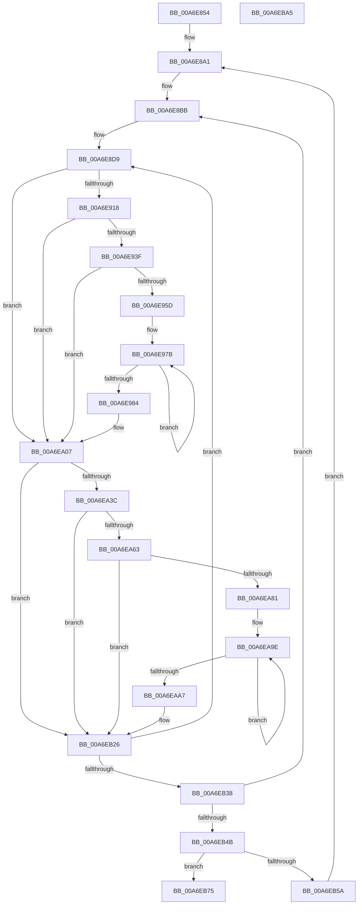

# PpmInfoTraceProfileSettings

- RVA: `0x00A6E854`–`0x00A6EBA6` (길이 `850` bytes)
- VA: `0x0000000140A6E854`
- 실행 섹션: `PAGE`
- PDB 이름 있음: `예`; PDB Function 태그: `아니요`
- unwind 정보 RVA: `0x000B4BEC`
- 디코드: `197`개 명령, `850/850` bytes 표시
- 미해석 바이트: `0` (있으면 어셈블리에 `.byte`로 보존)

> 이 문서는 커널 이미지의 기계어와 PDB 기호를 분석해 생성했습니다. 4번과 5번은 함수 원형과 자료형을 바이너리 사용 방식에서 추정한 C 해석이며 원본 소스 복구 결과는 아닙니다.

## 1. Dependencies

- 직접 호출 지점: **5**; 고유 호출 대상: **3**
- 직접 호출자로 확인된 함수: **1**
- RIP 상대 이미지 참조: **8**

### Outgoing calls
- `0x00A6E94D` → [EtwEventEnabled](../../text/39/EtwEventEnabled_function_00392450.md) (function, `0x00392450`)
- `0x00A6E9FF` → [EtwWrite](../../text/41/EtwWrite_function_0041C720.md) (function, `0x0041C720`)
- `0x00A6EA71` → [EtwEventEnabled](../../text/39/EtwEventEnabled_function_00392450.md) (function, `0x00392450`)
- `0x00A6EB1E` → [EtwWrite](../../text/41/EtwWrite_function_0041C720.md) (function, `0x0041C720`)
- `0x00A6EB7F` → [_security_check_cookie](../../text/6A/_security_check_cookie_function_006AC640.md) (function, `0x006AC640`)

### Direct callers
- [PpmEventTraceControlCallback](../A5/PpmEventTraceControlCallback_function_00A51F60.md) at `0x00A52292`

### Static image references
- `0x00A6E87A` → RVA `0x00E0A740` (`.data`; read)
- `0x00A6E88E` → RVA `0x00F077C0` (`.data`; read)
- `0x00A6E8A1` → RVA `0x00FC5F58` (`ALMOSTRO`; read)
- `0x00A6E918` → RVA `0x00E67A39` (`.data`; read)
- `0x00A6E93F` → RVA `0x00F083E8` (`.data`; read)
- `0x00A6E946` → RVA `0x0001AB90` (`.rdata`; read)
- `0x00A6EB51` → RVA `0x00F07BE8` (`.data`; read)
- `0x00A6EB61` → RVA `0x00F07BE0` (`.data`; read)

## 2. Other-region calls and transfers

- 다른 실행 섹션으로 향하는 call: **5**
  - `0x00A6E94D` → [EtwEventEnabled](../../text/39/EtwEventEnabled_function_00392450.md) (`PAGE` → `.text`)
  - `0x00A6E9FF` → [EtwWrite](../../text/41/EtwWrite_function_0041C720.md) (`PAGE` → `.text`)
  - `0x00A6EA71` → [EtwEventEnabled](../../text/39/EtwEventEnabled_function_00392450.md) (`PAGE` → `.text`)
  - `0x00A6EB1E` → [EtwWrite](../../text/41/EtwWrite_function_0041C720.md) (`PAGE` → `.text`)
  - `0x00A6EB7F` → [_security_check_cookie](../../text/6A/_security_check_cookie_function_006AC640.md) (`PAGE` → `.text`)
- 별도 외부 분기/꼬리 이동을 확인하지 못했습니다.

## 3. Assembly (complete function range)

```asm
00A6E854  48 8B C4                        mov rax, rsp
00A6E857  48 89 58 08                     mov qword ptr [rax + 8], rbx
00A6E85B  48 89 70 10                     mov qword ptr [rax + 0x10], rsi
00A6E85F  48 89 78 18                     mov qword ptr [rax + 0x18], rdi
00A6E863  55                              push rbp
00A6E864  41 54                           push r12
00A6E866  41 55                           push r13
00A6E868  41 56                           push r14
00A6E86A  41 57                           push r15
00A6E86C  48 8D A8 48 FF FF FF            lea rbp, [rax - 0xb8]
00A6E873  48 81 EC 90 01 00 00            sub rsp, 0x190
00A6E87A  48 8B 05 BF BE 39 00            mov rax, qword ptr [rip + 0x39bebf]
00A6E881  48 33 C4                        xor rax, rsp
00A6E884  48 89 85 80 00 00 00            mov qword ptr [rbp + 0x80], rax
00A6E88B  0F 57 C0                        xorps xmm0, xmm0
00A6E88E  48 8D 1D 2B 8F 49 00            lea rbx, [rip + 0x498f2b]
00A6E895  45 33 D2                        xor r10d, r10d
00A6E898  0F 11 45 88                     movups xmmword ptr [rbp - 0x78], xmm0
00A6E89C  44 88 54 24 30                  mov byte ptr [rsp + 0x30], r10b
00A6E8A1  48 8D 3D B0 76 55 00            lea rdi, [rip + 0x5576b0]
00A6E8A8  48 C7 45 80 46 00 00 00         mov qword ptr [rbp - 0x80], 0x46
00A6E8B0  4C 8D 4B 28                     lea r9, [rbx + 0x28]
00A6E8B4  4C 8D B3 10 02 00 00            lea r14, [rbx + 0x210]
00A6E8BB  8A 47 1D                        mov al, byte ptr [rdi + 0x1d]
00A6E8BE  41 8B F2                        mov esi, r10d
00A6E8C1  24 04                           and al, 4
00A6E8C3  F6 D8                           neg al
00A6E8C5  48 8B 07                        mov rax, qword ptr [rdi]
00A6E8C8  45 1B FF                        sbb r15d, r15d
00A6E8CB  41 F7 DF                        neg r15d
00A6E8CE  41 FF C7                        inc r15d
00A6E8D1  0F 10 00                        movups xmm0, xmmword ptr [rax]
00A6E8D4  F3 0F 7F 45 88                  movdqu xmmword ptr [rbp - 0x78], xmm0
00A6E8D9  0F B6 57 1C                     movzx edx, byte ptr [rdi + 0x1c]
00A6E8DD  44 8B 47 18                     mov r8d, dword ptr [rdi + 0x18]
00A6E8E1  45 8B E8                        mov r13d, r8d
00A6E8E4  44 0F AF EE                     imul r13d, esi
00A6E8E8  8B C6                           mov eax, esi
00A6E8EA  48 03 C0                        add rax, rax
00A6E8ED  48 89 44 24 78                  mov qword ptr [rsp + 0x78], rax
00A6E8F2  8B C2                           mov eax, edx
00A6E8F4  83 E0 3F                        and eax, 0x3f
00A6E8F7  48 C1 EA 06                     shr rdx, 6
00A6E8FB  48 03 54 24 78                  add rdx, qword ptr [rsp + 0x78]
00A6E900  4C 03 6F 10                     add r13, qword ptr [rdi + 0x10]
00A6E904  0F B6 C8                        movzx ecx, al
00A6E907  4D 03 E9                        add r13, r9
00A6E90A  49 8B 04 D1                     mov rax, qword ptr [r9 + rdx*8]
00A6E90E  48 0F A3 C8                     bt rax, rcx
00A6E912  0F 83 EF 00 00 00               jae 0x140a6ea07
00A6E918  44 38 15 1A 91 3F 00            cmp byte ptr [rip + 0x3f911a], r10b
00A6E91F  4C 8B 67 F8                     mov r12, qword ptr [rdi - 8]
00A6E923  44 89 44 24 60                  mov dword ptr [rsp + 0x60], r8d
00A6E928  40 88 74 24 40                  mov byte ptr [rsp + 0x40], sil
00A6E92D  8A 43 08                        mov al, byte ptr [rbx + 8]
00A6E930  88 44 24 38                     mov byte ptr [rsp + 0x38], al
00A6E934  44 89 54 24 58                  mov dword ptr [rsp + 0x58], r10d
00A6E939  0F 84 C8 00 00 00               je 0x140a6ea07
00A6E93F  48 8B 0D A2 9A 49 00            mov rcx, qword ptr [rip + 0x499aa2]
00A6E946  48 8D 15 43 C2 5A FF            lea rdx, [rip - 0xa53dbd]
00A6E94D  E8 FE 3A 92 FF                  call 0x140392450
00A6E952  45 33 D2                        xor r10d, r10d
00A6E955  84 C0                           test al, al
00A6E957  0F 84 AA 00 00 00               je 0x140a6ea07
00A6E95D  48 8D 44 24 38                  lea rax, [rsp + 0x38]
00A6E962  44 89 54 24 58                  mov dword ptr [rsp + 0x58], r10d
00A6E967  48 89 45 A0                     mov qword ptr [rbp - 0x60], rax
00A6E96B  48 83 C8 FF                     or rax, 0xffffffffffffffff
00A6E96F  48 C7 45 A8 01 00 00 00         mov qword ptr [rbp - 0x58], 1
00A6E977  4C 89 65 B0                     mov qword ptr [rbp - 0x50], r12
00A6E97B  48 FF C0                        inc rax
00A6E97E  45 38 14 04                     cmp byte ptr [r12 + rax], r10b
00A6E982  75 F7                           jne 0x140a6e97b
00A6E984  48 8B 0D 5D 9A 49 00            mov rcx, qword ptr [rip + 0x499a5d]
00A6E98B  48 8D 15 FE C1 5A FF            lea rdx, [rip - 0xa53e02]
00A6E992  FF C0                           inc eax
00A6E994  44 89 55 BC                     mov dword ptr [rbp - 0x44], r10d
00A6E998  89 45 B8                        mov dword ptr [rbp - 0x48], eax
00A6E99B  41 B9 07 00 00 00               mov r9d, 7
00A6E9A1  48 8D 44 24 58                  lea rax, [rsp + 0x58]
00A6E9A6  48 C7 45 C8 04 00 00 00         mov qword ptr [rbp - 0x38], 4
00A6E9AE  48 89 45 C0                     mov qword ptr [rbp - 0x40], rax
00A6E9B2  45 33 C0                        xor r8d, r8d
00A6E9B5  48 8D 44 24 40                  lea rax, [rsp + 0x40]
00A6E9BA  48 C7 45 D8 01 00 00 00         mov qword ptr [rbp - 0x28], 1
00A6E9C2  48 89 45 D0                     mov qword ptr [rbp - 0x30], rax
00A6E9C6  48 8D 45 88                     lea rax, [rbp - 0x78]
00A6E9CA  48 89 45 E0                     mov qword ptr [rbp - 0x20], rax
00A6E9CE  48 8D 44 24 60                  lea rax, [rsp + 0x60]
00A6E9D3  48 89 45 F0                     mov qword ptr [rbp - 0x10], rax
00A6E9D7  8B 44 24 60                     mov eax, dword ptr [rsp + 0x60]
00A6E9DB  89 45 08                        mov dword ptr [rbp + 8], eax
00A6E9DE  48 8D 45 A0                     lea rax, [rbp - 0x60]
00A6E9E2  48 89 44 24 20                  mov qword ptr [rsp + 0x20], rax
00A6E9E7  48 C7 45 E8 10 00 00 00         mov qword ptr [rbp - 0x18], 0x10
00A6E9EF  48 C7 45 F8 04 00 00 00         mov qword ptr [rbp - 8], 4
00A6E9F7  4C 89 6D 00                     mov qword ptr [rbp], r13
00A6E9FB  44 89 55 0C                     mov dword ptr [rbp + 0xc], r10d
00A6E9FF  E8 1C DD 9A FF                  call 0x14041c720
00A6EA04  45 33 D2                        xor r10d, r10d
00A6EA07  0F B6 57 1C                     movzx edx, byte ptr [rdi + 0x1c]
00A6EA0B  44 8B 47 18                     mov r8d, dword ptr [rdi + 0x18]
00A6EA0F  8B C2                           mov eax, edx
00A6EA11  83 E0 3F                        and eax, 0x3f
00A6EA14  48 C1 EA 06                     shr rdx, 6
00A6EA18  48 03 54 24 78                  add rdx, qword ptr [rsp + 0x78]
00A6EA1D  45 8B E8                        mov r13d, r8d
00A6EA20  44 0F AF EE                     imul r13d, esi
00A6EA24  0F B6 C8                        movzx ecx, al
00A6EA27  49 8B 04 D6                     mov rax, qword ptr [r14 + rdx*8]
00A6EA2B  4D 03 EE                        add r13, r14
00A6EA2E  4C 03 6F 10                     add r13, qword ptr [rdi + 0x10]
00A6EA32  48 0F A3 C8                     bt rax, rcx
00A6EA36  0F 83 EA 00 00 00               jae 0x140a6eb26
00A6EA3C  44 38 15 F6 8F 3F 00            cmp byte ptr [rip + 0x3f8ff6], r10b
00A6EA43  4C 8B 67 F8                     mov r12, qword ptr [rdi - 8]
00A6EA47  44 89 44 24 70                  mov dword ptr [rsp + 0x70], r8d
00A6EA4C  40 88 74 24 50                  mov byte ptr [rsp + 0x50], sil
00A6EA51  8A 43 08                        mov al, byte ptr [rbx + 8]
00A6EA54  88 44 24 48                     mov byte ptr [rsp + 0x48], al
00A6EA58  44 89 54 24 68                  mov dword ptr [rsp + 0x68], r10d
00A6EA5D  0F 84 C3 00 00 00               je 0x140a6eb26
00A6EA63  48 8B 0D 7E 99 49 00            mov rcx, qword ptr [rip + 0x49997e]
00A6EA6A  48 8D 15 1F C1 5A FF            lea rdx, [rip - 0xa53ee1]
00A6EA71  E8 DA 39 92 FF                  call 0x140392450
00A6EA76  45 33 D2                        xor r10d, r10d
00A6EA79  84 C0                           test al, al
00A6EA7B  0F 84 A5 00 00 00               je 0x140a6eb26
00A6EA81  48 8D 44 24 48                  lea rax, [rsp + 0x48]
00A6EA86  4C 89 65 20                     mov qword ptr [rbp + 0x20], r12
00A6EA8A  41 8D 4A 01                     lea ecx, [r10 + 1]
00A6EA8E  48 89 45 10                     mov qword ptr [rbp + 0x10], rax
00A6EA92  48 83 C8 FF                     or rax, 0xffffffffffffffff
00A6EA96  89 4C 24 68                     mov dword ptr [rsp + 0x68], ecx
00A6EA9A  48 89 4D 18                     mov qword ptr [rbp + 0x18], rcx
00A6EA9E  48 FF C0                        inc rax
00A6EAA1  45 38 14 04                     cmp byte ptr [r12 + rax], r10b
00A6EAA5  75 F7                           jne 0x140a6ea9e
00A6EAA7  03 C1                           add eax, ecx
00A6EAA9  48 89 4D 48                     mov qword ptr [rbp + 0x48], rcx
00A6EAAD  48 8B 0D 34 99 49 00            mov rcx, qword ptr [rip + 0x499934]
00A6EAB4  48 8D 15 D5 C0 5A FF            lea rdx, [rip - 0xa53f2b]
00A6EABB  89 45 28                        mov dword ptr [rbp + 0x28], eax
00A6EABE  41 B9 07 00 00 00               mov r9d, 7
00A6EAC4  48 8D 44 24 68                  lea rax, [rsp + 0x68]
00A6EAC9  44 89 55 2C                     mov dword ptr [rbp + 0x2c], r10d
00A6EACD  48 89 45 30                     mov qword ptr [rbp + 0x30], rax
00A6EAD1  45 33 C0                        xor r8d, r8d
00A6EAD4  48 8D 44 24 50                  lea rax, [rsp + 0x50]
00A6EAD9  48 C7 45 38 04 00 00 00         mov qword ptr [rbp + 0x38], 4
00A6EAE1  48 89 45 40                     mov qword ptr [rbp + 0x40], rax
00A6EAE5  48 8D 45 88                     lea rax, [rbp - 0x78]
00A6EAE9  48 89 45 50                     mov qword ptr [rbp + 0x50], rax
00A6EAED  48 8D 44 24 70                  lea rax, [rsp + 0x70]
00A6EAF2  48 89 45 60                     mov qword ptr [rbp + 0x60], rax
00A6EAF6  8B 44 24 70                     mov eax, dword ptr [rsp + 0x70]
00A6EAFA  89 45 78                        mov dword ptr [rbp + 0x78], eax
00A6EAFD  48 8D 45 10                     lea rax, [rbp + 0x10]
00A6EB01  48 89 44 24 20                  mov qword ptr [rsp + 0x20], rax
00A6EB06  48 C7 45 58 10 00 00 00         mov qword ptr [rbp + 0x58], 0x10
00A6EB0E  48 C7 45 68 04 00 00 00         mov qword ptr [rbp + 0x68], 4
00A6EB16  4C 89 6D 70                     mov qword ptr [rbp + 0x70], r13
00A6EB1A  44 89 55 7C                     mov dword ptr [rbp + 0x7c], r10d
00A6EB1E  E8 FD DB 9A FF                  call 0x14041c720
00A6EB23  45 33 D2                        xor r10d, r10d
00A6EB26  FE 45 97                        inc byte ptr [rbp - 0x69]
00A6EB29  4C 8D 4B 28                     lea r9, [rbx + 0x28]
00A6EB2D  FF C6                           inc esi
00A6EB2F  41 3B F7                        cmp esi, r15d
00A6EB32  0F 82 A1 FD FF FF               jb 0x140a6e8d9
00A6EB38  48 83 C7 28                     add rdi, 0x28
00A6EB3C  4C 8D 4B 28                     lea r9, [rbx + 0x28]
00A6EB40  48 83 6D 80 01                  sub qword ptr [rbp - 0x80], 1
00A6EB45  0F 85 70 FD FF FF               jne 0x140a6e8bb
00A6EB4B  44 0F B6 74 24 30               movzx r14d, byte ptr [rsp + 0x30]
00A6EB51  44 3A 35 90 90 49 00            cmp r14b, byte ptr [rip + 0x499090]
00A6EB58  74 1B                           je 0x140a6eb75
00A6EB5A  49 69 DE 20 04 00 00            imul rbx, r14, 0x420
00A6EB61  48 03 1D 78 90 49 00            add rbx, qword ptr [rip + 0x499078]
00A6EB68  41 FE C6                        inc r14b
00A6EB6B  44 88 74 24 30                  mov byte ptr [rsp + 0x30], r14b
00A6EB70  E9 2C FD FF FF                  jmp 0x140a6e8a1
00A6EB75  48 8B 8D 80 00 00 00            mov rcx, qword ptr [rbp + 0x80]
00A6EB7C  48 33 CC                        xor rcx, rsp
00A6EB7F  E8 BC DA C3 FF                  call 0x1406ac640
00A6EB84  4C 8D 9C 24 90 01 00 00         lea r11, [rsp + 0x190]
00A6EB8C  49 8B 5B 30                     mov rbx, qword ptr [r11 + 0x30]
00A6EB90  49 8B 73 38                     mov rsi, qword ptr [r11 + 0x38]
00A6EB94  49 8B 7B 40                     mov rdi, qword ptr [r11 + 0x40]
00A6EB98  49 8B E3                        mov rsp, r11
00A6EB9B  41 5F                           pop r15
00A6EB9D  41 5E                           pop r14
00A6EB9F  41 5D                           pop r13
00A6EBA1  41 5C                           pop r12
00A6EBA3  5D                              pop rbp
00A6EBA4  C3                              ret
00A6EBA5  CC                              int3
```

## 4. C-style interpretation (structured pseudocode)

```c
__int64 __fastcall PpmInfoTraceProfileSettings(void)
{
    __int64 result;
    __int64 v_r10;
    __int64 v_r13;
    __int64 v_r14;
    __int64 v_r15;
    __int64 v_rbx;
    __int64 v_rdi;
    __int64 v_rsi;
    __int64 v_rsp;
    unsigned __int64 v_stack_m140;
    unsigned int v_stack_m148;
    unsigned int v_stack_m150;
    unsigned int v_stack_m158;
    unsigned int v_stack_m160;
    unsigned __int8 v_stack_m168;
    unsigned __int8 v_stack_m170;
    unsigned __int8 v_stack_m178;
    unsigned __int8 v_stack_m180;
    unsigned __int8 v_stack_m188;
    unsigned __int64 v_stack_m198;
    unsigned __int64 v_stack_m28;

    *(unsigned __int64 *)(v_rsp + 8) = v_rbx;
    *(unsigned __int64 *)(v_rsp + 16) = v_rsi;
    *(unsigned __int64 *)(v_rsp + 24) = v_rdi;
    v_rsp = (v_rsp) - (400);
    result = (*(unsigned __int64 *)(v_rip + 3784383)) ^ (v_rsp);
    *(unsigned __int64 *)(v_rsp - 184 + 128) = result;
    v_r10 = 0;
    *(unsigned __int64 *)(v_rsp - 184 - 120) = v_xmm0;
    v_stack_m188 = 0;
loc_00A6E8A1:
    *(unsigned __int64 *)(v_rsp - 184 - 128) = 70;
loc_00A6E8BB:
    result = (unsigned __int8)((*(unsigned __int8 *)(v_rip + 5600944 + 29)) & (4));
    result = (unsigned __int8)(-(result));
    v_r15 = (unsigned int)(-(v_r15));
    v_r15 = (unsigned int)((v_r15) + 1);
    *(unsigned __int64 *)(v_rsp - 184 - 120) = v_xmm0;
loc_00A6E8D9:
    v_r13 = (unsigned int)(((unsigned int)((unsigned int)((unsigned int)(*(unsigned int *)(v_rip + 5600944 + 24))))) * (0));
    result = (0) + (0);
    v_stack_m140 = result;
    result = (unsigned int)(((unsigned int)((unsigned int)(*(unsigned __int8 *)(v_rip + 5600944 + 28)))) & (63));
    a2 = (*(unsigned __int8 *)(v_rip + 5600944 + 28)) >> (6);
    a2 = (a2) + (v_stack_m140);
    v_r13 = (v_r13) + (*(unsigned __int64 *)(v_rip + 5600944 + 16));
    v_r13 = (v_r13) + (v_rip + 4820779 + 40);
    if (condition_is_above_or_equal) goto loc_00A6EA07;
    v_stack_m158 = (unsigned int)((unsigned int)(*(unsigned int *)(v_rip + 5600944 + 24)));
    v_stack_m178 = 0;
    v_stack_m180 = (unsigned __int8)(*(unsigned __int8 *)(v_rip + 4820779 + 8));
    v_stack_m160 = 0;
    if ((*(unsigned __int8 *)(v_rip + 4165914)) == 0) goto loc_00A6EA07;
    result = EtwEventEnabled(*(unsigned __int64 *)(v_rip + 4823714), v_rip - 10829245, (unsigned int)(*(unsigned int *)(v_rip + 5600944 + 24)), v_rip + 4820779 + 40);
    v_r10 = 0;
    if ((unsigned __int8)(result) == 0) goto loc_00A6EA07;
    v_stack_m160 = 0;
    *(unsigned __int64 *)(v_rsp - 184 - 96) = v_stack_m180;
    result = (v_stack_m180) | (-1);
    *(unsigned __int64 *)(v_rsp - 184 - 88) = 1;
    *(unsigned __int64 *)(v_rsp - 184 - 80) = *(unsigned __int64 *)(v_rip + 5600944 - 8);
loc_00A6E97B:
    result = (result) + 1;
    if ((*(unsigned __int8 *)(*(unsigned __int64 *)(v_rip + 5600944 - 8) + result * 1)) != 0) goto loc_00A6E97B;
    result = (unsigned int)((result) + 1);
    *(unsigned int *)(v_rsp - 184 - 68) = 0;
    *(unsigned int *)(v_rsp - 184 - 72) = (unsigned int)(result);
    *(unsigned __int64 *)(v_rsp - 184 - 56) = 4;
    *(unsigned __int64 *)(v_rsp - 184 - 64) = v_stack_m160;
    a3 = 0;
    *(unsigned __int64 *)(v_rsp - 184 - 40) = 1;
    *(unsigned __int64 *)(v_rsp - 184 - 48) = v_stack_m178;
    *(unsigned __int64 *)(v_rsp - 184 - 32) = v_rsp - 184 - 120;
    *(unsigned __int64 *)(v_rsp - 184 - 16) = v_stack_m158;
    *(unsigned int *)(v_rsp - 184 + 8) = (unsigned int)((unsigned int)(v_stack_m158));
    v_stack_m198 = v_rsp - 184 - 96;
    *(unsigned __int64 *)(v_rsp - 184 - 24) = 16;
    *(unsigned __int64 *)(v_rsp - 184 - 8) = 4;
    *(unsigned __int64 *)(v_rsp - 184) = v_r13;
    *(unsigned int *)(v_rsp - 184 + 12) = 0;
    result = EtwWrite(*(unsigned __int64 *)(v_rip + 4823645), v_rip - 10829314, a3, 7);
    v_r10 = 0;
loc_00A6EA07:
    result = (unsigned int)(((unsigned int)((unsigned int)(*(unsigned __int8 *)(v_rip + 5600944 + 28)))) & (63));
    a2 = (*(unsigned __int8 *)(v_rip + 5600944 + 28)) >> (6);
    a2 = (a2) + (v_stack_m140);
    v_r13 = (unsigned int)(((unsigned int)((unsigned int)((unsigned int)(*(unsigned int *)(v_rip + 5600944 + 24))))) * (0));
    v_r13 = (v_r13) + (v_rip + 4820779 + 528);
    v_r13 = (v_r13) + (*(unsigned __int64 *)(v_rip + 5600944 + 16));
    if (condition_is_above_or_equal) goto loc_00A6EB26;
    v_stack_m148 = (unsigned int)((unsigned int)(*(unsigned int *)(v_rip + 5600944 + 24)));
    v_stack_m168 = 0;
    v_stack_m170 = (unsigned __int8)(*(unsigned __int8 *)(v_rip + 4820779 + 8));
    v_stack_m150 = 0;
    if ((*(unsigned __int8 *)(v_rip + 4165622)) == 0) goto loc_00A6EB26;
    result = EtwEventEnabled(*(unsigned __int64 *)(v_rip + 4823422), v_rip - 10829537, (unsigned int)(*(unsigned int *)(v_rip + 5600944 + 24)), 7);
    v_r10 = 0;
    if ((unsigned __int8)(result) == 0) goto loc_00A6EB26;
    *(unsigned __int64 *)(v_rsp - 184 + 32) = *(unsigned __int64 *)(v_rip + 5600944 - 8);
    *(unsigned __int64 *)(v_rsp - 184 + 16) = v_stack_m170;
    result = (v_stack_m170) | (-1);
    v_stack_m150 = (unsigned int)(v_r10 + 1);
    *(unsigned __int64 *)(v_rsp - 184 + 24) = v_r10 + 1;
loc_00A6EA9E:
    result = (result) + 1;
    if ((*(unsigned __int8 *)(*(unsigned __int64 *)(v_rip + 5600944 - 8) + result * 1)) != 0) goto loc_00A6EA9E;
    result = (unsigned int)((result) + ((unsigned int)(v_r10 + 1)));
    *(unsigned __int64 *)(v_rsp - 184 + 72) = v_r10 + 1;
    *(unsigned int *)(v_rsp - 184 + 40) = (unsigned int)(result);
    *(unsigned int *)(v_rsp - 184 + 44) = 0;
    *(unsigned __int64 *)(v_rsp - 184 + 48) = v_stack_m150;
    a3 = 0;
    *(unsigned __int64 *)(v_rsp - 184 + 56) = 4;
    *(unsigned __int64 *)(v_rsp - 184 + 64) = v_stack_m168;
    *(unsigned __int64 *)(v_rsp - 184 + 80) = v_rsp - 184 - 120;
    *(unsigned __int64 *)(v_rsp - 184 + 96) = v_stack_m148;
    *(unsigned int *)(v_rsp - 184 + 120) = (unsigned int)((unsigned int)(v_stack_m148));
    v_stack_m198 = v_rsp - 184 + 16;
    *(unsigned __int64 *)(v_rsp - 184 + 88) = 16;
    *(unsigned __int64 *)(v_rsp - 184 + 104) = 4;
    *(unsigned __int64 *)(v_rsp - 184 + 112) = v_r13;
    *(unsigned int *)(v_rsp - 184 + 124) = 0;
    result = EtwWrite(*(unsigned __int64 *)(v_rip + 4823348), v_rip - 10829611, a3, 7);
    v_r10 = 0;
loc_00A6EB26:
    v_rsi = (unsigned int)((0) + 1);
    if (((unsigned int)(v_rsi)) < ((unsigned int)(v_r15))) goto loc_00A6E8D9;
    v_rdi = (v_rip + 5600944) + (40);
    if (condition_is_not_equal) goto loc_00A6E8BB;
    if (((unsigned __int8)(v_stack_m188)) == (*(unsigned __int8 *)(v_rip + 4821136))) goto loc_00A6EB75;
    v_rbx = (v_rip + 4820779) * (v_stack_m188);
    v_rbx = (v_rbx) + (*(unsigned __int64 *)(v_rip + 4821112));
    v_r14 = (unsigned __int8)((v_stack_m188) + 1);
    v_stack_m188 = (unsigned __int8)(v_r14);
    goto loc_00A6E8A1;
loc_00A6EB75:
    a1 = (*(unsigned __int64 *)(v_rsp - 184 + 128)) ^ (v_rsp);
    result = _security_check_cookie(a1, v_rip - 10829611, a3, v_rip + 4820779 + 40);
    return result;
}
```

## 5. (Beta) C Style

```c
void PpmInfoTraceProfileSettings(void)
{
    int64_t result;
    int64_t local_r10;
    int64_t local_r13;
    int64_t local_r14;
    int64_t local_r15;
    int64_t local_rbx;
    int64_t local_rdi;
    int64_t local_rsi;
    int64_t local_rsp;
    uint64_t v_stack_m140;
    uint32_t v_stack_m148;
    uint32_t v_stack_m150;
    uint32_t v_stack_m158;
    uint32_t v_stack_m160;
    uint8_t v_stack_m168;
    uint8_t v_stack_m170;
    uint8_t v_stack_m178;
    uint8_t v_stack_m180;
    uint8_t v_stack_m188;
    uint64_t v_stack_m198;
    uint64_t v_stack_m28;

    *(uint64_t *)(local_rsp + 0x8) = local_rbx;
    *(uint64_t *)(local_rsp + 0x10) = local_rsi;
    *(uint64_t *)(local_rsp + 0x18) = local_rdi;
    local_rsp = (local_rsp) - (400);
    result = (*(uint64_t *)(v_rip + 0x39BEBF)) ^ (local_rsp);
    *(uint64_t *)(local_rsp - 0xB8 + 0x80) = result;
    local_r10 = 0;
    *(uint64_t *)(local_rsp - 0xB8 - 0x78) = v_xmm0;
    v_stack_m188 = 0;
loc_00A6E8A1:
    *(uint64_t *)(local_rsp - 0xB8 - 0x80) = 70;
loc_00A6E8BB:
    result = (uint8_t)((*(uint8_t *)(v_rip + 0x5576B0 + 0x1D)) & (4));
    result = (uint8_t)(-(result));
    local_r15 = (uint32_t)(-(local_r15));
    local_r15 = (uint32_t)((local_r15) + 1);
    *(uint64_t *)(local_rsp - 0xB8 - 0x78) = v_xmm0;
loc_00A6E8D9:
    local_r13 = (uint32_t)(((uint32_t)((uint32_t)((uint32_t)(*(uint32_t *)(v_rip + 0x5576B0 + 0x18))))) * (0));
    result = (0) + (0);
    v_stack_m140 = result;
    result = (uint32_t)(((uint32_t)((uint32_t)(*(uint8_t *)(v_rip + 0x5576B0 + 0x1C)))) & (63));
    a2 = (*(uint8_t *)(v_rip + 0x5576B0 + 0x1C)) >> (6);
    a2 = (a2) + (v_stack_m140);
    local_r13 = (local_r13) + (*(uint64_t *)(v_rip + 0x5576B0 + 0x10));
    local_r13 = (local_r13) + (v_rip + 4820779 + 40);
    if (condition_is_above_or_equal) goto loc_00A6EA07;
    v_stack_m158 = (uint32_t)((uint32_t)(*(uint32_t *)(v_rip + 0x5576B0 + 0x18)));
    v_stack_m178 = 0;
    v_stack_m180 = (uint8_t)(*(uint8_t *)(v_rip + 0x498F2B + 0x8));
    v_stack_m160 = 0;
    if ((*(uint8_t *)(v_rip + 0x3F911A)) == 0) goto loc_00A6EA07;
    result = EtwEventEnabled(*(uint64_t *)(v_rip + 0x499AA2), v_rip - 10829245, (uint32_t)(*(uint32_t *)(v_rip + 0x5576B0 + 0x18)), v_rip + 4820779 + 40);
    local_r10 = 0;
    if ((uint8_t)(result) == 0) goto loc_00A6EA07;
    v_stack_m160 = 0;
    *(uint64_t *)(local_rsp - 0xB8 - 0x60) = v_stack_m180;
    result = (v_stack_m180) | (-1);
    *(uint64_t *)(local_rsp - 0xB8 - 0x58) = 1;
    *(uint64_t *)(local_rsp - 0xB8 - 0x50) = *(uint64_t *)(v_rip + 0x5576B0 - 0x8);
loc_00A6E97B:
    result = (result) + 1;
    if ((*(uint8_t *)(*(uint64_t *)(v_rip + 0x5576B0 - 0x8) + result * 1)) != 0) goto loc_00A6E97B;
    result = (uint32_t)((result) + 1);
    *(uint32_t *)(local_rsp - 0xB8 - 0x44) = 0;
    *(uint32_t *)(local_rsp - 0xB8 - 0x48) = (uint32_t)(result);
    *(uint64_t *)(local_rsp - 0xB8 - 0x38) = 4;
    *(uint64_t *)(local_rsp - 0xB8 - 0x40) = v_stack_m160;
    a3 = 0;
    *(uint64_t *)(local_rsp - 0xB8 - 0x28) = 1;
    *(uint64_t *)(local_rsp - 0xB8 - 0x30) = v_stack_m178;
    *(uint64_t *)(local_rsp - 0xB8 - 0x20) = local_rsp - 184 - 120;
    *(uint64_t *)(local_rsp - 0xB8 - 0x10) = v_stack_m158;
    *(uint32_t *)(local_rsp - 0xB8 + 0x8) = (uint32_t)((uint32_t)(v_stack_m158));
    v_stack_m198 = local_rsp - 184 - 96;
    *(uint64_t *)(local_rsp - 0xB8 - 0x18) = 16;
    *(uint64_t *)(local_rsp - 0xB8 - 0x8) = 4;
    *(uint64_t *)(local_rsp - 0xB8) = local_r13;
    *(uint32_t *)(local_rsp - 0xB8 + 0xC) = 0;
    result = EtwWrite(*(uint64_t *)(v_rip + 0x499A5D), v_rip - 10829314, a3, 7);
    local_r10 = 0;
loc_00A6EA07:
    result = (uint32_t)(((uint32_t)((uint32_t)(*(uint8_t *)(v_rip + 0x5576B0 + 0x1C)))) & (63));
    a2 = (*(uint8_t *)(v_rip + 0x5576B0 + 0x1C)) >> (6);
    a2 = (a2) + (v_stack_m140);
    local_r13 = (uint32_t)(((uint32_t)((uint32_t)((uint32_t)(*(uint32_t *)(v_rip + 0x5576B0 + 0x18))))) * (0));
    local_r13 = (local_r13) + (v_rip + 4820779 + 528);
    local_r13 = (local_r13) + (*(uint64_t *)(v_rip + 0x5576B0 + 0x10));
    if (condition_is_above_or_equal) goto loc_00A6EB26;
    v_stack_m148 = (uint32_t)((uint32_t)(*(uint32_t *)(v_rip + 0x5576B0 + 0x18)));
    v_stack_m168 = 0;
    v_stack_m170 = (uint8_t)(*(uint8_t *)(v_rip + 0x498F2B + 0x8));
    v_stack_m150 = 0;
    if ((*(uint8_t *)(v_rip + 0x3F8FF6)) == 0) goto loc_00A6EB26;
    result = EtwEventEnabled(*(uint64_t *)(v_rip + 0x49997E), v_rip - 10829537, (uint32_t)(*(uint32_t *)(v_rip + 0x5576B0 + 0x18)), 7);
    local_r10 = 0;
    if ((uint8_t)(result) == 0) goto loc_00A6EB26;
    *(uint64_t *)(local_rsp - 0xB8 + 0x20) = *(uint64_t *)(v_rip + 0x5576B0 - 0x8);
    *(uint64_t *)(local_rsp - 0xB8 + 0x10) = v_stack_m170;
    result = (v_stack_m170) | (-1);
    v_stack_m150 = (uint32_t)(local_r10 + 1);
    *(uint64_t *)(local_rsp - 0xB8 + 0x18) = local_r10 + 1;
loc_00A6EA9E:
    result = (result) + 1;
    if ((*(uint8_t *)(*(uint64_t *)(v_rip + 0x5576B0 - 0x8) + result * 1)) != 0) goto loc_00A6EA9E;
    result = (uint32_t)((result) + ((uint32_t)(local_r10 + 1)));
    *(uint64_t *)(local_rsp - 0xB8 + 0x48) = local_r10 + 1;
    *(uint32_t *)(local_rsp - 0xB8 + 0x28) = (uint32_t)(result);
    *(uint32_t *)(local_rsp - 0xB8 + 0x2C) = 0;
    *(uint64_t *)(local_rsp - 0xB8 + 0x30) = v_stack_m150;
    a3 = 0;
    *(uint64_t *)(local_rsp - 0xB8 + 0x38) = 4;
    *(uint64_t *)(local_rsp - 0xB8 + 0x40) = v_stack_m168;
    *(uint64_t *)(local_rsp - 0xB8 + 0x50) = local_rsp - 184 - 120;
    *(uint64_t *)(local_rsp - 0xB8 + 0x60) = v_stack_m148;
    *(uint32_t *)(local_rsp - 0xB8 + 0x78) = (uint32_t)((uint32_t)(v_stack_m148));
    v_stack_m198 = local_rsp - 184 + 16;
    *(uint64_t *)(local_rsp - 0xB8 + 0x58) = 16;
    *(uint64_t *)(local_rsp - 0xB8 + 0x68) = 4;
    *(uint64_t *)(local_rsp - 0xB8 + 0x70) = local_r13;
    *(uint32_t *)(local_rsp - 0xB8 + 0x7C) = 0;
    result = EtwWrite(*(uint64_t *)(v_rip + 0x499934), v_rip - 10829611, a3, 7);
    local_r10 = 0;
loc_00A6EB26:
    local_rsi = (uint32_t)((0) + 1);
    if (((uint32_t)(local_rsi)) < ((uint32_t)(local_r15))) goto loc_00A6E8D9;
    local_rdi = (v_rip + 5600944) + (40);
    if (condition_is_not_equal) goto loc_00A6E8BB;
    if (((uint8_t)(v_stack_m188)) == (*(uint8_t *)(v_rip + 0x499090))) goto loc_00A6EB75;
    local_rbx = (v_rip + 4820779) * (v_stack_m188);
    local_rbx = (local_rbx) + (*(uint64_t *)(v_rip + 0x499078));
    local_r14 = (uint8_t)((v_stack_m188) + 1);
    v_stack_m188 = (uint8_t)(local_r14);
    goto loc_00A6E8A1;
loc_00A6EB75:
    a1 = (*(uint64_t *)(local_rsp - 0xB8 + 0x80)) ^ (local_rsp);
    result = _security_check_cookie(a1, v_rip - 10829611, a3, v_rip + 4820779 + 40);
    return result;
}
```

## 6. Execution-region graph

[열기: 2D/3D 그래프와 함수 탐색 컨트롤 패널](../../../control-panel.html?section=page&rva=0x00A6E854&view=graph)

- 2D 그래프는 위에서 아래로 흐르고, 3D 그래프는 빈 공간을 드래그해 회전합니다. Shift+드래그는 이동, 휠은 확대·축소, 함수 노드 선택은 대상 보고서 이동입니다.

### Static fallback


