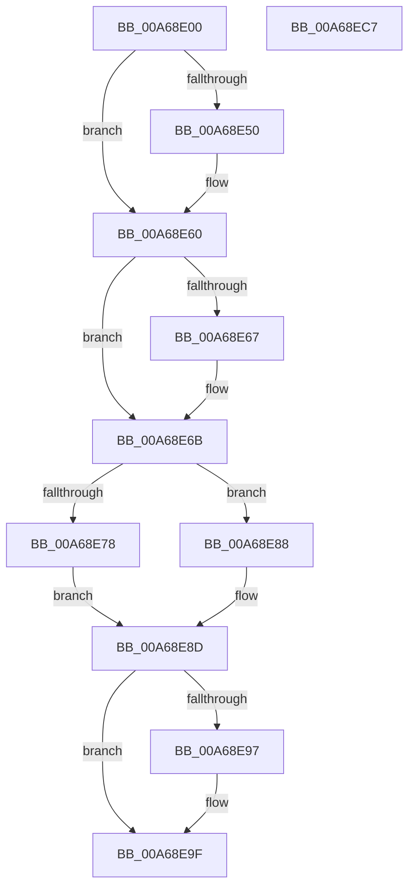

# PsReferencePartitionSystemProcess

- RVA: `0x00A68E00`–`0x00A68EC8` (길이 `200` bytes)
- VA: `0x0000000140A68E00`
- 실행 섹션: `PAGE`
- PDB 이름 있음: `예`; PDB Function 태그: `아니요`
- unwind 정보 RVA: `0x0006B074`
- 디코드: `58`개 명령, `200/200` bytes 표시
- 미해석 바이트: `0` (있으면 어셈블리에 `.byte`로 보존)

> 이 문서는 커널 이미지의 기계어와 PDB 기호를 분석해 생성했습니다. 4번과 5번은 함수 원형과 자료형을 바이너리 사용 방식에서 추정한 C 해석이며 원본 소스 복구 결과는 아닙니다.

## 1. Dependencies

- 직접 호출 지점: **6**; 고유 호출 대상: **6**
- 직접 호출자로 확인된 함수: **1**
- RIP 상대 이미지 참조: **1**

### Outgoing calls
- `0x00A68E3B` → [KeAbPreAcquire](../../text/21/KeAbPreAcquire_function_00210230.md) (function, `0x00210230`)
- `0x00A68E5B` → [ExfAcquirePushLockSharedEx](../../text/21/ExfAcquirePushLockSharedEx_function_0021044C.md) (function, `0x0021044C`)
- `0x00A68E78` → [ObfReferenceObject](../../text/20/ObfReferenceObject_function_0020FA20.md) (function, `0x0020FA20`)
- `0x00A68E9A` → [ExfReleasePushLockShared](../../text/26/ExfReleasePushLockShared_function_00263440.md) (function, `0x00263440`)
- `0x00A68EA2` → [KeAbPostRelease](../../text/2E/KeAbPostRelease_function_002E1600.md) (function, `0x002E1600`)
- `0x00A68EA7` → [KeLeaveCriticalRegion](../../text/25/KeLeaveCriticalRegion_function_0025D8B0.md) (function, `0x0025D8B0`)

### Direct callers
- [ExSwapinWorkerThreads](ExSwapinWorkerThreads_function_00A68C40.md) at `0x00A68CE4`

### Static image references
- `0x00A68E6F` → RVA `0x00FC6C08` (`ALMOSTRO`; read)

## 2. Other-region calls and transfers

- 다른 실행 섹션으로 향하는 call: **6**
  - `0x00A68E3B` → [KeAbPreAcquire](../../text/21/KeAbPreAcquire_function_00210230.md) (`PAGE` → `.text`)
  - `0x00A68E5B` → [ExfAcquirePushLockSharedEx](../../text/21/ExfAcquirePushLockSharedEx_function_0021044C.md) (`PAGE` → `.text`)
  - `0x00A68E78` → [ObfReferenceObject](../../text/20/ObfReferenceObject_function_0020FA20.md) (`PAGE` → `.text`)
  - `0x00A68E9A` → [ExfReleasePushLockShared](../../text/26/ExfReleasePushLockShared_function_00263440.md) (`PAGE` → `.text`)
  - `0x00A68EA2` → [KeAbPostRelease](../../text/2E/KeAbPostRelease_function_002E1600.md) (`PAGE` → `.text`)
  - `0x00A68EA7` → [KeLeaveCriticalRegion](../../text/25/KeLeaveCriticalRegion_function_0025D8B0.md) (`PAGE` → `.text`)
- 별도 외부 분기/꼬리 이동을 확인하지 못했습니다.

## 3. Assembly (complete function range)

```asm
00A68E00  48 89 5C 24 10                  mov qword ptr [rsp + 0x10], rbx
00A68E05  48 89 6C 24 18                  mov qword ptr [rsp + 0x18], rbp
00A68E0A  48 89 74 24 20                  mov qword ptr [rsp + 0x20], rsi
00A68E0F  57                              push rdi
00A68E10  41 56                           push r14
00A68E12  41 57                           push r15
00A68E14  48 83 EC 20                     sub rsp, 0x20
00A68E18  65 48 8B 04 25 88 01 00 00      mov rax, qword ptr gs:[0x188]
00A68E21  48 8D 59 70                     lea rbx, [rcx + 0x70]
00A68E25  4C 8B F2                        mov r14, rdx
00A68E28  48 8B F1                        mov rsi, rcx
00A68E2B  45 33 C0                        xor r8d, r8d
00A68E2E  33 D2                           xor edx, edx
00A68E30  48 8B CB                        mov rcx, rbx
00A68E33  66 FF 88 E4 01 00 00            dec word ptr [rax + 0x1e4]
00A68E3A  90                              nop
00A68E3B  E8 F0 73 7A FF                  call 0x140210230
00A68E40  48 8B F8                        mov rdi, rax
00A68E43  33 C0                           xor eax, eax
00A68E45  44 8D 78 11                     lea r15d, [rax + 0x11]
00A68E49  F0 4C 0F B1 3B                  lock cmpxchg qword ptr [rbx], r15
00A68E4E  74 10                           je 0x140a68e60
00A68E50  4C 8B CB                        mov r9, rbx
00A68E53  4C 8B C7                        mov r8, rdi
00A68E56  33 D2                           xor edx, edx
00A68E58  48 8B CB                        mov rcx, rbx
00A68E5B  E8 EC 75 7A FF                  call 0x14021044c
00A68E60  33 ED                           xor ebp, ebp
00A68E62  48 85 FF                        test rdi, rdi
00A68E65  74 04                           je 0x140a68e6b
00A68E67  C6 47 0A 01                     mov byte ptr [rdi + 0xa], 1
00A68E6B  48 8B 4E 78                     mov rcx, qword ptr [rsi + 0x78]
00A68E6F  48 3B 0D 92 DD 55 00            cmp rcx, qword ptr [rip + 0x55dd92]
00A68E76  74 10                           je 0x140a68e88
00A68E78  E8 A3 6B 7A FF                  call 0x14020fa20
00A68E7D  48 8B 46 78                     mov rax, qword ptr [rsi + 0x78]
00A68E81  8B FD                           mov edi, ebp
00A68E83  49 89 06                        mov qword ptr [r14], rax
00A68E86  EB 05                           jmp 0x140a68e8d
00A68E88  BF A0 04 00 C0                  mov edi, 0xc00004a0
00A68E8D  49 8B C7                        mov rax, r15
00A68E90  F0 48 0F B1 2B                  lock cmpxchg qword ptr [rbx], rbp
00A68E95  74 08                           je 0x140a68e9f
00A68E97  48 8B CB                        mov rcx, rbx
00A68E9A  E8 A1 A5 7F FF                  call 0x140263440
00A68E9F  48 8B CB                        mov rcx, rbx
00A68EA2  E8 59 87 87 FF                  call 0x1402e1600
00A68EA7  E8 04 4A 7F FF                  call 0x14025d8b0
00A68EAC  48 8B 5C 24 48                  mov rbx, qword ptr [rsp + 0x48]
00A68EB1  8B C7                           mov eax, edi
00A68EB3  48 8B 6C 24 50                  mov rbp, qword ptr [rsp + 0x50]
00A68EB8  48 8B 74 24 58                  mov rsi, qword ptr [rsp + 0x58]
00A68EBD  48 83 C4 20                     add rsp, 0x20
00A68EC1  41 5F                           pop r15
00A68EC3  41 5E                           pop r14
00A68EC5  5F                              pop rdi
00A68EC6  C3                              ret
00A68EC7  CC                              int3
```

## 4. C-style interpretation (structured pseudocode)

```c
__int64 __fastcall PsReferencePartitionSystemProcess(__int64 a1, __int64 a2, int a3)
{
    __int64 result;
    __int64 v_rbp;
    __int64 v_rsp;
    unsigned __int64 v_stack_p10;
    unsigned __int64 v_stack_p18;
    unsigned __int64 v_stack_p20;

    v_stack_p10 = v_rbx;
    v_stack_p18 = v_rbp;
    v_stack_p20 = v_rsi;
    v_rsp = (v_rsp) - (32);
    a3 = 0;
    a2 = 0;
    result = KeAbPreAcquire(a1 + 112, a2, a3, a4);
    result = 0;
    if (!(condition_is_equal)) {
        a4 = a1 + 112;
        a3 = 0;
        a2 = 0;
        a1 = a1 + 112;
        result = ExfAcquirePushLockSharedEx(a1, a2, a3, a4);
    }
    v_rbp = 0;
    if (result != 0) {
        *(unsigned __int8 *)(result + 10) = 1;
    }
    if ((*(unsigned __int64 *)(a1 + 120)) == (*(unsigned __int64 *)(v_rip + 5627282))) goto loc_00A68E88;
    result = ObfReferenceObject(*(unsigned __int64 *)(a1 + 120), a2, a3, a4);
    *(unsigned __int64 *)(a2) = *(unsigned __int64 *)(a1 + 120);
    goto loc_00A68E8D;
loc_00A68E88:
loc_00A68E8D:
    result = result + 17;
    if ((*(unsigned __int64 *)(a1 + 120)) != (*(unsigned __int64 *)(v_rip + 5627282))) {
        a1 = a1 + 112;
        result = ExfReleasePushLockShared(a1, a2, a3, a4);
    }
    result = KeAbPostRelease(a1 + 112, a2, a3, a4);
    result = KeLeaveCriticalRegion(a1 + 112, a2, a3, a4);
    v_rsp = (v_rsp) + (32);
    return (unsigned int)((unsigned int)((unsigned int)(0xC00004A0ULL)));
}
```

## 5. (Beta) C Style

```c
int64_t PsReferencePartitionSystemProcess(void *Arg1, void *Arg2, int32_t Arg3)
{
    uint8_t *arg1 = (uint8_t *)Arg1;
    uint8_t *arg2 = (uint8_t *)Arg2;

    int64_t result;
    int64_t local_rbp;
    int64_t local_rsp;
    uint64_t v_stack_p10;
    uint64_t v_stack_p18;
    uint64_t v_stack_p20;

    v_stack_p10 = local_rbx;
    v_stack_p18 = local_rbp;
    v_stack_p20 = local_rsi;
    local_rsp = (local_rsp) - (32);
    Arg3 = 0;
    Arg2 = 0;
    result = KeAbPreAcquire(Arg1 + 112, Arg2, Arg3, a4);
    result = 0;
    if (!(condition_is_equal)) {
        a4 = Arg1 + 112;
        Arg3 = 0;
        Arg2 = 0;
        Arg1 = Arg1 + 112;
        result = ExfAcquirePushLockSharedEx(Arg1, Arg2, Arg3, a4);
    }
    local_rbp = 0;
    if (result != 0) {
        *(uint8_t *)(result + 0xA) = 1;
    }
    if ((*(uint64_t *)(arg1 + 0x78)) == (*(uint64_t *)(v_rip + 0x55DD92))) goto loc_00A68E88;
    result = ObfReferenceObject(*(uint64_t *)(arg1 + 0x78), Arg2, Arg3, a4);
    *(uint64_t *)(arg2) = *(uint64_t *)(arg1 + 0x78);
    goto loc_00A68E8D;
loc_00A68E88:
loc_00A68E8D:
    result = result + 17;
    if ((*(uint64_t *)(arg1 + 0x78)) != (*(uint64_t *)(v_rip + 0x55DD92))) {
        Arg1 = Arg1 + 112;
        result = ExfReleasePushLockShared(Arg1, Arg2, Arg3, a4);
    }
    result = KeAbPostRelease(Arg1 + 112, Arg2, Arg3, a4);
    result = KeLeaveCriticalRegion(Arg1 + 112, Arg2, Arg3, a4);
    local_rsp = (local_rsp) + (32);
    return (uint32_t)((uint32_t)((uint32_t)(0xC00004A0ULL)));
}
```

### 관측된 메모리 오프셋

구조체 형식이 확인되지 않은 접근은 인자 기준의 오프셋으로만 기록했습니다.

| 기준 인자 | 오프셋 표현 | 폭 (bit) | 접근 |
|---|---:|---:|---|
| `Arg1` | `+ 0x0` | `64` | `R` |
| `Arg1` | `+ 0x70` | `64` | `R` |
| `Arg1` | `+ 0x78` | `64` | `R` |
| `Arg2` | `+ 0x0` | `64` | `W` |

## 6. Execution-region graph

[열기: 2D/3D 그래프와 함수 탐색 컨트롤 패널](../../../control-panel.html?section=page&rva=0x00A68E00&view=graph)

- 2D 그래프는 위에서 아래로 흐르고, 3D 그래프는 빈 공간을 드래그해 회전합니다. Shift+드래그는 이동, 휠은 확대·축소, 함수 노드 선택은 대상 보고서 이동입니다.

### Static fallback


