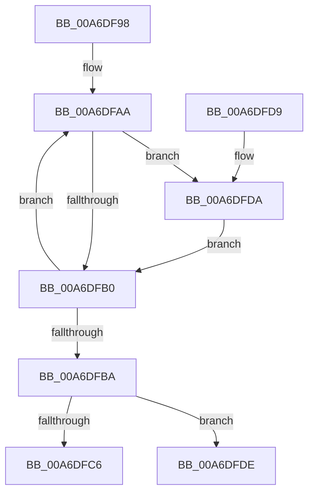

# PspFreeStorage

- RVA: `0x00A6DF98`–`0x00A6DFEC` (길이 `84` bytes)
- VA: `0x0000000140A6DF98`
- 실행 섹션: `PAGE`
- PDB 이름 있음: `예`; PDB Function 태그: `예`
- unwind 정보 RVA: `0x0006F13C`
- 디코드: `25`개 명령, `84/84` bytes 표시
- 미해석 바이트: `0` (있으면 어셈블리에 `.byte`로 보존)

> 이 문서는 커널 이미지의 기계어와 PDB 기호를 분석해 생성했습니다. 4번과 5번은 함수 원형과 자료형을 바이너리 사용 방식에서 추정한 C 해석이며 원본 소스 복구 결과는 아닙니다.

## 1. Dependencies

- 직접 호출 지점: **1**; 고유 호출 대상: **1**
- 직접 호출자로 확인된 함수: **2**
- RIP 상대 이미지 참조: **0**

### Outgoing calls
- `0x00A6DFCE` → [ExFreePoolWithTag](../../poolcode/B8/ExFreePoolWithTag_function_00B82870.md) (function, `0x00B82870`)

### Direct callers
- [PspJobDeleteStorageArrays](PspJobDeleteStorageArrays_function_00A6DF30.md) at `0x00A6DF75`
- [PspCreateSilo](../A8/PspCreateSilo_function_00A89CFC.md) at `0x00A89DE2`

### Static image references
- 디코드된 RIP-relative 메모리 참조가 없습니다.

## 2. Other-region calls and transfers

- 다른 실행 섹션으로 향하는 call: **1**
  - `0x00A6DFCE` → [ExFreePoolWithTag](../../poolcode/B8/ExFreePoolWithTag_function_00B82870.md) (`PAGE` → `POOLCODE`)
- call이 아닌 외부 분기/꼬리 이동: **1**
  - `0x00A6DFE7` → [sub_00B3F508](../B3/Unknown_function_00B3F508.md) (`tail-transfer`)

## 3. Assembly (complete function range)

```asm
00A6DF98  40 53                           push rbx
00A6DF9A  48 83 EC 20                     sub rsp, 0x20
00A6DF9E  48 8B D9                        mov rbx, rcx
00A6DFA1  48 8D 41 08                     lea rax, [rcx + 8]
00A6DFA5  B9 20 00 00 00                  mov ecx, 0x20
00A6DFAA  48 83 38 02                     cmp qword ptr [rax], 2
00A6DFAE  73 2A                           jae 0x140a6dfda
00A6DFB0  48 83 C0 10                     add rax, 0x10
00A6DFB4  48 83 E9 01                     sub rcx, 1
00A6DFB8  75 F0                           jne 0x140a6dfaa
00A6DFBA  48 8B 8B 00 02 00 00            mov rcx, qword ptr [rbx + 0x200]
00A6DFC1  48 85 C9                        test rcx, rcx
00A6DFC4  75 18                           jne 0x140a6dfde
00A6DFC6  BA 50 73 53 74                  mov edx, 0x74537350
00A6DFCB  48 8B CB                        mov rcx, rbx
00A6DFCE  E8 9D 48 11 00                  call 0x140b82870
00A6DFD3  48 83 C4 20                     add rsp, 0x20
00A6DFD7  5B                              pop rbx
00A6DFD8  C3                              ret
00A6DFD9  CC                              int3
00A6DFDA  CD 2C                           int 0x2c
00A6DFDC  EB D2                           jmp 0x140a6dfb0
00A6DFDE  48 8D 41 08                     lea rax, [rcx + 8]
00A6DFE2  BA 00 01 00 00                  mov edx, 0x100
00A6DFE7  E9 1C 15 0D 00                  jmp 0x140b3f508
```

## 4. C-style interpretation (structured pseudocode)

```c
__int64 __fastcall PspFreeStorage(__int64 a1)
{
    __int64 result;
    __int64 v_rsp;

    v_rsp = (v_rsp) - (32);
loc_00A6DFAA:
    if ((*(unsigned __int64 *)(a1 + 8)) >= 2) goto loc_00A6DFDA;
loc_00A6DFB0:
    result = (a1 + 8) + (16);
    a1 = (32) - (1);
    if (condition_is_not_equal) goto loc_00A6DFAA;
    if (*(unsigned __int64 *)(a1 + 512) != 0) goto loc_00A6DFDE;
    result = ExFreePoolWithTag(a1, (unsigned int)(0x74537350ULL), a3, a4);
    v_rsp = (v_rsp) + (32);
    return result;
loc_00A6DFDA:
    goto loc_00A6DFB0;
loc_00A6DFDE:
}
```

## 5. (Beta) C Style

```c
int64_t PspFreeStorage(void *Arg1)
{
    uint8_t *arg1 = (uint8_t *)Arg1;

    int64_t result;
    int64_t local_rsp;

    local_rsp = (local_rsp) - (32);
loc_00A6DFAA:
    if ((*(uint64_t *)(arg1 + 0x8)) >= 2) goto loc_00A6DFDA;
loc_00A6DFB0:
    result = (Arg1 + 8) + (16);
    Arg1 = (32) - (1);
    if (condition_is_not_equal) goto loc_00A6DFAA;
    if (*(uint64_t *)(arg1 + 0x200) != 0) goto loc_00A6DFDE;
    result = ExFreePoolWithTag(Arg1, (uint32_t)(0x74537350ULL), a3, a4);
    local_rsp = (local_rsp) + (32);
    return result;
loc_00A6DFDA:
    goto loc_00A6DFB0;
loc_00A6DFDE:
}
```

### 관측된 메모리 오프셋

구조체 형식이 확인되지 않은 접근은 인자 기준의 오프셋으로만 기록했습니다.

| 기준 인자 | 오프셋 표현 | 폭 (bit) | 접근 |
|---|---:|---:|---|
| `Arg1` | `+ 0x0` | `64` | `R` |
| `Arg1` | `+ 0x8` | `64` | `R` |
| `Arg1` | `+ 0x200` | `64` | `R` |

## 6. Execution-region graph

[열기: 2D/3D 그래프와 함수 탐색 컨트롤 패널](../../../control-panel.html?section=page&rva=0x00A6DF98&view=graph)

- 2D 그래프는 위에서 아래로 흐르고, 3D 그래프는 빈 공간을 드래그해 회전합니다. Shift+드래그는 이동, 휠은 확대·축소, 함수 노드 선택은 대상 보고서 이동입니다.

### Static fallback


