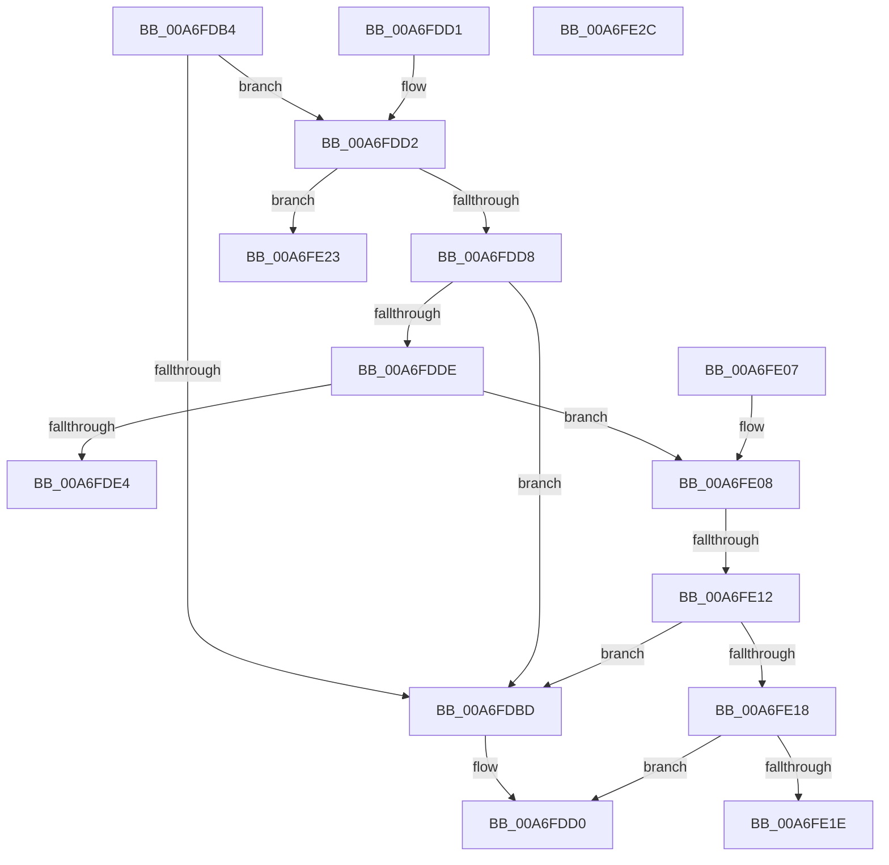

# PspGetJobLockHierarchyForAssignment

- RVA: `0x00A6FDB4`–`0x00A6FE2D` (길이 `121` bytes)
- VA: `0x0000000140A6FDB4`
- 실행 섹션: `PAGE`
- PDB 이름 있음: `예`; PDB Function 태그: `예`
- unwind 정보 RVA: `0x000DB714`
- 디코드: `35`개 명령, `121/121` bytes 표시
- 미해석 바이트: `0` (있으면 어셈블리에 `.byte`로 보존)

> 이 문서는 커널 이미지의 기계어와 PDB 기호를 분석해 생성했습니다. 4번과 5번은 함수 원형과 자료형을 바이너리 사용 방식에서 추정한 C 해석이며 원본 소스 복구 결과는 아닙니다.

## 1. Dependencies

- 직접 호출 지점: **0**; 고유 호출 대상: **0**
- 직접 호출자로 확인된 함수: **1**
- RIP 상대 이미지 참조: **0**

### Outgoing calls
- 직접 디코드된 call 명령이 없습니다.

### Direct callers
- [PspAssignProcessToJob](../A2/PspAssignProcessToJob_function_00A23370.md) at `0x00A23458`

### Static image references
- 디코드된 RIP-relative 메모리 참조가 없습니다.

## 2. Other-region calls and transfers

- 다른 실행 섹션으로 향하는 call: **0**
- call이 아닌 외부 분기/꼬리 이동: **2**
  - `0x00A6FE0C` → `0x00B40108` (`tail-transfer`)
  - `0x00A6FE1E` → `0x00B40108` (`tail-transfer`)

## 3. Assembly (complete function range)

```asm
00A6FDB4  4C 8B D1                        mov r10, rcx
00A6FDB7  41 83 E9 01                     sub r9d, 1
00A6FDBB  75 15                           jne 0x140a6fdd2
00A6FDBD  48 8B 44 24 28                  mov rax, qword ptr [rsp + 0x28]
00A6FDC2  C7 00 01 00 00 00               mov dword ptr [rax], 1
00A6FDC8  4C 89 50 08                     mov qword ptr [rax + 8], r10
00A6FDCC  C6 40 10 01                     mov byte ptr [rax + 0x10], 1
00A6FDD0  C3                              ret
00A6FDD1  CC                              int3
00A6FDD2  41 83 E9 01                     sub r9d, 1
00A6FDD6  74 4B                           je 0x140a6fe23
00A6FDD8  41 83 E9 01                     sub r9d, 1
00A6FDDC  74 DF                           je 0x140a6fdbd
00A6FDDE  41 83 E9 01                     sub r9d, 1
00A6FDE2  75 24                           jne 0x140a6fe08
00A6FDE4  48 8B 4C 24 28                  mov rcx, qword ptr [rsp + 0x28]
00A6FDE9  C7 01 02 00 00 00               mov dword ptr [rcx], 2
00A6FDEF  48 8B 82 A0 02 00 00            mov rax, qword ptr [rdx + 0x2a0]
00A6FDF6  48 89 41 08                     mov qword ptr [rcx + 8], rax
00A6FDFA  C6 41 10 01                     mov byte ptr [rcx + 0x10], 1
00A6FDFE  4C 89 51 18                     mov qword ptr [rcx + 0x18], r10
00A6FE02  44 88 49 20                     mov byte ptr [rcx + 0x20], r9b
00A6FE06  C3                              ret
00A6FE07  CC                              int3
00A6FE08  41 83 E9 01                     sub r9d, 1
00A6FE0C  0F 84 F6 02 0D 00               je 0x140b40108
00A6FE12  41 83 E9 01                     sub r9d, 1
00A6FE16  74 A5                           je 0x140a6fdbd
00A6FE18  41 83 F9 01                     cmp r9d, 1
00A6FE1C  75 B2                           jne 0x140a6fdd0
00A6FE1E  E9 E5 02 0D 00                  jmp 0x140b40108
00A6FE23  48 8B 44 24 28                  mov rax, qword ptr [rsp + 0x28]
00A6FE28  83 20 00                        and dword ptr [rax], 0
00A6FE2B  C3                              ret
00A6FE2C  CC                              int3
```

## 4. C-style interpretation (structured pseudocode)

```c
__int64 __fastcall PspGetJobLockHierarchyForAssignment(__int64 a1, __int64 a2, __int64 a3, int a4, __int64 a5)
{
    a4 = (unsigned int)((a4) - (1));
    if (condition_is_not_equal) goto loc_00A6FDD2;
loc_00A6FDBD:
    *(unsigned int *)(a5) = 1;
    *(unsigned __int64 *)(a5 + 8) = a1;
    *(unsigned __int8 *)(a5 + 16) = 1;
loc_00A6FDD0:
    return a5;
loc_00A6FDD2:
    a4 = (unsigned int)((a4) - (1));
    if (condition_is_equal) goto loc_00A6FE23;
    a4 = (unsigned int)((a4) - (1));
    if (condition_is_equal) goto loc_00A6FDBD;
    a4 = (unsigned int)((a4) - (1));
    if (condition_is_not_equal) goto loc_00A6FE08;
    *(unsigned int *)(a5) = 2;
    *(unsigned __int64 *)(a5 + 8) = *(unsigned __int64 *)(a2 + 672);
    *(unsigned __int8 *)(a5 + 16) = 1;
    *(unsigned __int64 *)(a5 + 24) = a1;
    *(unsigned __int8 *)(a5 + 32) = (unsigned __int8)(a4);
    return *(unsigned __int64 *)(a2 + 672);
loc_00A6FE08:
    a4 = (unsigned int)((a4) - (1));
    a4 = (unsigned int)((a4) - (1));
    if (condition_is_equal) goto loc_00A6FDBD;
    if (a4 != 1) goto loc_00A6FDD0;
loc_00A6FE23:
    return a5;
}
```

## 5. (Beta) C Style

```c
void *PspGetJobLockHierarchyForAssignment(int64_t Arg1, void *Arg2, int64_t Arg3, int32_t Arg4, void *Arg5)
{
    uint8_t *arg2 = (uint8_t *)Arg2;
    uint8_t *arg5 = (uint8_t *)Arg5;

    Arg4 = (uint32_t)((Arg4) - (1));
    if (condition_is_not_equal) goto loc_00A6FDD2;
loc_00A6FDBD:
    *(uint32_t *)(arg5) = 1;
    *(uint64_t *)(arg5 + 0x8) = Arg1;
    *(uint8_t *)(arg5 + 0x10) = 1;
loc_00A6FDD0:
    return Arg5;
loc_00A6FDD2:
    Arg4 = (uint32_t)((Arg4) - (1));
    if (condition_is_equal) goto loc_00A6FE23;
    Arg4 = (uint32_t)((Arg4) - (1));
    if (condition_is_equal) goto loc_00A6FDBD;
    Arg4 = (uint32_t)((Arg4) - (1));
    if (condition_is_not_equal) goto loc_00A6FE08;
    *(uint32_t *)(arg5) = 2;
    *(uint64_t *)(arg5 + 0x8) = *(uint64_t *)(arg2 + 0x2A0);
    *(uint8_t *)(arg5 + 0x10) = 1;
    *(uint64_t *)(arg5 + 0x18) = Arg1;
    *(uint8_t *)(arg5 + 0x20) = (uint8_t)(Arg4);
    return *(uint64_t *)(arg2 + 0x2A0);
loc_00A6FE08:
    Arg4 = (uint32_t)((Arg4) - (1));
    Arg4 = (uint32_t)((Arg4) - (1));
    if (condition_is_equal) goto loc_00A6FDBD;
    if (Arg4 != 1) goto loc_00A6FDD0;
loc_00A6FE23:
    return Arg5;
}
```

### 관측된 메모리 오프셋

구조체 형식이 확인되지 않은 접근은 인자 기준의 오프셋으로만 기록했습니다.

| 기준 인자 | 오프셋 표현 | 폭 (bit) | 접근 |
|---|---:|---:|---|
| `Arg2` | `+ 0x2A0` | `64` | `R` |
| `Arg5` | `+ 0x0` | `32` | `R/W` |
| `Arg5` | `+ 0x0` | `32` | `W` |
| `Arg5` | `+ 0x8` | `64` | `W` |
| `Arg5` | `+ 0x10` | `8` | `W` |
| `Arg5` | `+ 0x18` | `64` | `W` |
| `Arg5` | `+ 0x20` | `8` | `W` |

## 6. Execution-region graph

[열기: 2D/3D 그래프와 함수 탐색 컨트롤 패널](../../../control-panel.html?section=page&rva=0x00A6FDB4&view=graph)

- 2D 그래프는 위에서 아래로 흐르고, 3D 그래프는 빈 공간을 드래그해 회전합니다. Shift+드래그는 이동, 휠은 확대·축소, 함수 노드 선택은 대상 보고서 이동입니다.

### Static fallback


