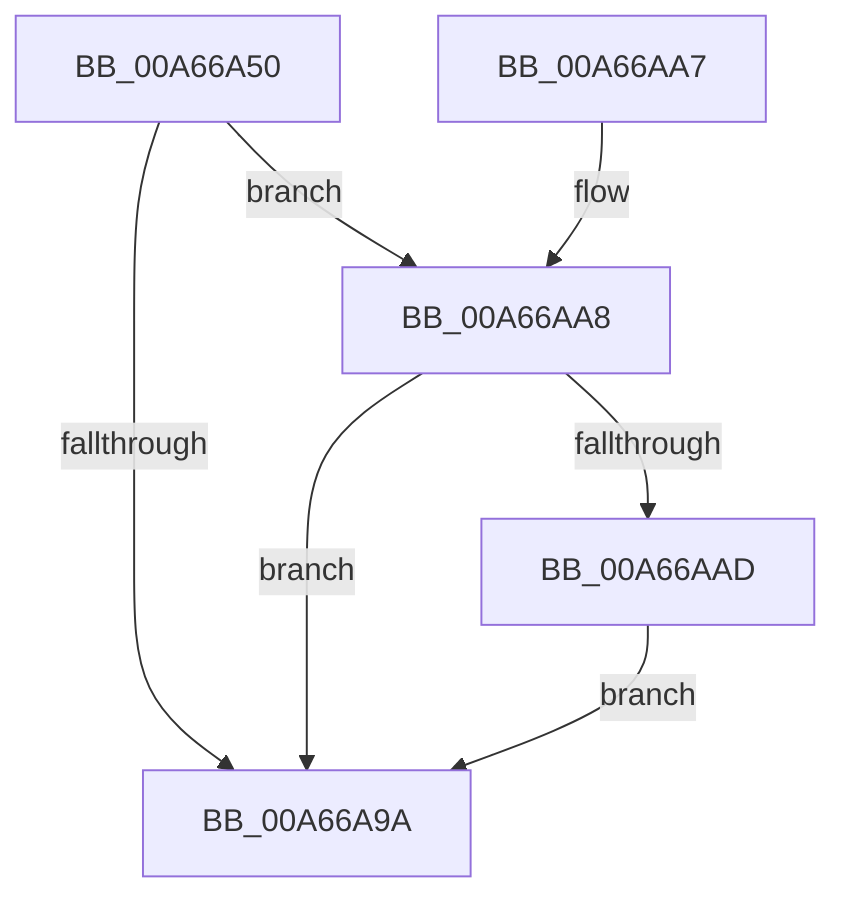

# PspGetProcessParameterOverrides

- RVA: `0x00A66A50`–`0x00A66AB9` (길이 `105` bytes)
- VA: `0x0000000140A66A50`
- 실행 섹션: `PAGE`
- PDB 이름 있음: `예`; PDB Function 태그: `아니요`
- unwind 정보 RVA: `0x000B3A64`
- 디코드: `28`개 명령, `105/105` bytes 표시
- 미해석 바이트: `0` (있으면 어셈블리에 `.byte`로 보존)

> 이 문서는 커널 이미지의 기계어와 PDB 기호를 분석해 생성했습니다. 4번과 5번은 함수 원형과 자료형을 바이너리 사용 방식에서 추정한 C 해석이며 원본 소스 복구 결과는 아닙니다.

## 1. Dependencies

- 직접 호출 지점: **2**; 고유 호출 대상: **2**
- 직접 호출자로 확인된 함수: **1**
- RIP 상대 이미지 참조: **1**

### Outgoing calls
- `0x00A66A84` → `ext-ms-win-ntos-processparameters-l1-1-0.dll!PsGetProcessParameterOverrides` (import, 간접 대상; import `ext-ms-win-ntos-processparameters-l1-1-0.dll!PsGetProcessParameterOverrides`)
- `0x00A66AB0` → [PspDestroyProcessParameterOverrides](../9F/PspDestroyProcessParameterOverrides_function_009F0D00.md) (function, `0x009F0D00`)

### Direct callers
- [NtCreateUserProcess](../AE/NtCreateUserProcess_function_00AEA680.md) at `0x00AEB0C3`

### Static image references
- `0x00A66A84` → RVA `0x00151340` (`ext-ms-win-ntos-processparameters-l1-1-0.dll!PsGetProcessParameterOverrides (IAT)`; read)

## 2. Other-region calls and transfers

- 다른 실행 섹션으로 향하는 call: **0**
- 별도 외부 분기/꼬리 이동을 확인하지 못했습니다.

## 3. Assembly (complete function range)

```asm
00A66A50  4C 8B DC                        mov r11, rsp
00A66A53  53                              push rbx
00A66A54  48 83 EC 40                     sub rsp, 0x40
00A66A58  83 64 24 24 00                  and dword ptr [rsp + 0x24], 0
00A66A5D  48 8D 81 F0 00 00 00            lea rax, [rcx + 0xf0]
00A66A64  49 83 63 08 00                  and qword ptr [r11 + 8], 0
00A66A69  48 8B D9                        mov rbx, rcx
00A66A6C  C7 44 24 20 01 00 00 00         mov dword ptr [rsp + 0x20], 1
00A66A74  49 8D 4B D8                     lea rcx, [r11 - 0x28]
00A66A78  49 89 53 E8                     mov qword ptr [r11 - 0x18], rdx
00A66A7C  49 8D 53 08                     lea rdx, [r11 + 8]
00A66A80  49 89 43 E0                     mov qword ptr [r11 - 0x20], rax
00A66A84  48 FF 15 B5 A8 6E FF            call qword ptr [rip - 0x91574b]
00A66A8B  0F 1F 44 00 00                  nop dword ptr [rax + rax]
00A66A90  48 8B 44 24 50                  mov rax, qword ptr [rsp + 0x50]
00A66A95  48 85 C0                        test rax, rax
00A66A98  75 0E                           jne 0x140a66aa8
00A66A9A  48 89 83 D8 01 00 00            mov qword ptr [rbx + 0x1d8], rax
00A66AA1  48 83 C4 40                     add rsp, 0x40
00A66AA5  5B                              pop rbx
00A66AA6  C3                              ret
00A66AA7  CC                              int3
00A66AA8  83 38 02                        cmp dword ptr [rax], 2
00A66AAB  74 ED                           je 0x140a66a9a
00A66AAD  48 8B C8                        mov rcx, rax
00A66AB0  E8 4B A2 F8 FF                  call 0x1409f0d00
00A66AB5  33 C0                           xor eax, eax
00A66AB7  EB E1                           jmp 0x140a66a9a
```

## 4. C-style interpretation (structured pseudocode)

```c
__int64 __fastcall PspGetProcessParameterOverrides(__int64 a1, __int64 a2)
{
    __int64 result;
    __int64 v_rsp;
    unsigned int v_stack_m24;
    unsigned int v_stack_m28;
    unsigned __int64 v_stack_p8;

    v_rsp = (v_rsp) - (64);
    v_stack_m28 = 1;
    *(unsigned __int64 *)(v_rsp - 24) = a2;
    *(unsigned __int64 *)(v_rsp - 32) = a1 + 240;
    result = ext_ms_win_ntos_processparameters_l1_1_0_dll_PsGetProcessParameterOverrides(v_rsp - 40, v_rsp + 8, a3, a4);
    if (v_stack_p8 != 0) goto loc_00A66AA8;
loc_00A66A9A:
    *(unsigned __int64 *)(a1 + 472) = v_stack_p8;
    v_rsp = (v_rsp) + (64);
    return v_stack_p8;
loc_00A66AA8:
    if ((*(unsigned int *)(v_stack_p8)) == 2) goto loc_00A66A9A;
    result = PspDestroyProcessParameterOverrides(v_stack_p8, v_rsp + 8, a3, a4);
    result = 0;
    goto loc_00A66A9A;
}
```

## 5. (Beta) C Style

```c
int64_t PspGetProcessParameterOverrides(void *Arg1, int64_t Arg2)
{
    uint8_t *arg1 = (uint8_t *)Arg1;

    int64_t result;
    int64_t local_rsp;
    uint32_t v_stack_m24;
    uint32_t v_stack_m28;
    uint64_t v_stack_p8;

    local_rsp = (local_rsp) - (64);
    v_stack_m28 = 1;
    *(uint64_t *)(local_rsp - 0x18) = Arg2;
    *(void **)(local_rsp - 0x20) = Arg1 + 240;
    result = kernel_indirect_call(local_rsp - 40, local_rsp + 8, a3, a4);
    if (v_stack_p8 != 0) goto loc_00A66AA8;
loc_00A66A9A:
    *(uint64_t *)(arg1 + 0x1D8) = v_stack_p8;
    local_rsp = (local_rsp) + (64);
    return v_stack_p8;
loc_00A66AA8:
    if ((*(uint32_t *)(v_stack_p8)) == 2) goto loc_00A66A9A;
    result = PspDestroyProcessParameterOverrides(v_stack_p8, local_rsp + 8, a3, a4);
    result = 0;
    goto loc_00A66A9A;
}
```

### 관측된 메모리 오프셋

구조체 형식이 확인되지 않은 접근은 인자 기준의 오프셋으로만 기록했습니다.

| 기준 인자 | 오프셋 표현 | 폭 (bit) | 접근 |
|---|---:|---:|---|
| `Arg1` | `+ 0xF0` | `64` | `R` |
| `Arg1` | `+ 0x1D8` | `64` | `W` |

## 6. Execution-region graph

[열기: 2D/3D 그래프와 함수 탐색 컨트롤 패널](../../../control-panel.html?section=page&rva=0x00A66A50&view=graph)

- 2D 그래프는 위에서 아래로 흐르고, 3D 그래프는 빈 공간을 드래그해 회전합니다. Shift+드래그는 이동, 휠은 확대·축소, 함수 노드 선택은 대상 보고서 이동입니다.

### Static fallback


