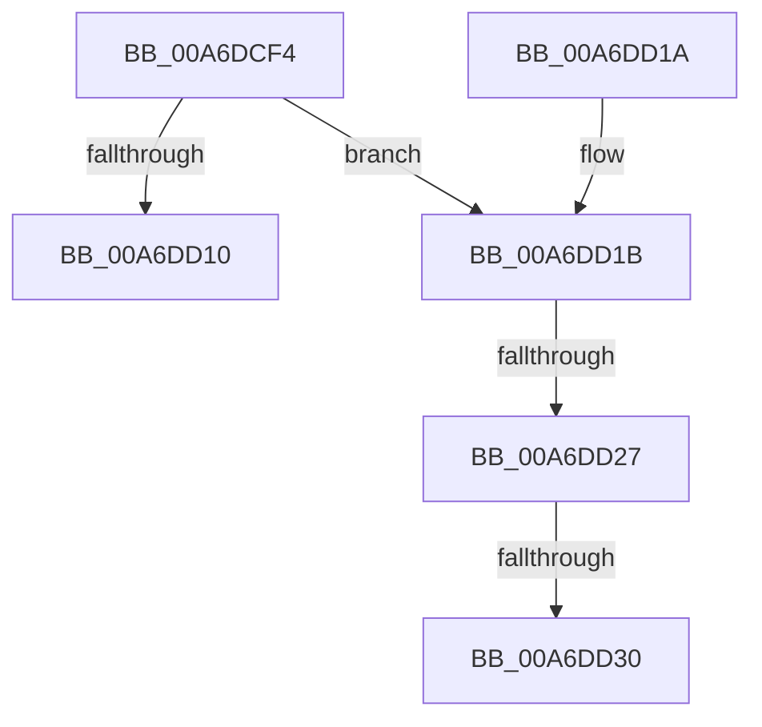

# PspGetProcessProtectionRequirementsFromImage

- RVA: `0x00A6DCF4`–`0x00A6DD4A` (길이 `86` bytes)
- VA: `0x0000000140A6DCF4`
- 실행 섹션: `PAGE`
- PDB 이름 있음: `예`; PDB Function 태그: `예`
- unwind 정보 RVA: `0x00078414`
- 디코드: `26`개 명령, `86/86` bytes 표시
- 미해석 바이트: `0` (있으면 어셈블리에 `.byte`로 보존)

> 이 문서는 커널 이미지의 기계어와 PDB 기호를 분석해 생성했습니다. 4번과 5번은 함수 원형과 자료형을 바이너리 사용 방식에서 추정한 C 해석이며 원본 소스 복구 결과는 아닙니다.

## 1. Dependencies

- 직접 호출 지점: **2**; 고유 호출 대상: **2**
- 직접 호출자로 확인된 함수: **2**
- RIP 상대 이미지 참조: **0**

### Outgoing calls
- `0x00A6DCFF` → [MiSectionControlArea](../../text/29/MiSectionControlArea_function_00294CB0.md) (function, `0x00294CB0`)
- `0x00A6DD36` → [RtlTestProtectedAccess](../A1/RtlTestProtectedAccess_function_00A100C8.md) (function, `0x00A100C8`)

### Direct callers
- [PspCreateProcess](../A1/PspCreateProcess_function_00A12758.md) at `0x00A12AF9`
- [NtCreateUserProcess](../AE/NtCreateUserProcess_function_00AEA680.md) at `0x00AEAF69`

### Static image references
- 디코드된 RIP-relative 메모리 참조가 없습니다.

## 2. Other-region calls and transfers

- 다른 실행 섹션으로 향하는 call: **1**
  - `0x00A6DCFF` → [MiSectionControlArea](../../text/29/MiSectionControlArea_function_00294CB0.md) (`PAGE` → `.text`)
- call이 아닌 외부 분기/꼬리 이동: **3**
  - `0x00A6DD21` → [sub_00B3F500](../B3/Unknown_function_00B3F500.md) (`tail-transfer`)
  - `0x00A6DD2A` → [sub_00B3F500](../B3/Unknown_function_00B3F500.md) (`tail-transfer`)
  - `0x00A6DD45` → [sub_00B3F500](../B3/Unknown_function_00B3F500.md) (`tail-transfer`)

## 3. Assembly (complete function range)

```asm
00A6DCF4  48 83 EC 28                     sub rsp, 0x28
00A6DCF8  4D 8B D8                        mov r11, r8
00A6DCFB  44 0F B6 D2                     movzx r10d, dl
00A6DCFF  E8 AC 6F 82 FF                  call 0x140294cb0
00A6DD04  48 8B 00                        mov rax, qword ptr [rax]
00A6DD07  8A 40 0F                        mov al, byte ptr [rax + 0xf]
00A6DD0A  24 0F                           and al, 0xf
00A6DD0C  3C 05                           cmp al, 5
00A6DD0E  74 0B                           je 0x140a6dd1b
00A6DD10  45 88 13                        mov byte ptr [r11], r10b
00A6DD13  33 C0                           xor eax, eax
00A6DD15  48 83 C4 28                     add rsp, 0x28
00A6DD19  C3                              ret
00A6DD1A  CC                              int3
00A6DD1B  41 B1 81                        mov r9b, 0x81
00A6DD1E  45 84 D2                        test r10b, r10b
00A6DD21  0F 84 D9 17 0D 00               je 0x140b3f500
00A6DD27  45 3A D1                        cmp r10b, r9b
00A6DD2A  0F 84 D0 17 0D 00               je 0x140b3f500
00A6DD30  41 8A D1                        mov dl, r9b
00A6DD33  41 8A CA                        mov cl, r10b
00A6DD36  E8 8D 23 FA FF                  call 0x140a100c8
00A6DD3B  84 C0                           test al, al
00A6DD3D  45 0F B6 C9                     movzx r9d, r9b
00A6DD41  45 0F 45 CA                     cmovne r9d, r10d
00A6DD45  E9 B6 17 0D 00                  jmp 0x140b3f500
```

## 4. C-style interpretation (structured pseudocode)

```c
__int64 __fastcall PspGetProcessProtectionRequirementsFromImage(__int64 a1, unsigned __int8 a2, __int64 a3)
{
    __int64 result;
    __int64 v_rsp;

    v_rsp = (v_rsp) - (40);
    result = MiSectionControlArea(a1, a2, a3, a4);
    result = (unsigned __int8)((*(unsigned __int8 *)(*(unsigned __int64 *)(result) + 15)) & (15));
    if (((unsigned __int8)(result)) == 5) goto loc_00A6DD1B;
    *(unsigned __int8 *)(a3) = a2;
    result = 0;
    v_rsp = (v_rsp) + (40);
    return result;
loc_00A6DD1B:
    result = RtlTestProtectedAccess(a2, 129, a3, 129);
    a4 = 129;
    if ((unsigned __int8)(result) != 0) { a4 = a2; }
}
```

## 5. (Beta) C Style

```c
int64_t PspGetProcessProtectionRequirementsFromImage(int64_t Arg1, uint8_t Arg2, int64_t Arg3)
{
    int64_t result;
    int64_t local_rsp;

    local_rsp = (local_rsp) - (40);
    result = MiSectionControlArea(Arg1, Arg2, Arg3, a4);
    result = (uint8_t)((*(uint8_t *)(*(uint64_t *)(result) + 0xF)) & (15));
    if (((uint8_t)(result)) == 5) goto loc_00A6DD1B;
    *(uint8_t *)(Arg3) = Arg2;
    result = 0;
    local_rsp = (local_rsp) + (40);
    return result;
loc_00A6DD1B:
    result = RtlTestProtectedAccess(Arg2, 129, Arg3, 129);
    a4 = 129;
    if ((uint8_t)(result) != 0) { a4 = Arg2; }
}
```

## 6. Execution-region graph

[열기: 2D/3D 그래프와 함수 탐색 컨트롤 패널](../../../control-panel.html?section=page&rva=0x00A6DCF4&view=graph)

- 2D 그래프는 위에서 아래로 흐르고, 3D 그래프는 빈 공간을 드래그해 회전합니다. Shift+드래그는 이동, 휠은 확대·축소, 함수 노드 선택은 대상 보고서 이동입니다.

### Static fallback


