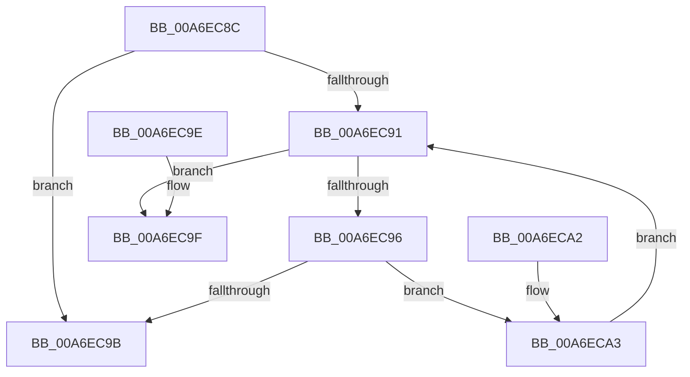

# PspIsSiloInSilo

- RVA: `0x00A6EC8C`–`0x00A6ECAC` (길이 `32` bytes)
- VA: `0x0000000140A6EC8C`
- 실행 섹션: `PAGE`
- PDB 이름 있음: `예`; PDB Function 태그: `아니요`
- unwind 정보 RVA: `0x000DB714`
- 디코드: `14`개 명령, `32/32` bytes 표시
- 미해석 바이트: `0` (있으면 어셈블리에 `.byte`로 보존)

> 이 문서는 커널 이미지의 기계어와 PDB 기호를 분석해 생성했습니다. 4번과 5번은 함수 원형과 자료형을 바이너리 사용 방식에서 추정한 C 해석이며 원본 소스 복구 결과는 아닙니다.

## 1. Dependencies

- 직접 호출 지점: **0**; 고유 호출 대상: **0**
- 직접 호출자로 확인된 함수: **5**
- RIP 상대 이미지 참조: **0**

### Outgoing calls
- 직접 디코드된 call 명령이 없습니다.

### Direct callers
- [PsIsThreadInSilo](../../text/41/PsIsThreadInSilo_function_0041859C.md) at `0x004185CB`
- [PsIsProcessInSilo](../../text/41/PsIsProcessInSilo_function_004185E0.md) at `0x00418612`
- [PsRootSiloInformation](../77/PsRootSiloInformation_function_0077F510.md) at `0x0077F578`
- [NtCreateUserProcess](../AE/NtCreateUserProcess_function_00AEA680.md) at `0x00AEAA91`
- [sub_00B1B2E4](../B1/Unknown_function_00B1B2E4.md) at `0x00B1B67F`

### Static image references
- 디코드된 RIP-relative 메모리 참조가 없습니다.

## 2. Other-region calls and transfers

- 다른 실행 섹션으로 향하는 call: **0**
- 별도 외부 분기/꼬리 이동을 확인하지 못했습니다.

## 3. Assembly (complete function range)

```asm
00A6EC8C  48 85 D2                        test rdx, rdx
00A6EC8F  74 0A                           je 0x140a6ec9b
00A6EC91  48 85 C9                        test rcx, rcx
00A6EC94  74 09                           je 0x140a6ec9f
00A6EC96  48 3B CA                        cmp rcx, rdx
00A6EC99  75 08                           jne 0x140a6eca3
00A6EC9B  B0 01                           mov al, 1
00A6EC9D  C3                              ret
00A6EC9E  CC                              int3
00A6EC9F  32 C0                           xor al, al
00A6ECA1  C3                              ret
00A6ECA2  CC                              int3
00A6ECA3  48 8B 89 18 05 00 00            mov rcx, qword ptr [rcx + 0x518]
00A6ECAA  EB E5                           jmp 0x140a6ec91
```

## 4. C-style interpretation (structured pseudocode)

```c
__int64 __fastcall PspIsSiloInSilo(__int64 a1, __int64 a2)
{
    __int64 result;

    if (a2 == 0) goto loc_00A6EC9B;
loc_00A6EC91:
    if (a1 == 0) goto loc_00A6EC9F;
    if (a1 != a2) goto loc_00A6ECA3;
loc_00A6EC9B:
    return 1;
loc_00A6EC9F:
    result = 0;
    return result;
loc_00A6ECA3:
    goto loc_00A6EC91;
}
```

## 5. (Beta) C Style

```c
int64_t PspIsSiloInSilo(int64_t Arg1, int64_t Arg2)
{
    int64_t result;

    if (Arg2 == 0) goto loc_00A6EC9B;
loc_00A6EC91:
    if (Arg1 == 0) goto loc_00A6EC9F;
    if (Arg1 != Arg2) goto loc_00A6ECA3;
loc_00A6EC9B:
    return 1;
loc_00A6EC9F:
    result = 0;
    return result;
loc_00A6ECA3:
    goto loc_00A6EC91;
}
```

## 6. Execution-region graph

[열기: 2D/3D 그래프와 함수 탐색 컨트롤 패널](../../../control-panel.html?section=page&rva=0x00A6EC8C&view=graph)

- 2D 그래프는 위에서 아래로 흐르고, 3D 그래프는 빈 공간을 드래그해 회전합니다. Shift+드래그는 이동, 휠은 확대·축소, 함수 노드 선택은 대상 보고서 이동입니다.

### Static fallback


