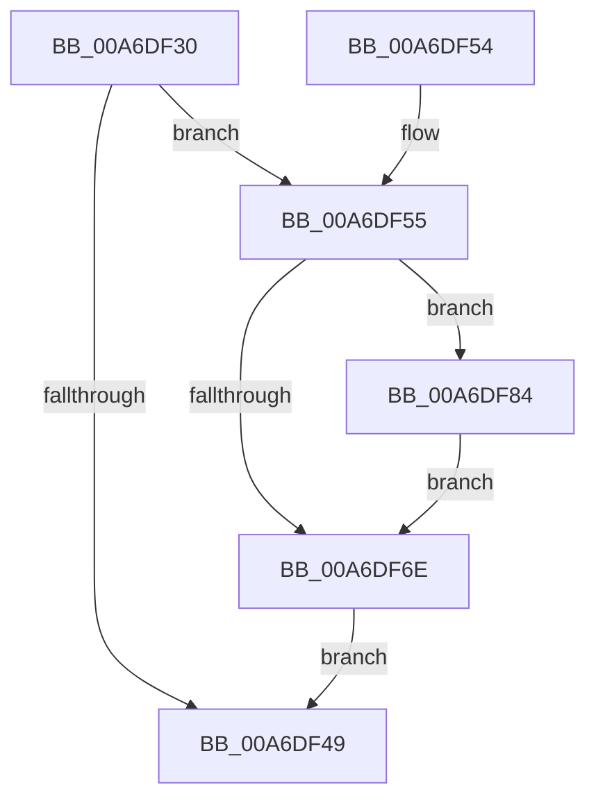

# PspJobDeleteStorageArrays

- RVA: `0x00A6DF30`–`0x00A6DF90` (길이 `96` bytes)
- VA: `0x0000000140A6DF30`
- 실행 섹션: `PAGE`
- PDB 이름 있음: `예`; PDB Function 태그: `아니요`
- unwind 정보 RVA: `0x00069D3C`
- 디코드: `25`개 명령, `96/96` bytes 표시
- 미해석 바이트: `0` (있으면 어셈블리에 `.byte`로 보존)

> 이 문서는 커널 이미지의 기계어와 PDB 기호를 분석해 생성했습니다. 4번과 5번은 함수 원형과 자료형을 바이너리 사용 방식에서 추정한 C 해석이며 원본 소스 복구 결과는 아닙니다.

## 1. Dependencies

- 직접 호출 지점: **3**; 고유 호출 대상: **2**
- 직접 호출자로 확인된 함수: **1**
- RIP 상대 이미지 참조: **0**

### Outgoing calls
- `0x00A6DF5D` → [PspStorageEmptyArray](PspStorageEmptyArray_function_00A6DFF4.md) (function, `0x00A6DFF4`)
- `0x00A6DF75` → [PspFreeStorage](PspFreeStorage_function_00A6DF98.md) (function, `0x00A6DF98`)
- `0x00A6DF89` → [PspStorageEmptyArray](PspStorageEmptyArray_function_00A6DFF4.md) (function, `0x00A6DFF4`)

### Direct callers
- [PspJobDelete](../../text/4B/PspJobDelete_function_004BF8F0.md) at `0x004BF959`

### Static image references
- 디코드된 RIP-relative 메모리 참조가 없습니다.

## 2. Other-region calls and transfers

- 다른 실행 섹션으로 향하는 call: **0**
- 별도 외부 분기/꼬리 이동을 확인하지 못했습니다.

## 3. Assembly (complete function range)

```asm
00A6DF30  48 89 5C 24 08                  mov qword ptr [rsp + 8], rbx
00A6DF35  57                              push rdi
00A6DF36  48 83 EC 20                     sub rsp, 0x20
00A6DF3A  48 8B B9 00 06 00 00            mov rdi, qword ptr [rcx + 0x600]
00A6DF41  48 8B D9                        mov rbx, rcx
00A6DF44  48 85 FF                        test rdi, rdi
00A6DF47  75 0C                           jne 0x140a6df55
00A6DF49  48 8B 5C 24 30                  mov rbx, qword ptr [rsp + 0x30]
00A6DF4E  48 83 C4 20                     add rsp, 0x20
00A6DF52  5F                              pop rdi
00A6DF53  C3                              ret
00A6DF54  CC                              int3
00A6DF55  BA 20 00 00 00                  mov edx, 0x20
00A6DF5A  48 8B CF                        mov rcx, rdi
00A6DF5D  E8 92 00 00 00                  call 0x140a6dff4
00A6DF62  48 8B 8F 00 02 00 00            mov rcx, qword ptr [rdi + 0x200]
00A6DF69  48 85 C9                        test rcx, rcx
00A6DF6C  75 16                           jne 0x140a6df84
00A6DF6E  48 8B 8B 00 06 00 00            mov rcx, qword ptr [rbx + 0x600]
00A6DF75  E8 1E 00 00 00                  call 0x140a6df98
00A6DF7A  48 83 A3 00 06 00 00 00         and qword ptr [rbx + 0x600], 0
00A6DF82  EB C5                           jmp 0x140a6df49
00A6DF84  BA 00 01 00 00                  mov edx, 0x100
00A6DF89  E8 66 00 00 00                  call 0x140a6dff4
00A6DF8E  EB DE                           jmp 0x140a6df6e
```

## 4. C-style interpretation (structured pseudocode)

```c
__int64 __fastcall PspJobDeleteStorageArrays(__int64 a1)
{
    __int64 result;
    __int64 v_rsp;
    unsigned __int64 v_stack_p8;

    v_stack_p8 = v_rbx;
    v_rsp = (v_rsp) - (32);
    if (*(unsigned __int64 *)(a1 + 1536) != 0) goto loc_00A6DF55;
loc_00A6DF49:
    v_rsp = (v_rsp) + (32);
    return result;
loc_00A6DF55:
    result = PspStorageEmptyArray(*(unsigned __int64 *)(a1 + 1536), 32, a3, a4);
    if (*(unsigned __int64 *)(*(unsigned __int64 *)(a1 + 1536) + 512) != 0) goto loc_00A6DF84;
loc_00A6DF6E:
    result = PspFreeStorage(*(unsigned __int64 *)(v_stack_p8 + 1536), 32, a3, a4);
    goto loc_00A6DF49;
loc_00A6DF84:
    result = PspStorageEmptyArray(*(unsigned __int64 *)(v_stack_p8 + 1536), 256, a3, a4);
    goto loc_00A6DF6E;
}
```

## 5. (Beta) C Style

```c
int64_t PspJobDeleteStorageArrays(void *Arg1)
{
    uint8_t *arg1 = (uint8_t *)Arg1;

    int64_t result;
    int64_t local_rsp;
    uint64_t v_stack_p8;

    v_stack_p8 = local_rbx;
    local_rsp = (local_rsp) - (32);
    if (*(uint64_t *)(arg1 + 0x600) != 0) goto loc_00A6DF55;
loc_00A6DF49:
    local_rsp = (local_rsp) + (32);
    return result;
loc_00A6DF55:
    result = PspStorageEmptyArray(*(uint64_t *)(arg1 + 0x600), 32, a3, a4);
    if (*(uint64_t *)(*(uint64_t *)(arg1 + 0x600) + 0x200) != 0) goto loc_00A6DF84;
loc_00A6DF6E:
    result = PspFreeStorage(*(uint64_t *)(v_stack_p8 + 0x600), 32, a3, a4);
    goto loc_00A6DF49;
loc_00A6DF84:
    result = PspStorageEmptyArray(*(uint64_t *)(v_stack_p8 + 0x600), 256, a3, a4);
    goto loc_00A6DF6E;
}
```

### 관측된 메모리 오프셋

구조체 형식이 확인되지 않은 접근은 인자 기준의 오프셋으로만 기록했습니다.

| 기준 인자 | 오프셋 표현 | 폭 (bit) | 접근 |
|---|---:|---:|---|
| `Arg1` | `+ 0x600` | `64` | `R` |
| `Arg1` | `+ 0x600` | `64` | `R/W` |

## 6. Execution-region graph

[열기: 2D/3D 그래프와 함수 탐색 컨트롤 패널](../../../control-panel.html?section=page&rva=0x00A6DF30&view=graph)

- 2D 그래프는 위에서 아래로 흐르고, 3D 그래프는 빈 공간을 드래그해 회전합니다. Shift+드래그는 이동, 휠은 확대·축소, 함수 노드 선택은 대상 보고서 이동입니다.

### Static fallback


