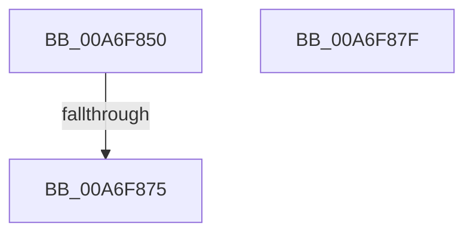

# PspMapSiloSharedDataView

- RVA: `0x00A6F850`–`0x00A6F880` (길이 `48` bytes)
- VA: `0x0000000140A6F850`
- 실행 섹션: `PAGE`
- PDB 이름 있음: `예`; PDB Function 태그: `예`
- unwind 정보 RVA: `0x000B4E40`
- 디코드: `19`개 명령, `48/48` bytes 표시
- 미해석 바이트: `0` (있으면 어셈블리에 `.byte`로 보존)

> 이 문서는 커널 이미지의 기계어와 PDB 기호를 분석해 생성했습니다. 4번과 5번은 함수 원형과 자료형을 바이너리 사용 방식에서 추정한 C 해석이며 원본 소스 복구 결과는 아닙니다.

## 1. Dependencies

- 직접 호출 지점: **2**; 고유 호출 대상: **2**
- 직접 호출자로 확인된 함수: **2**
- RIP 상대 이미지 참조: **0**

### Outgoing calls
- `0x00A6F85B` → [PsGetProcessServerSilo](../../text/44/PsGetProcessServerSilo_function_0044BEE0.md) (function, `0x0044BEE0`)
- `0x00A6F866` → [PsIsHostSilo](../../text/44/PsIsHostSilo_function_00443B30.md) (function, `0x00443B30`)

### Direct callers
- [PspAllocateProcess](../A1/PspAllocateProcess_function_00A13B3C.md) at `0x00A1610F`
- [PspSetupUserProcessAddressSpace](../AE/PspSetupUserProcessAddressSpace_function_00AEBDC8.md) at `0x00AEC026`

### Static image references
- 디코드된 RIP-relative 메모리 참조가 없습니다.

## 2. Other-region calls and transfers

- 다른 실행 섹션으로 향하는 call: **2**
  - `0x00A6F85B` → [PsGetProcessServerSilo](../../text/44/PsGetProcessServerSilo_function_0044BEE0.md) (`PAGE` → `.text`)
  - `0x00A6F866` → [PsIsHostSilo](../../text/44/PsIsHostSilo_function_00443B30.md) (`PAGE` → `.text`)
- call이 아닌 외부 분기/꼬리 이동: **1**
  - `0x00A6F86F` → [sub_00B4005A](../B4/Unknown_function_00B4005A.md) (`tail-transfer`)

## 3. Assembly (complete function range)

```asm
00A6F850  40 53                           push rbx
00A6F852  56                              push rsi
00A6F853  57                              push rdi
00A6F854  48 83 EC 50                     sub rsp, 0x50
00A6F858  48 8B F9                        mov rdi, rcx
00A6F85B  E8 80 C6 9D FF                  call 0x14044bee0
00A6F860  48 8B F0                        mov rsi, rax
00A6F863  48 8B C8                        mov rcx, rax
00A6F866  E8 C5 42 9D FF                  call 0x140443b30
00A6F86B  33 DB                           xor ebx, ebx
00A6F86D  84 C0                           test al, al
00A6F86F  0F 84 E5 07 0D 00               je 0x140b4005a
00A6F875  33 C0                           xor eax, eax
00A6F877  48 83 C4 50                     add rsp, 0x50
00A6F87B  5F                              pop rdi
00A6F87C  5E                              pop rsi
00A6F87D  5B                              pop rbx
00A6F87E  C3                              ret
00A6F87F  CC                              int3
```

## 4. C-style interpretation (structured pseudocode)

```c
__int64 __fastcall PspMapSiloSharedDataView(__int64 a1)
{
    __int64 result;
    __int64 v_rbx;
    __int64 v_rsp;

    v_rsp = (v_rsp) - (80);
    result = PsGetProcessServerSilo(a1, a2, a3, a4);
    result = PsIsHostSilo(result, a2, a3, a4);
    v_rbx = 0;
    result = 0;
    v_rsp = (v_rsp) + (80);
    return result;
}
```

## 5. (Beta) C Style

```c
int64_t PspMapSiloSharedDataView(int64_t Arg1)
{
    int64_t result;
    int64_t local_rbx;
    int64_t local_rsp;

    local_rsp = (local_rsp) - (80);
    result = PsGetProcessServerSilo(Arg1, a2, a3, a4);
    result = PsIsHostSilo(result, a2, a3, a4);
    local_rbx = 0;
    result = 0;
    local_rsp = (local_rsp) + (80);
    return result;
}
```

## 6. Execution-region graph

[열기: 2D/3D 그래프와 함수 탐색 컨트롤 패널](../../../control-panel.html?section=page&rva=0x00A6F850&view=graph)

- 2D 그래프는 위에서 아래로 흐르고, 3D 그래프는 빈 공간을 드래그해 회전합니다. Shift+드래그는 이동, 휠은 확대·축소, 함수 노드 선택은 대상 보고서 이동입니다.

### Static fallback


