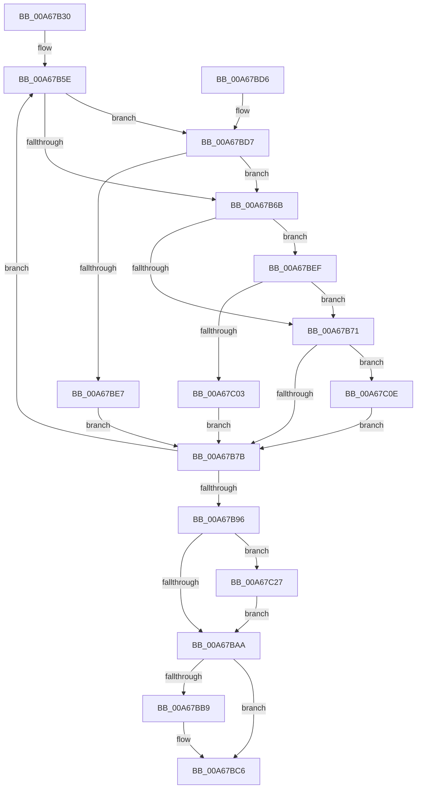

# PspNotificationPacketCallback

- RVA: `0x00A67B30`–`0x00A67C5F` (길이 `303` bytes)
- VA: `0x0000000140A67B30`
- 실행 섹션: `PAGE`
- PDB 이름 있음: `예`; PDB Function 태그: `아니요`
- unwind 정보 RVA: `0x000B3D10`
- 디코드: `73`개 명령, `303/303` bytes 표시
- 미해석 바이트: `0` (있으면 어셈블리에 `.byte`로 보존)

> 이 문서는 커널 이미지의 기계어와 PDB 기호를 분석해 생성했습니다. 4번과 5번은 함수 원형과 자료형을 바이너리 사용 방식에서 추정한 C 해석이며 원본 소스 복구 결과는 아닙니다.

## 1. Dependencies

- 직접 호출 지점: **4**; 고유 호출 대상: **4**
- 직접 호출자로 확인된 함수: **0**
- RIP 상대 이미지 참조: **0**

### Outgoing calls
- `0x00A67B51` → [PspLockJobExclusive](../91/PspLockJobExclusive_function_0091A4B8.md) (function, `0x0091A4B8`)
- `0x00A67BB0` → [PspUnlockJob](../91/PspUnlockJob_function_00919E00.md) (function, `0x00919E00`)
- `0x00A67BC1` → [ObfDereferenceObjectWithTag](../../text/2F/ObfDereferenceObjectWithTag_function_002F78E0.md) (function, `0x002F78E0`)
- `0x00A67C4D` → [IoSetIoCompletionEx](../../text/24/IoSetIoCompletionEx_function_0024FA80.md) (function, `0x0024FA80`)

### Direct callers
- 이 함수 시작 RVA로 연결되는 직접 call은 확인되지 않았습니다. 간접 호출은 완전히 역산할 수 없습니다.

### Static image references
- 디코드된 RIP-relative 메모리 참조가 없습니다.

## 2. Other-region calls and transfers

- 다른 실행 섹션으로 향하는 call: **2**
  - `0x00A67BC1` → [ObfDereferenceObjectWithTag](../../text/2F/ObfDereferenceObjectWithTag_function_002F78E0.md) (`PAGE` → `.text`)
  - `0x00A67C4D` → [IoSetIoCompletionEx](../../text/24/IoSetIoCompletionEx_function_0024FA80.md) (`PAGE` → `.text`)
- 별도 외부 분기/꼬리 이동을 확인하지 못했습니다.

## 3. Assembly (complete function range)

```asm
00A67B30  48 89 5C 24 08                  mov qword ptr [rsp + 8], rbx
00A67B35  48 89 74 24 10                  mov qword ptr [rsp + 0x10], rsi
00A67B3A  57                              push rdi
00A67B3B  48 83 EC 40                     sub rsp, 0x40
00A67B3F  65 48 8B 34 25 88 01 00 00      mov rsi, qword ptr gs:[0x188]
00A67B48  48 8B DA                        mov rbx, rdx
00A67B4B  48 8B D6                        mov rdx, rsi
00A67B4E  48 8B CB                        mov rcx, rbx
00A67B51  E8 62 29 EB FF                  call 0x14091a4b8
00A67B56  44 8B 8B 10 06 00 00            mov r9d, dword ptr [rbx + 0x610]
00A67B5D  90                              nop
00A67B5E  45 33 C0                        xor r8d, r8d
00A67B61  41 8B D1                        mov edx, r9d
00A67B64  41 0F BA E1 0E                  bt r9d, 0xe
00A67B69  72 6C                           jb 0x140a67bd7
00A67B6B  0F BA E2 10                     bt edx, 0x10
00A67B6F  72 7E                           jb 0x140a67bef
00A67B71  0F BA E2 0F                     bt edx, 0xf
00A67B75  0F 82 93 00 00 00               jb 0x140a67c0e
00A67B7B  8B CA                           mov ecx, edx
00A67B7D  41 8B C1                        mov eax, r9d
00A67B80  83 E1 F7                        and ecx, 0xfffffff7
00A67B83  45 85 C0                        test r8d, r8d
00A67B86  0F 45 CA                        cmovne ecx, edx
00A67B89  F0 0F B1 8B 10 06 00 00         lock cmpxchg dword ptr [rbx + 0x610], ecx
00A67B91  44 8B C8                        mov r9d, eax
00A67B94  75 C8                           jne 0x140a67b5e
00A67B96  48 8B 8B 28 02 00 00            mov rcx, qword ptr [rbx + 0x228]
00A67B9D  48 8B C1                        mov rax, rcx
00A67BA0  48 F7 D8                        neg rax
00A67BA3  1B FF                           sbb edi, edi
00A67BA5  41 23 F8                        and edi, r8d
00A67BA8  75 7D                           jne 0x140a67c27
00A67BAA  48 8B D6                        mov rdx, rsi
00A67BAD  48 8B CB                        mov rcx, rbx
00A67BB0  E8 4B 22 EB FF                  call 0x140919e00
00A67BB5  85 FF                           test edi, edi
00A67BB7  75 0D                           jne 0x140a67bc6
00A67BB9  BA 50 73 4A 62                  mov edx, 0x624a7350
00A67BBE  48 8B CB                        mov rcx, rbx
00A67BC1  E8 1A FD 88 FF                  call 0x1402f78e0
00A67BC6  48 8B 5C 24 50                  mov rbx, qword ptr [rsp + 0x50]
00A67BCB  48 8B 74 24 58                  mov rsi, qword ptr [rsp + 0x58]
00A67BD0  48 83 C4 40                     add rsp, 0x40
00A67BD4  5F                              pop rdi
00A67BD5  C3                              ret
00A67BD6  CC                              int3
00A67BD7  0F BA F2 0E                     btr edx, 0xe
00A67BDB  F7 83 50 04 00 00 00 08 00 00   test dword ptr [rbx + 0x450], 0x800
00A67BE5  74 84                           je 0x140a67b6b
00A67BE7  41 B8 0B 00 00 00               mov r8d, 0xb
00A67BED  EB 8C                           jmp 0x140a67b7b
00A67BEF  0F BA F2 10                     btr edx, 0x10
00A67BF3  F7 83 50 04 00 00 00 10 00 00   test dword ptr [rbx + 0x450], 0x1000
00A67BFD  0F 84 6E FF FF FF               je 0x140a67b71
00A67C03  41 B8 0C 00 00 00               mov r8d, 0xc
00A67C09  E9 6D FF FF FF                  jmp 0x140a67b7b
00A67C0E  0F BA F2 0F                     btr edx, 0xf
00A67C12  B8 04 00 00 00                  mov eax, 4
00A67C17  F6 83 50 04 00 00 10            test byte ptr [rbx + 0x450], 0x10
00A67C1E  44 0F 45 C0                     cmovne r8d, eax
00A67C22  E9 54 FF FF FF                  jmp 0x140a67b7b
00A67C27  48 8B 83 D0 04 00 00            mov rax, qword ptr [rbx + 0x4d0]
00A67C2E  45 33 C9                        xor r9d, r9d
00A67C31  48 8B 93 30 02 00 00            mov rdx, qword ptr [rbx + 0x230]
00A67C38  48 89 44 24 30                  mov qword ptr [rsp + 0x30], rax
00A67C3D  44 8B C7                        mov r8d, edi
00A67C40  C6 44 24 28 00                  mov byte ptr [rsp + 0x28], 0
00A67C45  4C 89 44 24 20                  mov qword ptr [rsp + 0x20], r8
00A67C4A  45 33 C0                        xor r8d, r8d
00A67C4D  E8 2E 7E 7E FF                  call 0x14024fa80
00A67C52  F0 48 FF 83 38 02 00 00         lock inc qword ptr [rbx + 0x238]
00A67C5A  E9 4B FF FF FF                  jmp 0x140a67baa
```

## 4. C-style interpretation (structured pseudocode)

```c
__int64 __fastcall PspNotificationPacketCallback(__int64 a1, __int64 a2, int a3)
{
    __int64 result;
    __int64 v_rdi;
    __int64 v_rsp;
    unsigned __int64 v_stack_p10;
    unsigned __int64 v_stack_p20;
    unsigned __int8 v_stack_p28;
    unsigned __int64 v_stack_p30;
    unsigned __int64 v_stack_p8;

    v_stack_p8 = v_rbx;
    v_stack_p10 = v_rsi;
    v_rsp = (v_rsp) - (64);
    result = PspLockJobExclusive(a2, *(unsigned __int64 *)(gs_base + (0 + 392)), a3, a4);
loc_00A67B5E:
    a3 = 0;
    if (condition_is_below) goto loc_00A67BD7;
loc_00A67B6B:
    if (condition_is_below) goto loc_00A67BEF;
loc_00A67B71:
    if (condition_is_below) goto loc_00A67C0E;
loc_00A67B7B:
    a1 = (unsigned int)(((unsigned int)((unsigned int)((unsigned int)((unsigned int)((unsigned int)(*(unsigned int *)(a2 + 1552))))))) & (0xFFFFFFF7ULL));
    if (0 != 0) { a1 = (unsigned int)((unsigned int)((unsigned int)((unsigned int)(*(unsigned int *)(a2 + 1552))))); }
    if (0 != 0) goto loc_00A67B5E;
    result = -(*(unsigned __int64 *)(a2 + 552));
    v_rdi = (unsigned int)((v_rdi) & (0));
    if (condition_is_not_equal) goto loc_00A67C27;
loc_00A67BAA:
    result = PspUnlockJob(a2, *(unsigned __int64 *)(gs_base + (0 + 392)), a3, (unsigned int)((unsigned int)((unsigned int)((unsigned int)((unsigned int)(*(unsigned int *)(a2 + 1552)))))));
    if ((unsigned int)(v_rdi) == 0) {
        a2 = 0x624A7350ULL;
        a1 = a2;
        result = ObfDereferenceObjectWithTag(a1, a2, a3, (unsigned int)((unsigned int)((unsigned int)((unsigned int)((unsigned int)(*(unsigned int *)(a2 + 1552)))))));
    }
    v_rsp = (v_rsp) + (64);
    return result;
loc_00A67BD7:
    if (((*(unsigned int *)(v_stack_p8 + 1104)) & (0x800ULL)) == 0) goto loc_00A67B6B;
    goto loc_00A67B7B;
loc_00A67BEF:
    if (((*(unsigned int *)(v_stack_p8 + 1104)) & (0x1000ULL)) == 0) goto loc_00A67B71;
    goto loc_00A67B7B;
loc_00A67C0E:
    a3 = 12;
    if (((*(unsigned __int8 *)(v_stack_p8 + 1104)) & (16)) != 0) { a3 = 4; }
    goto loc_00A67B7B;
loc_00A67C27:
    a4 = 0;
    v_stack_p30 = *(unsigned __int64 *)(v_stack_p8 + 1232);
    v_stack_p28 = 0;
    v_stack_p20 = (unsigned int)((unsigned int)(v_rdi));
    a3 = 0;
    result = IoSetIoCompletionEx(a1, *(unsigned __int64 *)(v_stack_p8 + 560), a3, a4);
    goto loc_00A67BAA;
}
```

## 5. (Beta) C Style

```c
int64_t PspNotificationPacketCallback(int64_t Arg1, void *Arg2, int32_t Arg3)
{
    uint8_t *arg2 = (uint8_t *)Arg2;

    int64_t result;
    int64_t local_rdi;
    int64_t local_rsp;
    uint64_t v_stack_p10;
    uint64_t v_stack_p20;
    uint8_t v_stack_p28;
    uint64_t v_stack_p30;
    uint64_t v_stack_p8;

    v_stack_p8 = local_rbx;
    v_stack_p10 = local_rsi;
    local_rsp = (local_rsp) - (64);
    result = PspLockJobExclusive(Arg2, *(uint64_t *)(gs_base + (0 + 0x188)), Arg3, a4);
loc_00A67B5E:
    Arg3 = 0;
    if (condition_is_below) goto loc_00A67BD7;
loc_00A67B6B:
    if (condition_is_below) goto loc_00A67BEF;
loc_00A67B71:
    if (condition_is_below) goto loc_00A67C0E;
loc_00A67B7B:
    Arg1 = (uint32_t)(((uint32_t)((uint32_t)((uint32_t)((uint32_t)((uint32_t)(*(uint32_t *)(arg2 + 0x610))))))) & (0xFFFFFFF7ULL));
    if (0 != 0) { Arg1 = (uint32_t)((uint32_t)((uint32_t)((uint32_t)(*(uint32_t *)(arg2 + 0x610))))); }
    if (0 != 0) goto loc_00A67B5E;
    result = -(*(uint64_t *)(arg2 + 0x228));
    local_rdi = (uint32_t)((local_rdi) & (0));
    if (condition_is_not_equal) goto loc_00A67C27;
loc_00A67BAA:
    result = PspUnlockJob(Arg2, *(uint64_t *)(gs_base + (0 + 0x188)), Arg3, (uint32_t)((uint32_t)((uint32_t)((uint32_t)((uint32_t)(*(uint32_t *)(arg2 + 0x610)))))));
    if ((uint32_t)(local_rdi) == 0) {
        Arg2 = 0x624A7350ULL;
        Arg1 = Arg2;
        result = ObfDereferenceObjectWithTag(Arg1, Arg2, Arg3, (uint32_t)((uint32_t)((uint32_t)((uint32_t)((uint32_t)(*(uint32_t *)(arg2 + 0x610)))))));
    }
    local_rsp = (local_rsp) + (64);
    return result;
loc_00A67BD7:
    if (((*(uint32_t *)(v_stack_p8 + 0x450)) & (0x800ULL)) == 0) goto loc_00A67B6B;
    goto loc_00A67B7B;
loc_00A67BEF:
    if (((*(uint32_t *)(v_stack_p8 + 0x450)) & (0x1000ULL)) == 0) goto loc_00A67B71;
    goto loc_00A67B7B;
loc_00A67C0E:
    Arg3 = 12;
    if (((*(uint8_t *)(v_stack_p8 + 0x450)) & (16)) != 0) { Arg3 = 4; }
    goto loc_00A67B7B;
loc_00A67C27:
    a4 = 0;
    v_stack_p30 = *(uint64_t *)(v_stack_p8 + 0x4D0);
    v_stack_p28 = 0;
    v_stack_p20 = (uint32_t)((uint32_t)(local_rdi));
    Arg3 = 0;
    result = IoSetIoCompletionEx(Arg1, *(uint64_t *)(v_stack_p8 + 0x230), Arg3, a4);
    goto loc_00A67BAA;
}
```

### 관측된 메모리 오프셋

구조체 형식이 확인되지 않은 접근은 인자 기준의 오프셋으로만 기록했습니다.

| 기준 인자 | 오프셋 표현 | 폭 (bit) | 접근 |
|---|---:|---:|---|
| `Arg2` | `+ 0x228` | `64` | `R` |
| `Arg2` | `+ 0x230` | `64` | `R` |
| `Arg2` | `+ 0x238` | `64` | `R/W` |
| `Arg2` | `+ 0x450` | `8` | `R` |
| `Arg2` | `+ 0x450` | `32` | `R` |
| `Arg2` | `+ 0x4D0` | `64` | `R` |
| `Arg2` | `+ 0x610` | `32` | `R` |

## 6. Execution-region graph

[열기: 2D/3D 그래프와 함수 탐색 컨트롤 패널](../../../control-panel.html?section=page&rva=0x00A67B30&view=graph)

- 2D 그래프는 위에서 아래로 흐르고, 3D 그래프는 빈 공간을 드래그해 회전합니다. Shift+드래그는 이동, 휠은 확대·축소, 함수 노드 선택은 대상 보고서 이동입니다.

### Static fallback


