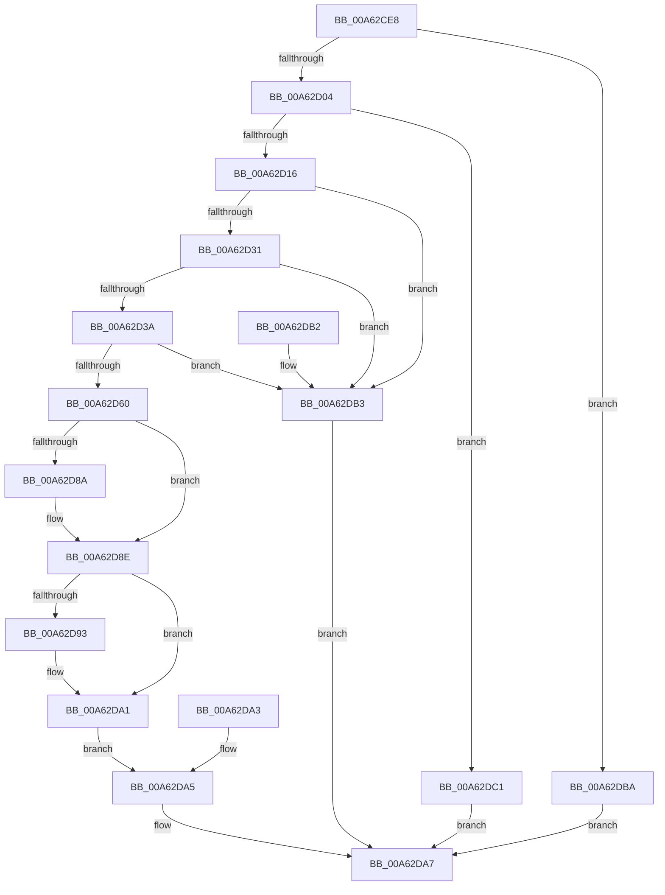

# PspQueryLastCallThread

- RVA: `0x00A62CE8`–`0x00A62DC8` (길이 `224` bytes)
- VA: `0x0000000140A62CE8`
- 실행 섹션: `PAGE`
- PDB 이름 있음: `예`; PDB Function 태그: `아니요`
- unwind 정보 RVA: `0x000B347C`
- 디코드: `56`개 명령, `224/224` bytes 표시
- 미해석 바이트: `0` (있으면 어셈블리에 `.byte`로 보존)

> 이 문서는 커널 이미지의 기계어와 PDB 기호를 분석해 생성했습니다. 4번과 5번은 함수 원형과 자료형을 바이너리 사용 방식에서 추정한 C 해석이며 원본 소스 복구 결과는 아닙니다.

## 1. Dependencies

- 직접 호출 지점: **0**; 고유 호출 대상: **0**
- 직접 호출자로 확인된 함수: **1**
- RIP 상대 이미지 참조: **1**

### Outgoing calls
- 직접 디코드된 call 명령이 없습니다.

### Direct callers
- [NtQueryInformationThread](../AE/NtQueryInformationThread_function_00AE3760.md) at `0x00AE40AE`

### Static image references
- `0x00A62D70` → RVA `0x00FC6AA0` (`ALMOSTRO`; read)

## 2. Other-region calls and transfers

- 다른 실행 섹션으로 향하는 call: **0**
- 별도 외부 분기/꼬리 이동을 확인하지 못했습니다.

## 3. Assembly (complete function range)

```asm
00A62CE8  48 89 5C 24 08                  mov qword ptr [rsp + 8], rbx
00A62CED  57                              push rdi
00A62CEE  48 83 EC 20                     sub rsp, 0x20
00A62CF2  4C 8B D2                        mov r10, rdx
00A62CF5  41 8D 40 F0                     lea eax, [r8 - 0x10]
00A62CF9  A9 F7 FF FF FF                  test eax, 0xfffffff7
00A62CFE  0F 85 B6 00 00 00               jne 0x140a62dba
00A62D04  65 48 8B 04 25 88 01 00 00      mov rax, qword ptr gs:[0x188]
00A62D0D  48 3B C8                        cmp rcx, rax
00A62D10  0F 84 AB 00 00 00               je 0x140a62dc1
00A62D16  44 8B 99 54 01 00 00            mov r11d, dword ptr [rcx + 0x154]
00A62D1D  33 D2                           xor edx, edx
00A62D1F  F0 09 14 24                     lock or dword ptr [rsp], edx
00A62D23  8A 81 84 01 00 00               mov al, byte ptr [rcx + 0x184]
00A62D29  3C 05                           cmp al, 5
00A62D2B  0F 85 82 00 00 00               jne 0x140a62db3
00A62D31  80 B9 32 02 00 00 01            cmp byte ptr [rcx + 0x232], 1
00A62D38  75 79                           jne 0x140a62db3
00A62D3A  48 8B 99 88 00 00 00            mov rbx, qword ptr [rcx + 0x88]
00A62D41  0F B7 B9 80 00 00 00            movzx edi, word ptr [rcx + 0x80]
00A62D48  8B 81 B4 01 00 00               mov eax, dword ptr [rcx + 0x1b4]
00A62D4E  48 89 44 24 10                  mov qword ptr [rsp + 0x10], rax
00A62D53  F0 09 14 24                     lock or dword ptr [rsp], edx
00A62D57  44 3B 99 54 01 00 00            cmp r11d, dword ptr [rcx + 0x154]
00A62D5E  75 53                           jne 0x140a62db3
00A62D60  48 B8 20 03 00 00 80 F7 FF FF   movabs rax, 0xfffff78000000320
00A62D6A  8B 08                           mov ecx, dword ptr [rax]
00A62D6C  2B 4C 24 10                     sub ecx, dword ptr [rsp + 0x10]
00A62D70  8B 05 2A 3D 56 00               mov eax, dword ptr [rip + 0x563d2a]
00A62D76  48 0F AF C8                     imul rcx, rax
00A62D7A  49 89 1A                        mov qword ptr [r10], rbx
00A62D7D  66 41 89 7A 08                  mov word ptr [r10 + 8], di
00A62D82  8D 42 10                        lea eax, [rdx + 0x10]
00A62D85  44 3B C0                        cmp r8d, eax
00A62D88  74 04                           je 0x140a62d8e
00A62D8A  49 89 4A 10                     mov qword ptr [r10 + 0x10], rcx
00A62D8E  4D 85 C9                        test r9, r9
00A62D91  74 0E                           je 0x140a62da1
00A62D93  B9 18 00 00 00                  mov ecx, 0x18
00A62D98  44 3B C0                        cmp r8d, eax
00A62D9B  0F 45 C1                        cmovne eax, ecx
00A62D9E  41 89 01                        mov dword ptr [r9], eax
00A62DA1  EB 02                           jmp 0x140a62da5
00A62DA3  8B D0                           mov edx, eax
00A62DA5  8B C2                           mov eax, edx
00A62DA7  48 8B 5C 24 30                  mov rbx, qword ptr [rsp + 0x30]
00A62DAC  48 83 C4 20                     add rsp, 0x20
00A62DB0  5F                              pop rdi
00A62DB1  C3                              ret
00A62DB2  CC                              int3
00A62DB3  B8 01 00 00 C0                  mov eax, 0xc0000001
00A62DB8  EB ED                           jmp 0x140a62da7
00A62DBA  B8 04 00 00 C0                  mov eax, 0xc0000004
00A62DBF  EB E6                           jmp 0x140a62da7
00A62DC1  B8 0D 00 00 C0                  mov eax, 0xc000000d
00A62DC6  EB DF                           jmp 0x140a62da7
```

## 4. C-style interpretation (structured pseudocode)

```c
__int64 __fastcall PspQueryLastCallThread(__int64 a1, __int64 a2, __int64 a3, __int64 a4)
{
    __int64 result;
    __int64 v_rsp;
    unsigned __int64 v_stack_m18;
    unsigned int v_stack_m28;
    unsigned __int64 v_stack_p8;

    v_stack_p8 = v_rbx;
    v_rsp = (v_rsp) - (32);
    if ((((unsigned int)(a3 - 16)) & (0xFFFFFFF7ULL)) != 0) goto loc_00A62DBA;
    if (a1 == (*(unsigned __int64 *)(gs_base + (0 + 392)))) goto loc_00A62DC1;
    a2 = 0;
    if (((unsigned __int8)(*(unsigned __int8 *)(a1 + 388))) != 5) goto loc_00A62DB3;
    if ((*(unsigned __int8 *)(a1 + 562)) != 1) goto loc_00A62DB3;
    v_stack_m18 = (unsigned int)(*(unsigned int *)(a1 + 436));
    if (((unsigned int)((unsigned int)(*(unsigned int *)(a1 + 340)))) != (*(unsigned int *)(a1 + 340))) goto loc_00A62DB3;
    a1 = (unsigned int)(((unsigned int)(*(unsigned int *)((unsigned int)(*(unsigned int *)(a1 + 436))))) - (v_stack_m18));
    a1 = (a1) * ((unsigned int)(*(unsigned int *)(v_rip + 5651754)));
    *(unsigned __int64 *)(a2) = *(unsigned __int64 *)(a1 + 136);
    *(unsigned __int16 *)(a2 + 8) = (unsigned __int16)(*(unsigned __int16 *)(a1 + 128));
    if (((unsigned int)(a3)) != ((unsigned int)(a2 + 16))) {
        *(unsigned __int64 *)(a2 + 16) = a1;
    }
    result = a2 + 16;
    if (a4 != 0) {
        a1 = 24;
        result = a2 + 16;
        if (((unsigned int)(a3)) != ((unsigned int)(a2 + 16))) { result = (unsigned int)(a1); }
        *(unsigned int *)(a4) = (unsigned int)(result);
    }
    goto loc_00A62DA5;
loc_00A62DA5:
loc_00A62DA7:
    v_rsp = (v_rsp) + (32);
    return 0;
loc_00A62DB3:
    goto loc_00A62DA7;
loc_00A62DBA:
    goto loc_00A62DA7;
loc_00A62DC1:
    goto loc_00A62DA7;
}
```

## 5. (Beta) C Style

```c
int64_t PspQueryLastCallThread(int64_t Arg1, void *Arg2, void *Arg3, int64_t Arg4)
{
    uint8_t *arg2 = (uint8_t *)Arg2;
    uint8_t *arg3 = (uint8_t *)Arg3;

    int64_t result;
    int64_t local_rsp;
    uint64_t v_stack_m18;
    uint32_t v_stack_m28;
    uint64_t v_stack_p8;

    v_stack_p8 = local_rbx;
    local_rsp = (local_rsp) - (32);
    if ((((uint32_t)(Arg3 - 16)) & (0xFFFFFFF7ULL)) != 0) goto loc_00A62DBA;
    if (Arg1 == (*(uint64_t *)(gs_base + (0 + 0x188)))) goto loc_00A62DC1;
    Arg2 = 0;
    if (((uint8_t)(*(uint8_t *)(Arg1 + 0x184))) != 5) goto loc_00A62DB3;
    if ((*(uint8_t *)(Arg1 + 0x232)) != 1) goto loc_00A62DB3;
    v_stack_m18 = (uint32_t)(*(uint32_t *)(Arg1 + 0x1B4));
    if (((uint32_t)((uint32_t)(*(uint32_t *)(Arg1 + 0x154)))) != (*(uint32_t *)(Arg1 + 0x154))) goto loc_00A62DB3;
    Arg1 = (uint32_t)(((uint32_t)(*(uint32_t *)((uint32_t)(*(uint32_t *)(Arg1 + 0x1B4))))) - (v_stack_m18));
    Arg1 = (Arg1) * ((uint32_t)(*(uint32_t *)(v_rip + 0x563D2A)));
    *(uint64_t *)(arg2) = *(uint64_t *)(Arg1 + 0x88);
    *(uint16_t *)(arg2 + 0x8) = (uint16_t)(*(uint16_t *)(Arg1 + 0x80));
    if (((uint32_t)(Arg3)) != ((uint32_t)(Arg2 + 16))) {
        *(uint64_t *)(arg2 + 0x10) = Arg1;
    }
    result = Arg2 + 16;
    if (Arg4 != 0) {
        Arg1 = 24;
        result = Arg2 + 16;
        if (((uint32_t)(Arg3)) != ((uint32_t)(Arg2 + 16))) { result = (uint32_t)(Arg1); }
        *(uint32_t *)(Arg4) = (uint32_t)(result);
    }
    goto loc_00A62DA5;
loc_00A62DA5:
loc_00A62DA7:
    local_rsp = (local_rsp) + (32);
    return 0;
loc_00A62DB3:
    goto loc_00A62DA7;
loc_00A62DBA:
    goto loc_00A62DA7;
loc_00A62DC1:
    goto loc_00A62DA7;
}
```

### 관측된 메모리 오프셋

구조체 형식이 확인되지 않은 접근은 인자 기준의 오프셋으로만 기록했습니다.

| 기준 인자 | 오프셋 표현 | 폭 (bit) | 접근 |
|---|---:|---:|---|
| `Arg2` | `+ 0x0` | `64` | `W` |
| `Arg2` | `+ 0x8` | `16` | `W` |
| `Arg2` | `+ 0x10` | `64` | `W` |
| `Arg3` | `- 0x10` | `32` | `R` |

## 6. Execution-region graph

[열기: 2D/3D 그래프와 함수 탐색 컨트롤 패널](../../../control-panel.html?section=page&rva=0x00A62CE8&view=graph)

- 2D 그래프는 위에서 아래로 흐르고, 3D 그래프는 빈 공간을 드래그해 회전합니다. Shift+드래그는 이동, 휠은 확대·축소, 함수 노드 선택은 대상 보고서 이동입니다.

### Static fallback


