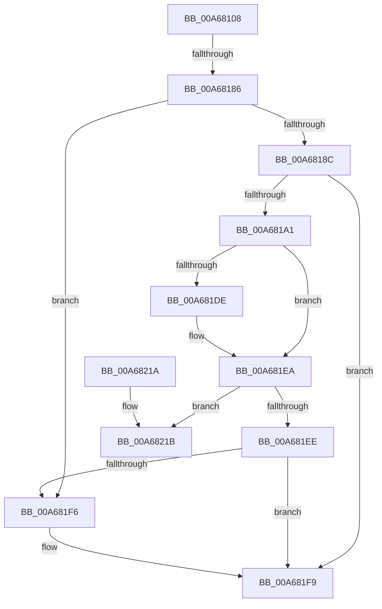

# PspReadUserQuotaLimits

- RVA: `0x00A68108`–`0x00A68230` (길이 `296` bytes)
- VA: `0x0000000140A68108`
- 실행 섹션: `PAGE`
- PDB 이름 있음: `예`; PDB Function 태그: `예`
- unwind 정보 RVA: `0x000B3DB8`
- 디코드: `86`개 명령, `296/296` bytes 표시
- 미해석 바이트: `0` (있으면 어셈블리에 `.byte`로 보존)

> 이 문서는 커널 이미지의 기계어와 PDB 기호를 분석해 생성했습니다. 4번과 5번은 함수 원형과 자료형을 바이너리 사용 방식에서 추정한 C 해석이며 원본 소스 복구 결과는 아닙니다.

## 1. Dependencies

- 직접 호출 지점: **4**; 고유 호출 대상: **4**
- 직접 호출자로 확인된 함수: **1**
- RIP 상대 이미지 참조: **3**

### Outgoing calls
- `0x00A68196` → [RtlConvertSidToUnicodeString](../92/RtlConvertSidToUnicodeString_function_00927B30.md) (function, `0x00927B30`)
- `0x00A681CE` → [ZwOpenKey](../../text/6A/ZwOpenKey_function_006AD310.md) (function, `0x006AD310`)
- `0x00A681DE` → [ExFreePool](../../poolcode/B8/ExFreePool_function_00B82850.md) (function, `0x00B82850`)
- `0x00A68202` → [_security_check_cookie](../../text/6A/_security_check_cookie_function_006AC640.md) (function, `0x006AC640`)

### Direct callers
- [PspAssignProcessQuotaBlock](../AE/PspAssignProcessQuotaBlock_function_00AE3124.md) at `0x00AE31DE`

### Static image references
- `0x00A68120` → RVA `0x00E0A740` (`.data`; read)
- `0x00A68137` → RVA `0x00FDA018` (`PAGEDATA`; read)
- `0x00A6821B` → RVA `0x00FD9DF8` (`PAGEDATA`; read)

## 2. Other-region calls and transfers

- 다른 실행 섹션으로 향하는 call: **3**
  - `0x00A681CE` → [ZwOpenKey](../../text/6A/ZwOpenKey_function_006AD310.md) (`PAGE` → `.text`)
  - `0x00A681DE` → [ExFreePool](../../poolcode/B8/ExFreePool_function_00B82850.md) (`PAGE` → `POOLCODE`)
  - `0x00A68202` → [_security_check_cookie](../../text/6A/_security_check_cookie_function_006AC640.md) (`PAGE` → `.text`)
- call이 아닌 외부 분기/꼬리 이동: **2**
  - `0x00A68180` → [sub_00B3EB8C](../B3/Unknown_function_00B3EB8C.md) (`tail-transfer`)
  - `0x00A6822B` → [sub_00B3EB8C + 0x83](../B3/Unknown_function_00B3EB8C.md) (`tail-transfer`)

## 3. Assembly (complete function range)

```asm
00A68108  40 55                           push rbp
00A6810A  53                              push rbx
00A6810B  57                              push rdi
00A6810C  41 54                           push r12
00A6810E  41 55                           push r13
00A68110  41 56                           push r14
00A68112  41 57                           push r15
00A68114  48 8D 6C 24 D9                  lea rbp, [rsp - 0x27]
00A68119  48 81 EC C0 00 00 00            sub rsp, 0xc0
00A68120  48 8B 05 19 26 3A 00            mov rax, qword ptr [rip + 0x3a2619]
00A68127  48 33 C4                        xor rax, rsp
00A6812A  48 89 45 1F                     mov qword ptr [rbp + 0x1f], rax
00A6812E  0F 57 C0                        xorps xmm0, xmm0
00A68131  C7 02 01 00 00 00               mov dword ptr [rdx], 1
00A68137  48 8B 1D DA 1E 57 00            mov rbx, qword ptr [rip + 0x571eda]
00A6813E  45 33 F6                        xor r14d, r14d
00A68141  48 8B F9                        mov rdi, rcx
00A68144  48 89 55 FF                     mov qword ptr [rbp - 1], rdx
00A68148  33 C9                           xor ecx, ecx
00A6814A  44 89 75 B7                     mov dword ptr [rbp - 0x49], r14d
00A6814E  89 4D 17                        mov dword ptr [rbp + 0x17], ecx
00A68151  4D 8B E8                        mov r13, r8
00A68154  48 89 4D DF                     mov qword ptr [rbp - 0x21], rcx
00A68158  41 BC C0 02 00 00               mov r12d, 0x2c0
00A6815E  89 4D E7                        mov dword ptr [rbp - 0x19], ecx
00A68161  4C 89 75 AF                     mov qword ptr [rbp - 0x51], r14
00A68165  44 8D 79 30                     lea r15d, [rcx + 0x30]
00A68169  48 89 5D A7                     mov qword ptr [rbp - 0x59], rbx
00A6816D  0F 11 45 07                     movups xmmword ptr [rbp + 7], xmm0
00A68171  0F 11 45 BF                     movups xmmword ptr [rbp - 0x41], xmm0
00A68175  0F 11 45 CF                     movups xmmword ptr [rbp - 0x31], xmm0
00A68179  0F 11 45 EF                     movups xmmword ptr [rbp - 0x11], xmm0
00A6817D  48 85 DB                        test rbx, rbx
00A68180  0F 84 06 6A 0D 00               je 0x140b3eb8c
00A68186  48 83 FB 01                     cmp rbx, 1
00A6818A  74 6A                           je 0x140a681f6
00A6818C  41 B0 01                        mov r8b, 1
00A6818F  48 8D 4D EF                     lea rcx, [rbp - 0x11]
00A68193  48 8B D7                        mov rdx, rdi
00A68196  E8 95 F9 EB FF                  call 0x140927b30
00A6819B  8B D8                           mov ebx, eax
00A6819D  85 C0                           test eax, eax
00A6819F  78 58                           js 0x140a681f9
00A681A1  48 8B 45 A7                     mov rax, qword ptr [rbp - 0x59]
00A681A5  4C 8D 45 BF                     lea r8, [rbp - 0x41]
00A681A9  48 89 45 C7                     mov qword ptr [rbp - 0x39], rax
00A681AD  48 8D 4D AF                     lea rcx, [rbp - 0x51]
00A681B1  48 8D 45 EF                     lea rax, [rbp - 0x11]
00A681B5  44 89 7D BF                     mov dword ptr [rbp - 0x41], r15d
00A681B9  0F 57 C0                        xorps xmm0, xmm0
00A681BC  48 89 45 CF                     mov qword ptr [rbp - 0x31], rax
00A681C0  BA 01 00 00 00                  mov edx, 1
00A681C5  44 89 65 D7                     mov dword ptr [rbp - 0x29], r12d
00A681C9  F3 0F 7F 45 DF                  movdqu xmmword ptr [rbp - 0x21], xmm0
00A681CE  E8 3D 51 C4 FF                  call 0x1406ad310
00A681D3  48 8B 4D F7                     mov rcx, qword ptr [rbp - 9]
00A681D7  8B D8                           mov ebx, eax
00A681D9  48 85 C9                        test rcx, rcx
00A681DC  74 0C                           je 0x140a681ea
00A681DE  E8 6D A6 11 00                  call 0x140b82850
00A681E3  0F 57 C0                        xorps xmm0, xmm0
00A681E6  0F 11 45 EF                     movups xmmword ptr [rbp - 0x11], xmm0
00A681EA  85 DB                           test ebx, ebx
00A681EC  79 2D                           jns 0x140a6821b
00A681EE  81 FB 34 00 00 C0               cmp ebx, 0xc0000034
00A681F4  75 03                           jne 0x140a681f9
00A681F6  41 8B DE                        mov ebx, r14d
00A681F9  8B C3                           mov eax, ebx
00A681FB  48 8B 4D 1F                     mov rcx, qword ptr [rbp + 0x1f]
00A681FF  48 33 CC                        xor rcx, rsp
00A68202  E8 39 44 C4 FF                  call 0x1406ac640
00A68207  48 81 C4 C0 00 00 00            add rsp, 0xc0
00A6820E  41 5F                           pop r15
00A68210  41 5E                           pop r14
00A68212  41 5D                           pop r13
00A68214  41 5C                           pop r12
00A68216  5F                              pop rdi
00A68217  5B                              pop rbx
00A68218  5D                              pop rbp
00A68219  C3                              ret
00A6821A  CC                              int3
00A6821B  4C 8D 25 D6 1B 57 00            lea r12, [rip + 0x571bd6]
00A68222  45 8B FE                        mov r15d, r14d
00A68225  4D 2B E5                        sub r12, r13
00A68228  49 8B FD                        mov rdi, r13
00A6822B  E9 DF 69 0D 00                  jmp 0x140b3ec0f
```

## 4. C-style interpretation (structured pseudocode)

```c
__int64 __fastcall PspReadUserQuotaLimits(__int64 a1, __int64 a2, __int64 a3)
{
    __int64 result;
    __int64 v_r12;
    __int64 v_r14;
    __int64 v_rbx;
    __int64 v_rsp;
    unsigned __int64 v_stack_m40;
    unsigned int v_stack_m48;
    unsigned __int64 v_stack_m58;
    unsigned __int64 v_stack_m5F;
    unsigned __int64 v_stack_m60;
    unsigned __int64 v_stack_m68;
    unsigned __int64 v_stack_m70;
    unsigned int v_stack_m78;
    unsigned __int64 v_stack_m80;
    unsigned int v_stack_m88;
    unsigned __int64 v_stack_m90;
    unsigned __int64 v_stack_m98;
    unsigned __int64 v_stack_mA0;
    unsigned int v_stack_mA8;
    unsigned __int64 v_stack_mB0;
    unsigned __int64 v_stack_mB8;

    v_rsp = (v_rsp) - (192);
    result = (*(unsigned __int64 *)(v_rip + 3810841)) ^ (v_rsp);
    v_stack_m40 = result;
    *(unsigned int *)(a2) = 1;
    v_r14 = 0;
    v_stack_m60 = a2;
    a1 = 0;
    v_stack_mA8 = 0;
    v_stack_m48 = 0;
    v_stack_m80 = 0;
    v_stack_m78 = 0;
    v_stack_mB0 = 0;
    v_stack_mB8 = *(unsigned __int64 *)(v_rip + 5709530);
    v_stack_m58 = v_xmm0;
    v_stack_mA0 = v_xmm0;
    v_stack_m90 = v_xmm0;
    v_stack_m70 = v_xmm0;
    if ((*(unsigned __int64 *)(v_rip + 5709530)) == 1) goto loc_00A681F6;
    result = RtlConvertSidToUnicodeString(v_stack_m70, 0, 1, a4);
    if (sign_flag) goto loc_00A681F9;
    v_stack_m98 = v_stack_mB8;
    v_stack_mA0 = (unsigned int)(a1 + 48);
    v_stack_m90 = v_stack_m70;
    v_stack_m88 = 704;
    v_stack_m80 = v_xmm0;
    result = ZwOpenKey(v_stack_mB0, 1, v_stack_mA0, a4);
    if (v_stack_m68 != 0) {
        result = ExFreePool(v_stack_m68, 1, v_stack_mA0, a4);
        v_stack_m70 = v_xmm0;
    }
    if (!sign_flag) goto loc_00A6821B;
    v_rbx = (unsigned int)((unsigned int)(result));
    if (((unsigned int)((unsigned int)((unsigned int)(result)))) == 0xC0000034ULL) {
        v_rbx = 0;
    }
    a1 = (v_stack_m40) ^ (v_rsp);
    result = _security_check_cookie(a1, 1, v_stack_mA0, a4);
    v_rsp = (v_rsp) + (192);
    return result;
loc_00A6821B:
    v_r12 = (v_rip + 5708758) - (a3);
}
```

## 5. (Beta) C Style

```c
int64_t PspReadUserQuotaLimits(int64_t Arg1, void *Arg2, int64_t Arg3)
{
    uint8_t *arg2 = (uint8_t *)Arg2;

    int64_t result;
    int64_t local_r12;
    int64_t local_r14;
    int64_t local_rbx;
    int64_t local_rsp;
    uint64_t v_stack_m40;
    uint32_t v_stack_m48;
    uint64_t v_stack_m58;
    uint64_t v_stack_m5F;
    uint64_t v_stack_m60;
    uint64_t v_stack_m68;
    uint64_t v_stack_m70;
    uint32_t v_stack_m78;
    uint64_t v_stack_m80;
    uint32_t v_stack_m88;
    uint64_t v_stack_m90;
    uint64_t v_stack_m98;
    uint64_t v_stack_mA0;
    uint32_t v_stack_mA8;
    uint64_t v_stack_mB0;
    uint64_t v_stack_mB8;

    local_rsp = (local_rsp) - (192);
    result = (*(uint64_t *)(v_rip + 0x3A2619)) ^ (local_rsp);
    v_stack_m40 = result;
    *(uint32_t *)(arg2) = 1;
    local_r14 = 0;
    v_stack_m60 = Arg2;
    Arg1 = 0;
    v_stack_mA8 = 0;
    v_stack_m48 = 0;
    v_stack_m80 = 0;
    v_stack_m78 = 0;
    v_stack_mB0 = 0;
    v_stack_mB8 = *(uint64_t *)(v_rip + 0x571EDA);
    v_stack_m58 = v_xmm0;
    v_stack_mA0 = v_xmm0;
    v_stack_m90 = v_xmm0;
    v_stack_m70 = v_xmm0;
    if ((*(uint64_t *)(v_rip + 0x571EDA)) == 1) goto loc_00A681F6;
    result = RtlConvertSidToUnicodeString(v_stack_m70, 0, 1, a4);
    if (sign_flag) goto loc_00A681F9;
    v_stack_m98 = v_stack_mB8;
    v_stack_mA0 = (uint32_t)(Arg1 + 48);
    v_stack_m90 = v_stack_m70;
    v_stack_m88 = 704;
    v_stack_m80 = v_xmm0;
    result = ZwOpenKey(v_stack_mB0, 1, v_stack_mA0, a4);
    if (v_stack_m68 != 0) {
        result = ExFreePool(v_stack_m68, 1, v_stack_mA0, a4);
        v_stack_m70 = v_xmm0;
    }
    if (!sign_flag) goto loc_00A6821B;
    local_rbx = (uint32_t)((uint32_t)(result));
    if (((uint32_t)((uint32_t)((uint32_t)(result)))) == 0xC0000034ULL) {
        local_rbx = 0;
    }
    Arg1 = (v_stack_m40) ^ (local_rsp);
    result = _security_check_cookie(Arg1, 1, v_stack_mA0, a4);
    local_rsp = (local_rsp) + (192);
    return result;
loc_00A6821B:
    local_r12 = (v_rip + 5708758) - (Arg3);
}
```

### 관측된 메모리 오프셋

구조체 형식이 확인되지 않은 접근은 인자 기준의 오프셋으로만 기록했습니다.

| 기준 인자 | 오프셋 표현 | 폭 (bit) | 접근 |
|---|---:|---:|---|
| `Arg2` | `+ 0x0` | `32` | `W` |

## 6. Execution-region graph

[열기: 2D/3D 그래프와 함수 탐색 컨트롤 패널](../../../control-panel.html?section=page&rva=0x00A68108&view=graph)

- 2D 그래프는 위에서 아래로 흐르고, 3D 그래프는 빈 공간을 드래그해 회전합니다. Shift+드래그는 이동, 휠은 확대·축소, 함수 노드 선택은 대상 보고서 이동입니다.

### Static fallback


