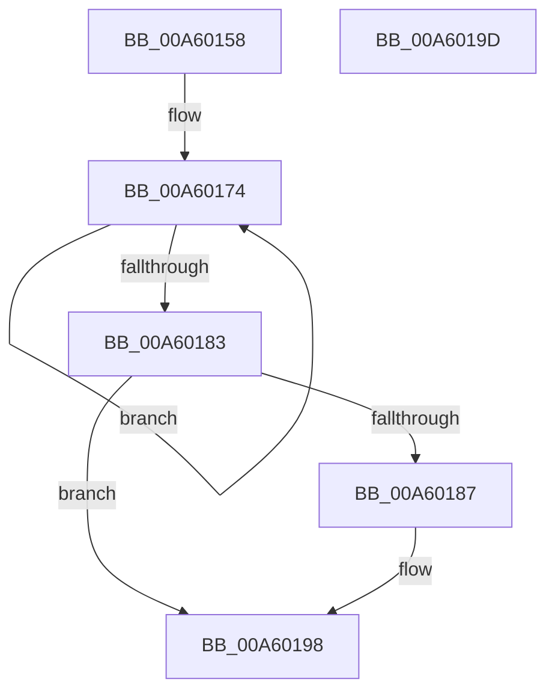

# PspScheduleEnforcementWorker

- RVA: `0x00A60158`–`0x00A6019E` (길이 `70` bytes)
- VA: `0x0000000140A60158`
- 실행 섹션: `PAGE`
- PDB 이름 있음: `예`; PDB Function 태그: `아니요`
- unwind 정보 RVA: `0x0005C788`
- 디코드: `16`개 명령, `70/70` bytes 표시
- 미해석 바이트: `0` (있으면 어셈블리에 `.byte`로 보존)

> 이 문서는 커널 이미지의 기계어와 PDB 기호를 분석해 생성했습니다. 4번과 5번은 함수 원형과 자료형을 바이너리 사용 방식에서 추정한 C 해석이며 원본 소스 복구 결과는 아닙니다.

## 1. Dependencies

- 직접 호출 지점: **1**; 고유 호출 대상: **1**
- 직접 호출자로 확인된 함수: **1**
- RIP 상대 이미지 참조: **2**

### Outgoing calls
- `0x00A60193` → [ExQueueWorkItem](../../text/2F/ExQueueWorkItem_function_002F9520.md) (function, `0x002F9520`)

### Direct callers
- [NtSetInformationJobObject](../9F/NtSetInformationJobObject_function_009F84C0.md) at `0x009FA84D`

### Static image references
- `0x00A60167` → RVA `0x00F065E8` (`.data`; read)
- `0x00A6018C` → RVA `0x00F06600` (`.data`; read)

## 2. Other-region calls and transfers

- 다른 실행 섹션으로 향하는 call: **1**
  - `0x00A60193` → [ExQueueWorkItem](../../text/2F/ExQueueWorkItem_function_002F9520.md) (`PAGE` → `.text`)
- 별도 외부 분기/꼬리 이동을 확인하지 못했습니다.

## 3. Assembly (complete function range)

```asm
00A60158  48 83 EC 28                     sub rsp, 0x28
00A6015C  F0 81 89 10 06 00 00 00 00 10 00  lock or dword ptr [rcx + 0x610], 0x100000
00A60167  0F 0D 0D 7A 64 4A 00            prefetchw byte ptr [rip + 0x4a647a]
00A6016E  8B 05 74 64 4A 00               mov eax, dword ptr [rip + 0x4a6474]
00A60174  8B C8                           mov ecx, eax
00A60176  83 C9 06                        or ecx, 6
00A60179  F0 0F B1 0D 67 64 4A 00         lock cmpxchg dword ptr [rip + 0x4a6467], ecx
00A60181  75 F1                           jne 0x140a60174
00A60183  A8 04                           test al, 4
00A60185  75 11                           jne 0x140a60198
00A60187  BA 01 00 00 00                  mov edx, 1
00A6018C  48 8D 0D 6D 64 4A 00            lea rcx, [rip + 0x4a646d]
00A60193  E8 88 93 89 FF                  call 0x1402f9520
00A60198  48 83 C4 28                     add rsp, 0x28
00A6019C  C3                              ret
00A6019D  CC                              int3
```

## 4. C-style interpretation (structured pseudocode)

```c
__int64 __fastcall PspScheduleEnforcementWorker(__int64 a1)
{
    __int64 result;
    __int64 v_rsp;

    v_rsp = (v_rsp) - (40);
loc_00A60174:
    a1 = (unsigned int)(((unsigned int)((unsigned int)((unsigned int)(*(unsigned int *)(v_rip + 4875380))))) | (6));
    if (condition_is_not_equal) goto loc_00A60174;
    result = (unsigned int)(*(unsigned int *)(v_rip + 4875380));
    if ((((unsigned __int8)((unsigned int)(*(unsigned int *)(v_rip + 4875380)))) & (4)) == 0) {
        a2 = 1;
        a1 = v_rip + 4875373;
        result = ExQueueWorkItem(a1, a2, a3, a4);
    }
    v_rsp = (v_rsp) + (40);
    return result;
}
```

## 5. (Beta) C Style

```c
int64_t PspScheduleEnforcementWorker(void *Arg1)
{
    uint8_t *arg1 = (uint8_t *)Arg1;

    int64_t result;
    int64_t local_rsp;

    local_rsp = (local_rsp) - (40);
loc_00A60174:
    Arg1 = (uint32_t)(((uint32_t)((uint32_t)((uint32_t)(*(uint32_t *)(v_rip + 0x4A6474))))) | (6));
    if (condition_is_not_equal) goto loc_00A60174;
    result = (uint32_t)(*(uint32_t *)(v_rip + 0x4A6474));
    if ((((uint8_t)((uint32_t)(*(uint32_t *)(v_rip + 0x4A6474)))) & (4)) == 0) {
        a2 = 1;
        Arg1 = v_rip + 4875373;
        result = ExQueueWorkItem(Arg1, a2, a3, a4);
    }
    local_rsp = (local_rsp) + (40);
    return result;
}
```

### 관측된 메모리 오프셋

구조체 형식이 확인되지 않은 접근은 인자 기준의 오프셋으로만 기록했습니다.

| 기준 인자 | 오프셋 표현 | 폭 (bit) | 접근 |
|---|---:|---:|---|
| `Arg1` | `+ 0x610` | `32` | `R/W` |

## 6. Execution-region graph

[열기: 2D/3D 그래프와 함수 탐색 컨트롤 패널](../../../control-panel.html?section=page&rva=0x00A60158&view=graph)

- 2D 그래프는 위에서 아래로 흐르고, 3D 그래프는 빈 공간을 드래그해 회전합니다. Shift+드래그는 이동, 휠은 확대·축소, 함수 노드 선택은 대상 보고서 이동입니다.

### Static fallback


